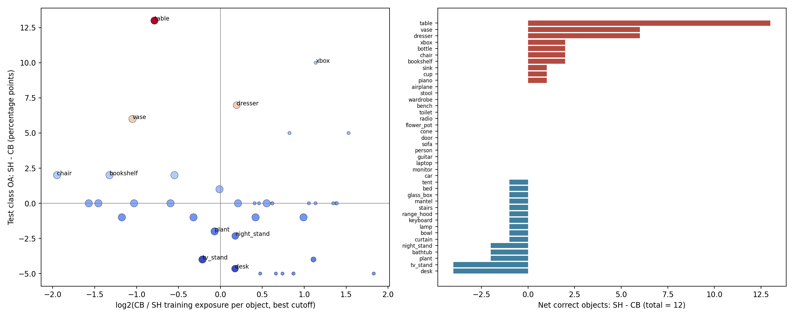
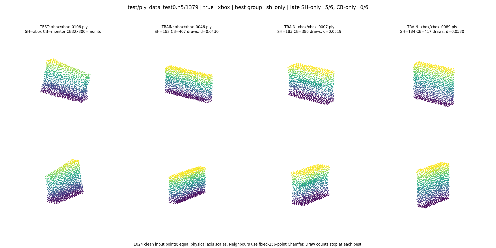
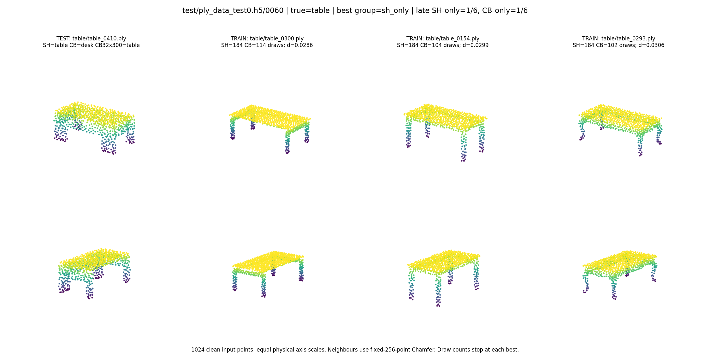

# TS06/SH32 与 TS30/CB32：抽样频次和逐对象错误审查

2026-11-18，按[170计划](../170_MN40_TS06_TS30_SAMPLING_ERROR_AUDIT_PLAN_2026-11-18.md)完成。主比较为两个H0：TS06/B05/SH32×307和TS30/B13/CB32×200，辅助TS31/CB32×300。没有新增训练或梯度审查。27次冻结复评的测试正确数与历史一致，OA/AA按历史展示精度匹配；参数和BN状态未变。CB两模型14个检查点的完整40×40混淆矩阵也与原日志逐项一致。

**抽样频次确实有很大差距，但目前没有发现足够证据，把CB相对SH的准确率下降直接归因于低频对象或低频形态。best的12个净正确差由55个SH独对和43个CB独对相减而来；大部分分歧在共同末段检查点不持续。** 类别混淆、训练预算、选中时点和批内组织仍需分开解释。

## 1. 抽样可以准确恢复，CB还有逐对象实测记录

- TS06：从seed4780初始化重建SH32全部300轮抽样。初始化模型指纹相同，21个已保存轮次的CPU RNG状态全部精确匹配，轮内9,824个不同对象、无重复。历史训练/测试loader消耗顺序已纳入重建。
- TS30/TS31：300轮日志都存有`sample_coverage.id_draw_counts`。逐轮汇总实测次数，同时用原SourceClassBatchSampler重建，全部训练ID的次数在全部300轮都一致。故CB频次具有实测与确定性重建两份证据。
- 训练顺序固定为train1、train4、train3、train2、train0；join使用`split/HDF5分片/0基行号`。数据附带7份id2file映射，其长度与分片行数相同，12,308个对象的映射类别逐行核对通过，附加原始mesh名称。

这验证的是历史对象抽样及重建一致性，不等于证明GPU训练参数轨迹逐位复现。复评使用已有冻结权重。

| 全300轮 | TS06 / SH32×307 | TS30 / CB32×200 | TS31 / CB32×300 |
| --- | ---: | ---: | ---: |
| 总对象呈现 | 2,947,200 | 1,920,000 | 2,880,000 |
| 每对象平均次数 | 299.512 | 195.122 | 292.683 |
| 每对象次数范围 | **295–300** | **31–820** | 53–1,181 |
| 整段从未见过的对象 | 0 | 0 | 0 |
| 首轮不同对象 | 9,824 | 4,234 | 5,347 |
| 全程批内重复对象位置 | 0 | 5,934 | 8,904 |

CB显著重分配了训练供给，但300轮后没有对象始终未被采到。首轮覆盖少不能解释成全程漏训。重复对象位置占TS30总呈现约.309%；主要频次差来自类别均衡和总呈现预算，而非大量批内自重复。

**补充澄清：31次来自chair，820次来自bowl，是跨类别极值。** 两类分别有889和64个训练对象，不能据此判定同一类内存在26倍的ID偏好。类内频次、低频错误尾部及seed22历史已补查，见[173简要结论与分项证据](../173_MN40_CB4780_EXPOSURE_AND_SEED_2026-11-18/report.md)。

下面按**各自best权重**截止统计：SH截止e184，CB截止e262。不得拿完整300轮次数解释更早模型。

| 类别 | 训练对象数 | SH每对象实际均次 | CB每对象实际均次 | CB/SH供给比 | SH独对 / CB独对 | 净SH优势对象 |
| --- | ---: | ---: | ---: | ---: | ---: | ---: |
| table | 392 | 183.658 | 106.464 | .580 | 14 / 1 | **+13** |
| dresser | 200 | 183.745 | 210.110 | **1.143** | 7 / 1 | **+6** |
| vase | 475 | 183.709 | 88.821 | .483 | 7 / 1 | **+6** |
| chair | 889 | 183.686 | 47.566 | .259 | 2 / 0 | +2 |
| xbox | 103 | 183.699 | 404.214 | **2.200** | 2 / 0 | +2 |
| desk | 200 | 183.725 | 207.360 | 1.129 | 0 / 4 | −4 |
| tv_stand | 267 | 183.734 | 158.412 | .862 | 2 / 6 | −4 |
| night_stand | 200 | 183.715 | 207.820 | 1.131 | 3 / 5 | −2 |
| bowl | 64 | 183.703 | 652.781 | 3.553 | 0 / 1 | −1 |

table、vase符合“CB供给减少并出现更多错误”的方向；dresser、xbox供给增加却退步，tv_stand供给减少却改善，构成直接反例。全40类数据见[best类别表](best_classes.csv)与[e300类别表](e300_classes.csv)。

## 2. 测试对象四分组和净差来源

| 模型时点 | 共同正确 | SH独对 | CB独对 | 共同错误 | 净SH优势 |
| --- | ---: | ---: | ---: | ---: | ---: |
| 各自best（e184/e262） | 2,273 | **55** | **43** | **97** | **12** |
| 同为e300 | 2,268 | 40 | 36 | 124 | 4 |

best正确数为2,328与2,316，OA差12/2,468=**.486224个百分点**。table净差+13、dresser+6、vase+6合计+25，其余类别合计−13，得到净差12。因此它不是“CB单方面新增12个错误”的情况。

主要混淆：

- table的14个SH独对中，CB有12个判为desk，另各1个判为bench、stool；反向1个CB独对中，SH也判为desk。
- dresser的7个SH独对中，CB有5个判为night_stand，另各1个判为desk、bed。
- vase的7个SH独对中，CB有5个判为flower_pot，另各1个判为wardrobe、cup。
- CB在desk和tv_stand各净补回4个，在night_stand净补回2个。两方向错误均保留完整ID清单。

图左为best截止的训练供给比与测试类OA差，点大小表示测试类样本数；右为净正确对象差。正值表示SH占优。

## 3. “稳定偏好某种batch”的证据有多强

共同检查e200、e220、e240、e260、e280、e300。沿用预设阈值：至少5/6次同向独对。

| 原始mesh名称 / HDF5 ID | 持续方向 | 六时点证据 | 各自best的情况 |
| --- | --- | --- | --- |
| `xbox/xbox_0106.ply`，test0/1379 | SH优势 | SH为monitor→其后5次xbox；CB6次均monitor | SH对，CB错 |
| `night_stand/night_stand_0266.ply`，test0/0168 | CB优势 | SH6次均dresser；CB首轮dresser、其后5次night_stand | CB对，SH错 |
| `bowl/bowl_0067.ply`，test0/0427 | CB优势 | SH6次均vase；CB前5次bowl、e300为vase | 两模型best均错 |
| `table/table_0462.ply`，test0/0511 | CB优势 | CB6次均table，SH只在e220为table | 两模型best均对 |

全测试集中持续SH优势1个、持续CB优势3个；不存在6/6始终同向独对的对象。best的55个SH独对中，后续六时点同向次数分别为：0次19个、1次17个、2次9个、3次6个、4次3个、5次1个。43个CB独对中也只有1个保留5/6的同向优势。

辅助TS31在自己的best上恢复了55个SH独对中的**26个**，其中table占11个。它整体best仍低于TS30，说明恢复部分对象与整体OA提高不是同一件事；增加预算、改变优化轨迹和选中时点仍共同参与该比较。

故这4个对象是两次训练间的持续分歧候选，不能视为已证明由batch组成单独造成。best误差中的大多数对象具有明显时点依赖。

## 4. 共同错误对象

“所有模型”仅指本次三个H0的指定权重：TS06、TS30、TS31。

- 各自best均错误：**87个**；其中flower_pot和vase各15个、table7个、dresser6个，cup/desk/night_stand各5个。
- 各自e300均错误：105个。
- 三模型在六个共同末段时点全部错误：**52个**。这些仍不能称为所有未来模型均无解。

例子：`dresser_0236.ply`三模型best均判night_stand；`wardrobe_0105.ply`均判xbox；`xbox_0105.ply`均判dresser；`table_0450.ply`均判night_stand；`flower_pot_0168.ply`均判plant。完整清单提供原始名称和HDF5行号，可逐对象复查。

## 5. 抽样频次与错误有没有直接关联

### 类别供给

40类中，log2(CB/SH供给比)与“SH减CB的测试类OA差”的Spearman相关为：

| 截止口径 | 相关ρ | 按类别bootstrap95%区间（4,000次） |
| --- | ---: | --- |
| 各自best | −.213 | [−.504, +.110] |
| 同为e300 | −.034 | [−.362, +.288] |

best方向上存在弱的供给减少伴随SH优势倾向，但区间包含0，且e300几乎无相关。现有40类观察不支持稳定的直接关联。

### 同一训练对象的实际频次

| clean训练集分组 | 各自best对象数 | e300对象数 |
| --- | ---: | ---: |
| 两模型均对 | 9,586 | 9,767 |
| SH独对 | 39 | 29 |
| CB独对 | 162 | 26 |
| 两模型均错 | 53 | 18 |

best的clean训练正确数为SH9,625、CB9,748；CB多拟合123个训练对象，测试却净少12个。两者best处在不同轮次，这不能单独证明过拟合，但不支持“CB整体没有把训练对象学好”的解释。

类内标准化后，best的39个SH独对训练对象，其CB次数平均低于同类均值.214个标准差；CB独对对象为+.016。全部训练对象的类内频次与CB真类分数差相关仅ρ=.014，e300也仅ρ=.014。该信号很弱，不能用它解释测试净差。

### 测试形态附近的训练供给

测试对象自身从未被训练采样。使用独立几何描述在同类训练集中筛20个候选，再用固定256点的对称平方Chamfer排序，检查最近5个和10个；它是候选筛选近邻，非穷举全类的精确最近邻。

共检查347个测试对象，包括196个目标与152个独立同类正确参照，部分对象集合重叠。正确参照按固定几何描述选择，未使用抽样频次挑选。比较次数时扣除类别平均供给。

| 测试分组 | 最近5个训练对象的CB均次 / 同类均次 |
| --- | ---: |
| SH独对55个 | **.9984** |
| CB独对43个 | 1.0047 |
| 两模型共同错97个 | .9938 |
| 匹配的共同正确参照152个 | 1.0015 |

SH独对与其匹配正确参照的近邻频次差为−.024个类内标准差；按类别均值汇总为+.042，类别bootstrap95%区间[−.102,+.188]。换最近10个后均差为+.042，方向也不稳定。**在该独立近邻定义下，未发现SH独对测试形态的相近训练对象被CB额外少采。** 此结果不排除别的形态距离或细粒度特征上的覆盖差异。

最清楚的反例是唯一持续SH优势的`xbox_0106.ply`：三个相近训练对象在CB best前出现407/386/417次，在SH best前为182/183/184次。它不是相近训练对象供给不足的例子。

## 6. 对象形态观察

图册固定选择全部4个持续候选、净损失最多3类的首个SH独对、三H0共同错误最多3类的首个对象，去重共10组。用模型实际输入的1,024点、统一物理轴比例、两个视角；供给截至各自best，几何距离使用固定256点。没有按图像内容挑选有利案例。

- `xbox_0106`呈薄长方体，同类近邻外形也接近。CB误分为monitor可能涉及类别轮廓区分，不能归因于没有接触相近Xbox；跨类几何量化尚未做。
- `table_0410`是四腿桌体，CB best误分desk，TS31 best恢复table；六末段时点只有1次SH独对，属阶段性分歧。
- `dresser_0233`包含外伸板面，具有与书桌相似的局部外形；CB best误分desk，而近邻在CB中采得更多。此对象在六末段时点甚至有3次CB独对，不能称稳定SH偏好。
- `vase_0499`为细长直立容器，CB best误分wardrobe；同类近邻供给减少，但六末段时点没有SH独对，仍不足以归因。
- `flower_pot_0168`包含细长容器和花叶，三个best均判plant；`vase_0498`为敞口容器，三个best均判flower_pot；`table_0450`为有下部承托的桌体，三个best均判night_stand。这些体现了类别形态重叠，不据此宣布标注错误。

[查看10组图册](gallery.html)。每组左列是测试对象，右侧三列是独立几何筛出的同类训练对象。

## 7. 交付与复现验收

本机完整私有交付包含34份CSV、10张点云图、图册和机器可读汇总。逐对象表不提交到Git；会话提供本机链接。关键文件：

| 文件 | 内容 |
| --- | --- |
| `train_exposures.csv` | 9,840个训练ID的best/e300频次、阶段次数、出现轮数和缺席情况；搭档列明确为全300轮 |
| `best_test_sh_only.csv` / `best_test_cb_only.csv` | 55/43个方向性分歧，含原始mesh名称及三模型预测 |
| `best_test_both_wrong.csv` | 两模型best共同错97个 |
| `best_test_all_three_wrong.csv` | 三个H0 best共同错87个 |
| `all_three_wrong_all_six_late.csv` | 三个H0六时点均错52个 |
| `persistent_candidates.csv` / `test_stability.csv` | 四个持续候选及所有测试对象的六时点轨迹 |
| `neighbours.csv` / `matched_controls.csv` | 几何近邻与频次、匹配正确参照及差值 |

验收：数据分片指纹与历史一致；SH初值和21个RNG检查点通过；两条CB线各300轮全ID实测次数吻合；27次冻结复评评分通过；14个历史CB混淆矩阵指纹相同；12,308行原始名称映射类别与7个分片长度通过；错误四组精确覆盖全部对象，55−43=12。最终GPU复评已结束并释放，原训练任务未干预。

代码阶段：CPU抽样/冻结复评`522039c`；对象关联`fd6ec76`；原始名称交付和物理比例图册`eff8938`。一次初版CPU汇总因重复解压数组过慢，核对身份后仅停止该诊断进程，保留旧输出；后续一次性读取数组，复用原预测完成。初版稀疏图仅作内部检查，最终图册使用1,024点和相同比例轴。

## 对后续工作的含义

本轮确认了CB类别供给重分配很大，也找到了具体错误ID；没有确认稳定的“采得少→CB错、SH对”规律。更值得保留的是table→desk、dresser→night_stand、vase→flower_pot这几条具体边界，以及best分歧随训练时点反转的事实。

若后续要验证batch因果，应保持同一对象呈现清单、增强、更新预算与学习率，只改批内搭配；要验证频次因果，则固定批内规则单独改类别/对象供给。当前单seed历史差异不能替代这两个对照。本轮未启动任何新训练，也不因这份诊断自动追加训练。
