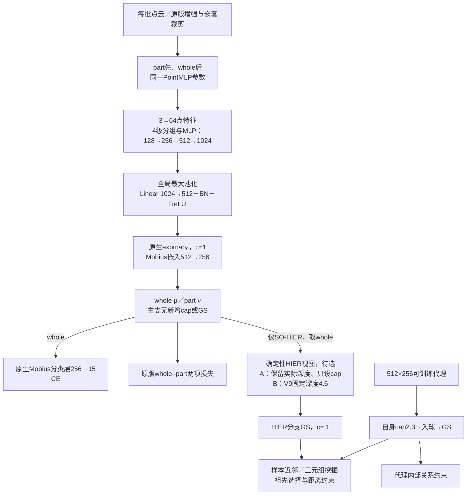

# ScanObjectNN：原生HyCoRe与新增HIER的两组对照计划

2026-11-20，**用户已同意并授权启动；按三项默认推荐实施**。前一轮完成只读资料与计划；本轮开始实现、数据验收和训练前检查。实际启动与冻结身份另见179执行记录。新数据任务与MN40的TS历史身份分别管理，暂称SO-H0、SO-HIER，不登记为已启动。

## 1. 推荐任务与本批问题

推荐 **ScanObjectNN / PB_T50_RS / main_split / 含背景，PointMLP＋HyCoRe**。这是HyCoRe发布仓库本来支持的真实扫描分类任务；[官方loader](../../../classification_ScanObject/ScanObjectNN.py)读取`{training,test}_objectdataset_augmentedrot_scale75.h5`，与数据作者对PB_T50_RS的命名一致。完整15类，不再按类别计数删减。

本批只回答：**在同一新数据、同一原生HyCoRe底座和训练协议上，指定的一套HIER分支能否提高分类OA，AA是否同步变化？** 数据集更换不能独立证明“类不平衡导致HIER无效”；真实扫描、遮挡、背景和类别集合都发生变化。

HyCoRe论文Table2的PointMLP+HyCoRe为OA87.2/AA85.9，DGCNN+HyCoRe为82.1/80.2，仅作为来源和量级参考；直接对照必须是本批重新训练的SO-H0，不能拿论文数值代替本地基线。[正式论文](https://papers.neurips.cc/paper_files/paper/2022/file/da8f9fc2b555d122369f36a9684415c1-Paper-Conference.pdf)

原始数据为15类、2902个独立实例，全体原始类别78–395例、最大/最小约5.06，不是严格均衡数据。扰动版本与原始对象数不同。PB_T50_RS预计HDF训练11,416行、测试2,882行，但本机没有该数据，**两个行数尚未由实际文件验收**；实施前须核对HDF形状、15类计数、文件SHA、有限坐标和行ID。[一手证据与边界](primary_sources.md)

## 2. 最小两组矩阵

| 条件 | SO-H0：源码HyCoRe | SO-HIER：源码HyCoRe＋HIER |
| --- | --- | --- |
| 数据 | 完整PB_T50_RS，官方训练/测试划分 | 相同文件、行序和类别映射 |
| 骨干（推荐） | 发布的ScanObject版PointMLP＋双曲嵌入/分类头 | 同一网络、同一初始化 |
| 主支几何 | 原生c=1；原数值投影 | 完全相同 |
| 主支额外cap／出口GS | 无 | 无；HIER映射仅在新分支 |
| 主支采样 | 自然SH32、shuffle/drop_last | 同一批对象、增强、whole/part |
| HyCoRe目标 | CE＋.01 Rcontr＋.001 Rhier | 完全相同 |
| 新增目标 | 无 | λs Rsample＋λp Rproxy，暂建议两者均.5 |
| HIER输入 | 无 | 当前批whole的256维嵌入，接在分类层之前 |
| HIER搜索 | 无 | 当前批32，Ks20/Kp20；不增加编码器前向 |
| 训练预算 | 单卡、300轮；预计356步/轮、106,800更新 | 相同；代理预计106,800次更新 |
| 随机数 | root seed4780 | root seed4780；HIER另用独立派生随机流 |
| 模型选择 | 沿发布入口，每轮完整test，三位小数OA严格提高选best，同分取早轮 | 相同 |

**H0保留HyCoRe自带的两项正则，不是普通PointMLP的纯CE基线。** 两组是一次配对，共两条完整训练；不在此批里同时搜索骨干、batch、K、代理数或权重。每轮步数最终由实际HDF行数决定：`floor(Ntrain/32)`。若11,416行确认，单轮11,392个不同HDF行、drop24，双组总213,600次主网更新；HDF行不等于独立物理对象。

保持SH32是为了匹配源码。ScanObjectNN只有15类，不能照搬MN40的16个不同类×2例CB32。Ks20统计的是样本近邻数，不要求类别数≥20；需核验有效关系覆盖，而不是因为15类就自动改K。

## 3. 主支结构与HIER接入点

接点是`model.emb`之后、`model.classifier`之前的whole μ。接入器只读取这个张量，不替换主支输出；原生分类头及whole–part目标继续用原μ/ν。HIER样本项回传同一PointMLP，代理内部项直接更新代理；没有第二套编码器或额外可训练投影头。新增可训练参数为512×256＝131,072个代理坐标。[原生模型](../../../classification_ScanObject/models/pointmlp.py)、[训练顺序](../../../classification_ScanObject/main_pointmlp_hycore.py)

## 4. 必须由用户决定的HIER视图

**暂推荐A：只在HIER分支设深度上限，允许样本在内部有深浅差别。** 这样先测试接近HIER发布代码“cap是上界”的设定，不把V9强制等深壳作为默认前提。它仍是对原生c1表示的适配，不称完全复刻原图像HIER。

令原生whole为μ，先取`u=logmap₀,c=1(μ)`：

- **A，实际深度＋cap：** 在分支内将u限长至2.3，按cH=.1做expmap及数值边界保护，再过该分支GS。保留方向，原点深度约为`min(d0,c=1(μ),4.6)`；主支自身的深度上限不改。不同曲率间这不是全局等距映射。
- **B，沿用V9固定壳：** 取μ方向，映射到cH=.1的固定深度4.6，再过分支GS。可直接延续既有固定壳配方，但该组检验的是“固定壳HIER”的新数据表现。

这两个选择不能在一条运行中混用。只有两条训练时，必须先选一个；如果同时对比A/B，需要第三条训练，属于另批授权。两种接法都保持主支c1及原生数值路径。把共享cap/GS加到主支会改变H0的源码底座，不属于本两组的默认计划。

## 5. 从ScanObject源码保留的完整训练配方

本机下列核心文件逐文本核对匹配固定官方commit `ef56a73020e309b1009c486fea1f601d3f7b3252`：入口、模型、数据loader、hutil和PointMLP launcher。详情及归一化文本SHA见[source_audit.json](source_audit.json)。

| 项目 | 本批推荐值／源码事实 | 注意 |
| --- | --- | --- |
| 输入 | 每个HDF行前1024点，仅XYZ | 沿用发布loader，不换FPS预采样或额外增强 |
| 数据增强 | 各轴scale[2/3,1.5]、平移[−.2,.2]、点序shuffle | 两组同一输入流 |
| whole | 随机600–1024点 | 与MN40常用800–1024不同 |
| part | 随机200至`n_points//2`；helper返回`n_points=whole_K−1` | 保留源码实际上界及part覆写whole别名行为 |
| HyCoRe对比项 | margin4、系数.01 | 原版批内flip负part照常使用 |
| HyCoRe局部层次项 | margin500/Npart、系数.001 | 入口确实是`.5*mar`和`.001*h_loss`，不能抄MN40两项各.01 |
| CE | 标签平滑ε=.2 | 实际`cal_loss`默认开启；不能照parser smoothing=False误判 |
| 优化器 | RiemannianSGD；LR .1→.001，cosine300；momentum.9，WD1e−4 | 不套用MN40 PointMLP的minLR.005、WD2e−4 |
| 参数裁剪 | 反传后原网络总梯度范数≤1 | 开启组仍只对原网络参数执行同一裁剪规则 |
| BN | 原生train/eval；part和whole各一次前向 | 不冻结、不增加辅助batch前向 |
| train/test batch | 32／32；workers8 | test原来也是shuffle=True/drop_last=False，首批原样保留 |
| 轮数 | 官方PointMLP launcher覆盖为300 | parser默认200不是实际launcher配方 |
| seed | 两组4780，延续用户项目约定 | 发布入口默认12，记录为成对覆盖，不称逐字默认launcher复现 |
| 选模 | 每轮完整test，OA严格刷新best，平局取早轮 | 保存best同轮AA，另报e300、末10均值/SD；不拿全程最高AA冒充同轮AA |

这些“源码事实”有的不同于论文文字中的通用配方；本计划优先遵循用户要求的发布源码。若选择按论文改`.001→.01`等，应给两组共同变更并明确另一个底座，不悄悄改其中一组。

HIER暂定：512×256代理、高斯初始化系数.9、cH=.1、代理cap2.3及自身GS；A1 AdamW LR.005→.0005、eps1e−4、betas(.9,.999)、WD.01、300轮cosine；Ks20/Kp20、T50、margin/tau=.1、λs=λp=.5、W0。保留已验证的self-negative修正，遇无有效关系时按已验证实现处理并计数。代理不加入原网络norm1裁剪；两个优化器每步各更新一次。

λ=.5是复用现有主配方的起点，不表示与CE梯度等强。用户也可将本次唯一开启组定为λ=.1；不在中途根据test表现切换权重。

若用户改选DGCNN，两组共同采用其ScanObject发布入口：250轮、whole800–1024、part200–600、层次margin1000/N、两项基础正则权重各.01；不能只换骨干而继续声称其余是DGCNN原配方。其编码器为4层动态图EdgeConv，max/avg池化拼接后投影512，再接原生c1的512→256→15双曲层。预计356步×250＝89,000更新/组，数据实测后定稿。

## 6. “其余保持一致”的验收与工程问题

这是实施获批后的验收清单，本轮尚未执行：

1. 固定官方源码身份、数据文件与标签行序；记录15类实际计数与原始/扰动行身份。数据缺失时先确认来源与SHA；不沿用旧下载地址而跳过验收。
2. 两组从相同原网络初值开始。HIER初始化、关系挖掘和Gumbel使用派生独立随机流，不能消费原训练与test shuffle所用CPU/CUDA/NumPy/Python流。记录真实对象行ID、增强和whole/part输入指纹；固定seed不承诺跨硬件参数逐位一致。
3. 先以关闭HIER的适配入口与源码基线核对输出、基础损失、更新数及固定输入下的数值容差；检查15类输出、原生曲率和主支未被替换。开启后核对有限损失、代理步数、分支几何和关系计数。这是功能验收，不追加研究性梯度审查。
4. 发布入口有固定GPU0、自动重用旧checkpoint路径等工程行为，且`models/ops/manifold_layers.py`导入`modelsnet.manifolds`，本地无该模块目录。采用两组相同的最小运行包装处理导入别名、GPU绑定和独立输出路径，保持数学计算与原网络不变；不修改旧源码或旧结果。修复和HIER方法变更分别记录。
5. 两组各单卡；显存是否能保持batch32需实施后实际验收，不直接从MN40显存推断。若源码32不可运行，先报告共同配置选择，不只缩小其中一组。两卡可并行，一卡可顺序；不预占GPU。
6. 正式训练前从头短测、核验后再fresh启动；短测权重不续训。预计步数按实际HDF重新核对，耗时待首个正式完整轮测得后估算，不套用MN40的小时数。

## 7. 结果、代理审查与解释边界

主任务单列OA/AA：best OA同轮AA、e300 OA/AA、末10均值/SD、15类混淆与正确数。两组均全预算结束，不按中途结果改采样或超参数。单seed配对先提供方向证据，论文历史成绩不作匹配H0。

按本机已批准的[代理审查v1.0](D:/Hycore/docs/research/156_HIER_PROXY_AUDIT_PROTOCOL_REVIEW_2026-11-08/protocol_v1.md)检查HIER开启组：样本项/代理内部项各自的使用覆盖、两点/三点角色与碰撞，逐条距离约束满足率，以及双曲与方向近邻。报告真实关系分母、当前32中的类别/同类搭档覆盖，不能只报总loss。可视化最近邻需展示扫描对象本身，不能用标签纯度代替真实形态层次。深度分层按异常追加，梯度审查不自动加入。

若H1改善OA/AA，只支持批准的整套HIER分支在该原生底座上的收益；两条训练不能把原因分别归到GS、视图和代理优化器。若OA不升但AA升，按MN20经验分开解释，不概括成正则全面无效。

## 8. 已获批准的默认选择（备选保留作历史说明）

| 决策 | 暂推荐 | 另一选择的影响 |
| --- | --- | --- |
| 骨干 | PointMLP，300轮 | DGCNN，官方launcher250轮；骨干与自身原配方一起换，两组均需采用它 |
| HIER样本视图 | A：实际深度＋分支cap | B：V9固定4.6壳；沿用旧组件，但继续绑定等深假设 |
| HIER权重 | 两项各.5 | 两项各.1；第一对改为较弱正则配方 |

用户随后回复“同意，挂上吧”，批准默认PointMLP、A实际深度分支cap、两项λ=.5，以及PB_T50_RS、15类全量、SH32、单卡、seed4780、原生c1与源码训练/test选模规则。实施检查通过后在空闲卡fresh启动，实际身份见179。
