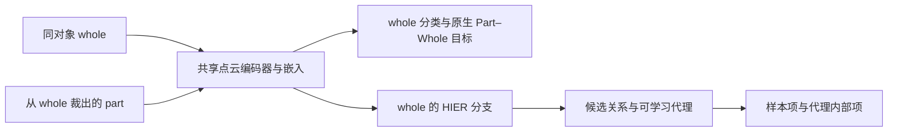

# HyCoRe＋HIER 点云分类实验分析

**汇报范围：2026年11月12日V10首批代理消融起，至11月26日全部后续终局与关键复核。** 编写日期：11月27日。按约40分钟准备，可压缩至30分钟；实验取证截止11月26日18:03:51（北京时间），论文原表于11月27日补核。数据来自已保存并核验的本机材料，本次未连接服务器、未新增训练。

本稿回答两个贯穿问题：**分类底座能否达到论文水平？在相同同对象Part–Whole基座上，跨对象HIER究竟增加了什么？** 先按日期展示全部实验及绝对成绩，再按启动顺序解释决策。每个阶段都同时给出论文参照、本地直接对照和本阶段结果。完整配置、实际日期、原目录和逐组来源见[实验附表](appendix_experiments.md)。

## 汇报安排与阅读约定

| 部分 | 建议时长 | 要让老师判断的事 |
|---|---:|---|
| 问题、方法和基准尺度 | 4分钟 | 研究目标是什么，什么才是有效对照 |
| 第一部分：按日期看实验与绝对成绩 | 12分钟 | 每批到底跑了哪些组，分数处于什么水平 |
| 第二部分：按启动时间解释决策 | 20分钟 | 为什么这样设计，哪些观察推动了后续，哪些没有复现 |
| 结论与待决问题 | 4分钟 | 哪些结论已有匹配证据，下一步应优先补什么 |

30分钟版本将第一部分缩至8分钟、第二部分缩至15分钟；保留第二部分第5、7、9、10节和收尾，其他日期表供老师追问。40分钟版本可在关键表格和三幅图上展开，不逐字朗读所有数字。

**成绩单位。** OA为全部测试样本的总体准确率；AA为逐类准确率的宏平均，均以百分比列出。所有差值用**百分点**，方向统一为“改动／开启组−指定对照”。best的AA只取best OA同轮，不能从检查点的独立最高AA字段代填。末10是同一次训练预定最后十轮的均值，不是十个独立seed。

**比较层次。** 论文OA用于交代绝对水平；同协议H0用于计算新增HIER的净作用；跨组批、入口或骨干的分数用于比较整套方案。历史MN40与多数SO实验保留逐轮test-best工程口径；新DeLA只测锁定e250。不同口径均保留标签，论文值和本地best的差距不直接解释成某个组件的作用。

**范围。** 本文纳入52条完成的正式训练（TS27–55的29组、17条后续非TS、6条新DeLA／权重／CB组），另记2条B17验证协议启动后停止的运行、7个发布权重复评条件及关键诊断。TS06、TS23等早期训练只作为直接参照，不再重讲V7–V9历史。

### 方法与最少必要术语

HyCoRe的同对象Part–Whole描述“同一物体的局部和整体”。本研究的假设是：同类不同实例可能还有可利用的细粒度形态关系，单个物体内部的径向约束没有直接规定这些跨对象分支。额外HIER从whole表示挖跨对象互近邻，以可学习代理组织两点／三点代表，增加样本项及代理内部项，希望在保留分类与对象内部结构的同时改进表示。

代理是抽象表示，不是物理部件标签。本范围采用在线代理，没有冻结教师。验证这个假设需要两个层次的证据：首先是匹配基座上的任务收益与重复性，其次才是独立几何／语义信号下的关系质量；分类改善本身不能证明真实形态树。本文先把第一层证据讲清楚，再标出机制证据能支持到哪一步。

共同形式为 `L = L_base + λs·Lsample + λp·Lproxy`；`L_base`包含该底座的分类和Part–Whole，新DeLA还保留坐标辅助项。**H0仅关闭新增HIER，仍保留该配对的Part–Whole。** 原版DeLA只有分类和坐标监督，不能直接充当新Part–Whole HIER的唯一H0。

| 缩写 | 本文含义 | 为什么必须区分 |
|---|---|---|
| SH32 | 每轮随机打乱、无放回、丢尾的小批32 | 接近原分类训练，但每批同类关系数随机 |
| CB32 | MN40／MN20为16类×有放回2例；SO为15类各2例＋两类各加1例 | 改变类别权重、对象暴露及批内搭档，不只改变HIER |
| B05／B13 | B05是MN40改版几何的SH32；B13沿相同几何采用CB32×200步 | 同为batch32也不是同一训练协议 |
| B17 | 两个SH32各自计算基础损失，再累积一次更新 | 不是一次BN64；每轮153次更新，与B05的307次不同 |
| 固定壳 | MN40 HIER把whole方向映射成固定深度4.6 | 只向HIER提供等深叶视图 |
| 实际深度cap | SO／新DeLA先logmap，再切空间cap2.3，以c=.1入球并用独立GS | 上限内保留深度变化，约4.6是上限；不能因末批多数触cap就改称固定壳实现 |
| A0／A1 | 代理AdamW分别为LR .01／eps1e−8与LR .005／eps1e−4 | LR和eps联动，不是曲率开关，也不是eps单因素 |
| Ks／Kp、P、λ | 样本／代理近邻数，代理数，HIER权重 | “池大小”是候选样本数，与分类batch和代理数分别记 |
| FIFO1／FIFO2 | 当前32锚点加前1／2步detach特征，池最多64／96 | 同时变化候选规模、年龄和梯度路由，历史候选不再反传编码器 |

### “封装入口”和“原脚本入口”具体差在哪里

旧稿的“本地适配”指**我们写的外层程序组织训练**：建立模型、数据加载器、优化器和逐轮循环，内部调用作者发布的PointMLP模型及原`train()`／`validate()`。旧稿的“作者入口”指**我们直接执行作者发布的`main()`主程序**，由原脚本建立这些对象和组织循环。两类实验都是我们从随机初值训练；“作者”不表示作者本人跑出的成绩，也不表示加载了作者训练好的权重。

| ScanObjectNN的实现层次 | 封装入口：SO-H0／SO-HIER | 原脚本入口：SO-S12、SO-S4780两对 |
|---|---|---|
| 模型、基础训练及测试函数 | 使用作者原实现 | 使用同一作者原实现 |
| 数据如何进入加载器 | 先核验并读入HDF数组，再交给原数据集类；训练外层附加样本行号跟踪 | 原脚本的数据加载器直接读同一批已核验HDF文件 |
| 模型、优化器及轮次由谁组织 | 我们的外层程序 | 作者发布的`main()` |
| 基础配方 | 原生c=1、原whole／part裁剪、原损失及优化器 | 相同基础配方 |
| 首批正式实验的seed | 4780 | 先用发布脚本默认12，后来补4780 |
| 共同兼容处理 | 修复残留导入名、允许外部选择空闲GPU、使用当前可运行依赖 | 相同兼容处理；仍不是作者历史环境的逐项复刻 |

两种SO入口均保留：whole600–1024、part200至`floor((whole_K−1)/2)`，CE＋.01对比项＋.001局部层次项（margin500/Npart），SH32×356×300及逐轮test-best。开启组才额外加本项目HIER。**最早两批同时换了入口和seed，不能用它们的差值单独衡量入口效果。** 后来补出的SO-S4780-H0提供了相同seed的入口比较，但仍是两次单独训练的观察值，未证明某项封装操作造成差距。[封装实现及验收](../179_SCANOBJECTNN_HIER_PAIR_LAUNCH_2026-11-20/run.md#so-h0-的-872-复现差距审查) · [原main入口](../180_SCANOBJECTNN_AUTHOR_LAUNCHER_S12_2026-11-21/run.md) · [同seed补组](../183_CLASSIFICATION_PAIRED_SEEDS_2026-11-23/run.md)

MN40的B05与原脚本H0还存在**基础数学配方差异**：B05采用c=.1、切空间cap2.3、基础GS，并将两项margin由1000/Npart与4减半为500/Npart与2；原脚本保持c=1及原配方。因此TS06的94.327与原脚本93.598的差距包含整套底座改动，不能归入SO这里讨论的训练外层差异。[MN40底座定义](../163_MN40_V10_EXPERIMENT_ATLAS_2026-11-15/report.md#底座详细配置)

### 论文基准与本地起点

{{PAPER_BASELINES}}

表中HyCoRe的“原骨干”优先指其论文同一结果表中的未加HyCoRe对照；MN40 PointMLP 93.4是HyCoRe作者的重实现读数，不能改称PointMLP原论文的最高结果。本地H0通常已经包含HyCoRe或新DeLA的Part–Whole；本文研究的是在该基座上再加HIER的第二层增量，不把原骨干→HyCoRe的论文增量与我们的HIER开关混为一项。

本文MN40历史目标是TS06的best **94.327%**；它采用改版B05，不能等同作者原生c=1复现。另一必要参照TS23为CB32低权重HIER：best **94.003%**、末10 **93.351%**。11月13日补出的匹配H0 TS30为best **93.841%**、末10 **93.088%**。因此，94.003既可低于另一个强底座94.327，也可在自身匹配底座上有正增量；这两种判断回答不同问题。[参照身份与标量](../197_CLASSIFICATION_REPORT_DRAFT_2026-11-26/ts_experiments.md)

## 第一部分：按日期段展示全部实验及对比结果

各表按实际启动日期归入阶段，同阶段内按直接对照相邻排列；精确时间见附录。同阶段实验可能在前一组结束前已启动。**每表前先读论文尺度和直接对照，再看增减。** 末10列对完整300轮组为e291–300，对250轮组为e241–250；固定终点DeLA不填未测的best或末10。表中低于论文表示绝对差距，是否有HIER净增益仍按明确的H0计算。行内差值以指定对照为准；对照若也是HIER，表示组件改动，不冒充HIER开关净增益。读数显示至三位小数，差值用源值计算并采用十进制四舍五入，不能仅将已显示的两数相减。

### A．11月12日—13日凌晨：代理消融、H0与更新预算

{{BASE_MN40}}

**本地参照：** TS23 best94.003／末10 93.351；TS06 best94.327／末10 93.027。本批补出同CB32协议H0 TS30 best93.841／末10 93.088。

{{TABLE_A}}

**本阶段读法：** 三个代理改动都未超过TS23。补H0后才确认TS23相对自身底座有best+.162、末10+.263；高K大权重TS32却出现best+.284、末10−.292。CB32多做30,000次更新的TS31也没有追上历史强SH32。不能把“代理消融不如TS23”误当成“TS23已经证明优于H0”。[160代理消融](../160_MN40_TS23_PROXY_ABLATIONS_2026-11-12.md) · [161补H0](../161_MN40_B13_CB32_CONTROLS_2026-11-13.md)

### B．11月13日晚—15日凌晨：回到SH32，检查A0/A1、权重和K

{{BASE_MN40}}

**本地直接对照：** CB32使用TS30 best93.841／末10 93.088；SH32使用TS06 best94.327／末10 93.027。两个底座不互相替代。

{{TABLE_B}}

**本阶段读法：** SH32默认TS35 best94.206，距TS06 −.121、距论文单次94.3约−.094；末10也低于TS06 .101。λ=1的TS37末10升至93.306，但best仍未过TS06。峰值与末段已有分歧，下一步需要分开看关系池和主分类组批。[162配置、入口验收及终局](../162_MN40_V10_TS_CONTINUATION_AND_SH32_2026-11-13.md)

### C．11月15日—16日下午：实时池、K分项和一步缓存

{{BASE_MN40}}

**本地直接对照：** B17累积协议H0 TS39 best93.801／末10 92.739；B05常规协议H0 TS06 best94.327／末10 93.027；当前批HIER TS35 best94.206／末10 92.926。

{{TABLE_C}}

**重跑身份：** B17旧验证选模H0／H64各正式运行2轮后，按当时要求停止，改成全量训练、历史test-best的TS39／41；H32旧版只做短测。两条停止组没有最终test成绩，详见附表，不混成完整300轮结果。

**本阶段读法：** TS44的best94.084没有超过TS06，但e30094.084、末10 93.416较H0分别+.567／+.389。B17的H64末段高于H32，best却较低；不能把两个“池64”跨B17／B05直接归为池规模效应。[164实时池与重跑](../164_MN40_V10_SH_POOL32_64_2026-11-15.md) · [165分项K与缓存](../165_MN40_V10_SH32_K_AND_CACHE_POOL_2026-11-16.md)

### D．11月16日晚—18日：分项权重、缓存扩展与历史候选选择

{{BASE_MN40}}

**本地直接对照：** 样本／代理项用TS35 best94.206／末10 92.926；缓存改动用TS44 best94.084／末10 93.416；最终H0仍是TS06 best94.327／末10 93.027。

{{TABLE_D}}

**本阶段读法：** TS45／46改善部分末段指标，但峰值低于TS35。FIFO扩大至96、从更长历史窗口选样本、FIFO64降权至.1均没有超过TS44。TS48相对TS49是best／末轮略低、末10略高，不能概括成“按类挑历史候选优于随机”。[166分项权重](../166_MN40_V10_SH32_SPLIT_HIER_WEIGHTS_2026-11-16.md) · [167 FIFO96](../167_MN40_V10_SH32_FIFO96_2026-11-18.md) · [168历史选择](../168_MN40_V10_HISTORY_SELECTION_2026-11-18.md)

### E．11月19日：自定义MN20四组与完整MN40双采样

**论文尺度：** 自定义MN20没有同任务论文OA，不能套完整MN40的94.3或历史94.327来排高低。TS53仍是完整MN40，适用前述论文参照。

**本地直接对照：** MN20 SH-H0 TS51 best93.634／末10 92.711；CB-H0 TS54 best92.918／末10 91.803。TS53使用完整MN40的TS06和TS35作参照。

{{TABLE_E}}

**本阶段读法：** MN20中SH-HIER的OA降、AA升；CB-HIER的OA和AA均升。完整MN40的独立CB-HIER TS53 best93.841／末10 92.942，未超过TS06。数据子集与额外前向分别是整套策略改动，不能只归因不平衡或CB候选。[175子集决定](../175_MN40_FILTER20_DUAL_SAMPLER_PLAN_2026-11-19/plan.md) · [176执行与终局](../176_MN40_FILTER20_DUAL_LAUNCH_2026-11-19/run.md)

### F．11月20日—21日：ScanObjectNN封装入口与原脚本入口

{{BASE_SO_POINTMLP}}

**本地直接对照：** 封装入口seed4780 H0 best85.357／末10 83.796；原脚本seed12 H0 best86.294／末10 84.042。MN40原脚本H0另按MN40论文基准看复现水平。

{{BASE_MN40}}

{{TABLE_F}}

**本阶段读法：** SO封装入口HIER best86.051、末10 84.608；原脚本seed12 HIER best86.294、末10 84.639。两套设置末段均改善，但原脚本组峰值持平；两次同时变入口与seed，尚不能叫同入口跨seed复验。MN40原脚本H0 best93.598也未达到论文单次94.3。[179封装入口](../179_SCANOBJECTNN_HIER_PAIR_LAUNCH_2026-11-20/run.md) · [180作者SO](../180_SCANOBJECTNN_AUTHOR_LAUNCHER_S12_2026-11-21/run.md) · [181作者MN40](../181_MN40_AUTHOR_LAUNCHER_S4780_2026-11-21/run.md)

### G．11月23日：预先以末10为主，补第二seed

{{BASE_SO_POINTMLP}}

{{BASE_MN40}}

**本地直接对照：** 同一SO原脚本入口 seed4780 H0 best85.600／末10 84.733；MN40 B05 seed4781 H0 best93.882／末10 93.254。与各自同seed HIER配对，论文目标只作绝对尺度。

{{TABLE_G}}

**本阶段读法：** SO原脚本seed4780末10 −.444，和seed12的+.597反向；MN40 FIFO seed4781末10 −.215，和4780的+.389反向。两个重点正向方案均未保持第二seed方向，不能只保留第一次正例。[183预定指标与两对终局](../183_CLASSIFICATION_PAIRED_SEEDS_2026-11-23/run.md)

**把SO的入口与seed拆开看H0。** 三组均已包含HyCoRe：

| H0运行 | 训练入口／seed | best OA | 末10 OA | 比较边界 |
|---|---|---:|---:|---|
| SO-H0 | 封装入口／4780 | 85.357 | 83.796 | 最早的HIER配对基线 |
| SO-S4780-H0 | 原脚本入口／4780 | 85.600 | 84.733 | 与SO-H0同seed，改变训练组织方式 |
| SO-S12-H0 | 原脚本入口／12 | 86.294 | 84.042 | 与前行同入口，改变seed |

最早85.357→86.294的best差+.937混合了两项变更。同seed入口比较的best差为+.243，而末10差+.937；同入口换seed的best差+.694，末10却−.690。不同指标的方向不能互相代替，这些单次读数也不能当成稳定的入口或seed平均效应。[179终局](../179_SCANOBJECTNN_HIER_PAIR_LAUNCH_2026-11-20/run.md) · [182 seed12终局](../182_MN40_V10_REPRO_AND_HIER_AUDIT_2026-11-23/report.md) · [183 seed4780终局](../183_CLASSIFICATION_PAIRED_SEEDS_2026-11-23/run.md)

### H．11月24日：公开权重、论文复现补对照和替代骨干

{{BASE_SO_ALL}}

{{BASE_ALTERNATIVES}}

当日先做发布权重复评，随后从头复跑原DeLA与DGCNN，再开DGCNN HIER和作者配方／顺序／当前池补对照。以下三类结果分别解释。

**H1．发布权重：推理结果，不是本项目从头训练的best。**

{{TABLE_PUBLIC}}

point2vec四个FP16条件只改变同一检查点的推理FPS seed，跨度.243个百分点、净6个测试样本；seed0是预定主读数。论文原表94.7与旧184所记作者94.65按各自来源保留，两种精度的读数不能当成新的训练差异，详见[论文核验](paper_baselines.md)。DeLA发布权重与本地从头训练也分别登记，不拿较高权重分数替代本地基线。HyCoRe本项目没有可核实的作者发布checkpoint实评；TS01或A3不是作者权重。[184权重协议](../184_V9_V10_BASELINE_AND_HIER_ROADMAP_2026-11-24/report.md)

**H2．正式训练：每条使用自己的同协议参照。**

{{TABLE_H}}

**本阶段读法：** DGCNN H0两seed best81.992／82.616围绕其论文HyCoRe读数，HIER末10却均下降。原DeLA从头best89.590、e25089.380，高于本次PointMLP H0，但没有显式Part–Whole。MN40当前批HIER seed4781末10 93.371，高于其H0 93.254；同seed缓存反而低于当前批。顺序与论文intra组合也没有补齐复现差距。[185作者底座](../185_AUTHOR_SOURCE_INTRA_PART_WHOLE_2026-11-24/run.md) · [188 DGCNN开关](../188_SCANOBJECTNN_DGCNN_HIER_2026-11-24/run.md) · [189当前池](../189_MN40_B05_S4781_CURRENT32_2026-11-24/run.md) · [190补对照](../190_CLASSIFICATION_TS45_ONWARD_2026-11-24/report.md)

### I．11月25日：DeLA建立共同Part–Whole H0，再测HIER

{{BASE_DELA}}

**本地直接对照：** 原DeLA e250 **89.380／88.440**；新Part–Whole H0 e250 **87.474／86.092**。只有新H0才是本次HIER开关的直接参照。

{{TABLE_I}}

**本阶段读法：** 新HIER e250 **88.237／86.899**，对新H0为**+.763 OA／+.807 AA**，但仍低于原版e250 **1.143 OA**个百分点。两条新组只测固定e250，不产生best或末10 test均值。移植的是DMR HLoss，不是完整DMR方法复现。[193数据流](../193_DELA_H0_MODEL_DATAFLOW_2026-11-25/design.md) · [194校准与配对](../194_DELA_H0_HIER_PAIR_2026-11-25/run.md) · [198终点身份](../198_CLASSIFICATION_PREPOWER_AUDIT_2026-11-26/provenance_audit.md)

### J．11月26日：PointMLP权重与DGCNN CB32开关

{{BASE_SO_ALL}}

**本地直接对照：** PointMLP原脚本seed12 H0 best86.294／末10 84.042，原.5 HIER best86.294／末10 84.639；DGCNN seed4780 SH-H0 best82.616／末10 80.940，新CB-H0 best81.783／末10 81.065。

{{TABLE_J}}

**本阶段读法：** PointMLP .1末10 84.445、1.0为84.087，均未胜原.5；DGCNN CB-HIER末10 80.569，仍低于CB-H0 .496。所有组已到终点，不能继续沿用早期的“排队／在训”。[196配置](../196_SCANOBJECTNN_WEIGHT_CB_PAIR_2026-11-26/run.md) · [权重终局](../198_CLASSIFICATION_PREPOWER_AUDIT_2026-11-26/weights_final.json) · [DG CB终局](../197_CLASSIFICATION_REPORT_DRAFT_2026-11-26/latest_8000_evidence.json)

### K．11月26日收官：关键机制与逐对象诊断，不计新增训练

| 核查 | 原有或锁定的比较对象 | 已得到的证据 | 不能代替什么 |
|---|---|---|---|
| 13组HIER已有遥测 | MN40当前／缓存，SO正负seed、权重、DGCNN，新DeLA | 活跃关系、碰撞、部分达标率、首／末批几何；统计分母逐项核实 | 全训练分布、逐代理角色与独立形态层次 |
| 7组MN40完整曲线 | TS06／35／44／47及4781 H0／当前／FIFO | 300轮连续，可离线比较峰值、末段与波动 | 多个独立训练seed的统计确认 |
| DeLA e250逐对象复核 | 固定H0／HIER、同2882测试HDF行 | 原两混淆矩阵完全复现；共同对2451、H0独对70、HIER独对92、共同错269 | 新训练seed、逐原始物体独立性及形态树证据 |

净增22条由92条新增判对减70条回退组成。55条案例按每类两方向各取最小row ID至多2条保存，属于描述性案例。单次复核没有改选模，参数／BN前后指纹不变；不能因重复评估就增加独立训练重复次数。[机制盘点](../198_CLASSIFICATION_PREPOWER_AUDIT_2026-11-26/mechanism_inventory.md) · [逐对象复核](../198_CLASSIFICATION_PREPOWER_AUDIT_2026-11-26/dela_object_diagnostic.md)

## 第二部分：按启动时间重建实验决策

每节用四部分展开：**当时的问题—实验与对照—结果—判断与下一步**。实验名单直接写入段内，关键结果再列小表；第一部分承接全部组，避免只凭编号讲故事。后来的解释和补证明确标为回顾，不倒写为当时已有的安排依据。

### 1．11月12—13日：从代理设置消融转向补齐H0

**① 当时的问题。** 历史TS23在CB32低权重、小邻域下达到94.003%，看起来较稳，但还没有同B13的H0。它低于强SH32的TS06 94.327，也低于论文94.3的绝对尺度；这可能同时含底座、预算和新增目标的影响。此时需要分别问：代理设置是否必要，CB训练是否只是更新不够，HIER对自身底座究竟有没有帮助。

**② 实验与对照。** 11月12日先开TS27（P256）、TS28（初始化.5）、TS29（代理cap2.9），三条各只改TS23一个代理设置。11月13日再开TS30（CB32-H0×200步）、TS31（H0×300步）、TS32（A1、K20/20、λ=.5）。全部300轮、seed4780；前三条不改主支cap和样本4.6壳。TS30后来补齐的H0可回头解释旧TS23，但不是TS27启动时已经存在的对照。[当时计划及执行](../160_MN40_TS23_PROXY_ABLATIONS_2026-11-12.md) · [补H0计划](../161_MN40_B13_CB32_CONTROLS_2026-11-13.md)

| 比较 | 绝对best OA | 绝对末10 OA | Δbest／Δ末10 OA（百分点） |
|---|---:|---:|---:|
| TS30 H0 | 93.841 | 93.088 | 参照 |
| TS23低K／λ=.1 HIER | 94.003 | 93.351 | +.162／+.263，相对TS30 |
| TS32高K／λ=.5 HIER | 94.125 | 92.796 | +.284／−.292，相对TS30 |
| TS31增加更新的H0 | 93.801 | 93.039 | −.041／−.049，相对TS30 |

**③ 观察。** TS27／28／29三项OA都未超过TS23；可见代理更少、初态更浅、cap更大没有在本批自动带来改善。TS31从60,000到90,000更新后也没有弥合与强SH32的差距。最关键的新增信息是：TS23在自身H0之上确有小幅正增量，而TS32峰值更高却末段更差。论文目标、历史强底座、匹配H0的三层参照给出了不同但不矛盾的判断。

**④ 判断与下一步。** 保留TS23作为CB32候选，不把代理调参胜出等同于HIER净收益；也不再只靠加更新解释差距。接着一方面复查高K下的A0／A1和权重，另一方面回到原SH32强底座接HIER。这一转折是在补齐H0后，把“组件如何调”推进到“是否能帮助强分类底座”。

### 2．11月13日晚—15日：强底座上峰值没突破，末段却对权重有反应

**① 当时的问题。** 如果HIER只帮助较弱的CB32方案，它的推广价值有限。需要在TS06的SH32基础上直接做开启组，并检查代理优化器和权重的选择能否迁移；这同时回应论文绝对水平和新增目标的局部效果。

**② 实验与对照。** TS33把TS32的A1改成A0；TS34保持CB32、将λ升至1。TS35接回B05 SH32×307、K20/20、A1、λ=.5；其关闭入口与历史TS06先做了初始化、输入和基础损失短测核对。随后TS36／37仅将两项λ改为.1／1，TS38将Ks、Kp同时20→10。TS06是经入口短测支持的历史同配方H0，不是本批同机重跑的H0。[162完整记录](../162_MN40_V10_TS_CONTINUATION_AND_SH32_2026-11-13.md)

| SH32配方 | best OA／同轮AA | 末10 OA／AA | 相对TS06 Δbest／Δ末10 OA |
|---|---:|---:|---:|
| TS06 H0 | 94.327／91.415 | 93.027／90.619 | — |
| TS35 λ=.5 | 94.206／91.006 | 92.926／90.628 | −.121／−.101 |
| TS36 λ=.1 | 93.801／90.728 | 93.043／90.664 | −.526／+.016 |
| TS37 λ=1 | 94.003／90.924 | 93.306／90.915 | −.324／+.280 |
| TS38 K10/10 | 93.882／90.853 | 93.055／90.577 | −.445／+.029 |

**③ 观察。** 默认TS35的峰值和末段都未胜TS06。TS37末段更高，但不能据此说它在峰值也更好；AA也要按各自口径看。CB32里，K20/20下A1→A0的best下降.365，和更早K10/20下A0峰值更高的方向不同。A0／A1不是统一可迁移的优劣关系。

**④ 判断与下一步。** 自然SH32并非挖不到HIER关系，分类增益也不只由有无同类样本决定。此时合理的问题变成：能否保留SH32的分类输入，而只改变关系池与样本／代理近邻结构？因此下一批把分类组批、HIER池和优化次数明确拆开，而不是直接宣称扩大batch能解决问题。

### 3．11月15—16日：把“分类batch32”和“HIER池64”分清

**① 当时的问题。** 改成CB既改变关系供给，也改变分类主支。为保住SH分类，希望增加候选关系而不直接切换类别均衡训练；但增加候选可以通过实时合批或历史缓存实现，二者优化语义不同。

**② 实验与对照。** 先有B17验证协议H0／H64，正式两轮后按当时要求停止，转为TS39（H0）、TS40（两个32池各自挖掘）、TS41（两个新鲜32合实时64）。三条都两个小批累积一次更新，每轮153步，共45,900次。另一支TS42只降Ks，TS43只降Kp；TS44保持B05每批更新，当前32锚点加前一步detach32，池最多64、共92,100更新。TS35、38、42、43构成Ks／Kp的2×2。[164](../164_MN40_V10_SH_POOL32_64_2026-11-15.md) · [165](../165_MN40_V10_SH32_K_AND_CACHE_POOL_2026-11-16.md)

| 直接比较 | H0或当前池 best／末10 OA | 改动组 best／末10 OA | Δbest／Δ末10 OA |
|---|---:|---:|---:|
| TS39→TS40，两池32 HIER | 93.801／92.739 | 93.963／92.970 | +.162／+.231 |
| TS39→TS41，实时64 HIER | 93.801／92.739 | 93.760／93.075 | −.041／+.336 |
| TS35→TS44，加入一步缓存 | 94.206／92.926 | 94.084／93.416 | −.122／+.490 |
| TS06→TS44，HIER＋缓存整套 | 94.327／93.027 | 94.084／93.416 | −.243／+.389 |

**③ 观察。** 实时64相对32池，末段更高、best较低，且两条B17开启组的末轮AA均低于其H0。TS44的e300达到94.084，和H0比较末轮+.567、末10+.389，但最高OA仍低于94.327。K分项中，固定另一个K=20时单降K有较好末段，两个一起降到10/10却不继续改善，提示参数存在依赖。

**④ 判断与下一步。** 这里出现的是若干具体训练方案的末段收益，不是普遍“池64最优”。B17与B05有不同BN组织、主支更新数、锚点和候选年龄；即使同叫64池也不能直接归因规模。后续分项权重与缓存线并行推进：TS45／46启动时TS44仍在训练，不能把它完整的末段正例提前作为两组的启动依据。TS44终局在11月17日07:18形成后，11月18日的扩池和选择对照才继续追查缓存候选问题。

### 4．11月16日晚—18日：关系池更大、更均衡或更弱，都没有单调改善

**① 当时的问题。** 当时已有SH32当前池结果，TS44缓存线仍在训练，分项权重线先问代理内部项是否过强、样本项是否应延后加入。随后TS44于11月17日07:18终局，末段正例进一步引出11月18日的问题：是增加关系供给有用，还是历史候选的组织有用？

**② 实验与对照。** TS45令样本项从e1的0线性升至e51的.5、代理项全程.5；TS46样本项.5、代理内部项0，代理仍接受样本项梯度。TS47将FIFO1扩至FIFO2（64→96）；TS48从前三批最多96历史对象里按类优先选32，TS49同窗口随机选32，两者加当前批后池最多64；TS50保持TS44池64而将两项λ降为.1。TS48–50启动时TS47尚未终局，不把后来终局写成当时已知理由。[166](../166_MN40_V10_SH32_SPLIT_HIER_WEIGHTS_2026-11-16.md) · [167](../167_MN40_V10_SH32_FIFO96_2026-11-18.md) · [168](../168_MN40_V10_HISTORY_SELECTION_2026-11-18.md)

| 缓存／权重配方 | best OA | 末10 OA | 与指定参照的Δ末10 OA |
|---|---:|---:|---:|
| TS44，一步历史，λ=.5 | 94.084 | 93.416 | 参照 |
| TS47，两步历史，λ=.5 | 93.760 | 93.006 | −.409，相对TS44 |
| TS48，长窗按类选择 | 93.882 | 93.152 | +.105，相对同窗随机TS49 |
| TS49，长窗随机选择 | 93.963 | 93.047 | −.369，相对TS44 |
| TS50，一步历史，λ=.1 | 93.801 | 93.023 | −.393，相对TS44 |

**③ 观察。** TS45和TS46较TS35改善部分末段，但峰值下降；尚缺全程“样本项0、代理内部项.5”的完整组，不能声称分项2×2做齐。TS47比TS44三项OA都低。TS48只在末10略高于TS49，best和末轮反低，说明候选类别更均衡不保证总体分类更好。池32的λ=.1→池64的λ=.1末10几乎不变；λ=.5却由TS35到TS44明显改善，不能把池效应脱离权重讨论。

**④ 判断与下一步。** 回顾这些终局，“更多关系、更长缓存、更均衡候选、更低权重”都不足以单独解释收益。MN20和双采样的计划实际上已依据此前采样审查形成，TS54早于TS48–50全部完成就启动；不能说它们是看完本批终局才决定的。下一阶段的问题是：在更接近类均衡的任务里，组批与HIER的相互依赖是否仍然存在？

### 5．11月19日：MN20四组给出有信息量的OA／AA分歧

**① 当时的问题。** MN40 SH／CB差异可能包含类别重加权、对象暴露、搭档和预算。减少类频差距能否改变结论？能否保留SH分类，再用独立CB给HIER供给关系？

**② 实验与对照。** 按训练类数130–400筛成20类（train4298／test1398），不是官方独立MN20或ModelNet10。TS51／52是SH32 H0／HIER，TS54／55是CB32 H0／HIER，均134×300、40,200更新；在这个子集内比较。TS53保留完整MN40，分类SH32外加新鲜CB32前向仅算HIER，辅助BN长期统计恢复，但增加了计算与数据呈现。[175](../175_MN40_FILTER20_DUAL_SAMPLER_PLAN_2026-11-19/plan.md) · [176](../176_MN40_FILTER20_DUAL_LAUNCH_2026-11-19/run.md)

| MN20组批 | H0 best／末10 OA | HIER best／末10 OA | Δ末10 OA／AA |
|---|---:|---:|---:|
| SH32，TS51→52 | 93.634／92.711 | 93.348／92.153 | **−.558／+.443** |
| CB32，TS54→55 | 92.918／91.803 | 93.062／92.532 | **+.730／+.762** |

**③ 观察。** CB32有同seed OA／AA全指标正例；SH32却OA下降、AA上升。H0下SH末10仍比CB高约.909，即使删去了极端类频，组批差异没有消失。CB-HIER末10的92.532也仍低于SH-H0的92.711约.179，局部正增量不等于该任务的最佳绝对方案。TS53在完整MN40 best93.841、末10 92.942，均低于TS06；额外CB不是直接超过强H0的办法。

{{FIG_MN20}}

**④ 判断与下一步。** 不能把SH-HIER概括为“所有指标都变差”，也不能从子集结果排除不平衡作用：删类还改了任务难度和分类竞争。TS53需要同额外计算量的SH辅助批，才能分离额外前向与CB组织。MN20四组及此前MN40结果形成了有条件正例，推动向真实扫描和原生Part–Whole基座迁移；SO于11月20日01:20已启动，早于TS53当日10:13终局，因此TS53完整负结果只是后来补证，不是SO启动时已知的理由。

### 6．11月20—21日：SO出现正例，同时暴露论文复现差距

**① 当时的问题。** 同一HIER思路换到真实扫描后是否有效？如果底座未达到论文，观测增量与复现差距要分别交代，不能只报+.812而不说绝对OA仍是多少。

**② 实验与对照。** 11月20日封装入口SO-H0／HIER，seed4780，使用作者PointMLP模型、训练函数及完整PB_T50_RS；11月21日再直接执行作者main与launcher默认seed12，形成SO-S12-H0／HIER。全部SH32×356×300。原生c1保持whole／part，HIER采用实际深度cap而不是MN40固定壳。另跑MN40原脚本H0 seed4780，以核查公开入口水平。[179](../179_SCANOBJECTNN_HIER_PAIR_LAUNCH_2026-11-20/run.md) · [180](../180_SCANOBJECTNN_AUTHOR_LAUNCHER_S12_2026-11-21/run.md) · [181](../181_MN40_AUTHOR_LAUNCHER_S4780_2026-11-21/run.md)

{{BASE_SO_POINTMLP}}

| SO设置 | H0 best／末10 OA | HIER best／末10 OA | Δbest／Δ末10 OA |
|---|---:|---:|---:|
| 封装入口seed4780 | 85.357／83.796 | 86.051／84.608 | +.694／+.812 |
| 原脚本入口seed12 | 86.294／84.042 | 86.294／84.639 | 0／+.597 |

**③ 观察。** 两套设置末段均正，原脚本组best OA持平而best同轮AA反低.297；e300 AA却提高1.392。绝对成绩方面，原脚本H0 best86.294距论文87.2低.906，HIER也未补峰值差距。MN40原脚本H0 best93.598，距论文单次94.3低.702；B05 TS06较高不等于原生入口已复现。

**④ 判断与下一步。** 当时可以保留SO迁移希望，但两批同时改入口与seed，不构成同入口跨seed复现。发布代码与论文的局部层次权重、margin、裁点确有差异，训练分片顺序也会改变对应对象；它们是待检验变量，不是已经解释完的原因。于是先补同入口第二seed，同时安排MN40第二seed，预先把末10 OA定为主比较，避免事后只追最高峰值。

### 7．11月23日：第二seed改变了对“可重复收益”的判断

**① 当时的问题。** 要验证的是已有具体配方是否重复，而不是再从许多参数中挑一个单次高分。分别复验MN40的HIER＋FIFO1整体，以及SO原脚本入口实际深度HIER。

**② 实验与对照。** MN40-B05-S4781-H0／HIER-FIFO1同入口、同seed、300轮；SO原脚本SO-S4780-H0／HIER同入口、同seed、300轮。两对都检查初值、首批、裁剪和基础损失，预选最后十轮平均OA为主。历史4780和新的4781不能混成一次方差估计；SO封装入口4780也不替代原脚本入口4780。[183配对登记](../183_CLASSIFICATION_PAIRED_SEEDS_2026-11-23/run.md)

| 固定方案 | 第一seed：H0→HIER末10 OA | 第二seed：H0→HIER末10 OA | 配对增量是否同方向 |
|---|---:|---:|---|
| MN40 B05＋FIFO1 | 4780：93.027→93.416（+.389） | 4781：93.254→93.039（−.215） | 否 |
| SO原脚本PointMLP | 12：84.042→84.639（+.597） | 4780：84.733→84.289（−.444） | 否 |

**③ 观察。** SO两颗seed的best各自都持平，但末轮／末10方向相反；只看best会掩盖差异。MN40从第一次末段正例变为第二次下降。它们尚不足以估计稳定的总体训练方差，但已经足以反对“这个配方在观察过的seed中都提升”的陈述。

{{FIG_PAIRED}}

**④ 判断与下一步。** 回顾终局，应把结论收紧为“存在条件性正例，主要方案的末段收益尚不稳定”。MN40需要4781当前批HIER来拆开HIER和缓存，因此11月24日晚补CURRENT32。SO的换骨干和论文复现工作已并行部署：DGCNN H0于11月24日01:55、HIER于14:14启动，都早于SO第二seed HIER当日14:18:47终局。该负例后来收紧了解释，不能倒写成DGCNN部署的已知依据。后续应保留负seed，选择更有判别力的直接对照。

### 8．11月24日：把复现、推理、换骨干和缓存补证分别记账

**① 当时的问题。** 有三个并行问题：作者基线是否足够强；同HIER配方能否迁移骨干；MN40第二seed的负结果来自HIER还是缓存。发布权重复评另提供一个尺度：较强模型在相同任务上实际可到多高，以及同权重推理取点有多敏感。

**② 实验与对照。** 发布DeLA在MN40／SO各单次复评；point2vec同一预训练后微调权重在4个FPS seed、另一个精度对照下复评。正式训练包括原DeLA、DG-S12-H0、DG-S12-HIER、DG-S4780-H0／HIER、MN40-S4781-CURRENT32、MN40原脚本分片顺序H0、SO-S12-PAPER-INTRA H0。后两条分别改训练分片顺序，或联动局部层次权重与margin，均与历史基线跨主机。[184](../184_V9_V10_BASELINE_AND_HIER_ROADMAP_2026-11-24/report.md) · [185](../185_AUTHOR_SOURCE_INTRA_PART_WHOLE_2026-11-24/run.md) · [188](../188_SCANOBJECTNN_DGCNN_HIER_2026-11-24/run.md) · [190](../190_CLASSIFICATION_TS45_ONWARD_2026-11-24/report.md)

{{BASE_SO_ALL}}

| 问题与直接对照 | 对照绝对OA：best／末10 | 改动组绝对OA：best／末10 | 能下的判断 |
|---|---:|---:|---|
| DGCNN seed12 H0→HIER | 81.992／81.607 | 81.888／81.263 | 末10−.344，e250却+.139 |
| DGCNN seed4780 H0→HIER | 82.616／80.940 | 81.298／80.326 | 末10−.614，第二seed仍负 |
| MN40 4781 H0→CURRENT32 | 93.882／93.254 | 94.084／93.371 | 末10+.118，当前池有一次小正例 |
| MN40原脚本H0→改分片顺序 | 93.598／93.002 | 93.679／92.970 | best+.081，末10−.032，未恢复TS02 |
| SO原脚本S12 H0→论文intra组合 | 86.294／84.042 | 85.010／83.664 | best−1.284，末10−.378 |

**“分片顺序”的具体含义。** 完整MN40的9,840个训练样本存放在5个HDF5文件`ply_data_train0.h5`至`ply_data_train4.h5`中。加载器先把5个文件按顺序拼成训练总表，再按seed打乱总表的行号。181原脚本运行的实际拼接顺序为**3→0→2→4→1**；本批改为早期TS02的**1→4→3→2→0**，测试文件仍按0→1。文件内容、样本集合与数量不变，但总表同一行号对应的物体变了；即使seed相同、打乱的行号序列相同，每批实际物体及其增强对应关系也会改变。新旧两组都关闭HIER、使用相同seed4780和300轮配方，但跨主机，Python补丁版本也由3.9.23变为3.9.25，故这是一次加载顺序补对照，不能量化纯顺序效应。best仅+.081、末10反而−.032，不足以将复现差距归因于分片顺序。[185运行与顺序清单](../185_AUTHOR_SOURCE_INTRA_PART_WHOLE_2026-11-24/run.md) · [190终局](../190_CLASSIFICATION_TS45_ONWARD_2026-11-24/report.md)

**③ 观察。** DGCNN H0已经围绕论文HyCoRe水平，新增HIER的两颗seed末段仍负，所以不能把所有负增量都归结为“本地H0太弱”。4781 CURRENT32高于H0，而FIFO1低于CURRENT32约.332，与旧4780缓存增量相反。分片顺序和论文intra组合没有单独补齐原复现缺口，后者还同时改两参数，不能分配单项责任。原DeLA从头best89.590／e25089.380，发布权重实评90.42；前者才是我们训练得到的底座，后者是另一份已训练权重的推理。

point2vec预定主FPS seed0 OA94.287；另三seed范围94.125–94.368。只改变推理采样可净差6个测试样本，说明必须固定取点协议；它不是4个训练seed，更不能从最高值倒推出我们从头训练的水平。DeLA／point2vec的更高分证明强替代底座可用，但不证明HyCoRe复现问题已经被解释。

**④ 判断与下一步。** 保留原脚本复现作为独立问题，保留DGCNN负例作为换骨干检验。性能方向转向DeLA时，先建立共同Part–Whole H0，再测HIER；不能直接拿原版DeLA和新增多个组件的DeLA-HIER作净增益对照。资产筛查中的PointNeXt、SinPoint、DMR等没有本项目完整分类实测，明确放在候选，不补成实验成绩。

### 9．11月25日：DeLA的正增量要与底座改造损失同时展示

**① 当时的问题。** 既希望借强骨干提升绝对OA，又要保留本研究的同对象Part–Whole。原版DeLA缺少这一显式基座，因此需要先回答“改造后的H0还剩多少性能”，再问HIER能加多少。

**② 实验与对照。** 新DeLA-H0／HIER同seed4780、SH32×356×250。whole1024裁part384–511，共享编码器与双曲尾部，只whole更新共享BN运行统计，保留坐标监督，新增`.02×DMR HLoss`。这项权重依据8个训练批的初始损失量级选择，使加权HLoss／CE中位数约5%，不使用test；两组共同校准输入尺度.0761。开启组仅加whole的HIER实际深度cap分支。两组固定e250后一次正式test，最终各89,000尝试、88,961有效更新、39次AMP跳步。[193数据流](../193_DELA_H0_MODEL_DATAFLOW_2026-11-25/design.md) · [194配对](../194_DELA_H0_HIER_PAIR_2026-11-25/run.md)

{{BASE_DELA}}

| SO DeLA参照 | e250 OA／AA | 相对新H0的OA | 相对原版e250的OA |
|---|---:|---:|---:|
| 原版原脚本入口从头训练 | 89.380／88.440 | +1.906 | — |
| 新Part–Whole H0 | 87.474／86.092 | — | −1.906 |
| 同Part–Whole＋HIER | 88.237／86.899 | **+.763** | **−1.143** |
| 发布权重单次复评 | 90.420／89.240 | 不作同训练配对 | 不同训练权重参照 |

**③ 观察。** HIER相对新H0有+.763 OA／+.807 AA的固定终点正例，但未恢复原版绝对水平。原版到新H0同时改头、Part–Whole、HLoss和运行流程，下降1.906不能单独归给HLoss。训练后首批whole嵌入两组都接近原生边界，属于共同现象；初始尺度校准并未保证整个双曲尾部全程远离边界。

{{FIG_DELA}}

后续身份审查确认两组AMP跳步总数虽相同，发生时期不同；这是开启HIER后的实际数值路径，配对并未失效，但不能说每一步有效更新位置一致。锁定e250的独立复核逐元素重现原混淆矩阵，参数／BN未变：共同正确2451，HIER独对92，H0独对70，共同错269，净+22。由此可见改善伴随回退，不能简化成只修正22个样本；测试单位是HDF扰动行，独立原始物体身份未核，不作独立物体显著性检验。[198身份与AMP](../198_CLASSIFICATION_PREPOWER_AUDIT_2026-11-26/provenance_audit.md) · [逐对象证据](../198_CLASSIFICATION_PREPOWER_AUDIT_2026-11-26/dela_object_diagnostic.md)

**④ 判断与下一步。** 这是目前值得独立seed复验的新正例，结论限于本改造基座和固定e250。若目标是解释底座损失，下一条应保留同双曲头但关HLoss；若目标是确认HIER收益，则先固定整套配方补配对seed。原欧氏头也需要同入口匹配，才有条件进一步拆换头作用。直接画一条“原DeLA→新HIER”的差线不能替代这两类问题。

### 10．11月26日：权重和CB32进一步限定了结论的适用条件

**① 当时的问题。** SO原脚本PointMLP末段收益跨seed翻转，是否与HIER强度有关？DGCNN SH32下的负增量是否随更均衡的组批改变？本批先定末10 OA为主，不在终局后再按峰值挑胜者。

**② 实验与对照。** SO-S12-HIER-L0.1／L1.0在同一新主机，将样本及代理两项权重一起从.5改为.1／1，与历史同seed H0／.5比较；新旧主机同型，但小差异仍可能含主机残差。DG-S4780-CB32-H0／HIER组成新开关，与历史SH32两组形成2×2；CB每批15类各2＋轮换两类各加1，批内行不重复，跨步重复。H0的00:32是入队，实际07:51开始，避免按队列时间误排。[196](../196_SCANOBJECTNN_WEIGHT_CB_PAIR_2026-11-26/run.md)

{{BASE_SO_ALL}}

| PointMLP原脚本seed12 | best OA | e300 OA | 末10 OA／AA | Δ末10 OA对H0 |
|---|---:|---:|---:|---:|
| H0 | 86.294 | 84.074 | 84.042／82.515 | — |
| HIER .5 | 86.294 | 84.837 | 84.639／83.317 | +.597 |
| HIER .1 | 85.566 | 84.559 | 84.445／83.092 | +.402 |
| HIER 1.0 | 85.253 | 84.525 | 84.087／82.567 | +.045 |

| DGCNN seed4780 | H0 best／末10 OA | HIER best／末10 OA | Δbest／Δ末10 OA |
|---|---:|---:|---:|
| SH32 | 82.616／80.940 | 81.298／80.326 | −1.318／−.614 |
| CB32 | 81.783／81.065 | 81.437／80.569 | −.346／−.496 |

**③ 观察。** 两个新权重均未超过原.5末段，1.0与H0接近、best明显较低。新.1与1.0同主机比较，末10相差约.357，也不能代替独立seed。DGCNN CB的HIER负差比SH少约.118，但方向仍负，CB-HIER末10仍低于SH-H0约.371；不能把“少下降一点”写成已解决问题。[权重终局与AA身份](../198_CLASSIFICATION_PREPOWER_AUDIT_2026-11-26/weights_final.json) · [DG CB终局](../197_CLASSIFICATION_REPORT_DRAFT_2026-11-26/latest_8000_evidence.json)

**④ 判断与下一步。** 当前数据不支持统一“增大／减小λ”或“改CB”即可让HIER稳定生效。更有价值的收尾是把分类结果和机制量对照：两颗MN40 seed的FIFO参与率均约84.1%、active关系均增加，却对应相反分类增量；SO正负seed的末段三条约束共同达标率均约95%、代理末批均未贴cap。几何或关系计数提供机制假设，不能替代匹配分类结果，更不能当独立形态证据。[13组机制盘点](../198_CLASSIFICATION_PREPOWER_AUDIT_2026-11-26/mechanism_inventory.md)

## 收尾：当前能向老师报告的结论

### 1．底座与论文差距，解释到了哪一步

MN40改版B05的TS06 best94.327达到论文单次94.3的数值水平，但MN40-AUTHOR-H0-S4780／MN40-AUTHOR-TRAIN-ORDER-S4780的best93.598／93.679仍低；SO-S12-H0／SO-S4780-H0的86.294／85.600也低于论文87.2。改分片顺序和论文intra组合没有补齐缺口，现有记录只能列出数据顺序、入口、配方、环境和随机轨迹的差异，不能量化各自责任。DGCNN H0两seed围绕论文HyCoRe水平；DeLA原版从头与发布权重复评分开，强底座性能可用性已经有实际读数支持。[逐组身份与成绩](appendix_experiments.md) · [原脚本入口与补对照](../190_CLASSIFICATION_TS45_ONWARD_2026-11-24/report.md)

### 2．HIER的净增益，目前支持什么

| 可报告的发现 | 关键证据 | 强度与边界 |
|---|---|---|
| 完整MN40 CB32有低K／低权重正例 | TS30→TS23 best／末轮／末10 +.162／+.365／+.263，[161](../161_MN40_B13_CB32_CONTROLS_2026-11-13.md) | 单seed历史匹配；不是所有CB配方都好 |
| MN20收益依赖组批与指标 | TS51→52 SH：OA降AA升；TS54→55 CB：OA／AA均升，[176](../176_MN40_FILTER20_DUAL_LAUNCH_2026-11-19/run.md) | 同子集单seed；没有论文同任务基准 |
| MN40 FIFO与SO原脚本PointMLP未保持第二seed方向 | TS06→44与MN40-B05-S4781-H0→HIER-FIFO1：+.389→−.215；SO-S12、SO-S4780两对H0→HIER：+.597→−.444末10 OA，[183](../183_CLASSIFICATION_PAIRED_SEEDS_2026-11-23/run.md) | 不能陈述为已稳定复现的收益 |
| DGCNN当前HIER配方末段持续负 | DG-S12、DG-S4780的SH开关：−.344／−.614，[188](../188_SCANOBJECTNN_DGCNN_HIER_2026-11-24/run.md)；DG-S4780-CB32开关：−.496，[196](../196_SCANOBJECTNN_WEIGHT_CB_PAIR_2026-11-26/run.md) | 是具体配方的负证据，不排除所有未来HIER设计 |
| 新DeLA Part–Whole固定终点有正例 | DeLA-H0→DeLA-HIER：+.763 OA／+.807 AA，[194](../194_DELA_H0_HIER_PAIR_2026-11-25/run.md)；92新增、70回退，[198逐对象复核](../198_CLASSIFICATION_PREPOWER_AUDIT_2026-11-26/dela_object_diagnostic.md) | 单seed、仍低于原版e250；需复验和拆改造成本 |

### 3．下一步需要老师帮助决定的优先级

**若目标是确认方法有效：** 固定新DeLA整套配方和e250协议补配对seed；MN20 CB32与TS23可作为其他有条件正例复验。不要继续从大量单seed超参数里用最高best代替重复性。

**若目标是解释底座为何掉分：** 优先同DeLA双曲头关HLoss，与同入口欧氏原头做层次拆分；论文复现继续把分片、intra权重／margin／裁点分别对照。原版→新H0的多组件变化不能靠现有日志归给某一个损失。

**若目标是证明层次机制：** 固定同一强底座做固定壳↔实际深度、GS位置、缓存历史特征↔当前重编码等直接对照；配合独立几何／语义信号。祖先使用、距离达标和深度分布应作为支持或反驳具体假设的诊断，不以“回内”“分层外观”代替真实形态验证。

本稿建议先把**可重复分类收益**和**共同基座改造成本**作为近期主问题；机制回放围绕这两个问题选择最小检查。后续矩阵应在审阅计划后启动，本次材料不包含新增实验授权。

用于正式统计确认时，还应预先统一验证集选模或固定终点，H0／HIER按同一协议匹配重跑，官方test只用于锁定检查点的报告。历史逐轮test-best继续作为工程开发记录保留，不能和固定终点混排后挑出最高数字充当统一结论。

## 附录与证据入口

- [完整逐组附表](appendix_experiments.md)：52条完成正式训练、2条停止组、7个权重复评条件、必要历史锚点与原目录。
- [本稿结构化实验数据](experiments.json)与[覆盖检查](coverage.json)：用于核对实验身份与表格数字。
- [论文原表核验](paper_baselines.md)：原骨干／HyCoRe、输入及投票口径和原始出处。
- [197原始核验总稿](../197_CLASSIFICATION_REPORT_DRAFT_2026-11-26/report.md)：更早历史及详细证据层次。
- [198收官审查](../198_CLASSIFICATION_PREPOWER_AUDIT_2026-11-26/report.md)：新终局、身份、机制、DeLA逐对象复核及局限。

本稿只使用实际测得结果。论文、从头训练、发布权重、独立诊断分别标识；单seed不作总体统计确认。原始完整日志、权重、点云和服务器私有信息均保留本机私有目录，不随本文提交。
