# V8系统审查：与V7及原版HIER的几何、激活和热点对照

审查日期：2026-10-16。主范围为已经完成300轮的V8-HIER64及其V8-B64同协议无HIER对照；V7与原版CUB/Cars/SOP best作为历史参考。仅读取既有训练记录、训练集冻结前向和缓存；未更新参数、未新增验证/测试评估。V8-B0-32-C01单卡shuffle对照在本报告采集时仍训练中，另列进度，不伪填最终结果。

单卡B0进度快照（UTC 2026-10-15T17:01:04.096354+00:00）：running，e283第157/276步；当前best e249，val OA 94.5122%。尚无final test；本报告的完整几何与主结论不含这一未完成组。

## 1. 可以先读的判断

V8消除了V7末期大批代理未被样本祖先选择的现象，反向NN4覆盖从27提升到231，但没有解决热点，也没有形成类似CUB/Cars那样的内部代理分布。V8末期510/512代理触及forward cap，代理输出几乎同深4.6；clean whole则分散在2.51–4.60，中位数3.74。最浅1%的whole仍占72.17%的NN4槽。

V8-HIER test OA为92.7877%，同协议关闭HIER的B64为92.9092%，相差−0.1216个百分点，即3/2468个对象。独立形态指标存在局部差异，但不足以主张稳定结构收益或分类收益。下一步应优先解释“whole径向离散 + 代理cap薄壳 + 方向共同分量”的联合状态，而不是再次把代理休眠当成唯一原因。

## 2. 审查范围、口径与可比性

| 对象 | 训练/审查范围 | 用于什么比较 |
| --- | --- | --- |
| V8-HIER64 | 300轮日志；12个checkpoint，均8856训练对象 | 时间演变、训练真实usage、冻结机制和形态 |
| V8-B64 | 300轮；12个checkpoint，均8856对象 | 相同V8几何与batch协议，仅关闭HIER |
| V7-HIER64 | 既有300轮日志及11个全池快照 | 版本结果对照；曲率、cap、hook及权重不同 |
| 原版CUB / Cars / SOP | 分别为5864 / 8054 / 59551个训练对象，best缓存 | 保留不同数据、512维、类别数及训练协议边界 |
| V8-B0-32-C01 | 单卡shuffle32；采集时仍在训练 | 仅列现有进度；不当作已完成几何审查 |

“训练使用”指实际训练hard Gumbel祖先日志；另区分非碰撞选择与正hinge选择。“反向NN4”指每个代理到完整样本池查四个最近对象，一共2048槽；它既不是训练三元组采样，也不是一轮训练覆盖。hard选择未选中仍可能收到ST软选择梯度，proxy项查询端点也能收到梯度。静态whole→proxy最近邻占用率同样不等于训练激活。

所有ModelNet40快照采用相同固定对象身份与clean first1024/eval BN。主干真实训练仍使用随机增强、随机whole/part与train BN；两套深度曲线必须分开。原版三个数据集的最佳权重不能推断其训练演变；跨数据集覆盖绝对数、角度与聚类纯度也不能当作统一任务性能排名。

## 3. 分类效果：先看同协议无HIER对照

| 模型 | best轮次 | val OA % | test OA % | test AA % |
| --- | --- | --- | --- | --- |
| V7-HIER64 | 187 | 93.8008 | 92.2204 | 89.7204 |
| V8-HIER64 | 221 | 94.2073 | 92.7877 | 90.0372 |
| V8-B64 | 132 | 94.3089 | 92.9092 | 90.3157 |

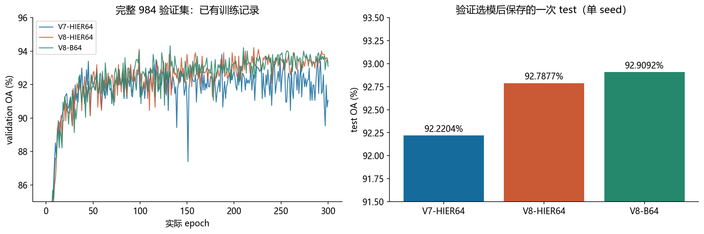

图1：保存的完整验证曲线与最终一次test。审查没有重跑test；不同版本曲线不构成单因素因果实验。

V8相对V7的OA上升同时混合了c=1→0.1、官方cap/hook、intra margin和HIER权重变化，不能全部归于inter目标。B64是当前最直接的目标开关对照：初始化、划分、seed、global64和300×200步一致。两机硬件/运行位置仍不同，且只有一个seed；0.1216个百分点差异不支持显著胜负判断。

## 4. 半径演化：V8没有复制出原版whole薄壳

$$
d_0(x)=\frac{2}{\sqrt c}\operatorname{artanh}(\sqrt c\|x\|),\quad q=\sqrt c\|x\|,\quad \rho=d_0/2.\qquad \|v\|\le2.3\Longrightarrow d_0\lesssim4.6.
$$

切空间参数范数、球坐标半径、原点双曲距离是三个量。V8 c≈0.1时，cap后的坐标半径约1.965、归一化半径q≈0.621、双曲深度4.6；不是到了数值球边界q=0.999。原版1e−5等数值细节会带来微小偏差。forward cap只截断参与映射的向量；它不会把优化器保存的原参数模长投回2.3。

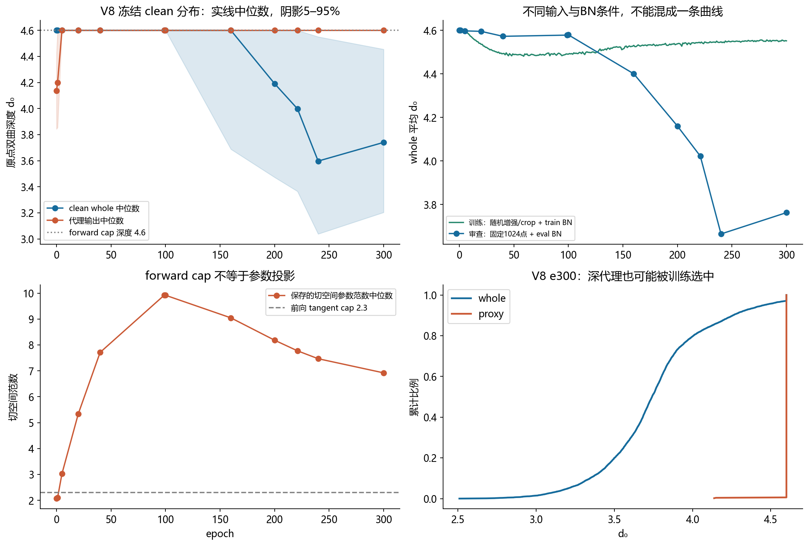

图2：V8从初始化到e300的clean径向分布、训练/clean条件差异和参数范数。阴影是5–95%分位；稀疏快照之间的连线仅供观察。

V8初始化whole已几乎在4.6薄壳；e5仍接近薄壳，随后clean whole向内且分散，e221中位数3.999、e300为3.741。代理反而很快顶到4.6，末期保存参数范数中位数6.923。两者都受同一个cap约束，仍能学出不同实际分布：cap是上限，既不是目标半径，也不是whole和代理的相对深度保证。

图3：原版三个best分别显示；V7/V8各自best与固定e300分别比较。原版whole标准差仅约3–6×10⁻⁷；V8末期whole标准差约0.350。

| 模型 | 对象 | min | p05 | median | p95 | max | 总体std |
| --- | --- | --- | --- | --- | --- | --- | --- |
| 原版 CUB best | whole | 4.600 | 4.600 | 4.600 | 4.600 | 4.600 | 5.3e-07 |
| 原版 CUB best | proxy | 3.932 | 4.160 | 4.247 | 4.508 | 4.600 | 0.103 |
| 原版 Cars best | whole | 4.600 | 4.600 | 4.600 | 4.600 | 4.600 | 5.59e-07 |
| 原版 Cars best | proxy | 3.364 | 3.988 | 4.093 | 4.363 | 4.600 | 0.129 |
| 原版 SOP best | whole | 4.600 | 4.600 | 4.600 | 4.600 | 4.600 | 3.02e-07 |
| 原版 SOP best | proxy | 4.110 | 4.600 | 4.600 | 4.600 | 4.600 | 0.0501 |
| V7 best e187 | whole | 2.579 | 4.176 | 5.389 | 6.200 | 6.213 | 0.56 |
| V7 best e187 | proxy | 1.995 | 2.101 | 2.485 | 6.000 | 6.000 | 1.84 |
| V7 last e300 | whole | 1.686 | 2.510 | 4.808 | 5.442 | 5.885 | 0.906 |
| V7 last e300 | proxy | 2.107 | 2.211 | 2.481 | 5.982 | 6.000 | 1.71 |
| V8 best e221 | whole | 2.515 | 3.366 | 3.999 | 4.600 | 4.600 | 0.406 |
| V8 best e221 | proxy | 4.152 | 4.600 | 4.600 | 4.600 | 4.600 | 0.0273 |
| V8 last e300 | whole | 2.509 | 3.204 | 3.741 | 4.455 | 4.600 | 0.35 |
| V8 last e300 | proxy | 4.138 | 4.600 | 4.600 | 4.600 | 4.600 | 0.0285 |

[完整径向统计CSV：含均值、方差与四分位数](tables/radial_statistics.csv)

## 5. 激活、休眠与pair/triple：V7的问题确实缓解了

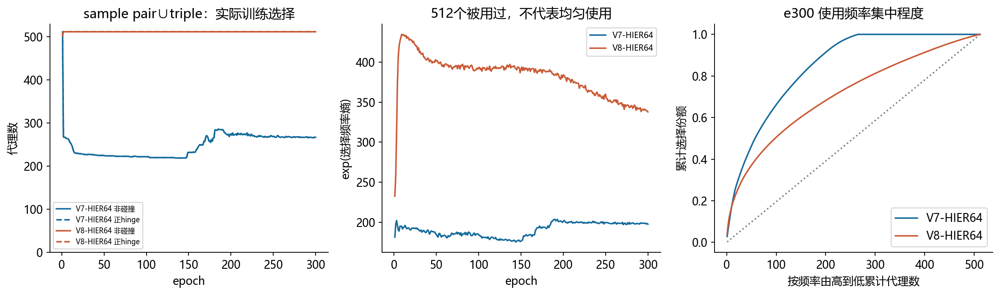

图4：来自300轮真实训练日志的非碰撞与正hinge祖先使用；有效代理数与累计选择频率用于识别“全用过但仍不均匀”。

固定e300：V7 sample非碰撞祖先并集为267个，V8为512个；V8正hinge祖先并集为512个。V8非碰撞频率熵对应有效代理数为337.7，仍低于512。不存在“512个都出现过，所以训练均匀”的推论。

图4补充：每个稳定代理行的300轮真实使用轨迹。每列对应一个训练epoch，不从快照插值激活。

两个版本在已记录300轮中都没有从未被sample非碰撞选过的代理；V7末期245个当轮未用，属于后期休眠，不能描述为整个训练始终未受训练。V8有506个代理每个epoch都被使用，末期未用数为0。

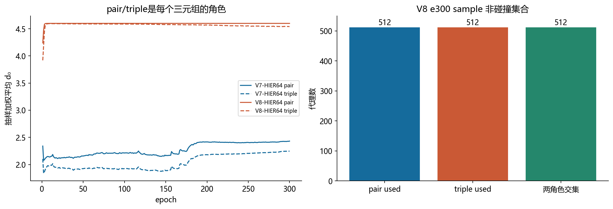

图5：sample pair与triple抽样加权深度，以及V8两角色集合交集。此处是训练日志，不是全量NN4。

V8 e300 sample非碰撞pair/triple深度均值4.5991/4.5398，差约0.0593；两角色都覆盖512代理，交集也是512。不能将它们解释成互不重叠的两层代理。CUB/Cars原版同样角色高度重叠，SOP几乎同深。V7曾出现的浅层sample-used与深层未用分裂，没有以同样形式出现在V8末期；V8更主要的径向问题变成绝大多数代理挤在输出cap薄壳。

## 6. 热点：改善明显，径向偏置与方向冗余仍同时存在

| 模型 | raw覆盖 | 等whole深度覆盖 | 最大重复四例 | 最热4例槽份额 |
| --- | --- | --- | --- | --- |
| 原版 CUB best | 1646 | 1646 | 1 | 0.93% |
| 原版 Cars best | 1664 | 1664 | 1 | 0.93% |
| 原版 SOP best | 432 | 432 | 12 | 35.25% |
| V7 last e300 | 27 | 221 | 287 | 80.47% |
| V8 last e300 | 231 | 1051 | 34 | 24.85% |

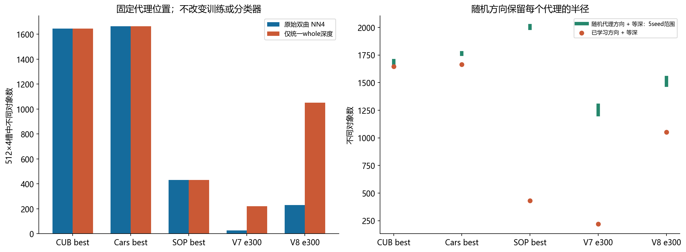

图6：等深控制仅改whole半径、保留全部方向与代理；随机方向控制则改变代理方向并保留各自半径。二者不能混称。

原版CUB/Cars whole本来几乎等深，因此统一深度后覆盖基本不变；CUB严格稳定距离为1646，旧官方FP32为1647，差1来自极近邻排序。原版SOP仍是432，说明等深也可能存在方向热点。V7为27→221，V8为231→1051；因此V8当前几何中的径向差异确实显著改变反向近邻排序。这个冻结控制没有证明训练中全部热点由半径单独造成。

V8 e300随机代理方向保留半径，raw覆盖只有53–62，低于已训练方向231；配合等whole深度才得到1476–1545，高于已训练方向1051。这同时表明：学习到的方向已部分抵消径向偏置，但仍有相对于随机基准的覆盖冗余。不能因此直接重置代理方向，随机方向扩大覆盖不等于改善分类或形态关系。

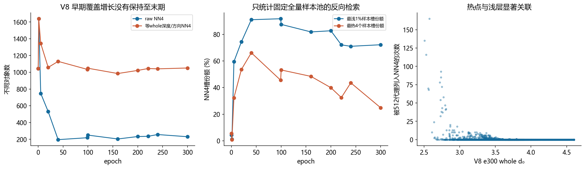

图7：V8覆盖随训练收缩；e300最浅1%对象占72.17%反向NN4槽，最热4例占24.85%。

e5 raw覆盖748，best e221为236，e300为231；等深覆盖分别1345、1045、1051。热点并不是只有末期某几个深代理才造成；早期已有径向敏感性，训练继续后方向与半径两方面的集中共同影响覆盖。最大重复四例由V7 e300的287组降到V8的34组，但仍应保留热点警报。

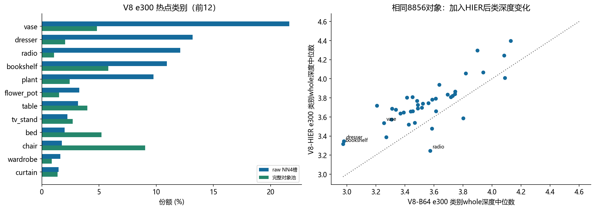

图8：热点槽类别份额与样本池份额，以及V8-HIER/B64相同对象池的类别深度中位数。类别偏置不等于语义上更高层。

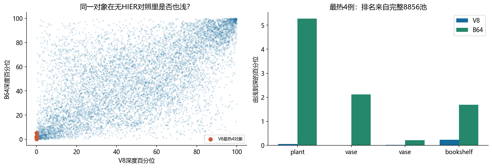

图9：使用同一对象ID配对V8与B64，比较最热样本在无HIER对照中的深度百分位。B64也是V8几何，并非最初c=1的HyCoRe。

| 热度排名 | 类别 | 槽数 | V8 d₀ | V8深度百分位 | B64深度百分位 |
| --- | --- | --- | --- | --- | --- |
| 1 | plant | 165 | 2.575 | 0.06% | 5.27% |
| 2 | vase | 135 | 2.509 | 0.01% | 2.12% |
| 3 | vase | 116 | 2.529 | 0.02% | 0.21% |
| 4 | bookshelf | 93 | 2.738 | 0.24% | 1.69% |

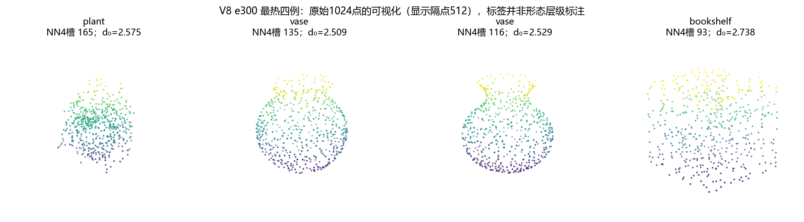

图10：最热四个对象的点云。用于辨识对象形态，不从四个例子推导全类别机制。

最热四例为plant、两个vase和bookshelf，分别是全池由浅到深第5、1、2、21个对象；并不是恰好最浅的前四个。在B64里这四例深度百分位约5.27%、2.12%、0.21%、1.69%，本来偏浅，但V8中更加极端；不能把全部差异都说成HIER凭空制造，也不能把B64等同最初c=1的原始HyCoRe。

## 7. 类别方向：whole分开了，代理有亲和但仍处于类别方向外围

$$
u=x/\|x\|,\quad m_k=\frac1{N_k}\sum_{i:y_i=k}u_i,\quad \hat m_k=m_k/\|m_k\|,\quad \theta_{pk}=\arccos(u_p^\top\hat m_k),\quad R=\|P^{-1}\sum_p u_p\|.
$$

留一类别中心准确率是训练集方向结构诊断，中心排除查询对象；它不是独立测试准确率。最近类别是与40个类别方向中心夹角最小者，任何代理都会得到一个相对最近标签，不代表位于该类簇内。R是平均单位方向的模长，不是某一对代理的余弦。

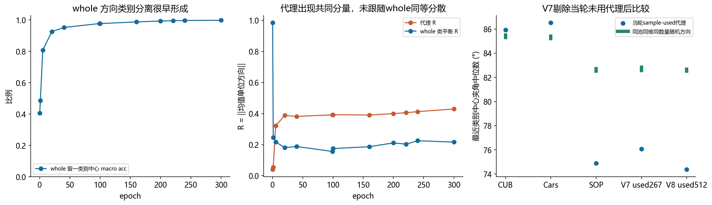

图11：whole方向类别分离、代理共同方向与各数据集匹配的随机方向角度基准。原版512维、类别数不同，所以不能单看角度大小排名。

V7角度面板已按当轮sample-used筛为267个，并重新生成同数量随机方向基准；中位数为76.08°。V8此时512个均sample-used。原版三个best的现有真实图像无更新窗口中sample有效祖先也均为512个。全代理方向集中度与使用组亲和是分别定义的指标，不将V7深层未用群的角度混入使用组结论。

V8 whole留一方向macro准确率由初始化约0.405升到e5的0.807、e20的0.926、e100的0.977及e300的0.998；类别方向分离确实发生。代理R则由0.041升到e300的0.430，出现共同方向分量，尚不及原版SOP的0.648，但远高于CUB/Cars的0.044/0.047。

V8 e300所有代理都是当轮sample-used，其最近类别中心夹角中位数74.39°，相同全池/256维随机方向参考约82.7°，所以不能说代理完全没学到类别亲和。然而512代理都不落入最近类别包含90%样本的方向锥；它们更像位于类别簇外围的关系节点。CUB/Cars原版也无代理进入该方向锥，不能把“必须进入细类簇”当作HIER的既定设计目标。方向锥也不等于双曲凸包。

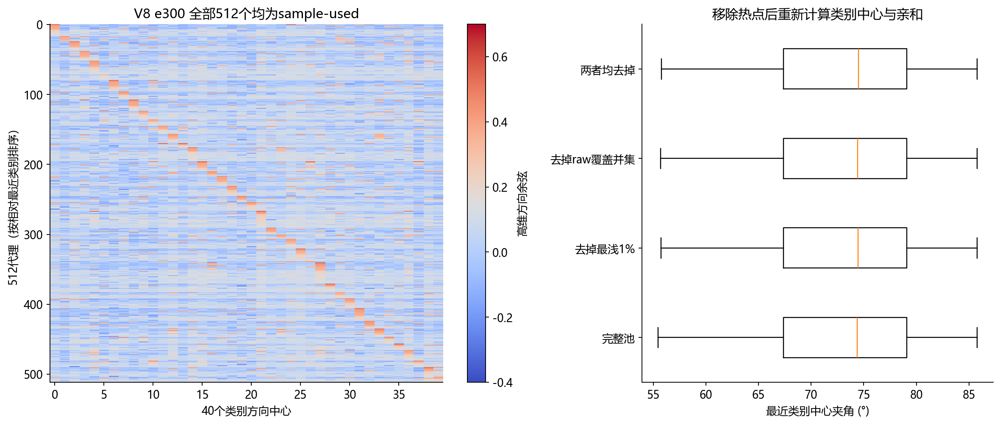

图12：仅使用实际sample-used代理（V8此时为全部512）分析高维类别余弦，并剔除热点/最浅对象后重新计算类别中心。绝非二维投影的簇归属推断。

去除最浅1%、raw NN4覆盖并集和二者并集的亲和对照用于检查热点污染；完整数值随表保存。类别标签仍是单层人工标签，较高top-k同类纯度或最近类别稳定本身不能验证“发现了真实形态层级”。

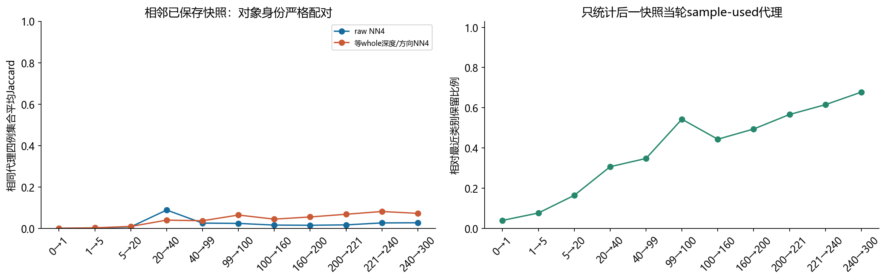

图12补充：相同代理的最近四例与相对最近类别随时间的保留率。快照间隔不等，不能当作单位epoch变化率；相对最近类别稳定也不是簇内归属。

e240→e300：相对最近类别在当轮sample-used代理中的保留率为67.8%；raw NN4平均Jaccard为0.027，方向NN4为0.072。代理类别方向偏好与精确最近样本的稳定性是两个层面。高维方向亲和确有演化，但与whole形成一致类内软结构仍需独立形态证据。

## 8. 独立形态检查：尚无一致的结构收益

采用同一320训练查询对象（40类各8例）、完整8856候选池和FPS64点云Chamfer信号，分别检查原坐标与中心化/单位RMS。这里展示去整体尺度影响后的结果；类内Spearman来自每类其余7查询，近邻重叠已扣除4/7的随机期望。全池富集还使用完整候选池。误差条为固定图上200次类别bootstrap，不代表多seed训练置信区间。

图13：三个互补形态指标。选择best与固定e300分别展示，避免用一个更好的数值概括全部结构。

e300 V8/B64：类内Spearman为0.1269/0.1291，扣随机近邻重叠为0.0849/0.0576，全池富集为0.2558/0.2122。best时V8/B64相应为0.1496/0.1599、0.1195/0.0977、0.2987/0.3164。存在指标与选模轮次依赖，不能认定HIER带来一致形态改进；V8类内Spearman也低于V7 best的0.2135。Chamfer是独立几何信号，但仍不是人工层级真值。

| V8/B64轮次 | 形态指标 | 配对差值 V8−B64 | 按类别配对bootstrap 95%区间 |
| --- | --- | --- | --- |
| 221/132 | within_class_spearman | -0.0104 | [-0.1017, 0.0791] |
| 221/132 | chance_adjusted_overlap | 0.0219 | [-0.0711, 0.1130] |
| 221/132 | chamfer_enrichment | -0.0177 | [-0.0465, 0.0159] |
| 300/300 | within_class_spearman | -0.0022 | [-0.0788, 0.0710] |
| 300/300 | chance_adjusted_overlap | 0.0273 | [-0.0437, 0.1003] |
| 300/300 | chamfer_enrichment | 0.0436 | [0.0166, 0.0695] |

差值额外按同一查询对象配对后，在40个类别均值上做2000次bootstrap；比只看两组误差条是否重叠更合适。该区间仍只描述当前两个固定模型和这一形态指标，不包含重训随机性或best轮次选择不确定性。

其中固定e300的全池Chamfer富集差值+0.0436，配对区间约[+0.0166,+0.0695]不含0，是当前固定模型上的局部正面证据；但best对比的该指标变为负差，另外两项区间含0，因此仍不能扩展为普遍结构收益。

## 9. 损失与梯度：没有被hook完全压没，也不等同于优化器实际位移

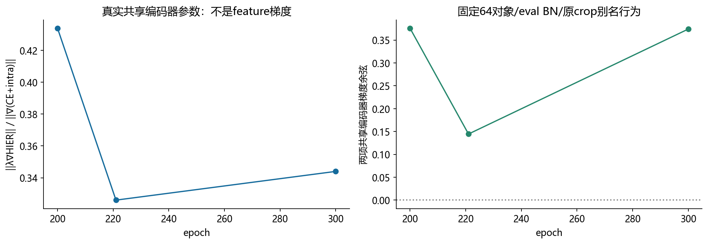

图14：通过两遍feature-adjoint/VJP回传获得13227200个共享编码器参数的真实偏导；重放特征最大差0，RNG/BN/参数保持，零optimizer更新。

| 轮次 | 加权HIER/base梯度范数比 | 梯度余弦 | 参数更新 |
| --- | --- | --- | --- |
| 200 | 0.4338 | 0.3757 | 0 |
| 221 | 0.3260 | 0.1445 | 0 |
| 300 | 0.3440 | 0.3741 | 0 |

e221/e300 HIER/base编码器梯度比约0.326/0.344，余弦约0.145/0.374。HIER确实能影响编码器，不能把无分类收益简单归因于hook把信号全部抹掉。proxy–proxy项对编码器梯度为0，是因为它只依赖代理参数，不是故障。此为固定64对象、固定crop/eval BN、保留原HyCoRe child别名覆盖行为的条件探针，不能替代train BN全轨迹或实际Adam/RSGD更新分析。源manifest没有独立train-label SHA字段，探针另记录真实载入标签与输入哈希；重放一致性与不变性已验收。

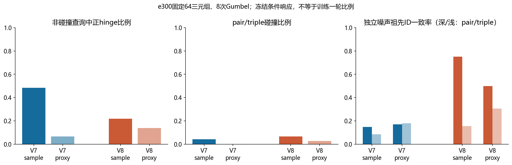

图15：相同查询与不同Gumbel噪声的冻结损失响应；与图4真实整轮训练激活统计分开。

V8 e300固定sample查询的pair ID独立噪声一致率约0.752，triple约0.156：共同祖先选择仍有很强随机性。sample非碰撞正hinge比例约0.220，proxy约0.139；这既不等于512代理都没约束，也不能把选择ID变动全部解释为结构不稳定。代理切空间梯度在两个分项均可非零；多数越cap代理的径向可优化性被压制，角向信号仍存在。少数未cap代理可主导整体径向梯度范数，不能用整体范数代表510个cap代理各自情况。

图15补充：按原参数是否超过2.3，拆分两个分项的梯度。正径向导数对应朴素负梯度下降的向内趋势；不能直接等同AdamW实际位移。

## 10. 与原版HIER的联系，以及下一步可检验的假设

CUB/Cars：whole几乎严格同深，代理稍浅且方向分散；SOP：whole同样同深，但大多数代理cap且方向共同分量强，仍存在热点；V7：whole分散并伴深层未使用代理群；V8：whole后期分散、几乎所有代理cap，但全部仍被sample使用。四种状态说明热点、代理休眠、cap饱和和角色层次是相关但不等价的维度。

| 假设 | 当前支持 | 尚不能证明 | 优先验证办法 |
| --- | --- | --- | --- |
| whole深度离散影响反向检索 | V8仅等whole深度231→1051 | 不能推出统一半径训练会提高分类 | 保持候选与查询不变，先比较角向/径向敏感性及类内形态 |
| 代理共同方向造成覆盖冗余 | V8 R=.430；等深学习方向覆盖低于随机 | 随机方向覆盖高不是结构收益 | 保留代理Gram的整体旋转、去均值控制，并同时评价形态/纯度 |
| forward cap改变径向学习 | 510/512越cap，代理输出几乎同深 | 不能说角向停止训练或只有proxy项激活 | 按cap组拆sample/proxy的径向和角向梯度、频率与Adam状态 |
| 当前HIER关系不够贴合分类/形态 | 同协议无OA增益，形态指标不一致 | 不足以否定所有inter目标 | 固定V8主协议，先定位采样关系与独立形态一致性，再设计单因素试验 |

本次不启动新训练矩阵，也不基于test挑方案。建议优先做冻结机制控制，只有当覆盖改善同时保留或提高独立形态指标时，再提出新的训练计划。若补训练，应一次只改一个关键机制，并保留V8-B64的同协议对照。

## 11. 可复现入口、文件与检查记录

审查代码已为V8显式适配最终共享表示cap/hook、官方mobius+eps距离、c≈0.1及gamma500/delta2；遗留c=1路径保持独立。原始训练commit：V8主模型14f8a72，B64为85fc812；审查实现ad53d36/7ebc081。154项现有及V8合同测试通过。官方CPU FP32 NN4与独立稳定距离在e5/e221/e300覆盖分别同为748/236/231，降低算子误用造成结论的风险；并不保证每个极近邻排序逐位等同CUDA AMP。

全系统包含：逐轮性能/损失/LR/裁剪、几何分布、真实选择与生命周期、全池近邻与热点、角色与碰撞、Gumbel重复、分项梯度、Adam状态、独立形态及真实编码器梯度。主/对照共24个新全量训练集特征快照；结合V7为35个系统快照；8个固定机制快照、12个独立形态快照、3个编码器探针。全量缓存/点云/权重/日志/身份表留私有，不进入公开报告或Git。

[几何与冻结控制总表](tables/geometry_and_controls.csv)

[V8快照时间演变](tables/evolution_snapshots.csv)

[真实训练祖先使用汇总](tables/training_usage_aggregate.csv)

[类别深度与热点份额](tables/class_depth_and_hotspots.csv)

[独立形态与bootstrap区间](tables/independent_shape.csv)

[同对象配对形态差值](tables/paired_shape_differences.csv)

[编码器梯度结果](tables/encoder_gradients.csv)

[冻结Gumbel机制汇总](tables/frozen_mechanisms.csv)

[最热四例匿名统计](tables/hottest_four_aggregate.csv)

[样本绑定与最近类别稳定性](tables/temporal_binding.csv)

[cap组分项梯度](tables/cap_group_gradients.csv)

[代理生命周期汇总](tables/proxy_lifetimes_aggregate.csv)

[代理类别方向亲和与热点剔除对照](tables/proxy_class_affinity.csv)
