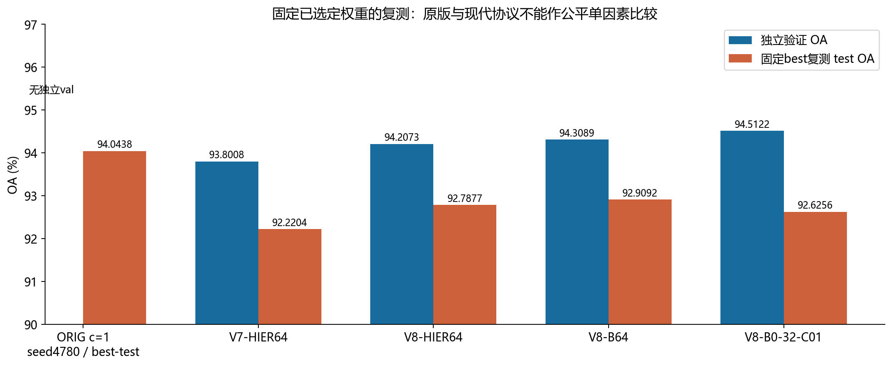
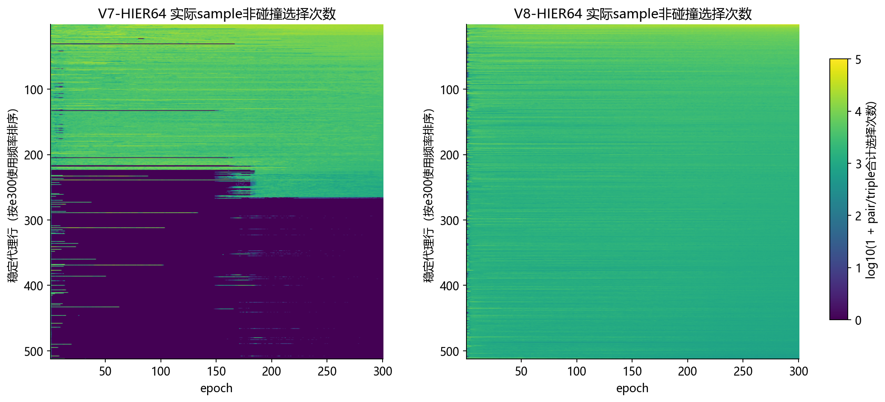
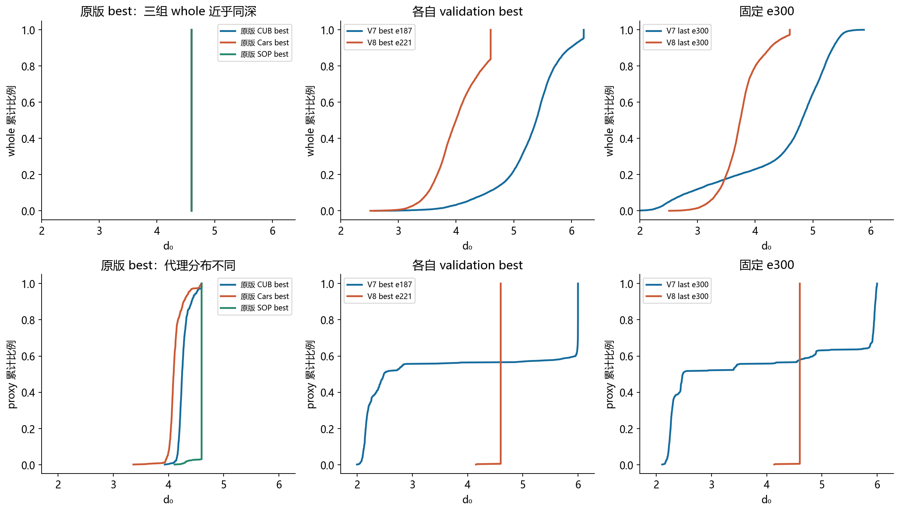
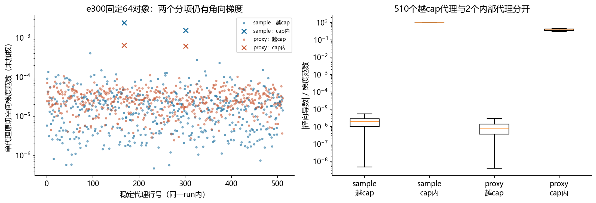
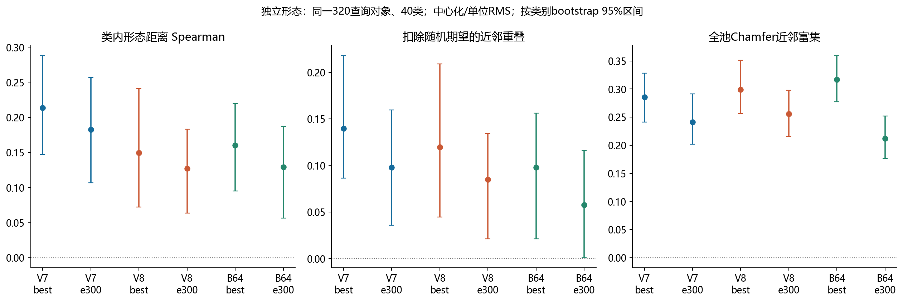

# V7—V8实验结果与训练/验证/测试协议核查

日期：2026-10-17。先列正式结果，再解释划分与shuffle还原程度，最后介绍从V7问题得到V8方案的过程及实际嵌入改善。本次已在两台服务器对预先固定的五份best权重重新前向评估，五组成绩均与已有记录一致；没有训练更新、重新选模或投票。

## 1. 先区分三个容易混淆的权重

| 身份 | 实际best轮次 | 说明 |
| --- | --- | --- |
| 原始HyCoRe，ORIG-B0-32-S4780 | epoch元数据229 | 原日志0起编号；c=1；按test选best；并非e221 |
| V8-HIER64-K20-W0 | e221 | c≈.1；有HIER；按984独立验证选best |
| V8-B0-32-C01 | e249 | c≈.1；无HIER；shuffle32；按984独立验证选best |

“原版应该是221轮”经权重文件核对需要更正：e221属于V8主训练。原始seed4780检查点实际记录epoch=229；保留原0起编号，不和现代1起completed-epoch标签混写。复测按实际checkpoint的net读取，不将last的best_net或代理状态拼接成另一个模型。

## 2. V7和V8主训练、对照的正式成绩

四组均训练300轮。表中val和test来自同一份已选中的best；测试池均2468例，验证池均984例。OA为总体正确率，AA为40类别正确率均值。每个版本只有一个seed，不将细小差异解释为显著胜负。

| 实验 | best epoch | val OA % | val AA % | test OA % | test AA % | test正确/2468 |
| --- | --- | --- | --- | --- | --- | --- |
| V7-HIER64-K20-W0 | 187 | 93.8008 | 90.7654 | 92.2204 | 89.7204 | 2276 |
| V8-HIER64-K20-W0 | 221 | 94.2073 | 91.5457 | 92.7877 | 90.0372 | 2290 |
| V8-B64 | 132 | 94.3089 | 91.5306 | 92.9092 | 90.3157 | 2293 |
| V8-B0-32-C01 | 249 | 94.5122 | 91.8165 | 92.6256 | 89.8128 | 2286 |

图1：本轮固定best复测结果。原版没有独立验证柱；其较高test不自动说明更好的同协议泛化。

V7→V8主模型：val OA提高0.4065个百分点，test OA提高0.5673个百分点，即多对14例。V8-HIER比shuffle对照多对4例，但比同batch/同采样的B64少对3例。最直接的HIER开关对照仍不支持明确分类收益。

V8-B0-32-C01验证OA最高，却没有最高test：这不构成计算矛盾。984个验证对象和2468个测试对象不同；用验证集挑中的单轮最优，也不保证在test同样最优。不能看完test再换选另一个checkpoint。

| 原版或文献参照 | 独立val OA/AA | test OA % | test AA % | 选模/评估边界 |
| --- | --- | --- | --- | --- |
| 本地原始HyCoRe seed4780，e229 | 无 | 94.0438 | 91.5448 | 本轮复测；历史best-test，无voting |
| HyCoRe论文 PointMLP，无voting | 未在表1报告 | 94.3 | 91.7 | 论文表1，不是本地这份权重 |
| HyCoRe论文 PointMLP，有voting | 未在表1报告 | 94.5 | 91.9 | 含voting，不与本轮单次前向混合 |

V7正式只跑了一条完整主训练，没有另训V7-B64或V7-B0。此前V7审查参考的无HIER类别均衡模型实际上是V6-B64，不应改名成V7对照。其e231为val OA94.3089%、AA91.8307%，选中模型test OA91.8558%、AA89.9994%；它继承V6的20轮共同前缀，不能充当V7严格同协议开关消融。本次读其已验收结果，没有重新测试该历史权重。

## 3. 原始HyCoRe与V7/V8的数据划分到底差在哪里

| 协议 | 用于梯度更新的train | 独立validation | 官方test | 用于选best |
| --- | --- | --- | --- | --- |
| 本地原始HyCoRe | 官方HDF5 train全部9840 | 无 | 2468；每轮前向 | test OA |
| V7-HIER64 | 8856，来自官方train | 984，来自官方train | 原官方2468；训练结束评估一次 | val OA；同分取较低CE |
| V8主训练/B64/B0-32 | 同一8856 | 同一984 | 与V7相同官方2468 | 同上 |

V7与V8不是把官方test再切一部分作val。它们在原9840个训练对象内部按类别分层留出10%；官方test始终保持原来的2468。算法使用NumPy default_rng(seed+1701)，seed22即1723：每类随机排列，取max(1, round(该类数量×0.1))作验证，其余作训练，最后两组ID各自排序。得到8856/984。

已核对四组源manifest及可用checkpoint中的train_ids/validation_ids；split SHA均为3bbf0c79b3cb9581caeafe3f7f12caa6861f236f0159512a5998d5e9bcf25105。两机复测的test输入、test标签、现代984子集输入SHA也完全一致。因此V7/V8的结果差异不能归为换了一批验证或测试对象。这里9840/2468以本项目实际读取的HDF5数据为准，不拿其他预处理版本的总数替代。

原始模型在现代984子集上的复测OA为98.9837%、AA为98.7055%。这些对象曾在原始9840训练中使用，因此只能叫“训练内984子集诊断”，不能称其val准确率，也不能用它说明原模型验证泛化更强。

[40类原始train、现代train/val和官方test数量](tables/split_class_counts.csv)

## 4. V8-B0-32-C01的shuffle是否忠实复刻原版

它忠实保留了采样和训练算子的若干关键语义，但没有完整复刻原版的训练数据量、几何参数或评估选模协议。这符合当时51号计划中已经确定的V8对照口径，不应将它称作未改动的原版复现。

| 项目 | 原始HyCoRe | V8-B0-32-C01 | 判断 |
| --- | --- | --- | --- |
| 采样 | batch32，shuffle，无放回，drop_last | 同样32/无放回/丢尾，显式epoch种子 | 采样类型保留，不是逐batch随机流复刻 |
| 训练池/每轮步数 | 9840；307步，9824槽，丢16 | 8856；276步，8832槽，丢24 | 训练量和更新预算不同 |
| 300轮名义更新数 | 92100 | 82800 | 相差9300步；不据此推断历史断点重跑次数 |
| 训练输入 | 随机scale/shift、点顺序；whole800–1024、part200–600 | 同类增强与点数范围，保留part覆盖whole行为 | 关键输入算子保留 |
| 负part | batch内flip，可能同类 | 仍允许同类，记录碰撞 | 保留原语义 |
| 曲率/最终表示cap/hook | c=1；无V8额外cap/hook | c≈.1；cap2.3；一次逆度量hook | 有意采用V8几何 |
| intra margin | 1000/N和4 | 500/N和2 | 有意适配有限深度预算 |
| 训练中每轮评估 | 官方test，含前向和CE/准确率 | 独立val，含前向和CE/准确率 | 评估对象与选模依据不同 |
| 训练结束的test | 历史best已按test挑选 | 恢复val-best，再对2468作前向 | test确实参与最终推理，未进入训练梯度 |

准确回答“test有没有参与前向传播”：两种协议都会。原版每个epoch都会对test前向；V7及三组V8在300轮训练循环内只用train反向、val评估选模，结束后才加载官方test并对已选best作一次前向。原版和现代评估都使用eval模式和no_grad，不以测试loss反向更新权重；区别是原版让测试准确率参与选择哪个模型被保留。

本轮2026-10-17应用户要求，对五份预先固定权重又各作了一次val/子集诊断和test前向；这是训练结束后的复核，不应继续声称这些权重在整个历史中“只接触过一次test”。本轮没有根据分数重选epoch、调整参数或续训。

无voting测试的输入语义相同：首1024点、无训练增强、无part、eval BN。原版按batch16，现代组按batch32；这次复测使用各自原来的batch条件，所有已有OA/AA均复现。原版每轮test-selected还意味着其test不再是完全独立的最终留出评估；因此原版94.0438%与现代92.x%同时混合了训练量、选模、seed和几何差异，不能直接归因于c变化或HIER。

## 5. 从V7的表现到V8的idea：动机、改动和预期

V7解决的是更早版本保存的代理参数冲出数值映射有效区的问题：初始化放到训练whole内侧，并在AdamW更新后限制参数范数≤3，避免映射到q=.999边缘。但完整训练后仍发现两群代理、末期245个未被sample选用、全池NN4只覆盖27个对象。统一whole深度后覆盖221，进一步改变代理方向才大幅上升，提示径向竞争和方向冗余同时存在。

据此，V8把研究方向改成“让HyCoRe适配官方HIER的几何配置”。这里要精确措辞：V7模型、intra和HIER当时都在c=1，并不是已经查出一个算子误用c=.1；不一致主要是相对官方HIER的c=.1/cap/hook配置。V8是几何方案的整体迁移，不能把既有问题预先全部归因为曲率错误。

| 改动 | V7 | V8 | 当时的意图 |
| --- | --- | --- | --- |
| 共同曲率 | 1 | 0.1 | 恢复官方HIER几何环境，减少迁移改造 |
| whole/part与proxy前向cap | 无官方额外tangent cap | 最终共享表示与代理cap2.3 | 统一有效深度预算，离开数值边界 |
| 梯度放缩 | 不加官方hook | 最终共享mu/nu各自一次逆度量hook | 恢复官方球内梯度处理 |
| HIER距离算子 | 稳定精确c=1距离 | 官方Möbius分母epsilon1e−5及artanh截断 | 统一到官方数值实现，不能与曲率改动拆开归因 |
| 代理参数约束 | AdamW后投影原参数到范数≤3 | 取消post-step参数投影；保留前向cap | 遵循官方forward规则；二者不是同一种cap |
| 代理初始化 | 校准后统一深度2.240048 | 官方随机高斯；典型初始深度约4.14 | 0.9仅是初始化尺度，不保证后续一直在whole内侧 |
| HyCoRe层次/对比margin | 1000/N；4 | 500/N；2 | 使两个intra目标适配深度4.6预算 |
| HIER权重 | 0.1 | 0.5 | 伴随新几何/hook的既定方案，不等于梯度必增5倍 |

保持的关键条件包括：seed22、相同8856/984划分、D256/P512、K20/T50、HIER margin/tau .1、从第一步启用、global64/local32类别均衡、300×200步，以及模型RSGD和代理AdamW各自的余弦调度。两项intra系数仍各.01。V8的B64仅关闭HIER；B0另改成shuffle32，每轮276步。因此V8主/B64最接近目标开关对照，而主/B0同时改变采样、batch和更新次数。

$$
d_0(x)=\frac{2}{\sqrt c}\operatorname{artanh}(\sqrt c\|x\|),\quad t_{cap}=2.3\Rightarrow d_{0,cap}\approx4.6.\qquad R_{hier}:1000/N\to500/N,\quad\delta:4\to2.
$$

margin减半来自两个软目标在有限深度预算下的兼容性分析，不是把c从1改为.1的单位换算，也不是已验证的最优系数。原始N=200时1000/N=5已大于4.6；若还维持对比margin4，会增加小part的目标张力，所以同时审查两项margin。49号文档保留了完整推导。

## 6. 相对改进：代理被重新使用，whole热点有所分散

图2：每个稳定代理行的300轮实际训练sample非碰撞使用轨迹，V8末期不再有V7的大块未用群。

| 固定e300指标 | V7 | V8 | 可以支持的判断 |
| --- | --- | --- | --- |
| sample非碰撞祖先并集 | 267/512 | 512/512 | 当轮未用问题显著改善 |
| 每个epoch都被用过的代理 | 215 | 506 | 持续参与程度提高 |
| 全程从未被用过 | 0 | 0 | V7是后期休眠，不是始终没训练 |
| raw NN4不同样本 | 27 | 231 | 反向检索覆盖增加，仍只占2048槽的小部分 |
| 最大重复四例代理数 | 287 | 34 | 重复四例明显减轻 |
| 最热四对象占槽 | 80.47% | 24.85% | 热点集中度下降 |
| 最浅1%whole占槽 | 95.02% | 72.17% | 径向偏置缓解但依然明显 |
| 仅等whole深度NN4覆盖 | 221 | 1051 | 方向去径向控制仍有改善 |
| 全部代理方向集中度R | 0.5428 | 0.4296 | 共同方向分量减小但没有消失 |

图3：固定代理与方向，仅统一whole深度；以及保留代理半径的随机方向控制。它们是冻结检索反事实，不是重训收益。

这里的“代理使用”来自训练hard Gumbel日志；NN4则是每个代理向全8856对象池查四个近邻，方向相反，不是训练覆盖。不能把NN4增加到231表述成只训练了231个样本，也不能把512代理被选中过表述为均匀使用或有512个不同层级。V8末期非碰撞频率熵对应有效代理数约337.7，仍存在频率集中。

best权重也呈相似改善：V7 e187 raw覆盖34、等深472、最大重复四例191；V8 e221为236、1045、29。说明e300比较不是仅由两组best发生在不同epoch造成的表观差异；但跨版本多项改动仍不能分配单因素功劳。

图4：分别比较原版HIER三个best、V7/V8各自best与固定e300。whole与proxy分布独立展示，横轴为各自模型的原点双曲深度。

| 模型/阶段 | 对象 | 深度min | 中位数 | max | std |
| --- | --- | --- | --- | --- | --- |
| V7 best e187 | whole | 2.5789 | 5.3892 | 6.2126 | 0.5604 |
| V7 best e187 | proxy | 1.9952 | 2.4848 | 6.0000 | 1.8354 |
| V7 last e300 | whole | 1.6863 | 4.8080 | 5.8852 | 0.9056 |
| V7 last e300 | proxy | 2.1069 | 2.4810 | 6.0000 | 1.7076 |
| V8 best e221 | whole | 2.5150 | 3.9990 | 4.6000 | 0.4057 |
| V8 best e221 | proxy | 4.1518 | 4.6000 | 4.6000 | 0.0273 |
| V8 last e300 | whole | 2.5093 | 3.7408 | 4.6000 | 0.3503 |
| V8 last e300 | proxy | 4.1379 | 4.6000 | 4.6000 | 0.0285 |

V8 e300 clean whole中位数由V7的4.808变为3.741，std由.906变为.350；但两版曲率和cap不同，数值缩小本身不能当成层级质量提升。更有意义的证据是同池近邻热点减轻、训练使用恢复，再结合独立形态检查。

## 7. 尚未解决：代理cap薄壳、类别外围与残余热点

V8把V7的“浅层使用群 + 深层未用群”改成了“几乎全部代理在forward cap附近且仍被使用”。e300有510/512原参数范数超过2.3，球内代理深度几乎均为4.6，raw保存参数范数中位数6.923。前向截断不等于更新后参数投影，不能说参数只到2.3，也不能说深度到了数学球边界。

图5：V8 e300按510个越cap与2个内部代理分组，sample/proxy分项均存在梯度；越cap组主要是角向信号。

越cap组sample/proxy径向占比中位数约1.90e−6/7.93e−7，但梯度范数>1e−12的代理两项均为510。径向可优化性受压制，不等于完全没训练。V8真实编码器加权HIER/base梯度比在e221/e300约.326/.344，也不支持hook把全部HIER信号压没的解释。

图6：whole早期方向分类分离；代理有共同方向。V7亲和对比仅算当轮sample-used的267个，V8为512个。

V8已使用代理到最近类别中心的夹角中位数74.39°，V7使用组为76.08°；各自同维随机参考约82.7°，有方向亲和。移除热点后V8仍约74.43–74.48°，因此不是热点四例单独制造的结果。但两版使用组均没有代理进入最近类包含90%样本的方向锥，仍不能说形成了明确类内节点。原版CUB/Cars也无代理进入该锥，这不是HIER强制设计的条件；它们更分散、代理更浅，而原版SOP本身也存在方向热点。

图7：pair与triple是每个三元组的条件角色，不是给代理预先分配的两层身份。

V8 e300 sample非碰撞pair/triple抽样加权深度4.5991/4.5398，有弱的平均偏移；两角色集合都是512且交集512。不能把深度差约.059解释为固定两层已形成。whole等深后覆盖1051仍低于随机方向等深1476–1545，说明方向冗余未解决；原始raw随机方向仅53–62，也说明学习到的方向已部分抵消径向偏置，不宜直接随机重置代理。

## 8. 改进是否转化成我们想要的形态结构

图8：独立形态指标，固定320个查询、40类、完整8856候选池；中心化/单位RMS点云Chamfer；误差条是类别bootstrap。

固定e300，V8比B64的全池Chamfer富集高.0436，按同对象配对后类别bootstrap 95%区间[+.0166,+.0695]，是局部正面证据。但类内Spearman为.1269/.1291，扣随机近邻重叠为.0849/.0576，对应差值区间都含0；各自best时Chamfer富集又是.2987/.3164，V8反而稍低。当前支持“训练机制和检索几何改善，部分形态指标改善”，尚不支持普遍类内层级收益或明确分类增益。

下一步仍应优先冻结验证径向竞争、代理共同方向及cap后径向可优化性。扩大覆盖必须与独立形态指标一起评价；这份结果不能把曲率、cap、hook、初始化、margin和权重的共同变化解释成单项已证实的机制。本轮没有启动新训练或调参。

若后续想判断“整套V8几何/margin适配是否降低了HyCoRe分类能力”，目前还缺一组相同8856/984、seed22、shuffle32/276步、验证选模的c=1原始几何参照。本地seed4780的9840训练/best-test不能替代它。该对照仍比较的是几何与margin组合，若要单独归因曲率还需再控制其他项；这里只指出证据缺口，不启动训练。

## 9. 可核验资料与复测记录

复测脚本为docs/research/diagnostics/fixed_hycore_checkpoint_eval_v1.py，代码cb83192；两个私有spec在运行前固定五份checkpoint及预期轮次，核对源SHA、实际加载曲率、切分ID和模型/BN状态。原版不加V8 cap/hook；V8在加载权重前配置正确cap/hook。两机test/val输入SHA一致；五份模型均零backward、零optimizer更新，源checkpoint与模型/BN保持不变。完整路径、NPZ身份表和日志留私有，公开文件仅含匿名汇总。

这五次test是经用户明确要求的固定模型复核，不用于重新挑选最优轮次。历史V6-B64只引用已验收结果。论文94.3/94.5来自NeurIPS 2022表1；原始脚本每轮test选模来自classification_ModelNet40/main_pointmlp_hycore.py。V7→V8决策依据为36/37/44/49/50/51号文档，完整嵌入审查见53。

[V7/V8完整验证与测试结果表](tables/selected_results.csv)

[原始权重复测与训练内984子集](tables/original_retest.csv)

[e300训练及验证成绩（不是best的test）](tables/e300_train_validation.csv)

[逐类划分数量](tables/split_class_counts.csv)

[best/last径向统计](tables/radial_comparison.csv)

[best/last热点对比](tables/hotspot_comparison.csv)
