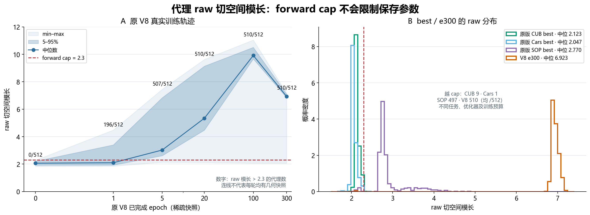
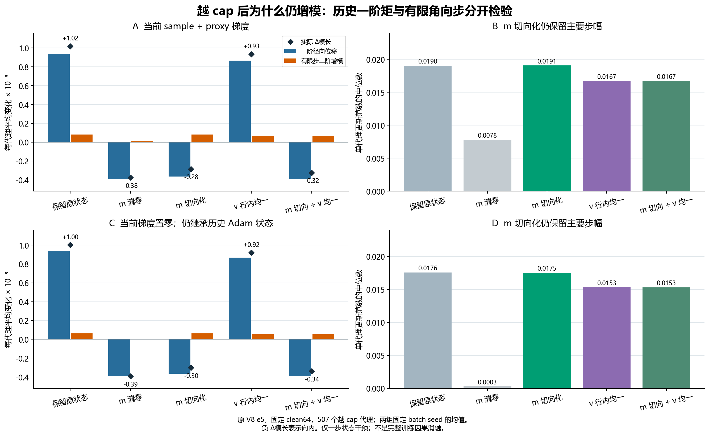
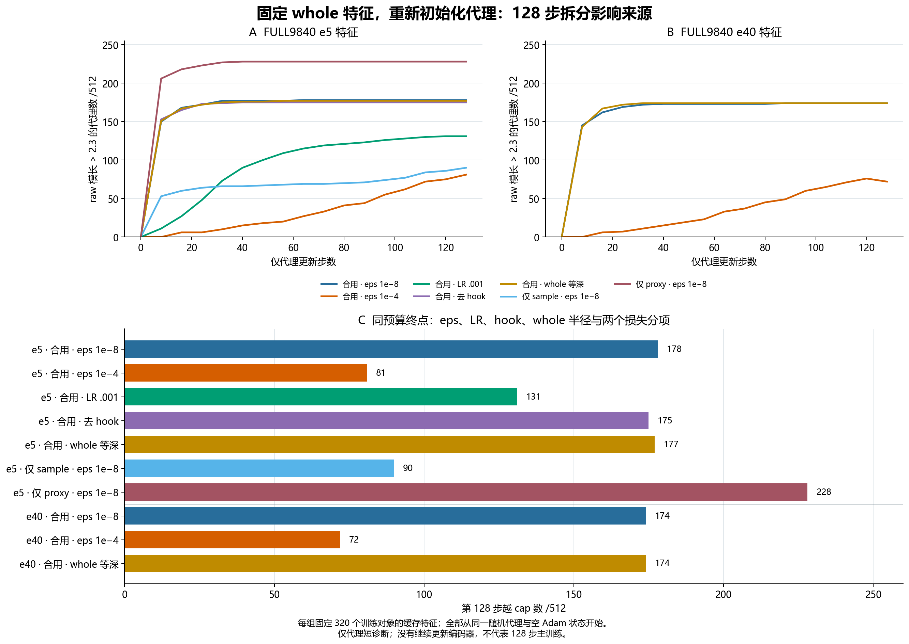
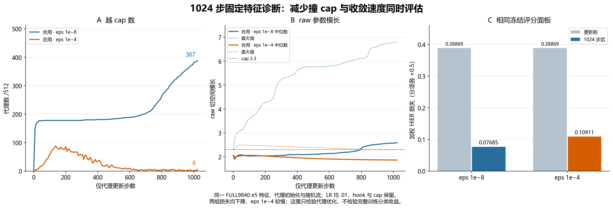
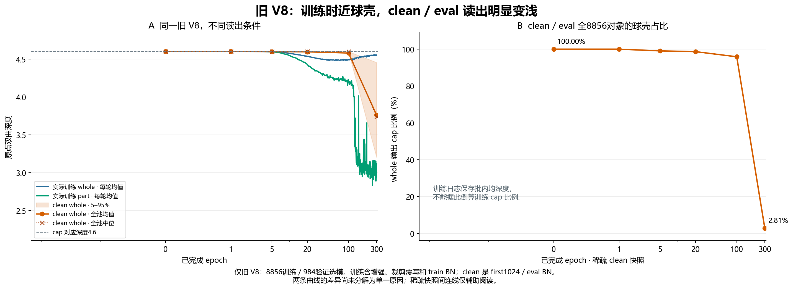
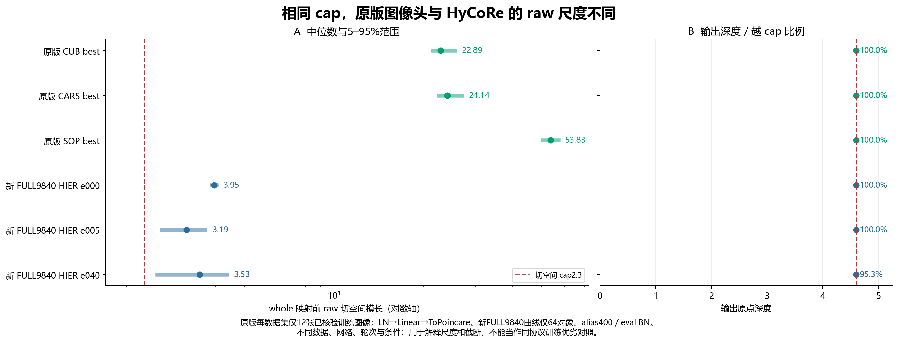
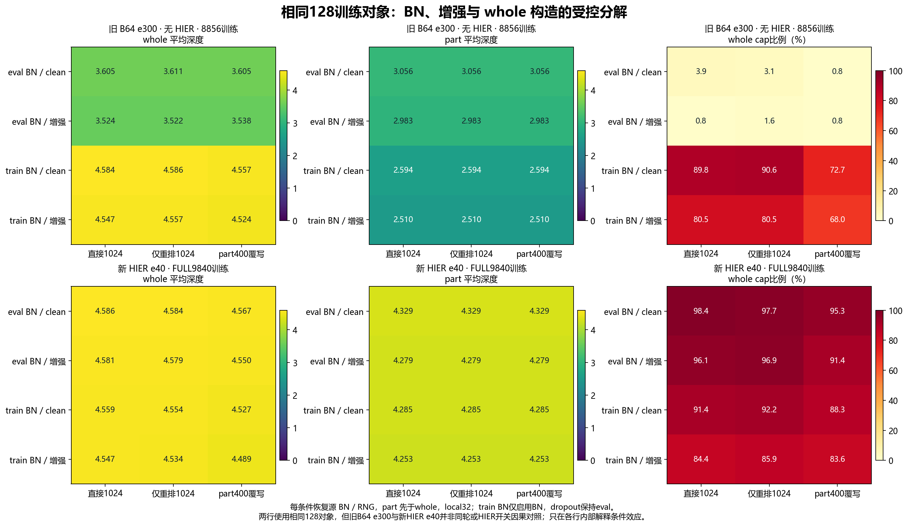
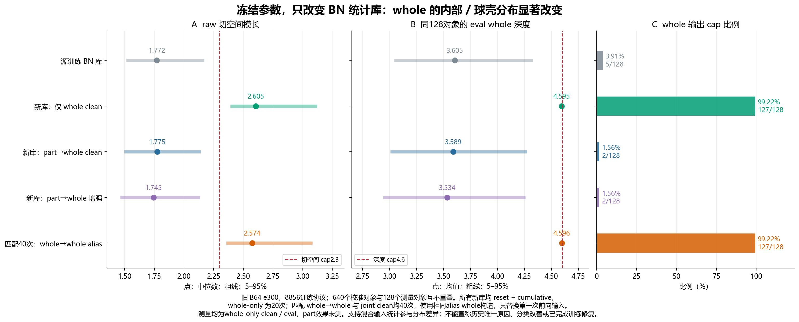

# V8代理撞cap与whole球壳：原因及受控证据

日期：2026-10-18。承接报告53、54的现象，本次使用原版HIER完整代理Adam状态、旧V8真实训练记录、固定特征代理更新，以及空闲GPU上的固定训练对象前向对照，检查原因。没有修改完整主训练，没有以test成绩选择这些诊断条件。

目前能确定两件事。**代理的问题主要落在实际优化步幅及历史状态，不能根据“小梯度”推断“小更新”；whole的问题则必须先区分训练前向和clean/eval前向。** 原V8早期已经形成球壳，晚期训练时仍靠近壳；晚期clean/eval嵌入向内分散，BN状态是已得到直接干预支持的重要因素。

| 问题 | 已验证的结果 | 不能据此推出 |
|---|---|---|
| 代理为何首次越cap | 初始化距离cap较近；相同梯度的Adam步幅受eps显著影响；固定输入连续优化可重现越界 | 不是所有代理始终受外推；没有逐生产步记录每个代理首次越界 |
| 为何越界后还增长 | 保持当前梯度/v等不变，去掉历史m的径向分量，使早期已越cap组平均外移转为回缩 | 不是已经证明最优的流形优化器；不是所有阶段都外漂 |
| eps是否相关 | 匹配1024步：越cap387→6，固定评分损失两组都下降 | 不等于分类收益；eps较大组优化较慢；原版SOP仍大量越界 |
| whole为何没有预想的壳 | 原V8早期是壳；晚期无HIER模型同128对象只切换BN，贴cap3.9%→89.8% | 不是HIER独有现象，也不能把train模式嵌入当作推理结果 |
| 原版为何更像壳 | 每集12训练anchor的head原始模长约22–54，远大于2.3；截断后自然成壳 | 不说明HIER目标理论保证所有样本等深 |

新增的BN统计库控制进一步匹配了whole构造和40次前向：whole→whole库使eval whole贴cap99.22%，part→whole库仅1.56%；两者网络参数、640校准对象及128测量对象均相同。它支持共用统计参与eval内缩，尚不等于分类修复。

## 数据与实验边界

| 资料/实验 | 输入和协议 | 本次操作 |
|---|---|---|
| 旧V8-HIER64 | 已完成300轮，8856训练/984验证；e0/1/5/20/100/300和60000步日志 | 本地CPU读取完整训练缓存、代理及Adam；不改原权重 |
| 原版HIER CUB/Cars/SOP best | 用户提供完整权重及完整几何缓存 | 提取真实Adam；CPU固定训练面板；每集12张图像只读head前向 |
| 当前FULL9840 HIER | 官方9840训练；已有e0/1/5/20/40 | 在已有权重上固定320训练对象，只更新新建代理副本 |
| 晚期whole条件试验 | 旧V8-B64无HIER e300、当前FULL9840 HIER e40 | 两模型均使用相同128训练对象；18条件；每条件恢复BN/RNG |

旧V8和FULL9840是不同训练，图中明确标记。B64 e300与HIER e40不是同轮HIER开关对照；本次对它们分别进行模型内的条件干预。训练集对象ID、源SHA、完整状态和日志留私有目录；材料只包含匿名统计。代理轨迹改变私有副本，编码器保持冻结；“源模型零更新”不等于副本没有执行Adam步骤。

## 一、代理撞cap的机制

这里的 cap 是切空间模长上限 2.3。它约束本次前向使用的向量，不会把优化器保存的 raw 参数投影回 2.3。代理撞 cap 意味着保存参数的模长超过 2.3，前向只保留被截断后的长度和原有方向；不意味着代理到了庞加莱球的数值边界，也不意味着代理完全停止训练。

需要把两个阶段分开：第一阶段是代理怎样首次跨过 2.3；第二阶段是跨过以后，为什么 raw 模长还能继续增长。两阶段受到的作用不同，不能用末期几乎为零的径向梯度倒推首次越界原因。

### 1. 真实训练中，越 cap 很早出现，raw 模长随后继续增长

原 V8 的代理初始化 raw 模长中位数为 2.0687，距 cap 只有约 0.2313；最外侧初始化代理为 2.2854，距 cap 约 0.0146。初始化尚无代理越 cap，但不同代理的越界余量并不相同。

| 原 V8 保存轮次 | raw 模长中位数 | raw 模长最大值 | 越 cap 数 /512 |
| --- | ---: | ---: | ---: |
| 初始化 | 2.0687 | 2.2854 | 0 |
| e1 | 2.1003 | 4.4841 | 196 |
| e5 | 3.0265 | 7.4556 | 507 |
| e20 | 5.3430 | 9.6274 | 510 |
| e100 | 9.9190 | 11.0474 | 510 |
| e300 | 6.9231 | 7.1722 | 510 |

这说明撞 cap 不是末期才发生的事件。前 5 轮已接近全体越界，后续 raw 模长仍明显变化；与此同时，多数代理的实际输出深度一直被截在约 4.6。e100 到 e300 raw 模长下降，不等于代理输出已经从 cap 壳返回内部。

在 c=0.1 下，若记 raw 参数为 w、截断结果为 v，则忽略数值稳定项时：

$$
v=\min\left(1,\frac{2.3}{\|w\|}\right)w,
\qquad
p=\operatorname{Exp}^{c}_0(v),
\qquad
d_0(p)=2\|v\|\le4.6.
$$

实际代码有 1e−5 等稳定项，因此越 cap 后的径向导数接近零，不是严格数学零；角向导数仍可以非零。

### 2. 首次越 cap：梯度不大，Adam 步幅仍可能不小

仅看梯度范数不足以判断代理实际走多远。AdamW 的参数变化取决于一、二阶历史矩、学习率、eps 和 weight decay：

$$
\Delta w
=-\eta\frac{\widehat m}{\sqrt{\widehat s}+\epsilon}
-\eta\lambda_{\mathrm{wd}}w.
$$

分式逐坐标计算。fresh Adam 第一步，在 eps 相对每坐标梯度足够小时，更新接近每坐标按符号走一步；256 维、学习率 0.01 时，其向量步长的典型尺度可以接近：

$$
\|\Delta w\|\approx\eta\sqrt{D}=0.01\sqrt{256}=0.16.
$$

这不是径向增量公式，也不意味着第一步必然越 cap。方向可能向内，实际初始化的多数代理也不会仅因一次 0.16 的更新就跨过中位数对应的约 0.23 余量。但它说明，小梯度经 Adam 归一化后仍可能形成相对于初始化余量不可忽略的连续步幅；最外侧代理的余量更小。

固定 e5 条件下，fresh Adam 使用 eps=1e−8，单代理更新范数中位数约 0.158；只改 eps=1e−4 后约 0.00418。梯度没有因此改变，变化来自优化器对小梯度的处理。因此目前证据更支持“代理优化步幅与有限径向余量不匹配”，不支持“梯度发生数值爆炸”。

也不能把 HIER 解释为处处向外推。初始化的单步探针既有向内也有向外响应，合用损失的平均首次模长变化还可以为负。首次越界是有限代理、连续更新和变化中的关系共同产生的现象；现有稀疏真实快照没有记录每个代理首次越界的确切生产步号。

### 3. 越 cap 后继续增模：历史一阶矩比当前径向梯度更关键

跨过 cap 后，当前损失对 raw 模长的直接敏感度很弱。但 Adam 保存的一阶矩未必与当前参数方向正交；历史更新还能继续产生外向位移。图2在原 V8 e5 的 507 个越 cap 代理上做一步配对干预，固定特征与当前梯度，所有操作在副本上完成。

最直接的证据是：把当前梯度置零、保留原 Adam 历史状态后，仍约 95.1% 代理向外，平均模长增加约 0.001003。把历史一阶矩的当前径向分量去掉后，平均变化转为约 −0.000302，而更新范数中位数从约 0.01757 变为 0.01754，主要更新力度基本保留。只把二阶矩在每个代理的坐标间改为均一，平均模长仍增加约 0.000921。

这个条件实验支持：越 cap 后，历史一阶矩中的径向分量是持续增模的主要直接来源；不能只用当步径向梯度解释，也不能只归因于二阶矩的逐坐标不均匀。当前梯度置零的干预仍会执行继承状态的 AdamW 更新，并非无梯度时自动跳过参数的训练操作。

图中的“m 切向化”具体是欧氏参数空间的一步投影。记当前单位方向为 u：

$$
u=\frac{w}{\|w\|},
\qquad
m_{\perp}=m-\langle m,u\rangle u.
$$

为什么历史m会带上外向作用？可以用一个简化的切向SGD步骤理解：若当前g与w正交，更新后的位置为w′=w−ηg，则旧梯度与新位置的内积为：

$$
\langle g,w'\rangle=-\eta\|g\|^2<0.
$$

也就是，原先对旧位置切向的方向，在移动后的新位置已经不再切向；继续沿旧下降方向走，就可能带来径向外移。真实Adam还包含逐坐标预条件和多个历史项，但这个例子说明了“当步径向梯度很弱，历史状态仍向外带”的原因，而不是假设损失主动要求代理无限向外。

它用于诊断历史矩的当前径向分量，**不是严格的双曲平行移动或向量运输**，也不是已经验证可长期训练的优化器设计。该实验不能直接推出“训练时每步做此投影一定更好”。

此外，即使更新完全切向，有限步也会增加模长：

$$
\|w+\Delta w\|^2
=\|w\|^2+2\|w\|\langle u,\Delta w\rangle+\|\Delta w\|^2.
$$

当径向内积为零而步长非零时，最后一项仍为正。图2把实际模长变化分为一阶径向位移与剩余有限步增模；在这一 e5 面板中，后者约 6×10⁻⁵，小于保留历史矩时约 10⁻³ 的主要外移量。e300 的低学习率状态不再普遍外移，不能把早期结果描述成所有阶段都单调增模。

### 4. 128 步对照：eps、LR、hook、whole 半径和两个损失分别检验

这组实验使用另一条 FULL9840 训练的既有 e5/e40 whole 特征；每组固定 320 个训练对象，重新初始化代理及 Adam 状态，不继续更新编码器。它检验给定 whole 几何时代理优化的条件响应，不复原原 V8 的完整生产轨迹。

| 固定特征 | 128 步干预 | 越 cap 数 /512 |
| --- | --- | ---: |
| e5 | sample+proxy，eps=1e−8 | 178 |
| e5 | 仅改 eps=1e−4 | 81 |
| e5 | 仅改代理 LR=.001 | 131 |
| e5 | 去梯度 hook | 175 |
| e5 | whole 统一深度 | 177 |
| e5 | 仅 sample，eps=1e−8 | 90 |
| e5 | 仅 proxy，eps=1e−8 | 228 |
| e40 | sample+proxy，eps=1e−8 | 174 |
| e40 | 仅改 eps=1e−4 | 72 |
| e40 | whole 统一深度 | 174 |

在这两个窗口中，增大 eps 都明显降低越 cap 数；降低 LR 也有效，但只是在该参数值和预算下改善较小。去 hook 或统一 whole 深度没有明显减少越 cap。因此不能把代理 cap 主要归咎于 hook，也不能认为 whole 形成等深壳就会自然避免代理 cap。

sample 单项和 proxy 单项都能使代理越 cap；proxy 单项在这一窗口更明显。但两项相加的结果不是两个单项结果的简单加和，不能据此认定完整训练中只有 proxy–proxy 项负责。

### 5. 1024 步延长：eps=1e−4 减少撞 cap，但优化较慢

这里的评分已经包含HIER外系数：每个分项均乘0.5，合计为0.5×sample+0.5×proxy。它不包含HyCoRe分类及intra目标，也不是未加权的sample+proxy原始值。两组使用完全相同的尺度。

| 1024 步终点 | eps=1e−8 | eps=1e−4 |
| --- | ---: | ---: |
| 越 cap 数 /512 | 387 | 6 |
| raw 模长中位数 | 2.5861 | 1.8613 |
| raw 模长最大值 | 6.7940 | 2.3003 |
| 同一固定面板初始 sample+proxy 损失 | 0.38869 | 0.38869 |
| 同一固定面板末端 sample+proxy 损失 | 0.07685 | 0.10911 |

增大 eps 后，越 cap 数不是永远单调增加：早期上升后，多数代理回到内部。两组损失都下降，eps=1e−4 的末端损失仍较高，所以它不是没有代价的“修复开关”。当前能够确认的是，该条件下优化器 eps 显著改变代理越 cap 轨迹；不能确认完整训练分类更好、关系更准确，或者更低的 HIER 损失必然表示更好的层次结构。

### 6. 原版 HIER 对照：配置差异真实存在，但 eps 不是万能解释

原版 CUB/Cars/SOP 的实际 checkpoint 均采用 AdamW、FP16 和 eps=1e−4。官方源码按是否使用 FP16 选择 eps：FP16 为1e−4，FP32 为1e−8。因此不能说 V8 的 eps=1e−8 是代码普遍写错；更准确的说法是，它与此次比较的三份原版权重的实际优化器设置不同。

三份原版 HIER 的外部权重同为 0.5，内部等权 sample+proxy，margin/tau 均为0.1，与 V8 的相应系数一致。尚有明显混杂：代理维度512对256、global batch180对64、代理 LR、Adam步数、监督基础目标及 whole 径向分布均不同。

原版 raw 代理模长中位数分别约为2.1234、2.0467、2.7698；越 cap 数为9、1、497。尤其 **SOP 即使采用 eps=1e−4，仍有497个代理越 cap**。这说明 eps 不是足以保证内部代理分布的条件，不能用 CUB/Cars 的结果承诺 V8 只改 eps 就能获得同样几何。

保存的真实Adam状态还给出一个直观对照。下表对各自clean训练缓存取相同64抽样协议，计算sample+proxy的一步；不同数据、维度、训练阶段和保存LR仍有混杂，**不是原版图像batch180的精确训练重放**。

| 一步副本条件 | 原V8 e300 | CUB best | Cars best | SOP best |
|---|---:|---:|---:|---:|
| 原代理初始LR | .01 | .005 | .005 | .03 |
| checkpoint保存LR | .0005 | .000625 | .0003125 | .00081 |
| Adam已更新步数 | 60000 | 544 | 1980 | 31666 |
| weight decay | .01 | .01 | .01 | .0001 |
| 当前梯度范数中位数 | 1.85e−5 | 1.81e−4 | 1.67e−4 | 8.20e−5 |
| 实际一步位移范数中位数 | 1.82e−3 | 2.44e−4 | 9.39e−5 | 1.12e−4 |

V8此时当前梯度更小，实际Adam步幅却更大，再次说明应测参数真实位移、m/v与eps的相对尺度。不能仅凭原版末态步幅小，就认定它历史上从未越cap；SOP的497个越界代理正是反例。完整表见[一步统计CSV](tables/proxy_original_saved_step_comparison.csv)。

### 7. 对下一步方案的直接含义

最有证据的下一项改动是只把代理 AdamW eps 改为1e−4，保留其他设置，验证完整训练中是否减少越 cap 并保留关系学习与分类能力。代理 LR=.001可以作为独立替代对照，先不与 eps 同时修改，避免失去归因能力。

不建议仅因这次结果取消 hook、强制 whole 等深，或直接调小 HIER 外系数：前两项在本条件窗口没有明显消除 cap；外系数缩小也不能保证 Adam 步幅同比缩小。若后续仍采用永久 raw 参数边界，需要同时审查历史动量的几何处理；单纯把参数投回边界，旧一阶矩仍可能下一步再次把它向外推。

现有结果将“撞 cap 为什么发生”从笼统的模长过大，推进到可检验的机制：初始化余量较小，Adam 对小梯度仍可产生明显步幅；越 cap 后径向反馈减弱，历史一阶矩和有限角向步仍能改变 raw 模长。完整训练中各因素的累计贡献及任务收益，仍需后续单因素实验确定。

## 二、whole到底有没有形成球壳

### 1. 先纠正观察前提：它曾形成球壳，训练与审查前向也不相同

| 旧V8轮次 | 真实训练whole均深度 | 真实训练part均深度 | clean/eval whole均深度 | clean/eval whole贴cap比例 |
|---|---:|---:|---:|---:|
| e1 | 4.6000 | 4.6000 | 4.6000 | 100.00% |
| e5 | 4.5972 | 4.5965 | 4.5978 | 99.07% |
| e20 | 4.5359 | 4.4295 | 4.5956 | 98.66% |
| e100 | 4.4909 | 4.2144 | 4.5796 | 95.88% |
| e300 | 4.5521 | 3.1210 | 3.7628 | 2.81% |

训练均值来自每轮200步真实日志，part大小随训练取样；clean审查使用固定的干净训练对象、eval BN，因此两列不是配对的同一批前向。它们首先揭示需要排查的条件差异，不能仅凭差值就指定原因。旧V8 e300 clean whole深度标准差约0.3503，明显不是薄壳；但“V8从来没有形成壳”与实际记录不符。

### 2. 原版HIER的壳，首先是head输出尺度与截断共同形成的

| 原版head测量 | CUB | Cars | SOP |
|---|---:|---:|---:|
| cap前切空间模长中位数 | 22.887 | 24.141 | 53.833 |
| cap前模长范围 | 21.432–26.150 | 22.289–27.215 | 50.154–57.287 |
| 观测对象数 | 12训练anchor | 12训练anchor | 12训练anchor |
| cap后深度 | 约4.6 | 约4.6 | 约4.6 |

36张图像的输出方向与原完整缓存高度一致（最小余弦大于0.9999998），源模型/BN保持。完整缓存此前已确认三集whole均在约4.6薄壳；本次小面板用于定位head尺度来源，不能把12张的raw范围称作全数据集上下界。

原版head为ResNet50的avg+max pooling、非仿射LayerNorm、线性投影，再进入带cap的ToPoincare。LayerNorm先把2048维输入的尺度标准化，线性head仍可输出远大于2.3的长度。其基础监督PALoss_Angle还会归一化X和P，主要使用方向，不要求保留每个样本的原始半径。这样的raw输出被2.3截断，出现球壳很自然。

V8保留PointMLP的BN、Möbius表示头及双曲分类器，再在共享mu上执行最终cap。它没有完全复制原版的head和基础监督。当前FULL9840 e0/e5/e40固定64对象的raw whole中位数约3.95/3.19/3.53，仍能使早期大部分样本撞cap，但距离阈值的余量远小于原版22–54。晚期BN条件或共享网络变化更容易使部分whole返回阈值内部。**只统一曲率、cap和hook，不足以保证两个模型具有相同的whole径向分布。**

### 3. 固定同128对象：BN模式是晚期深度差异的主要已验证因素

下面是旧V8-B64无HIER e300。同128训练对象、local32、同权重，改变一个前向条件；关闭dropout，仅使BN使用当前批统计，所有条件后恢复BN/RNG。

| BN状态与输入 | whole均深度 | whole深度标准差 | 贴cap比例 |
|---|---:|---:|---:|
| eval BN；干净、直接1024点 | 3.6047 | 0.3761 | 3.91% |
| 仅BN train；干净、直接1024点 | 4.5841 | 0.0735 | 89.84% |
| eval BN；增强、直接1024点 | 3.5241 | 0.3693 | 0.78% |
| 仅BN train；增强、直接1024点 | 4.5474 | 0.1732 | 80.47% |
| eval BN；增强、part覆写whole | 3.5380 | 0.3671 | 0.78% |
| 仅BN train；增强、part覆写whole | 4.5235 | 0.1851 | 67.97% |

只改变BN就使干净whole均深度增加约0.9794；eval条件下增强使它减少约0.0806。part覆写和点序重排也会影响结果，但在这个面板中不足以解释接近一个单位的主要差异。完整train模式补充与BN-only模式的whole测量相同，与该mu路径没有生效的dropout一致。

这说明晚期clean/eval分散并不等于模型在训练时始终学不到外侧whole。更直接的解释是：**当前批统计与保存的BN运行统计，会把同一个点云变成不同尺度的head输入；由于raw输出靠近2.3阈值，这个差异被cap放大为“薄壳/内部散布”的明显差别。** 这是固定模型、固定输入的直接干预结论，不依赖两条完整训练的性能比较。

当前FULL9840 HIER e40同128对象则仍处于较早的壳阶段：干净直接whole在eval下均深度4.5865、贴cap98.44%；BN train下4.5589、贴cap91.41%。这也表明不能把BN train一概描述为向外推：作用方向依赖模型阶段及保存统计。它与旧B64 e300分别回答各自的条件问题，不用于估计HIER净效果。

### 4. 冻结参数重估BN：联合part/whole统计能够重现分散

在同一B64 e300上，额外取640个训练对象，严格排除上述128个测量对象。固定网络参数，重置BN的running统计并以momentum=None累计；分别只前向whole、依次前向part400与whole、以及增强后的part→whole。随后所有条件都用同样的干净whole、eval BN测量128对象。

| 临时统计库来源 | whole raw模长中位数 | whole均深度 | 深度标准差 | 贴cap比例 |
|---|---:|---:|---:|---:|
| 原checkpoint统计 | 1.7716 | 3.6047 | 0.3761 | 3.91% |
| 只用whole，干净输入 | 2.6054 | 4.5953 | 0.0532 | 99.22% |
| whole→whole，匹配alias与40次前向 | 2.5739 | 4.5964 | 0.0409 | 99.22% |
| part→whole，干净输入、40次前向 | 1.7750 | 3.5890 | 0.3563 | 1.56% |
| part→whole，原版增强 | 1.7446 | 3.5338 | 0.3717 | 1.56% |

这比模式切换更直接：测量时全部使用eval，改变的只有临时BN统计库。只用whole校准时，大多数raw输出超过2.3；联合统计则把它们缩到阈值内部，并重现接近原checkpoint的分散。**在BN train whole本已靠壳的这份固定模型上，选择whole-only或part+whole运行统计，足以让相同clean/eval对象在薄壳与内部散布之间切换。共用统计因而是train/eval径向差的一个得到干预支持的可实现机制。** 这也解释了为何关闭HIER的B64仍可能存在类似现象。

原因是train BN对当前whole批次使用本批均值/方差，而eval使用训练中保存的running均值/方差。part与whole经过同一套BN，两次前向都会更新保存统计；eval的whole因而面对混合分布统计。BN train靠壳不是由running统计造成的，本次干预改变的是eval分布。在多层网络中，这些归一化差异会传到最终head模长，是否跨过cap取决于输出尺度。

为排除“只因whole构造或前向次数不同”的替代解释，又补做了严格匹配：两组都先执行相同的part400别名构造，保留完全相同的whole输入，均进行40次local32前向；唯一改变是每批先前向whole还是part，随后都前向whole。whole→whole统计库使留出whole均深度4.5964、贴cap99.22%；part→whole仍为3.5890、1.56%。两个实验的640校准对象和128测量对象逐ID哈希一致。这进一步支持加入part前向所产生的共用BN运行统计，是本例eval内缩的直接机制。

需要保留三个界限：一是校准使用固定part400，而历史训练N会变化；二是临时库采用重置后累计估计，和原训练EMA不同，不能宣称已还原历史唯一成因；三是本次只验证whole，尚未检查更换统计后的part相对深度、方向语义和分类表现。因此“whole-only BN校准”目前是冻结诊断和下一步候选，不直接覆盖正式checkpoint。

BN-only诊断也不意味着正式预测应直接采用train模式。train BN会依赖同批其他对象；正式模型比较仍以既定eval协议为准。本报告没有据此重新选择best或补报更高test成绩。

### 5. 为什么不直接把whole和part都强制到壳上

cap是上限，不是把内部点吸向外侧的目标。HyCoRe的径向项为：

$$
R_{\mathrm{hier}}
=\operatorname{ReLU}\left[d_0(\nu)-d_0(\mu)+\frac{500}{N}\right].
$$

它约束whole相对part更深，不要求whole达到最大深度；达成margin后，该项可以停止提供径向压力。若whole与part都被强制为4.6，则正margin无法满足。分类、对比项、HIER及共享网络/BN还会共同影响表示；不能把双曲几何本身当作一个保证所有whole始终在边缘的定理。

当前FULL9840 e40的坐标叶节点探针中，CE与径向项大多对whole给出外向下降方向，HIER sample项则混合；已经cap的raw径向梯度很弱。这些是给定表示的局部导数，**不是**共享编码器实际RSGD更新；不宜据此断言某个单项导致晚期整体向内。网络参数同时服务part、whole和其他样本，BN运行统计也随训练更新。

## 三、下一步修改的优先顺序

1. **代理优化先做单因素验证。** 最有直接轨迹证据的是代理AdamW仅将eps改为1e−4，保留网络、loss、LR、采样和协议。需要同时记录真实步幅、raw越cap数、损失进度、覆盖/角度和分类结果。eps较大时收敛较慢，不能以减少cap数单独判胜。
2. **把BN观测条件纳入每次审查。** 同权重、同训练对象并列clean/eval、训练增强/当前批BN两套分布；补充raw head尺度。若只看clean/eval，会把前向条件差异误认为整个训练过程都没有形成壳。
3. **优先补whole/part统计分离的冻结检验。** 本次whole-only统计已经恢复whole薄壳，下一步应检查同一临时统计库下part是否仍位于内部、方向及形态对应是否保持；之后才讨论独立BN、推理前whole-only校准或其他归一化方式。不能只因形成壳就覆盖正式模型或改变test协议。
4. **m径向分量处理保留为机制候选。** 一步干预很有解释力，但128步副本仅将越cap178降为169，最大模长3.739降为2.411。它抑制了过度外漂，未消除越cap，不足以直接定为新优化器。raw边界约束若启用，也要同步考虑历史状态。
5. **不把代理cap等同于热点的全部原因。** 等深whole仍会出现代理cap；原SOP whole全在壳上仍有方向热点。后续要并看代理角向冗余、类别对应、NN4覆盖与独立形态信号；扩大覆盖或降低loss都不是层次有效性的充分证据。

本次没有自动启动V9，也没有改变正在运行的FULL9840训练及两组对照。

## 四、复现与验收

源代码位于[独立诊断文件夹](../diagnostics/v8_cap_mechanism/README.md)。本次核心版本包括：原静态/轨迹探针c42cae9，匹配服务器输入09d13f1，head依赖及长轨迹评分4845702，条件试验与历史m干预633cd43，冻结BN统计库干预0027c25，前向次数/构造匹配1b934ed。原版来源为HIER-CVPR23提交3986a744a1a54fd357e307d1cb3f2e81910b9ffc。

原版权重实际使用FP16+eps1e−4；官方代码的FP32分支本来就是eps1e−8。因此本次发现是与三份参考权重的**实际数值配方差异**，不是已证明V8遗漏官方必需操作的实现错误。原版SOP仍497/512越cap，也说明不能承诺一个eps值解决全部问题。

9项Torch数学/优化器测试通过；所有已完成只读前向均核查源SHA及模型/BN恢复。GPU始终使用空闲卡，私有代理副本执行10×128步、2×1024步及1×128步历史m干预，另有固定状态的一步探针；没有编码器训练更新，没有test前向。原始3集head共36张训练图像，本次whole条件试验两模型各18条件、同128训练对象；BN校准使用额外640训练对象，和128测量对象交集为0，源参数与BN/RNG恢复。完整对象与权重没有进入材料包或Git。

统计表位于[tables](tables/)。原代理raw分位数使用NumPy；GPU轨迹的模长中位数沿用运行时Torch下中位数。二者偶数样本时略有差异，不能视为重新训练产生的变化。代理越cap定义raw norm>2.3，whole贴cap定义原点深度≥4.5999。
