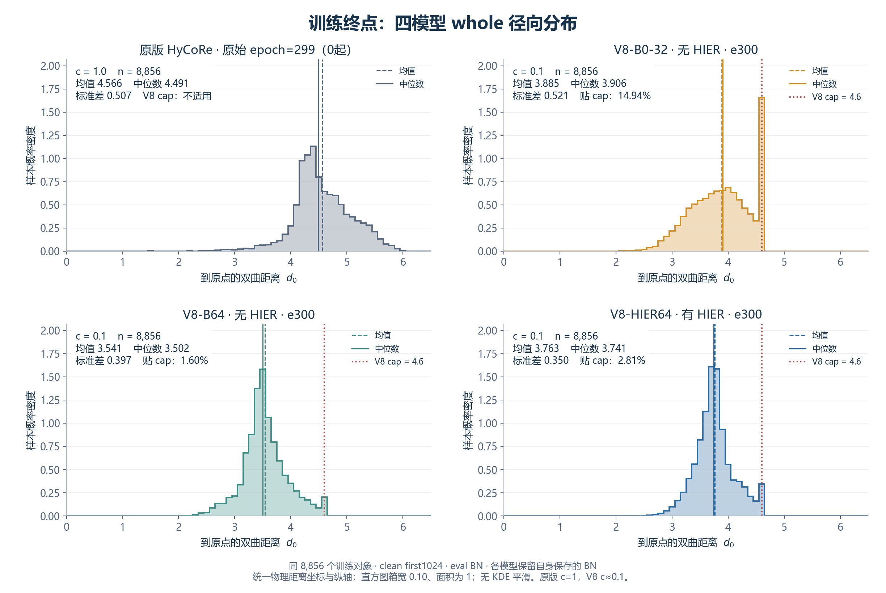
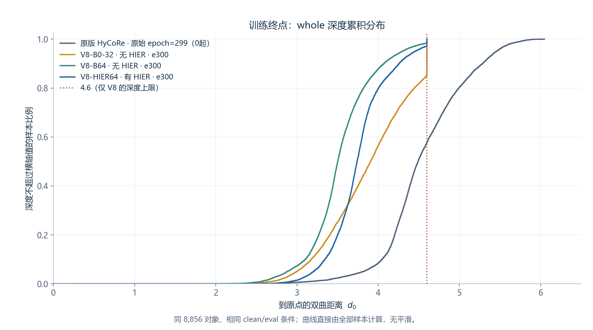
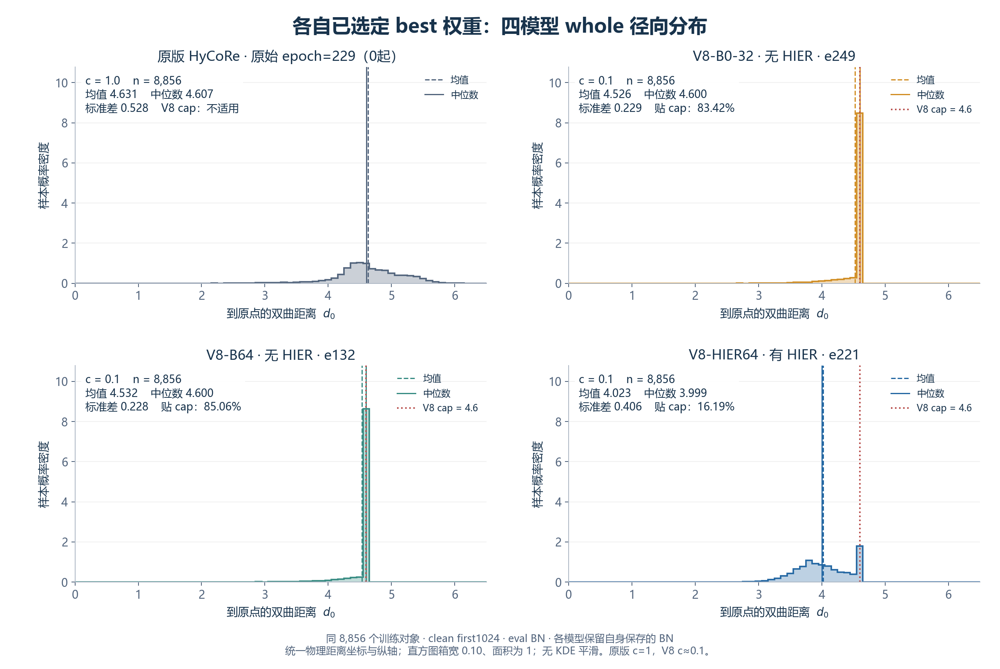
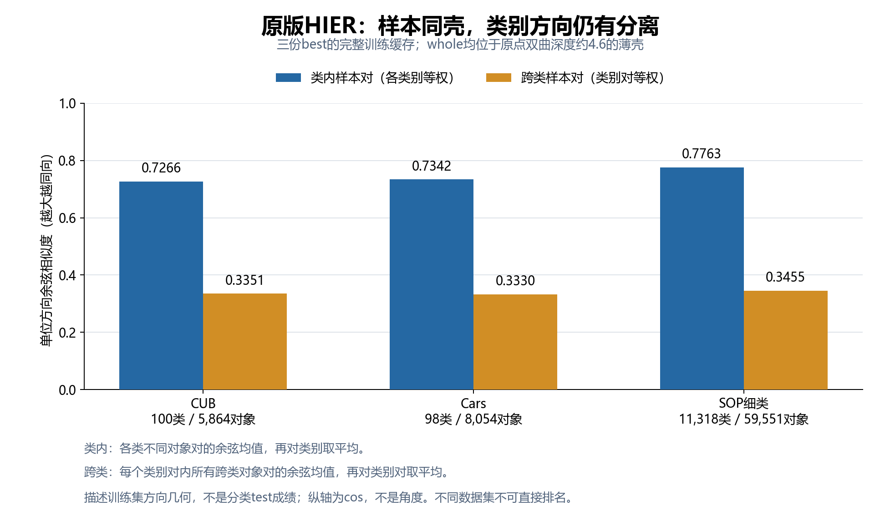
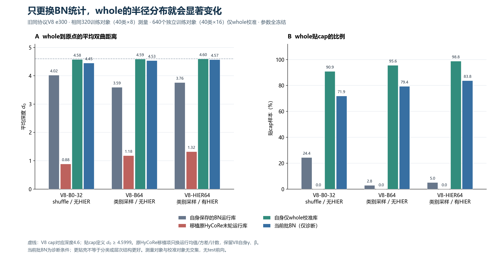
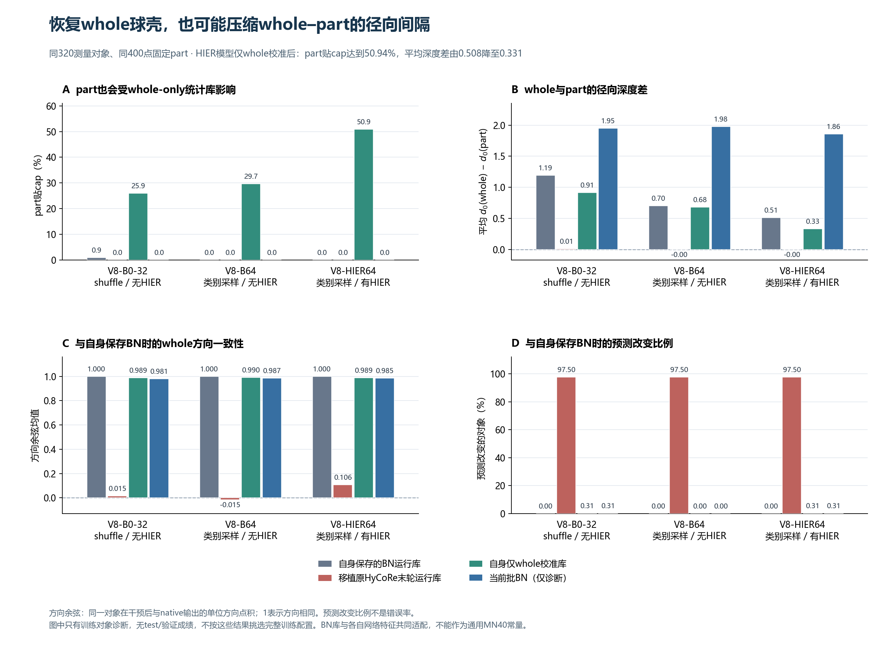

# 四模型whole分布与BN兼容性：V8冻结审查

日期：2026-10-19。按用户确认，比较已经完成、同8856训练/984验证协议的V8-HIER64、V8-B64无HIER、V8-B0-32无HIER，并以原始HyCoRe作为参照。最近FULL9840重跑不混入本报告。

本次补齐B0的best/e300完整训练集嵌入，制作四模型原点双曲距离—样本概率密度图；核查原版HIER的类别方向分离；在冻结网络上比较本模型BN、借用原版HyCoRe运行统计、whole-only校准及当前批次BN。没有编码器训练、代理更新或新增test前向，没有覆盖正式权重或BN。

## 1. 先读结论

1. **e300时三组V8的eval whole都没有全体贴壳。** HIER组比同batch的无HIER B64更深、分布更窄，不能把whole内部分散简单归因于加入HIER。原始HyCoRe也具有径向离散。
2. **同壳能排除样本之间的径向深度差，却不保证代理都停在浅层。** 原版SOP whole全在4.6壳上，仍497/512代理越cap；V8自己的e5 whole贴cap99.07%，当时已507/512代理越cap。
3. **报告57的3.91%→89.84%没有借用别人的BN。** 它在同一个B64 e300上切换“自己保存的运行统计”与“当前批统计”。不是把ResNet或原版HyCoRe的BN移植进去。
4. **原版HyCoRe最终BN不是可直接复用的MN40通用BN。** 本次真实移植只替换运行buffer、保留V8自己的γ/β和全部权重，仍造成明显错配。用每个模型自己的训练whole校准可恢复whole壳，但也抬高part，需要继续审查whole/part关系。

## 2. 四个whole密度图：统一输入与真实深度

每个面板均为同一批8856个训练对象、同样的原始first1024点、无增强、eval BN、各模型自身保存的BN统计。V8统一e300；原始HyCoRe的last记录epoch=299，沿用原0起编号，即完成300轮后的状态。

原版缓存此前按HDF5 glob顺序拼接，本次按“文件名+文件内行号”转为canonical ID。已同时核对全部对象标签，并通过原版完整输入历史摘要、当前按旧顺序重算摘要和同8856点云字节摘要的桥接，确认四模型输入字节一致。详细验收见[输入与缓存验证](tables/whole_density_validation.json)。

横轴为原点双曲距离：

$$
d_0(x)=\frac{2}{\sqrt c}\operatorname{artanh}\!\left(\sqrt c\|x\|\right).
$$

四面板使用共同横轴与纵轴，直方图箱宽0.10、面积归一，不使用KDE掩盖cap上的集中质量。红线4.6只属于V8额外cap；原版HyCoRe没有这个额外上限。原版c=1、三组V8 c≈0.1，因此原版只作为分布参照，不能仅凭跨曲率距离大小判断表达能力或任务优劣。

| 训练终点 | 均深度 | 深度中位数 | 标准差 | V8贴cap比例 |
|---|---:|---:|---:|---:|
| 原始HyCoRe last，原epoch299 | 4.5659 | 4.4913 | 0.5074 | 不适用 |
| V8-B0-32，无HIER | 3.8851 | 3.9065 | 0.5209 | 14.94% |
| V8-B64，无HIER | 3.5407 | 3.5019 | 0.3974 | 1.60% |
| V8-HIER64 | 3.7628 | 3.7408 | 0.3503 | 2.81% |

贴cap采用与报告57相同的判据d0≥4.5999。数值映射的实际最大值约4.59998，不能用过窄容差误判。

在相同global64、相同训练池和轮数下，HIER相对B64均深度增加约0.2221，标准差下降约0.0471。本次单seed结果不支持“HIER必然把whole拉向原点”的说法。B0还改变了shuffle32采样及每轮276次更新，与B64的类别采样200次更新不同，不能把它们之间的全部差异只归于batch大小。

原版HyCoRe本来也不是等深叶节点模型。V8把whole推到cap壳的愿望来自迁移HIER几何的实验设想，不是忠实复刻原版HyCoRe必须达到的行为。

[完整分位数CSV](tables/whole_depth_distribution.csv)；[原版单图](figures/05_1_original_whole_depth_last.png)；[B0单图](figures/05_2_v8_b0_whole_depth_last.png)；[B64单图](figures/05_3_v8_b64_whole_depth_last.png)；[HIER单图](figures/05_4_v8_hier64_whole_depth_last.png)。

## 3. 各自best补充：不能混同训练时刻

| best身份 | 均深度 | 中位数 | 标准差 | 贴cap |
|---|---:|---:|---:|---:|
| 原版HyCoRe，原epoch229 | 4.6312 | 4.6073 | 0.5281 | 不适用 |
| V8-B0-32，e249 | 4.5261 | 4.6000 | 0.2287 | 83.42% |
| V8-B64，e132 | 4.5320 | 4.6000 | 0.2281 | 85.06% |
| V8-HIER64，e221 | 4.0226 | 3.9990 | 0.4057 | 16.19% |

三组V8的best均由同984验证集选择；原版按test选best。best对比说明最终选中模型的实际读出分布，但不能将不同轮次、不同选模协议的差异当成HIER的单因素因果效果。主图因此统一训练终点。

## 4. whole同壳能实现浅层代理吗

### 4.1 理论上可以，现有HIER目标不作全体保证

把样本深度统一为D后，对任意一个固定的非原点代理，样本的双曲距离排序只由方向夹角决定：

$$
\cosh(\sqrt c\,d)
=
\cosh(\sqrt c\,D)\cosh(\sqrt c\,D_p)
-
\sinh(\sqrt c\,D)\sinh(\sqrt c\,D_p)\cos\theta.
$$

因此样本之间“某几个点因为更浅而普遍更近”的检索偏置被排除。位于原点的代理则到所有等深样本等距。不同代理自己的深度仍不相同，跨代理祖先竞争仍有径向作用；方向冗余、共享候选、三元组及优化轨迹也仍存在。

内部共同祖先在几何上完全可实现。两个深度均为D、方向夹角为θ的样本，其测地中点深度r满足：

$$
\tanh(\sqrt c\,r)
=
\tanh(\sqrt c\,D)\cos(\theta/2).
$$

在c=.1、D=4.6时，θ为20°、60°、120°，对应r约4.393、3.278、1.526。方向越接近，中点也可以越靠壳；“同壳”不意味着所有合理祖先都应很浅。这个解析示例说明可实现性，不把测地中点等同于HIER学习到的代理。

HIER使用有限的共享代理和相对距离hinge约束，没有“每个代理深度必须低于全部whole”的硬约束。迁移初始化与优化器类别不能保证相同代理分布；本次参考权重实际采用AMP/eps1e−4，V8代理采用FP32/eps1e−8，且基础监督、维度、学习率与更新预算不同。

| 原版HIER best | whole深度中位数 | 代理深度中位数 | raw代理越cap数 |
|---|---:|---:|---:|
| CUB | ≈4.6 | 4.2468 | 9/512 |
| Cars | ≈4.6 | 4.0935 | 1/512 |
| SOP | ≈4.6 | ≈4.6 | 497/512 |

SOP构成“whole成壳就必然得到内部代理”的直接反例。V8 e5也已同时出现whole贴cap99.07%与507个代理越cap，说明晚期whole内部分散不是早期代理撞cap的必要条件。以上代理事实复用[报告45](../45_ORIGINAL_HIER_BEST_GEOMETRY_AUDIT_2026-10-08.md)、[报告46](../46_ORIGINAL_HIER_SOP_MECHANISM_AND_ACTIVATION_2026-10-08.md)及[报告57](../57_V8_CAP_AND_WHOLE_CAUSES_2026-10-18/report.md)。

### 4.2 原版HIER同壳样本确实有类间方向分离

| 数据集 | 类内样本对余弦宏平均 | 跨类样本对余弦宏平均 |
|---|---:|---:|
| CUB | 0.7266 | 0.3351 |
| Cars | 0.7342 | 0.3330 |
| SOP细类 | 0.7763 | 0.3455 |

这里比较单位方向的余弦，不是角度，也不是类别中心之间的角度；宏权定义由图注和[来源CSV](tables/original_hier_class_direction.csv)说明。CUB/Cars留一最近类别方向中心宏准确率分别约94.35%/97.54%，属于训练方向诊断，不是论文分类test。

这三份原版HIER实验使用有标签深度度量学习基础目标，并非纯无监督聚类。数据证明“同壳”与“类别方向分离”可以同时成立；不能据此证明代理形成了有效类内层次。

## 5. 3.91%→89.84%究竟换了谁的BN

没有移植任何其他网络的BN。报告57的这组试验用同一份旧V8-B64无HIER e300、同128训练对象、相同权重和干净whole：

| 条件 | BN归一化来源 | whole均深度 | 贴cap |
|---|---|---:|---:|
| 原checkpoint eval | 该模型自己保存的运行均值/方差 | 3.6047 | 3.91% |
| 仅BN设为train | 当前local32批次的均值/方差 | 4.5841 | 89.84% |

其余层保持eval，未更新γ/β或任何网络参数，每条件后恢复BN/RNG。表中128对象与下节新320面板不同，贴cap比例不能跨面板当作干预差值。

训练模式使用当前批均值/方差，默认评估使用保存的运行统计，这是BN本身的模式差异。见[PyTorch BN说明](https://docs.pytorch.org/docs/2.14/generated/torch.nn.BatchNorm1d.html)。此说明只支持BN的通用行为，下文的幅度来自本项目固定模型实测。

BN在多层改变特征的中心和尺度，后续层再映射到最终切向量。报告57该固定模型的raw输出接近2.3阈值，统计来源变化足以使很多样本跨越阈值。cap会隐藏阈值以上的模长差异，不是数学上不连续的跳变开关。

原版HIER确实冻结ResNet50的BN运行统计；代码并没有同时关闭γ/β梯度，其head使用无affine的LayerNorm→Linear→ToPoincare。它从预训练权重与对应BN一起起步，后续训练适应该统计来源。这与训练结束后把另一份独立网络的BN塞入V8不同。见[官方ResNet实现](https://github.com/sung-yeon-kim/HIER-CVPR23/blob/3986a744a1a54fd357e307d1cb3f2e81910b9ffc/hier/models/resnet.py)、[官方head](https://github.com/sung-yeon-kim/HIER-CVPR23/blob/3986a744a1a54fd357e307d1cb3f2e81910b9ffc/hier/models/model.py)。

## 6. 新实验：原版HyCoRe最终BN能作为MN40通用BN吗

### 6.1 固定参数、固定对象的四条件

三份旧V8模型均固定e300，取40类×8个训练对象，共320个测量对象；另取同8856训练池内40类×16个对象，共640个校准对象，二者完全不重叠。不使用验证或test校准，也不按面板分类成绩选条件。

输入为clean first1024 whole与固定400点part。part取距离whole质心最近的采样点作中心，再选400近邻，不覆写whole。该固定条件用于模型内干预，不宣称复原训练的随机增强、随机N及别名覆写。

四个条件：

1. 本模型自己的保存BN统计；
2. 只借用原版HyCoRe last的running_mean、running_var、num_batches_tracked，共38层114个buffer，仍保留V8自己的γ/β及全部网络参数；
3. 对当前模型重置运行统计，用640个训练whole做20次local32前向累计校准，然后eval；
4. 只让BN使用当前批统计，作为诊断参照，不当作正式推理方案。

所有条件后完整恢复参数、BN及RNG；源文件SHA保持。三份模型的native面板输出与此前完整缓存逐元素一致，最大绝对差均为0，320个预测逐个相同。[重放验收](tables/bn_native_replay_validation.json)。

### 6.2 原版BN直接移植明显错配，自己校准whole能够恢复壳

| 固定e300模型 | 自己保存的BN | 借原版HyCoRe最终BN | 自己的whole-only校准BN | 当前批BN |
|---|---:|---:|---:|---:|
| B0-32 | 4.0219（24.38%） | 0.8832（0%） | 4.5765（90.94%） | 4.4490（71.88%） |
| B64 | 3.5933（2.81%） | 1.1789（0%） | 4.5920（95.63%） | 4.5340（79.38%） |
| HIER64 | 3.7605（5.00%） | 1.3203（0%） | 4.5971（98.75%） | 4.5665（83.75%） |

表内为whole均深度，括号为贴cap比例。它们都是相同320面板，不是全8856密度图的比例。

借原版运行统计后，三组均有97.5%的面板预测改变，whole方向与native方向的平均余弦约0.015、−0.015、0.106，whole/part深度差也接近0。这是统计与网络不匹配的直接证据，不是训练把模型参数破坏了；恢复原buffer即可恢复原输出。

BN统计描述的是“该网络前面各层权重产生的特征通道”，不只是MN40点云本身的分布。两份独立训练网络的BN形状相同，也不代表相同通道具备相同含义与尺度。因此可以为每个固定模型建立覆盖其训练输入分布的校准统计，但不能把原版最终BN当成跨网络通用模块直接搬运。

这次也在主HIER e300上补齐了直接干预：相同权重、相同输入，仅改统计来源，whole均深度3.7605→4.5971，贴cap5.00%→98.75%。BN统计来源确实足以显著改变这份主模型的eval径向分布；不能据此认定它是整个历史变化的唯一原因。

### 6.3 恢复whole壳还不等于保住part–whole关系

| 模型 | native whole−part均深度差 | whole-only校准后均深度差 | 校准后part贴cap |
|---|---:|---:|---:|
| B0-32 | 1.1889 | 0.9139 | 25.94% |
| B64 | 0.6990 | 0.6775 | 29.69% |
| HIER64 | 0.5080 | 0.3313 | 50.94% |

whole-only校准后的whole方向与native方向平均余弦约0.989，面板预测改变比例分别0.31%、0%、0.31%，说明本面板主要出现尺度与径向变化。但同一套whole统计被用于part时，part也变深，主HIER约一半part被cap，whole-part平均间隔反而缩小。

这里part固定N=400，对应径向margin=1.25；均值表不能替代逐对象margin满足率。当前批BN的角色特定统计则得到更大的whole-part均深度差，但会依赖批次组成，不能作为稳定的全局统计替代品。

可行的下一项冻结检验是分别审查whole与part的统计适配，或考察角色分离的运行统计。是否改善验证/测试分类、独立形态或代理层次仍未检验，本次不覆盖正式BN、不新选best、不启动新的完整训练。

校准只是冻结后读出条件的变化，代理没有更新，不能把“校准后whole成壳”描述成“在成壳条件下重新学到了内部代理”。

## 7. 关于历史m的100字解释

早期越cap后，即使本步梯度清零，Adam的旧梯度记忆仍能让代理外移；去掉其径向成分，下一步转为回缩。说明早期持续外移有历史状态的贡献，并非每轮都向外。

## 8. 复现与边界

- 新增B0导出仅best/e300两份权重、每份8856训练对象；原权重、模型/BN状态及输入保持，不新增test。
- 四模型密度均从球内向量按各自c重算d0，原版ID经过文件顺序重映射及完整输入字节证明。原版训练池9840与V8训练池8856不同，所以原版不是只差HIER的配对对照。
- 新BN试验为三模型×四条件、320测量/640校准训练对象，参数冻结，零backward、零optimizer、零test；全模型状态/BN/RNG和源SHA恢复/保持通过。GPU仅使用已确认空闲卡，完成后释放。
- 原版HIER类分离图复用三个best的完整训练缓存，不重训图像模型，不将三个不同数据集的数值排名当作统一任务成绩。
- 本次用累计BN重估作为干预，与历史EMA和随机part训练不同，不能称复原了训练历史唯一成因。
- 数值表、JSON验收及独立单图保存在本目录。权重、完整嵌入、点云、原始对象ID、服务器路径与完整日志仅在私有目录。

复现代码：[密度图](../diagnostics/whole_density_bn_20261019/density_figures.py)、[原HIER方向图](../diagnostics/whole_density_bn_20261019/original_hier_direction_figure.py)、[冻结BN探针](../diagnostics/whole_density_bn_20261019/bn_reference_probe.py)、[BN图表](../diagnostics/whole_density_bn_20261019/bn_reference_figures.py)。私有配置通过命令参数传入，不将私有路径写入源码或提交Git。另见[BN匿名汇总](bn_probe_summary.json)与[报告验收](validation.json)。
