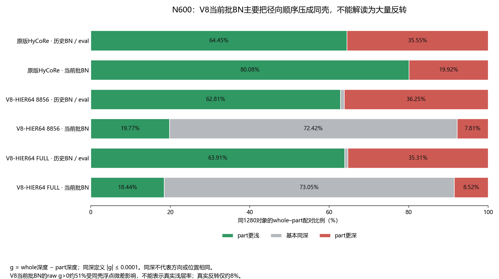

# N600当前批BN顺序统计的补充说明

补充日期：2026-10-20；基础冻结诊断数据采集于2026-10-19。

这份补充纠正原报告严格使用g>0作为“顺序正确率”在大量贴cap时的解释局限。原报告正文与用户修改保持原样；本页为CPU重算已有缓存，没有模型前向或训练更新。

## 1. 比较的是同一个对象的whole和part

每行都是同一批1280个训练对象，同一对象的whole与其N600 part逐对相减。两种BN条件的对象ID及标签逐元素一致。定义：

$$
g=d_0(whole)-d_0(part).
$$

g>0.0001为part更浅，|g|≤0.0001为基本同深，g<−0.0001为part更深。这个容差仅区分数值上相等的深度，不代表满足500/N或1000/N的完整margin。**同深也不表示双曲位置相同：方向仍可不同。**

| 终点模型 | BN读出 | part更浅 | 基本同深 | part更深 |
| --- | --- | ---: | ---: | ---: |
| 原版HyCoRe | 历史/eval | 825（64.45%） | 0（0.00%） | 455（35.55%） |
| 原版HyCoRe | 当前批 | 1025（80.08%） | 0（0.00%） | 255（19.92%） |
| V8-HIER64 8856 | 历史/eval | 804（62.81%） | 12（0.94%） | 464（36.25%） |
| V8-HIER64 8856 | 当前批 | 253（19.77%） | 927（72.42%） | 100（7.81%） |
| V8-HIER64 FULL | 历史/eval | 818（63.91%） | 10（0.78%） | 452（35.31%） |
| V8-HIER64 FULL | 当前批 | 236（18.44%） | 935（73.05%） | 109（8.52%） |

## 2. 为什么原版切BN后顺序改善

原版同1280对象从历史/eval改用当前批统计，whole平均深度由4.74058降至3.99355，part由4.54199降至3.61121。part平均收缩更多，平均whole−part间隔由0.19859增至0.38235，顺序正确比例64.45%→80.08%。这些是同一权重的两种读出条件，不是模型重新训练后的提升。BN使用的各层均值与方差改变了whole和part经过网络后的特征，影响不必同比例。

## 3. V8下降约三成，主要不是更多真实反转

旧V8当前批BN有927对、FULL有935对whole和part同时贴cap；它们恰好就是全部“基本同深”配对。原报告raw g>0得到51.25%和51.95%，其中大量g仅约10⁻⁷：微小浮点差把同壳配对分成正负，无法用来判断谁实际更浅。

按容差重算，V8真实反转仅7.81%和8.52%，低于原版当前批BN的19.92%。代价是72%–73%的配对失去可辨的径向间隔。去掉两者同时贴cap后，旧V8253/353（71.67%）、FULL 236/345（68.41%）的part更浅。原版没有V8的4.6深度cap，不对其使用“同时贴cap”指标。

## 4. N600的margin较小，但不能等同于惩罚力度更弱

径向hinge为：

$$
R_N=\max(0,\gamma/N-g),\qquad
\frac{\partial R_N}{\partial g}=-1\quad\text{（约束未满足时）}.
$$

N600的目标间隔比N200/400小，表示允许part更接近whole；但约束未满足时，单个hinge对g的导数并未因为margin较小而减弱。这里各N均使用同一0.01系数。链式传回网络的实际梯度还取决于映射、BN和cap，不能由margin大小单独断言。

当前批BN下，旧V8的N600平均残余hinge为0.7923，FULL为0.7965；N200反而分别仅0.2040和0.2078。因此本次可确认N600更容易同壳、完整径向约束仍未满足；不能证明历史训练中“margin较小、压力较弱”就是原因。part点数改变带来的输入差异、同一个cap与其他共享目标仍需单独干预区分。

## 5. 可复核范围

脚本读取原先18份缓存，对6份终点同1280面板生成上表，并保存全部18份的匿名统计与源SHA。源缓存SHA前后不变；对象ID与标签仅保存哈希，不公开原始值。best结果也保存在JSON供复核，不增加新的GPU实验。CSV见[tables/n600_last_same1280.csv](tables/n600_last_same1280.csv)，完整统计与校验见[tables/n600_order_clarification.json](tables/n600_order_clarification.json)。
