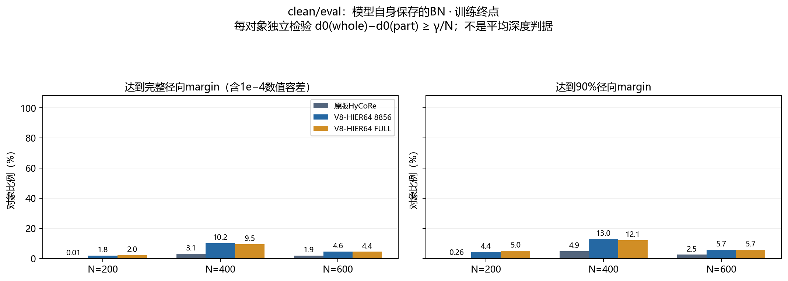
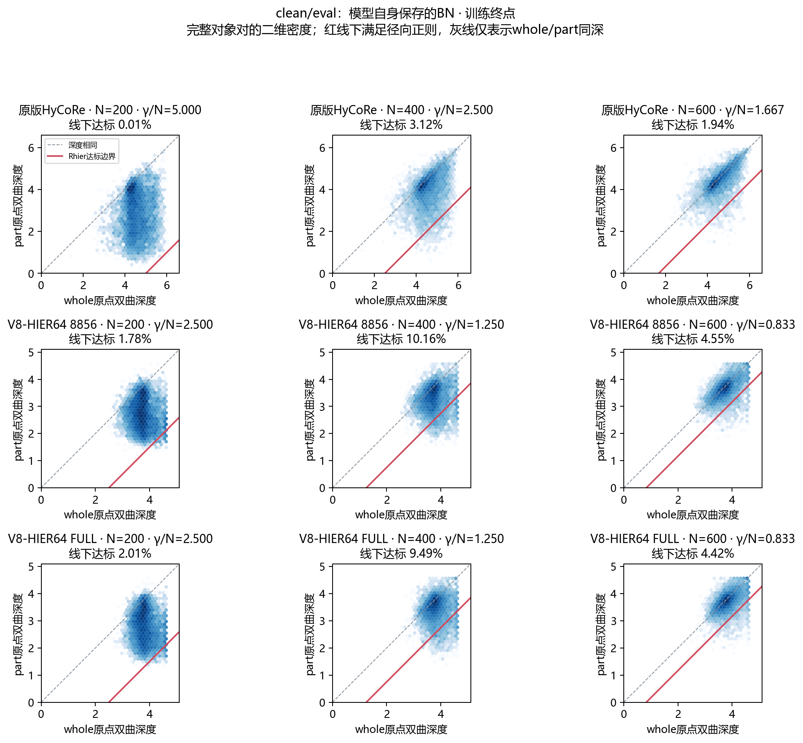
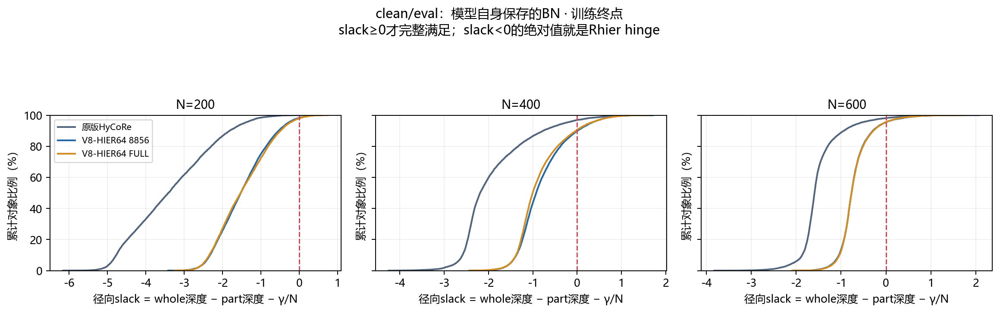
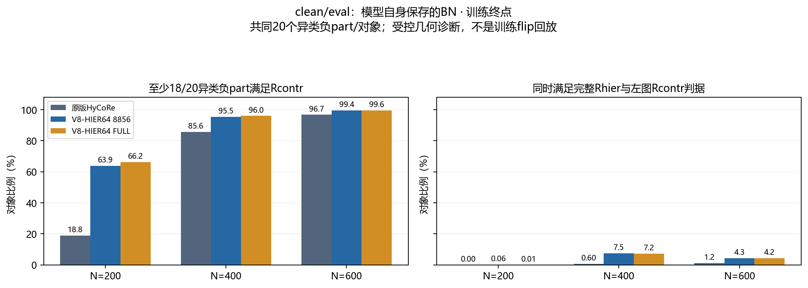

# whole–part逐对象间隔审查：V8与原版HyCoRe

日期：2026-10-19。比较原版HyCoRe、此前8856/984协议的V8-HIER64，以及最近FULL9840重跑的V8-HIER64；每版都检查预先确定的best和300轮终点。原版epoch沿用0起编号229/299，V8为已完成轮次；8856协议best为221，FULL9840 best为297。

本报告回答的是：每个对象的whole与对应part是否达到正则项设计的间隔。全部模型使用相同8856个训练对象，N=200/400/600分别统计，不用两个平均深度的差代替逐对象验收。分类成绩不用于选择诊断条件，也没有新增test前向。

**核心判断：超参数已按500/N、2正确实现，但clean/eval下只有少数对象兑现完整径向间隔；原版1000/N同样不是普遍兑现的硬约束。** 放宽到90%目标也不改变这一总体判断。当前批BN显著改善V8的N400间隔，N600则因part自身也靠近cap而仍很差，不能把whole成壳当成整个intra结构修复成功。

## 1. 代码中的设计究竟要求什么

径向项要求whole比part更深，且间隔达到一个**下界**，不要求恰好等于margin：

$$
g_i=d_0(w_i)-d_0(p_i),\qquad
R_{\mathrm{hier},i}=\max\left(\frac{\gamma}{N}-g_i,0\right).
$$

对比项则使用whole到正、负part的双曲距离：

$$
h_{ij}=d(w_i,p_j)-d(w_i,p_i),\qquad
R_{\mathrm{contr},ij}=\max(\delta-h_{ij},0).
$$

| 模型 | 曲率c | gamma | N=200径向下界 | N=400 | N=600 | 对比距离差下界delta |
|---|---:|---:|---:|---:|---:|---:|
| 原版HyCoRe | 1 | 1000 | 5 | 2.5 | 1.6667 | 4 |
| 两版V8-HIER64 | .1 | 500 | 2.5 | 1.25 | .8333 | 2 |

N是part实际点数，不是whole点数，也不是裁剪函数返回的k−1。Rcontr不能用原点深度差判断。实际训练负part来自batch内part.flip；原版是local32，V8在global64 gather后flip。CE与两项intra联合反向，intra系数各.01；这些是软损失，没有保证每个样本都满足的投影或硬约束。

代码依据：[原版裁剪及损失](../../../classification_ModelNet40/hutil.py)、[原版训练调用](../../../classification_ModelNet40/main_pointmlp_hycore.py)、[V8径向/对比目标](../../../inter_hierarchy_MN40/hier_proxy_scratch_v8/base_protocol.py)。

## 2. “符合”采用什么判据

- 完整达标：g达到gamma/N，允许1e−4双曲距离的数值容差；另保存完全无容差的计数。
- 基本达标：g至少达到90%的目标margin。这是本报告显式定义的宽松诊断，不是论文新增目标。
- 仅顺序正确：g>0，whole确实比part深。它远弱于完整margin达标。
- 对比项：每对象取20个不同的异类负part，所有模型共享负对象，统计每对达标率，以及至少18/20对达标的对象比例。联合达标要求完整Rhier且满足该Rcontr对象判据。

最后一项是受控负样本几何诊断，**不是历史训练batch.flip回放**，不能称为真实训练Rcontr合规率。

## 3. clean/eval：逐对象完整Rhier达标率

输入为原始first1024点、无增强、不覆盖whole，模型使用自己保存的eval BN。每对象用一个固定均匀随机中心，构造同中心嵌套200/400/600近邻part。原版既有完整缓存复用，旧ID已按HDF5文件名和行号转为canonical ID；V8使用完全相同的对象与中心重新前向。另由服务器CPU独立重算全9840历史part索引，核对三个N历史SHA，再验证canonical8856索引与GPU实际索引逐元素相同，见[历史索引强验证](tables/historical_part_index_bridge.json)。

| 模型及权重 | N200完整达标 | N400完整达标 | N600完整达标 | 三个N均达标 |
| --- | --- | --- | --- | --- |
| 原版HyCoRe best（原epoch 229（0起）） | 6/8856（0.07%） | 534/8856（6.03%） | 321/8856（3.62%） | 0.01% |
| V8-HIER64 8856 best（e221） | 327/8856（3.69%） | 1381/8856（15.59%） | 746/8856（8.42%） | 1.21% |
| V8-HIER64 FULL best（e297） | 223/8856（2.52%） | 1107/8856（12.50%） | 445/8856（5.02%） | 0.61% |
| 原版HyCoRe last（原epoch 299（0起）） | 1/8856（0.01%） | 276/8856（3.12%） | 172/8856（1.94%） | 0.00% |
| V8-HIER64 8856 last（e300） | 158/8856（1.78%） | 900/8856（10.16%） | 403/8856（4.55%） | 0.51% |
| V8-HIER64 FULL last（e300） | 178/8856（2.01%） | 840/8856（9.49%） | 391/8856（4.42%） | 0.52% |

三个N均达标指同一对象的三个固定part全部通过，不是把三个N的分母混在一起；它也不代表所有200–600点数或所有随机中心都通过。

### 基本达到90%目标margin

| 模型及权重 | N200 | N400 | N600 |
| --- | --- | --- | --- |
| 原版HyCoRe best（原epoch 229（0起）） | 0.56% | 8.83% | 4.58% |
| V8-HIER64 8856 best（e221） | 8.59% | 19.65% | 10.22% |
| V8-HIER64 FULL best（e297） | 6.04% | 15.70% | 6.26% |
| 原版HyCoRe last（原epoch 299（0起）） | 0.26% | 4.88% | 2.48% |
| V8-HIER64 8856 last（e300） | 4.36% | 12.95% | 5.68% |
| V8-HIER64 FULL last（e300） | 4.97% | 12.07% | 5.71% |

### 只看“whole更深”会得到多宽松的印象

以下均为训练终点：

| 模型终点 | N200 whole更深 | N400 | N600 |
| --- | --- | --- | --- |
| 原版HyCoRe | 96.97% | 83.27% | 65.88% |
| V8-HIER64 8856 | 95.65% | 81.62% | 63.29% |
| V8-HIER64 FULL | 95.30% | 78.17% | 63.36% |

达到深浅顺序，不代表留出了设计的径向间隔。反过来，少量间隔不足也不能被描述成whole/part顺序完全颠倒。

## 4. 看清每对位置与违例幅度

slack定义为实际深度差减目标margin。图2能区分whole太浅、part太深与二者同步变化；各面板颜色为格内对象数的对数，颜色尺度独立，不用于比较面板间的计数大小。图3展示违例幅度，避免只凭达标率忽略离目标还有多远。完整分位数和hinge保存在数值表中。

## 5. Rcontr与两个约束同时成立的比例

以下均为训练终点。每对象20个不同异类负part；“对象通过”指至少18个满足本模型delta。

| 模型终点 | N | 负配对达标 | 对象≥18/20达标 | 同时满足完整Rhier |
| --- | --- | --- | --- | --- |
| 原版HyCoRe | 200 | 51.72% | 18.76% | 0.00% |
| 原版HyCoRe | 400 | 91.47% | 85.60% | 0.60% |
| 原版HyCoRe | 600 | 97.66% | 96.70% | 1.16% |
| V8-HIER64 8856 | 200 | 74.94% | 63.88% | 0.06% |
| V8-HIER64 8856 | 400 | 97.10% | 95.46% | 7.52% |
| V8-HIER64 8856 | 600 | 99.62% | 99.45% | 4.30% |
| V8-HIER64 FULL | 200 | 77.01% | 66.19% | 0.01% |
| V8-HIER64 FULL | 400 | 97.43% | 95.98% | 7.20% |
| V8-HIER64 FULL | 600 | 99.73% | 99.60% | 4.21% |

两版V8使用delta2，原版使用delta4。跨曲率绝对距离不直接比较优劣，而是分别用各自配置验收。由于原版训练shuffle可能出现同类flip，而本诊断统一使用异类负例，这些比例不能冒称原版真实训练loss的零hinge比例。

## 6. 当前批BN诊断：与eval读出分开看

另外用同8856训练池的40类×32对象，共1280个固定测量对象，仅把BN切为当前local32批统计，其余模块保持eval。每个N条件都恢复参数、BN和RNG，part先whole后，不做优化更新。

| 模型终点 | N | 同1280 native完整Rhier | 当前批BN完整Rhier | 当前批BN仅顺序正确 | 当前批BN part贴V8 cap |
| --- | --- | --- | --- | --- | --- |
| 原版HyCoRe | 200 | 0.00% | 0.00% | 97.50% | 不适用 |
| 原版HyCoRe | 400 | 4.14% | 2.50% | 93.28% | 不适用 |
| 原版HyCoRe | 600 | 2.19% | 1.80% | 80.08% | 不适用 |
| V8-HIER64 8856 | 200 | 1.72% | 37.11% | 100.00% | 0.00% |
| V8-HIER64 8856 | 400 | 8.12% | 96.56% | 100.00% | 0.00% |
| V8-HIER64 8856 | 600 | 3.59% | 1.17% | 51.25% | 75.47% |
| V8-HIER64 FULL | 200 | 2.97% | 36.02% | 100.00% | 0.00% |
| V8-HIER64 FULL | 400 | 8.36% | 95.39% | 100.00% | 0.00% |
| V8-HIER64 FULL | 600 | 3.05% | 0.55% | 51.95% | 76.33% |

本表两列使用完全相同的1280对象：native从全8856缓存按对象ID筛选，当前批BN使用该固定面板；相同part中心与点数，参数保持。附表保留每条件身份摘要。面板总体40类均衡后shuffle为local32，并非生产中的每卡16类×2。当前批BN也不等于真实训练：这里没有增强、随机whole点数、part覆盖whole或参数更新。

该诊断可判断当前批归一化下是否更容易满足径向设计，不能据此认定更换正式BN一定改善分类或代理层次。

尤其要按N分别看：N600的margin比N400小，但part自身可能更深、更接近cap，仍然缺乏足够间隔。网络保持原版固定512点的首级FPS请求，N200/400包含重复采样、N600不属于该情形；本次只记录这种输入与几何差异，没有通过单因素干预证明FPS是原因，也不把当前批BN条件直接当成真实训练统计。

## 7. 怎样解读这次检查

1. 参数正确实现与最终几何达标是两件事。500/N、2及原版1000/N、4在源码中的单位和位置均已核对。
2. V8按自身较小目标的达标率较原版高，不能单独归因于HIER：曲率、margin与训练协议同时不同；本报告没有把这些因素分离为单因素因果效果。
3. Rhier是软压力；达到较低平均loss，不代表每个对象都满足间隔。分类、对比与其他正则共享网络，BN读出条件也影响位置。
4. 原版clean/eval也不能自动假定全部满足1000/N。N=200要求gap≥5，whole自身不足5的对象即使part在原点也不可能达标；表中同时保存这种可行性比例。
5. V8 cap仅限定whole/part深度不超过约4.6，不会主动把whole推到4.6，也不保证part保持在允许其margin的内部。
6. 本报告是固定输入几何检查，不给未记录的历史训练逐对象达标率。真实训练日志只有均值时，不能从均值反推比例。

## 8. 素材、验收与复现

表格：[逐N全统计](tables/paired_margin_summary.csv)、[40类统计](tables/paired_margin_by_class.csv)、[三个N全满足](tables/paired_all_three_sizes.csv)、[统计验收](tables/paired_margin_validation.json)、[输入与状态验收](tables/input_and_forward_validation.json)。各自best与当前批BN的同类图均在[图索引](tables/figure_index.json)，未把best不同轮次当作单因素训练对照。

独立工具：[输入整理](../diagnostics/whole_part_margin_20261019/setup_local_inputs.py)、[冻结前向](../diagnostics/whole_part_margin_20261019/forward_probe.py)、[配对统计及图](../diagnostics/whole_part_margin_20261019/analyze_pairs.py)。只在空闲GPU运行，源权重与数据SHA不变，参数/BN/RNG逐条件恢复；零backward、零optimizer、零test。完整向量、样本ID、服务器配置和日志仅保存在私有目录。
