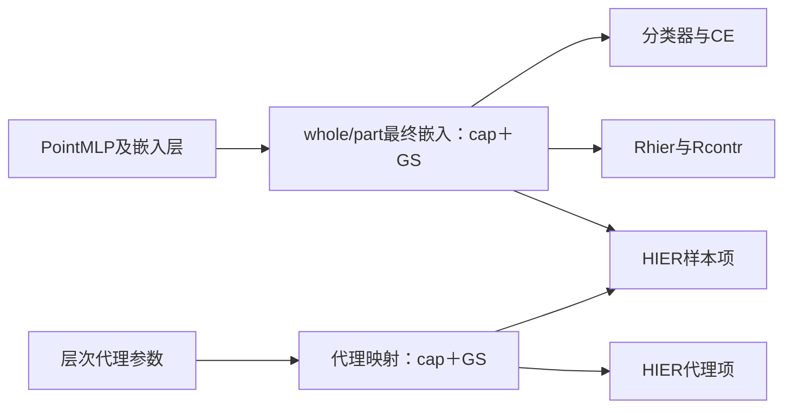

# 实验参数命名与HIER梯度缩放范围

日期：2026-10-20。按用户最新决定重整V8和原版修改线；早期V1–V7仍由33旧规范负责。本规范更新其“几何参数和seed只放元数据”的旧约定。旧运行身份保持，通过[机器映射](experiment_registry_v2.json)使用新的展示名。

## 命名与未来默认协议

```
{谱系}-{采样族}[-K20-W0]-C{曲率}-CAP{切空间上限或none}-GS{0/1}-M{gamma}_{delta}-{选模}-S{seed}
```

| 字段 | 含义 |
| --- | --- |
| ORIG / V8 | 原版训练流程的修改线 / V8实现及其对照。关闭HIER不会将V8变成ORIG |
| B0-32 / B64 / HIER64 | shuffle32 / 类别均衡global64且关闭HIER / 同类别均衡global64开启HIER |
| K20-W0 | HIER近邻参数20、无warmup；只有HIER族需要 |
| C0.1 / C1 | 全链双曲运算曲率 |
| CAP2.3 / CAPnone | whole/part最终切空间模长上限2.3 / 不加此上限，仍有数值安全投影；HIER版代理用相同前向cap |
| GS1 / GS0 | 启用 / 关闭逆度量梯度缩放；GS不是norm裁剪、AMP GradScaler或学习率 |
| M500_2 / M1000_4 | Rhier阈值500/N、Rcontr阈值2 / 原阈值1000/N、4；两损失系数仍各0.01 |
| TS / VS984 | 全9840训练、每轮2468 test选best / 历史8856训练、984独立验证选best |
| S4780 / S22 | 实际随机seed；以后ORIG修改线4780，V系列22 |

今后新实验使用TS、官方9840训练，不再另划984验证集；test只评估，不反向、不更新BN。按300轮完整预算保存best，不因test早停。历史VS984不重标TS、历史seed不改写。官方launcher本来显式使用4780；22是Python参数未传seed时的fallback，不将二者混淆。

本次新组：`ORIG-B0-32-C0.1-CAP2.3-GS1-M500_2-TS-S4780`。对照61为完全相同参数名中的`GS0`。

名称用来定位主要条件；完整可复现性仍需manifest中的源码、数据行顺序、增强/随机流、BN、损失、优化器、worker、评估batch和环境。ORIG与V8即使C/CAP/GS/M相同，仍有seed、随机流等差异，不能据此声称完全相同实现。

## 既有实验的展示映射

以下是身份映射，不改变已有目录、日志、checkpoint和结果。VS984与TS是不同训练，不能合并。

| 旧称或范围 | 新展示名 |
| --- | --- |
| ORIG-B0-32-S4780 | `ORIG-B0-32-C1-CAPnone-GS0-M1000_4-TS-S4780` |
| V8-B0-32-C01 | `V8-B0-32-C0.1-CAP2.3-GS1-M500_2-VS984-S22` |
| V8-B64 | `V8-B64-C0.1-CAP2.3-GS1-M500_2-VS984-S22` |
| V8-HIER64-K20-W0 | `V8-HIER64-K20-W0-C0.1-CAP2.3-GS1-M500_2-VS984-S22` |
| V8-B0-32-C01-FULL9840-TESTSEL | `V8-B0-32-C0.1-CAP2.3-GS1-M500_2-TS-S22` |
| V8-B64-FULL9840-TESTSEL | `V8-B64-C0.1-CAP2.3-GS1-M500_2-TS-S22` |
| V8-HIER64-K20-W0-FULL9840-TESTSEL | `V8-HIER64-K20-W0-C0.1-CAP2.3-GS1-M500_2-TS-S22` |
| V8-B0-32-C01-NOHOOK-FULL9840-TESTSEL | `V8-B0-32-C0.1-CAP2.3-GS0-M500_2-TS-S22` |
| ORIG-B0-32-C01-S4780 | `ORIG-B0-32-C0.1-CAPnone-GS0-M1000_4-TS-S4780` |
| ORIG-B0-32-C01-CAP23-S4780 | `ORIG-B0-32-C0.1-CAP2.3-GS0-M1000_4-TS-S4780` |
| ORIG-B0-32-C01-CAP23-MHALF-S4780 | `ORIG-B0-32-C0.1-CAP2.3-GS0-M500_2-TS-S4780` |
| 本次新增GS组（已迁8000） | `ORIG-B0-32-C0.1-CAP2.3-GS1-M500_2-TS-S4780` |

新运行从创建时写新名；已运行实验通过registry展示新名，保留原manifest的canonical_name作不可变溯源，不追溯编辑。别名必须同时匹配谱系和选模协议，不能用裸`V8-B0-32`区分两批训练。

## HIER的梯度缩放究竟放在哪里

核对官方HIER仓库固定commit `3986a744a1a54fd357e307d1cb3f2e81910b9ffc` 的本地源码副本：

1. [hyptorch/nn.py](https://github.com/sung-yeon-kim/HIER-CVPR23/blob/3986a744a1a54fd357e307d1cb3f2e81910b9ffc/hier/hyptorch/nn.py#L176)：`ToPoincare`先截切向量模长，再expmap/project，最后调用grad_fix。前向位置不因grad_fix改变。
2. [hyptorch/pmath.py](https://github.com/sung-yeon-kim/HIER-CVPR23/blob/3986a744a1a54fd357e307d1cb3f2e81910b9ffc/hier/hyptorch/pmath.py#L30)：`RiemannianGradient.backward`在球内输出x处，将上游梯度乘逆度量因子。
3. [models/model.py](https://github.com/sung-yeon-kim/HIER-CVPR23/blob/3986a744a1a54fd357e307d1cb3f2e81910b9ffc/hier/models/model.py#L111)：图像网络最终head使用`ToPoincare(riemannian=True)`；样本嵌入经过这里。
4. [losses.py](https://github.com/sung-yeon-kim/HIER-CVPR23/blob/3986a744a1a54fd357e307d1cb3f2e81910b9ffc/hier/losses.py#L30)：HIERLoss的512个层次代理lcas也单独经过`ToPoincare(riemannian=True)`。样本—代理与代理—代理项都使用这些输出。
5. [train.py](https://github.com/sung-yeon-kim/HIER-CVPR23/blob/3986a744a1a54fd357e307d1cb3f2e81910b9ffc/hier/train.py#L153)：监督度量损失和层次损失先相加，统一backward。官方AdamW参数组覆盖网络、监督损失模块和层次损失模块，不是只优化层次代理。

$$
s(x)=\frac{(1-c\lVert x
Vert_2^2)^2}{4},\qquad
\widetilde{\frac{\partial L}{\partial x}}=s(x)\frac{\partial L}{\partial x}.
$$

这里的梯度由损失和整条计算图决定，不是某一个样本自行提供的固定数。样本侧会汇合监督度量损失与HIER样本项的梯度；层次代理侧会汇合HIER样本项和代理项的梯度。代理—代理项本身没有到图像网络的直接路径；它改变代理后会在未来间接影响样本项。

缩放不是只管理“HIER正则的梯度”。同一映射输出后，只要损失到参数的反向路径穿过该输出，该路径贡献就会被缩放。因此样本侧缩放会沿head继续传给可训练backbone。HIER中的PA监督分类代理是另一个概念：它们在PALoss_Angle里做余弦归一化，没有经过HIERLoss层次代理的ToPoincare，不能说所有名为proxy的参数都直接接受该缩放。

## V8如何移植，哪些参数并非直接缩放

V8在最终共享whole mu、part nu映射末端各放一次InverseMetric，之后才分支到分类器、HyCoRe正则和HIER；512层次代理各经过自身的一次相同映射。没有在每项loss再加一次，也没有在每层网络重复乘。



上图前向向右；反向沿箭头返回。CE、Rhier、Rcontr和HIER样本项传回PointMLP/嵌入层的贡献都经过GS。即使HIER完全关闭，前三项也仍经过GS，因此无HIER的B0/B64开启GS是有效实验条件。

分类器参数位于GS之后：CE对分类器参数的直接autograd梯度不穿过共享mu的GS，故不直接乘该因子。HIER样本项不经过分类器，也没有对分类器参数的直接梯度。注意全模型norm裁剪1、动量、weight decay及后续网络演化可产生间接影响；“直接梯度没过GS”不等于最终分类器更新在两条完整训练中完全相同。

$$
\widetilde{g}_{\theta}=\sum_i J_i(\theta)^{\mathsf T}s(x_i)g_{x_i}.
$$

每个whole、part、proxy有自己的s(x)。因此它会重加权样本/分支贡献，汇合后的网络梯度方向也可能改变；不能理解为“给整个网络统一乘一个学习率”。源代码的RSGD对ManifoldParameter的处理、裁剪及优化器自身变换，也与这个局部GS是不同步骤。cap仅影响前向模长及映射导数，不保证所有点到球壳；GS前向本身是恒等映射。

c0.1且切空间cap2.3处，s约为0.094197；球心处为0.25。这是局部反传梯度的系数，不能直接当成AdamW实际位移比例。新CPU合同以同输入、同权重比较GS0/GS1：前向逐元素一致，嵌入之前的梯度按s变化，位于其后的分类器直接梯度一致；正式GPU仍须独立短测通过。

实现依据：`inter_hierarchy_MN40/hier_proxy_scratch_v8/geometry.py`的InverseMetric/to_ball/FinalGeometry，`hier_loss.py`的proxies，`train.py`的统一loss.backward；原版GS补充使用相同cap/map函数且保留原RSGD。
