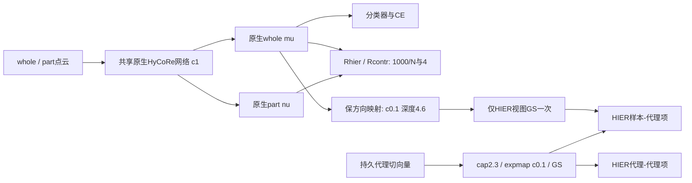

# V9：原生HyCoRe与独立等深度HIER分支

日期：2026-10-20。状态：30项CPU检查、双进程梯度对照和双卡训练限定短测通过；19:44从头正式启动，首轮完整评估/检查点验收通过，后台继续。

## 已确认的实验设计

用户授权“各自保留”的V9部署到8001，并确认继续双卡类别均衡global64、300轮。这里的“各自保留”指基础几何与HIER局部几何分别贴近原实现；固定壳视图、分类骨干和采样协议仍是本实验的方法与协议选择，不称为两个原实验的完全复现。本次只启动一条主训练，不追加矩阵。

| 条件 | V8主训练 | 本次V9 |
|---|---|---|
| 原生whole/part曲率 | c=0.1 | c=1 |
| 原生whole/part额外处理 | 共享cap2.3及GS | 不加HIER式cap/GS；保留原生数值投影 |
| HyCoRe径向与对比margin | 500/N、2 | 1000/N、4 |
| HIER看到的whole | 共享whole，其半径随训练和BN变化 | 取原生whole方向，固定c=0.1下原点深度4.6 |
| HIER样本GS | 共享输出，影响全部目标 | 只经过HIER视图分支一次 |
| 层次代理 | 512×256；c0.1、cap2.3、GS、AdamW | 保持 |
| 训练batch | 双卡，每卡16类×2例；global64 | 保持，200步/轮 |
| 训练/选模 | FULL9840组为9840训练、2468 test逐轮选best | 同FULL9840协议，无验证子集 |

用户已明确今后test选模；这里按此授权执行，test仅eval/no_grad前向，不参与梯度、学习率调节或提前终止。旧8856/984验证组选模方式不追溯改写。

## 表示与梯度流

原生网络输出$\mu_i$（whole）、$\nu_i$（part），在$c_b=1$球内用于分类与HyCoRe。HIER样本视图为

$$
\widehat{\mu}_i=r_H\frac{\mu_i}{\|\mu_i\|},\qquad
r_H=\frac{\tanh(\sqrt{c_H}\,4.6/2)}{\sqrt{c_H}},\qquad c_H=0.1.
$$

$r_H=1.9651196143$。这是保方向的跨曲率视图，不是等距变换。原生whole和part均不被拉到此壳上，part不构造HIER视图。固定半径的导数去除该分支对原生whole的直接径向梯度，角向梯度保留。共享网络被更新后，原生whole/part的半径仍可能间接变化。

HIER视图在归一化后经过一次原HIER逆度量梯度缩放，其常数为

$$
s_H=\frac{(1-c_H r_H^2)^2}{4}=0.09419696766.
$$

基础CE、Rhier、Rcontr的路径不经过该GS。层次代理仍用自己的cap→expmap→GS。若原生向量范数不超过$10^{-8}$、出现非有限数或越出原生球，明确报错，不用detach、直通估计或补造方向隐瞒问题。

## 固定配置

- 名称：`V9-HIER64-K20-W0-Cbase1-Chier0.1-CAPbaseNone-H4.6-GShier-M1000_4-TS-S22`。
- 从头随机初始化，seed22，无teacher或来源checkpoint；PointMLP/D256，40类；FP32。
- 双卡global64，每卡16类×2例、两卡类别块分离，200步/轮，300轮；HIER从第1步生效，权重0.5。
- 保留原HyCoRe的part先、whole后，共享local32 BN，part修改whole的原始别名行为和global64 flip负例。crop whole800–1024，part200–600。
- 总目标为$L_{CE}+0.01R_{contr}+0.01R_{hier}+0.5(R_{sample}+R_{proxy})$。HyCoRe为c1、1000/N和4；HIER为c0.1、margin0.1/tau0.1、K20/T50；保留样本与代理self-k排除。
- 主网络RiemannianSGD：lr0.1→0.005，momentum0.9，weight decay0.0002，网络梯度范数clip1。代理AdamW：lr0.01→0.0005，betas0.9/0.999，eps1e-8，weight decay0.01，无额外代理梯度clip。均300轮cosine。
- 代理初始化为官方$\mathcal N(0,I_D)2.3\times0.9/\sqrt D$；只做前向cap2.3，不新增参数或Adam状态的径向投影。
- best按每轮完整2468 test未舍入OA严格变好保存，平局保留最早；完整训练300轮。原生eval/no_grad读出，历史BN保留。

## 实现与验收

代码位于`inter_hierarchy_MN40/hier_proxy_scratch_v9/`，不改旧V5–V8入口。`base_protocol.py`保留前向/采样协议并恢复c1/1000/N/4；另按官方`torch.max(x,0)`保留零hinge处的半梯度，这一精确边界修正单独记录，不归因于HIER结构目标。

`geometry.py`只新增HIER视图，不安装原生输出hook；`train.py`将两域分支，`parameter_audit.py`使用相同路由；`telemetry.py`分别记录原生c1 whole/part和c0.1 HIER视图/代理。旧单曲率审查工具不能直接混用本次张量，manifest明确标注两个域。

1. CPU：官方HyCoRe loss数值及梯度、四处原生c1/初始化保持、壳/方向/GS次数/角向梯度、原生基础梯度不变、完整训练池和best规则。
2. CPU双进程：global64模型与代理梯度对单进程参考，避免错误的rank倍数。
3. 检查GPU完全空闲、UUID固定与锁；双次检查通过后执行2轮×2步训练限定短测，读训练数据选smoke检查点，不读取test。核对有限性、双rank代理同步、每步BN计数+2、HIER视图深度4.6、原生网络初始化身份。
4. 短测退出并确认GPU空闲，正式任务从头重新初始化。源码固定、独立目录，禁止从smoke续训。
5. 正式首轮核对200次更新、2468 test计数、last/best保存、参数及梯度有限和几何分域。

保留每轮指标、逐步心跳、双rank恢复状态、best/last及每20轮checkpoint；e1/e5/e99另外存档。e1/5/20/40/99/100/160/200/240/300保存分项参数梯度审查，以及同一次真实训练前向的原生mu/nu、HIER视图和更新前代理，供后续追踪热点、激活和角向分布。

## 解释边界与后续比较

首要比较是同FULL9840协议的V8与V9，但V9同时恢复原生曲率、去除共享cap/GS并改变HIER样本视图；一条主训练只能检验组合方案，不能独立归因各开关。固定壳可以排除HIER精确近邻排序中的样本径向差异，但不能保证代理方向分散、热点消失、代理更浅或分类收益。官方带数值稳定项的距离仍按原代码实现，不声称所有浮点退化情形均有完全相同排序。

后续审查应分别看：原生whole/part的逐对象margin满足率，HIER视图的方向类间/类内结构，代理深度与cap率、sample/proxy两类祖先激活、NN4覆盖与重复热点，以及按激活分组的代理—类别方向夹角。不能把人为固定的HIER壳当作原生whole自动成壳的证据。

## 上线记录

- 生产源码：`b5d2d8b6dcc65be0d7ffafd39dde1168d98bc562`，分支`codex/v9-dual-curvature-shell-20261020`，本地提交并推送后，服务器fetch/pull --ff-only同步并冻结。
- 19:43提交有效后台；19:44:28–19:44:46完成2×2 train-only短测，官方test未读取。19:44:55从头启动300轮正式训练，使用8001空闲GPU1/2，两次空闲检查后以UUID固定。
- 30项单元检查（5项完整训练/选模＋9项几何＋10项原HyCoRe协议＋6项集成）及CPU双进程global64梯度对照通过。首次两次尝试停在CPU严格容差检查，均无GPU训练；调整浮点容差/参考dtype并新增生产FP32核验后通过，科学实现未改变。
- 原生网络初始化SHA：`fd7251e0eb6b397ecaf3862e9cc00a6bc2be9b684329fdc31dc05915b388d29d`。短测与正式e0的网络/代理张量逐元素一致，正式未加载短测权重。
- 短测快照：HIER whole深度范围4.5999994–4.6000004；方向与原生whole一致。原生whole/part均深度2.4808/2.4940（同一初始实际训练前向）；此处是不同域读出，不能把HIER深度当成原生whole深度。
- 19:47:50保存首轮：200次更新、完整2468 test、best/last/e1文件及双rank恢复状态通过；代理Adam step=200、所有BN计数400（每步两次训练前向），评估未改变BN。网络/代理/Adam状态有限，双卡代理最大差异0；HIER视图深度偏差最大约3.8e−7。首轮168.38秒，峰值29628MiB/卡，随后继续第2轮。
- 首轮原生whole深度范围2.099–6.122、平均4.099；part平均3.881。这是200批增强训练前向的12800个位置，包含重复训练对象，不能当作clean/eval全数据集分布。原生深度确实可超过4.6；HIER输入另固定4.6。仅用作路由正确性证据，不据此声称结构或准确率收益。
- 审核摘要：[几何与从头初始化验收](artifacts/v9_launch_2026-10-20/launch_geometry_acceptance.json)、[首轮验收](artifacts/v9_launch_2026-10-20/first_epoch_acceptance.json)。保存的e1权重SHA为`6b2b2687ca12746b9f037b13099c1028215e2a24b9e987048462eef75df8fc9c`。

私有目录、PID、环境和GPU UUID在本地忽略的65工程交接；共享文档不记录服务器地址或原始日志。
