# V9 whole与层次代理的嵌入深度审查

日期：2026-10-21。核心比较五组已完成实验，每组best与训练终点各一份；另附循环采样两组同e120及无HIER组best/e300，共14份固定权重。全量测量对象为同一批9840个训练对象。

**V9缓解了原始距离下的热点集中，但没有解决代理贴cap：e300时V8为510/512，V9为512/512。V9代理没有整体进入样本球壳内侧，也未形成可辨认的径向层次。** 原生whole仍存在深度分散；HIER所见whole固定4.6是分支构造，不能当作原生whole学出了球壳。

## 1. 比较对象与测量口径

| 实验 | 原生几何／margin | 采样与预算 | HIER输入 | seed |
| --- | --- | --- | --- | --- |
| 历史原版HyCoRe | c1，无额外cap/GS；1000/N、4 | shuffle32；历史训练含早期resume | 无 | 4780 |
| 原版c0.1＋cap＋半margin＋GS | c0.1，cap2.3、GS；500/N、2 | shuffle32；307步×300轮 | 无 | 4780 |
| V9-B64，无HIER | c1，无额外cap/GS；1000/N、4 | 均衡64；200步×300轮 | 无 | 22 |
| V9-HIER64 | c1，无额外cap/GS；1000/N、4 | 均衡64；200步×300轮 | c0.1固定深度4.6＋分支GS | 22 |
| V8-HIER64／TS | c0.1，cap2.3、共享GS；500/N、2 | 均衡64；200步×300轮 | 原生whole的实际半径 | 22 |

五组均为完整9840训练池、test选模口径；V8使用TS版本，非旧VS984版本。V9-B64与V9-HIER64是相互匹配的HIER整体增量比较；原版c0.1基线与旧V9-B64同时改变几何、margin、seed及训练协议，不能把差异独立归因为batch。最新c0.1循环配对在第7节单列。完整成绩与名称见[68实验总表](../68_ALL_V8_ORIGINAL_V9_EXPERIMENTS_2026-10-21.md)。

测量使用每个对象前1024点、同一排序和相同输入字节、batch32、model.eval()、历史BN、no_grad。未增强、未更新参数、未重新校准BN、未计算任何test输入。best已经事先固定，本次没有再次选模。历史原版best元数据epoch=229、终点=299，保留其0起编号；终点对应完成300轮。

双曲深度与归一化球坐标半径分别定义为：

$$
d_0(x)=\frac{2}{\sqrt c}\operatorname{atanh}(\sqrt c\|x\|),\qquad q=\sqrt c\|x\|.
$$

跨曲率时分面展示深度，并附q的累积分布；q仅表示相对各自球边界的位置，不等于相同双曲距离或相同表达能力。c0.1的额外cap2.3对应深度4.6；原生c1组没有这一额外上限。贴cap定义为与4.6相差不超过0.001，原生c1组该指标不适用。

## 2. whole的完整深度分布

| 实验 | 权重／实际轮次 | c | 均值 | 中位数 | 标准差 | P5–P95 | 最小–最大 | 贴cap |
| --- | --- | --- | --- | --- | --- | --- | --- | --- |
| 历史原版HyCoRe | best／229（原0起） | 1.0 | 4.631 | 4.607 | 0.526 | 3.734–5.455 | 1.299–6.213 | — |
| 历史原版HyCoRe | e300／299（原0起） | 1.0 | 4.565 | 4.490 | 0.508 | 3.813–5.456 | 1.463–6.047 | — |
| 原版c0.1＋cap＋半margin＋GS | best／e184 | 0.1 | 4.585 | 4.600 | 0.115 | 4.600–4.600 | 2.336–4.600 | 96.96% |
| 原版c0.1＋cap＋半margin＋GS | e300／e300 | 0.1 | 3.836 | 3.837 | 0.514 | 2.964–4.600 | 1.592–4.600 | 12.47% |
| V9-B64，无HIER | best／e237 | 1.0 | 4.293 | 4.425 | 0.709 | 2.896–5.232 | 1.609–6.178 | — |
| V9-B64，无HIER | e300／e300 | 1.0 | 4.039 | 4.326 | 0.970 | 2.120–5.152 | 0.869–6.152 | — |
| V9-HIER64 | best／e204 | 1.0 | 4.831 | 5.082 | 0.858 | 2.791–5.727 | 1.279–6.213 | — |
| V9-HIER64 | e300／e300 | 1.0 | 3.888 | 4.254 | 1.093 | 1.513–5.087 | 0.930–6.213 | — |
| V8-HIER64／TS | best／e297 | 0.1 | 3.906 | 3.881 | 0.338 | 3.400–4.600 | 2.601–4.600 | 6.05% |
| V8-HIER64／TS | e300／e300 | 0.1 | 3.841 | 3.802 | 0.323 | 3.351–4.508 | 2.537–4.600 | 3.56% |

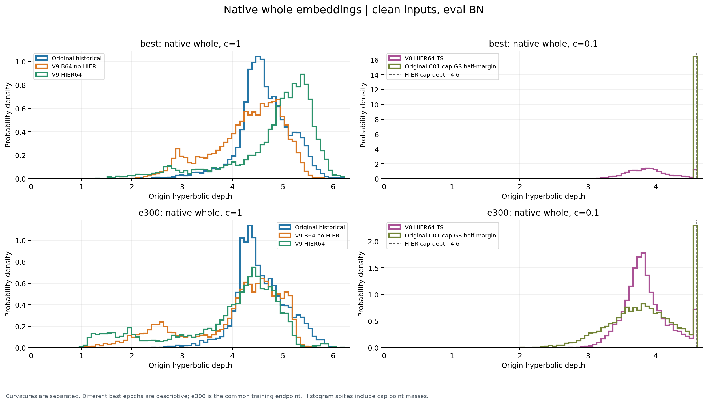

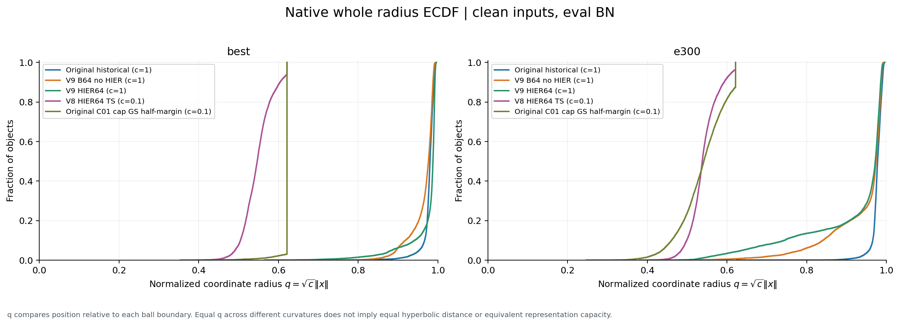

**在共同e300，V9-HIER64的原生whole均值3.888、中位数4.254、标准差1.093；匹配无HIER对照为4.039、4.326、0.970。** 这份固定读出中，加入HIER后原生whole平均略浅，分布更宽，没有变成薄壳。HIER视图仅保留方向，并不保证共享网络更新后原生半径不变。

best与末轮也有明显差别：V9-HIER64的原生whole均值4.831→3.888，中位数5.082→4.254；高表现的原版c0.1基线best贴cap96.96%，末轮只有12.47%。因此不能只凭某一份best或末轮概括整个训练过程，也不能把这些跨checkpoint差异全部归因于BN：这里网络权重和BN状态都随训练变化，本次没有做新的BN因果干预。

## 3. V9代理是否进入球壳内部

V9包含原生c1 whole与独立c0.1 HIER视图两个域。代理只与同域的HIER视图比较：

$$
d_0(\hat\mu)=4.6,\qquad c_{\mathrm{HIER}}=0.1.
$$

| 实验 | 权重 | HIER whole中位深度 | 代理深度最小–最大 | 代理深度标准差 | 贴cap代理 | 参数模长中位数 | 参数模长最小–最大 |
| --- | --- | --- | --- | --- | --- | --- | --- |
| V8-HIER64／TS | best | 3.881 | 4.071713–4.599994 | 3.15e-02 | 510/512 | 6.933 | 2.036–7.206 |
| V8-HIER64／TS | e300 | 3.802 | 4.084300–4.599994 | 3.08e-02 | 510/512 | 6.915 | 2.042–7.184 |
| V9-HIER64 | best | 4.600 | 4.599993–4.599996 | 6.18e-07 | 512/512 | 8.051 | 6.557–8.465 |
| V9-HIER64 | e300 | 4.600 | 4.599992–4.599994 | 2.98e-07 | 512/512 | 6.885 | 5.770–7.232 |

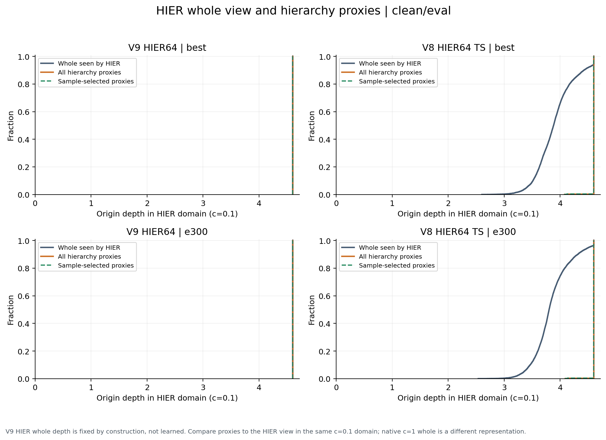

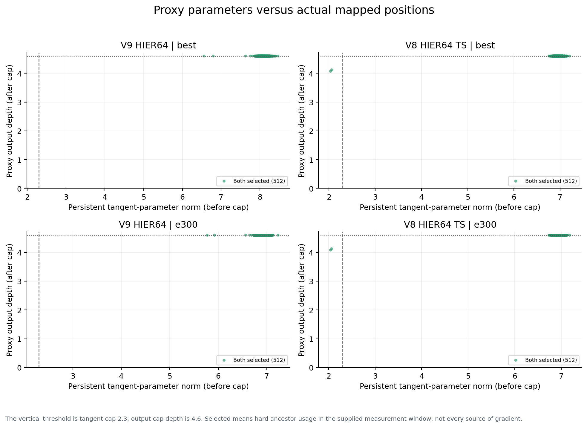

**V9在best和e300的512个代理全贴cap。** e300代理深度约4.599992–4.599994，标准差仅约3×10⁻⁷，属于数值薄壳，不能把这些浮点微差读作代理分层。其保存参数模长却在5.770–7.232，中位数6.885，远大于2.3。前向cap把这些不同模长压到几乎相同的输出半径。

与V8相比，V9末轮参数模长中位数6.885与V8的6.915接近；V8尚有两个内部代理，V9则没有。**本次证据不支持V9改善了代理的径向分布。** cap是上界，没有保证代理严格浅于whole；固定whole视图也没有阻止代理进入cap区。

## 4. 代理是什么时候撞cap的

| 轮次 | V8贴cap代理 | V9贴cap代理 | V8参数模长中位数 | V9参数模长中位数 |
| --- | --- | --- | --- | --- |
| 0 | 0 | 0 | 2.069 | 2.069 |
| 1 | 194 | 196 | 2.054 | 2.029 |
| 5 | 510 | 378 | 2.976 | 2.742 |
| 20 | 510 | 509 | 5.129 | 4.655 |
| 40 | 510 | 509 | 7.653 | 7.281 |
| 99 | 510 | 512 | 9.909 | 9.772 |
| 100 | 510 | 512 | 9.905 | 9.773 |
| 300 | 510 | 512 | 6.915 | 6.885 |

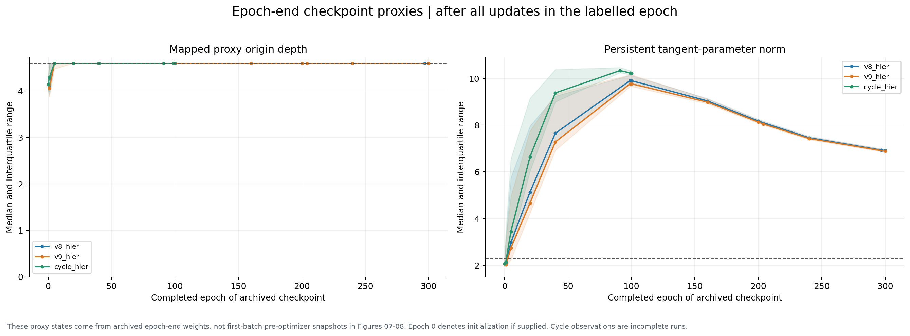

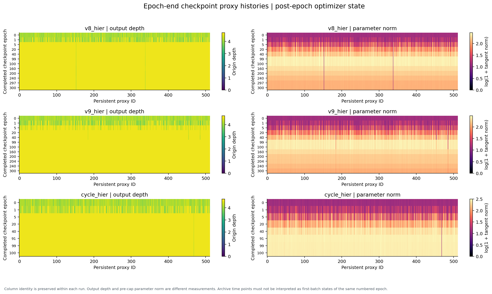

两组从完全相同的代理初始化起步：e0参数模长中位数2.069、深度中位数4.137。V9在e5只有378个贴cap，少于V8的510个，说明早期饱和确实延缓；但e20已有509个，e99存档已512个，后续存档一直为512。只能确定这些存档时刻，未还原每个代理首次越界的精确step。

两组参数模长在中期约增至9.8–9.9，末期回落至约6.9。**并非整个训练一直向外增长；晚期虽然回缩，仍未回到2.3以内，因此输出深度继续贴cap。** 本次没有分离V9的即时梯度、Adam历史状态及weight decay贡献，不能仅凭轨迹把原因定为学习率过大、eps或某一个损失项。[57的干预证据](../57_V8_CAP_AND_WHOLE_CAUSES_2026-10-18/report.md)可作为候选机制背景，不能替代对V9的直接干预。

## 5. 贴cap是否等于代理没有被训练

| 实验 | 权重 | sample曾选中 | sample正hinge且非碰撞曾选中 | proxy曾选中 | sample选择有效数量 | proxy选择有效数量 | 最集中代理占proxy选择比例 |
| --- | --- | --- | --- | --- | --- | --- | --- |
| V8-HIER64／TS | best | 512 | 512 | 512 | 315.3 | 108.4 | 30.52% |
| V8-HIER64／TS | e300 | 512 | 512 | 512 | 311.3 | 106.5 | 30.90% |
| V9-HIER64 | best | 512 | 512 | 512 | 286.8 | 274.9 | 4.59% |
| V9-HIER64 | e300 | 512 | 512 | 512 | 263.6 | 270.8 | 4.59% |

这里的“有效数量”是选择频率熵的指数，反映分配均匀度，不是有梯度的代理数量；“正hinge且非碰撞”单列为真实训练关系条件，也不能直接证明其径向梯度非零。整轮pair与triple角色的硬选择次数合并统计，源自该checkpoint对应的真实训练轮，非冻结特征重新抽样。

V8、V9的best与e300，sample与proxy分项均选中过全部512代理，sample正hinge且非碰撞集合也覆盖512个。**当前V9问题是代理全部压在同一径向壳上，不能套用V7“深层代理大量休眠”的解释。** 选择到代理和代理获得有效径向位置更新是不同的问题。

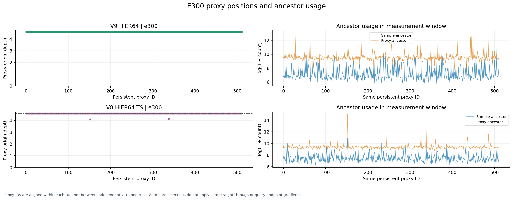

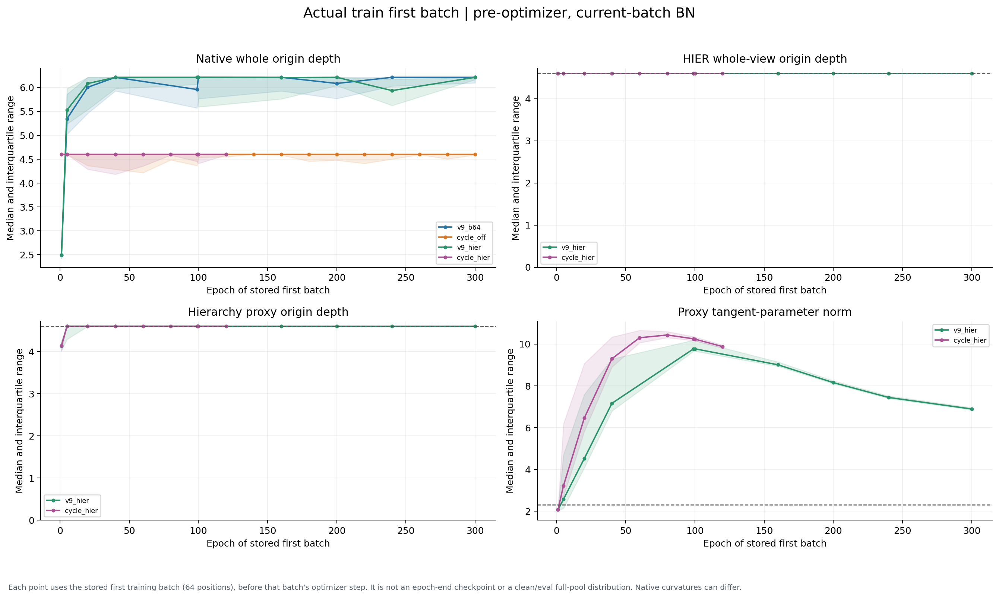

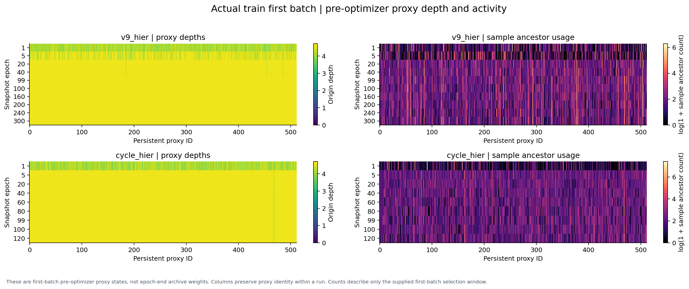

图7–8仅使用保存的首个global64训练前向，位置处于该轮第一次optimizer更新之前；它们不是9840个唯一对象的全量分布。图10–11使用轮末固定权重的代理深度与参数模长；整轮祖先选择见图5及第5节表。两类时点不混用。V8 TS没有同格式首批快照，所以首批图不伪造V8曲线；其代理历史从固定权重恢复。图7–8中的cycle_hier仅截至e120，仍在训练，不作末轮比较。

## 6. 热点缓解是否意味着代理学出了更好的层次

| 实验 | 权重 | 实际NN4覆盖 | 等whole深度覆盖 | 最大重复四例／512 | 最热四对象槽位占比 | HIER所见whole最浅1%槽位占比 | 代理方向集中度R |
| --- | --- | --- | --- | --- | --- | --- | --- |
| V8-HIER64／TS | best | 221 | 1077 | 61 | 36.57% | 72.22% | 0.412 |
| V8-HIER64／TS | e300 | 216 | 1025 | 36 | 32.67% | 71.92% | 0.412 |
| V9-HIER64 | best | 584 | 584 | 6 | 9.18% | 不适用：全部同壳 | 0.616 |
| V9-HIER64 | e300 | 725 | 725 | 7 | 6.49% | 不适用：全部同壳 | 0.625 |

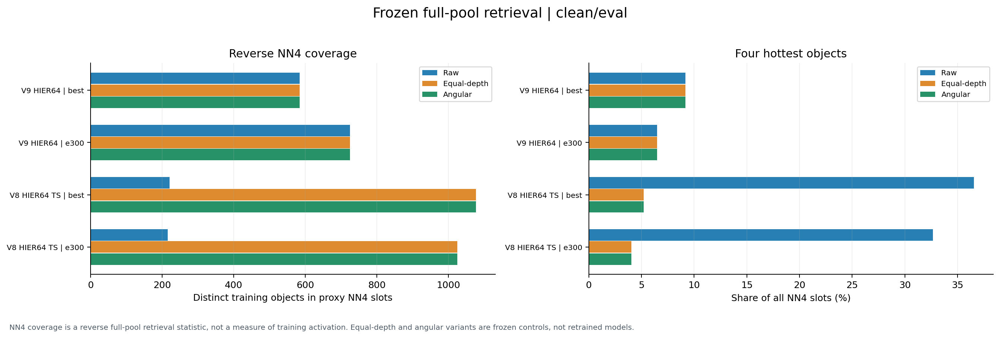

NN4是在完整9840候选池中，每个代理检索4个不同对象，总计2048个槽位；覆盖数不是训练时被使用对象的总数。比较使用与训练一致的官方FP32距离，包括Mobius分母的1e−5稳定项；另算等深度和方向夹角近邻。最浅1%按HIER所见whole深度排序：V8等于原生whole，V9是固定壳视图，因此V9该列没有径向意义；并不是说V9原生c1 whole没有深浅差异。

共同e300时，V8实际覆盖216→V9的725，最热四对象槽位占比32.67%→6.49%，最大重复四例36→7，热点集中明显缓解。V9三种近邻的覆盖都为725，且本次逐代理四例集合也一致：HIER视图已同壳，径向深浅不再改变这份近邻排序。

但V8冻结表示仅统一whole深度就能覆盖1025个对象，高于V9的725；V9代理方向集中度R也从V8的0.412升至0.625。**因此可以说V9降低了原始径向偏置下的热点，不能说它已经学习到更分散、更丰富的代理方向或径向层级。** V8→V9还同时改变基础几何与GS路径，不据此独立归因每个开关。

全部V9代理均在真实训练中使用，其最近类别方向中心夹角中位数仍约76.5°；这只是高维角度指标，不能直接解释成“完全不绑定类别”。e300有342/512代理的NN4四例同类，而V8原始距离为196/512、等深度为301/512。方向角度、类别局部纯度、径向祖先关系需分别解释。分类别统计及逐代理角度见附表。

分类准确率也没有随这些结构指标自动改善：沿用已有正式记录，V9-HIER64 best test OA93.314%，匹配B64为93.436%；e300分别88.452%与91.167%。本次没有重新测试或据test挑选诊断条件。

## 7. 最新c0.1循环配对：只看同e120

| 实验 | 固定存档 | 原生whole均值 | 中位数 | 标准差 | 贴cap比例 |
| --- | --- | --- | --- | --- | --- |
| c0.1循环B64，无HIER | e120 | 4.544 | 4.600 | 0.219 | 89.48% |
| c0.1循环HIER64（中途） | e120 | 4.384 | 4.600 | 0.376 | 59.73% |

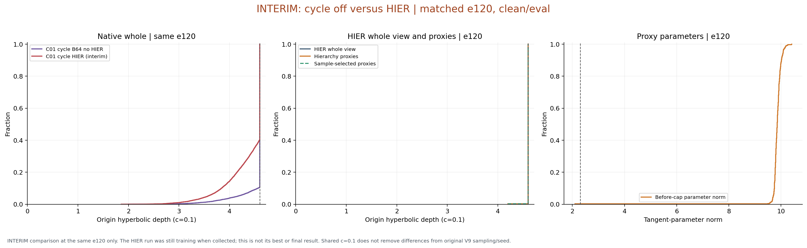

这对实验保留c0.1、cap2.3、半margin、GS、seed4780和300步/轮，共同e120更适合检查HIER增量。此时HIER组原生whole贴cap59.73%，无HIER为89.48%；HIER组仍有511/512代理贴cap，参数模长中位数9.856，NN4覆盖786。说明这个较早存档也没有看到代理整体进入壳内。HIER组仍在训练，不能与另一组最终300轮成绩混作完成配对。

循环无HIER组已完成300轮，其whole均值3.795、中位数3.787、标准差0.379；对应单卡c0.1基线为3.836、3.837、0.514。它们几何与seed一致，但还改变类别均衡、循环采样、全局负例和307→300步，应称训练batch构建协议效应。

## 8. 与原版HIER的已有审查交叉验证

| 原版HIER训练集best | whole深度 | 代理深度中位数 | 越cap参数个数 |
| --- | --- | --- | --- |
| CUB | 约4.6，极薄壳 | 4.247 | 9/512 |
| Cars | 约4.6，极薄壳 | 4.094 | 1/512 |
| SOP | 约4.6，极薄壳 | 4.600 | 497/512 |

此表复用[45原版HIER几何审查](../45_ORIGINAL_HIER_BEST_GEOMETRY_AUDIT_2026-10-08.md)与[46机制审查](../46_ORIGINAL_HIER_SOP_MECHANISM_AND_ACTIVATION_2026-10-08.md)，没有重新前向图像。SOP与V9共同说明：样本都在球壳上，并不足以保证代理形成浅层分布；CUB/Cars的浅代理不能仅由“whole成壳”解释。网络、基础目标、数据方向结构和优化轨迹仍需考虑。

## 9. 对下一步修改的实际含义

- 保留固定视图可作为隔离whole径向近邻偏置的工具，本次已看到原始热点减轻。
- 若目标是可解释的径向祖先层次，下一步关键是代理自身的优化与径向约束；继续只调整whole球壳并不能由本次证据保证成功。
- 候选机制应区分“参数越过cap后输出径向受限”与“同壳上的角向冗余”。先用固定特征和固定关系，对代理更新及Adam历史状态做配对干预，比直接再增加一轮完整训练更能定位原因。
- 本次未启动任何新训练、未改已有参数或BN，也未提前终止循环HIER主训练。

## 附表、复现与证据

- [全部径向统计CSV](stats.csv)：含上下界、P1/P5/P25/P50/P75/P95/P99、方差与cap率。
- [分类别whole统计CSV](class_stats.csv)、[逐代理统计CSV](proxy_stats.csv)、[匿名热点统计CSV](hotspots.csv)。
- [代理训练历史CSV](proxy_history_summary.csv)、[整轮训练深度与使用数量CSV](training_history_summary.csv)、[匿名完整概要JSON](summary.json)、[验收与权重身份](acceptance.json)。
- [独立工具与说明](../diagnostics/v9_embedding_review_20261021/README.md)。采集、分析、绘图分离；6项统计契约及真实输入格式联调通过，图像检查修正了浮点噪声自动放大。
- 14份权重均验证源SHA与冻结前向前后网络/BN状态不变；三组导出的训练点字节哈希一致；零backward、零optimizer更新、零test前向。CPU历史检查读取前后源文件状态一致，未构造网络或初始化CUDA。
- 原始权重、完整嵌入和样本身份留在私有诊断目录；Git只保存工具、匿名统计与图文。图像同时提供PNG与SVG。
