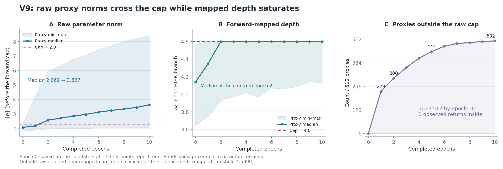
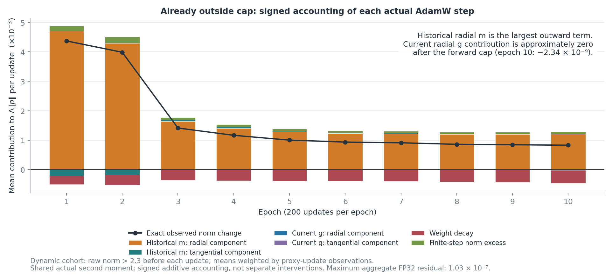
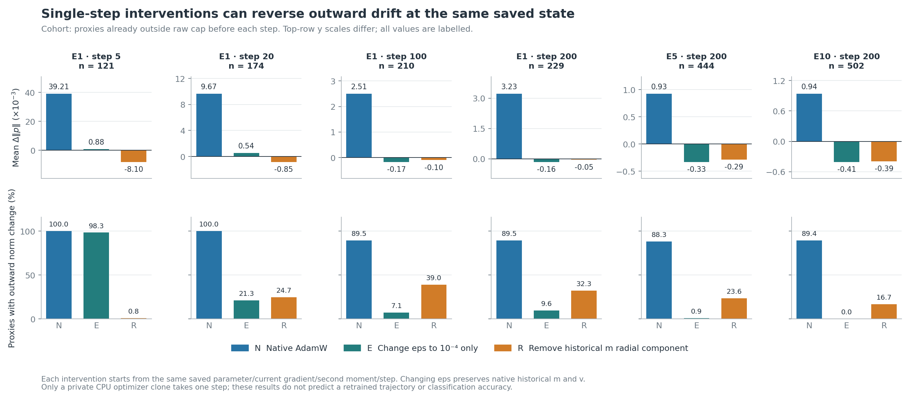

# V9代理为什么贴cap：前10轮逐步诊断

日期：2026-10-22。用户明确授权在8000服务器从头训练5–10轮，观察代理模长的快速变化。本次执行10轮×200步，保留原300轮余弦学习率计划；没有读取test、验证/选模前向或提前停止原有实验。

**当前证据把过程分成两段：首次越界前，HIER的相对距离损失确实允许向外梯度；越界后，前向cap几乎切断raw参数的径向反馈，而AdamW的历史一阶矩持续产生外向位移。whole等深和0.9初始化都已生效，但它们没有约束代理必须留在内层。**

## 1. 本次到底复现了什么

保留已完成c1 V9的原生HyCoRe c1/1000_N与4、HIER c0.1/whole固定深度4.6/代理cap2.3及GS、D256/P512/K20/T50/margin=tau=.1、lambda=.5、seed22、双卡global64类别均衡、每轮200步及原优化器。原生网络初始化SHA与历史V9一致；9840训练标签身份与既有匹配对照一致。原始入口保持不动，诊断在固定源码副本上插入观测。

为了只看训练机制，本次关闭额外编码器参数审查、每轮test和模型选择。每步仍只有原来的正式参数更新；关键步在同一个训练图上读取sample/proxy分项梯度、选择和Adam状态。单进程真实HIER图测试验证，这些观测不改变该图的最终梯度、参数更新和随机状态。

这是一条**同配置的有界机制复现**，不宣称历史轨迹逐位重放：本次e1有229个越cap，历史69报告为196；本次e5为444，历史为378。跨GPU数值路径、关闭原DDP参数审查等影响未逐项隔离，不能用新轨迹替换历史记录。新的实际更新本身则可以逐步核算，并用于固定状态干预。

完整配置和验收见[acceptance.json](acceptance.json)。原始权重、样本身份、完整日志和80份关键步快照留在私有运行目录；这里仅保存匿名聚合统计和图表。

## 2. 0.9倍初始化确实在内层，但不是持续约束

实际初始化为高斯张量`N(0,I)/sqrt(D) * 2.3 * .9`，不是将每个代理都精确归一化到同一模长。其raw模长中位数2.068705、范围1.823132–2.285371，对应典型原点深度约4.1374；512个代理初始都在cap以内。

0.9倍设置因此没有失效，只在初始时刻提供余量。最外侧代理离raw阈值2.3仅约0.01463。它不会在后续更新中继续拉代理回4.14。

| 完成轮次 | raw模长中位数 | 越cap代理/512 |
| --- | ---: | ---: |
| 初始化 | 2.069 | 0 |
| 1 | 2.175 | 229 |
| 2 | 2.569 | 300 |
| 3 | 2.708 | 358 |
| 4 | 2.849 | 408 |
| 5 | 2.965 | 444 |
| 6 | 3.121 | 473 |
| 7 | 3.239 | 488 |
| 8 | 3.346 | 493 |
| 9 | 3.448 | 499 |
| 10 | 3.627 | 502 |

第1步已经有19个代理越界。2000步内累计502个首次越界，没有任何一个越界代理回到2.3以内。raw参数还在继续变长，但映射后深度被限制在约4.6，所以需要把这两个量分开。

这里的中位数统一使用NumPy偶数样本中间两项的平均。实时日志使用Torch下中位数，例如e10为3.620573；这与本表3.626748的差异来自统计定义。

## 3. HIER本身有没有向外动力

有，但不能把它解释成所有代理持续受到同方向的径向推力。

对一次有效三元组，a是pair代理、b是triple代理，实际三项损失为

\[
\ell=[d(i,a)-d(i,b)+m]_+
    +[d(j,a)-d(j,b)+m]_+
    +[d(k,b)-d(k,a)+m]_+.
\]

它要求i/j更靠近a、k更靠近b；没有显式`d0(a)<d0(whole)`或`d0(b)<d0(a)`。minimax用于**选择候选代理**，不是额外加入的绝对中心距离最小化项。源码链为[V9入口](../../../inter_hierarchy_MN40/hier_proxy_scratch_v9/train.py)、[V8 HIER包装](../../../inter_hierarchy_MN40/hier_proxy_scratch_v8/hier_loss.py)与[V6三hinge实现](../../../inter_hierarchy_MN40/hier_proxy_scratch_v6/hier_loss.py)。

这产生三种可能的向外作用：

1. **相对距离中的排斥。** 例如`-d(k,a)`会让a远离k。角度较大时，向外移动通常可以增大该距离。pair和triple角色的拉/推符号相反，一个代理又会在不同关系中担任不同角色。
2. **对接近方向的吸引。** 两个whole同深4.6，并不意味着它们的几何中心应保持4.14。c=.1时，二者夹角10°的测地中点深度约4.546；夹角30°时约4.165。对于窄方向群体，初始化4.14反而偏浅，吸引能够向外拉。
3. **hard Gumbel的straight-through选择路径。** 前向选一个代理，反向仍通过softmax概率回传。一个不适合某角色的候选，可以通过增加自己的选择代价降低被选概率；这条路径不等于把被选代理拉向真实几何祖先。

更直接的反例是：把whole i/j/k放在4.6壳上的−5°/5°/160°，两个候选代理也放在4.6壳上的0°/100°，正常确定性minimax选择不同的pair/triple代理后，margin=.1的三个hinge全为零。**壳上代理在这个相对距离目标下是可行解。** 这不代表随机Gumbel的每次抽样都零损失，也不是当前模型的实测三元组。

公式推导、实际官方距离CPU核验及反例数值见[损失审查](../diagnostics/v9_proxy_cap_cause_20261021/loss_force_audit.md)。真实早期分项梯度见第6节。

## 4. 为什么越cap后仍会持续增模

代理参数t经前向clip和expmap进入球内。越界后近似为

\[
t\longmapsto 2.3\frac{t}{\|t\|}\longmapsto p.
\]

此时改变raw模长几乎不改变输出，径向导数接近零，角向导数仍存在。实现中的`+1e-5`留下极小径向残差，因此不写成严格数学零。刚越cap时，实际映射的径向/角向响应比约3.1×10⁻⁶；raw模长6.885处约1.0×10⁻⁶。GS是每个球内向量上的正标量因子，不提供“代理回内层”的恢复力。

AdamW更新的是未截断的t，且不投影参数或m/v状态。它的逐坐标自适应和历史一阶矩使得`g·u≈0`并不意味着`Δt·u≈0`。旧梯度在旧位置可能是切向；参数方向改变后，旧m相对新位置可以带有径向分量。此外，即使一步严格切向，有限步也满足

\[
\|t+\Delta t\|^2=\|t\|^2+2\|t\|\langle u,\Delta t\rangle+\|\Delta t\|^2,
\]

最后一项仍可增模。

本次807,594个“更新前已经越cap”的代理—步观察中，87.63%实际继续增模。其平均一步模长变化可按真实AdamW的同一个二阶矩分母分解为：

| 项目 | 对raw模长变化的平均贡献 |
| --- | ---: |
| 历史m的径向分量，经Adam预条件 | +0.00165393 |
| 历史m的切向分量，经Adam预条件后的径向贡献 | −0.00000599 |
| 当前梯度径向分量的贡献 | 约−0.00000000075 |
| 当前梯度切向分量，经预条件后的径向贡献 | −0.00000295 |
| weight decay | −0.00038876 |
| 有限步剩余增模 | +0.00008434 |
| 实际模长变化 | **+0.00134054** |

所以越界后这份轨迹的主要外移量，能够由**历史m的径向分量**解释；当前径向梯度已极弱，weight decay一直向内，但未抵消历史外移。该表是对实际一步的代数核算，动态集合按代理—步计数加权，不等于独立训练干预。

2000次更新的Adam位移重建最大单坐标误差为2.58×10⁻⁷。更多实现与映射导数见[优化器审查](../diagnostics/v9_proxy_cap_cause_20261021/optimizer_cap_audit.md)。

## 5. 固定同一步干预：历史状态与eps都有直接影响

从保存的真实p/g/m/v/step出发，在CPU私有副本上各执行一步。先验证原设置重放与记录更新一致，最大单坐标误差5.96×10⁻⁸。然后只改一个因素：eps变为1e−4，或仅移除旧m相对当前t的径向分量；其余当前梯度、v、step/bias correction及超参数保持。

| 同一更新前已越cap集合 | 原设置平均Δ模长 | 只去旧m径向分量 | 只改eps=1e−4 |
| --- | ---: | ---: | ---: |
| e1 step5，121个 | +0.039208 | −0.008096 | +0.000878 |
| e1 step20，174个 | +0.009673 | −0.000849 | +0.000536 |
| e1 step100，210个 | +0.002505 | −0.000099 | −0.000172 |
| e5 step200，444个 | +0.000926 | −0.000286 | −0.000330 |
| e10 step200，502个 | +0.000941 | −0.000394 | −0.000407 |

e1 step20中，原更新让174/174个越界代理增模；只去旧m径向后为43/174。e10 step200中，只改eps后，502个越界代理没有一个继续增模。这是对**当前固定状态的一步位移**的直接干预证据，不承诺从头长期训练也会获得相同比例，更不说明分类或形态关系改善。

eps也不是完整解释：第1步没有历史m，仍有19个代理越cap；该步全体模长平均反而下降0.02572。首次越界与越界后的持续外漂需要分别解释。

## 6. 早期sample/proxy与选择路径

7个保存步骤均读取同一次真实训练的分项梯度。它们的和与正式同步后的总代理梯度最大误差3.26×10⁻⁹。负的`g·u`表示普通梯度下降具有外向分量，不能直接代替AdamW的实际位移。

为避免把CPU/GPU导数差异误当选择路径，本次进一步恢复保存的CUDA Gumbel随机状态，在同一GPU上重算两项。7个步骤×2个分项的硬pair/triple选择、hinge激活、距离、损失及full-ST梯度全部逐元素一致；full-ST梯度最大绝对误差与相对L2误差均为0。随后在**同一距离计算图**上固定原选择及hinge激活，得到直接距离梯度；二者之差才用于解释ST选择路径。这个验收独立于“相减残差为零”的代数恒等式。

以下只统计更新前尚未越cap的代理，均为带外部权重.5的平均径向导数，单位10⁻⁶：

| 真实步骤／分项 | 内部代理数 | full-ST | 固定选择的直接距离项 | ST选择路径 |
| --- | ---: | ---: | ---: | ---: |
| e1 step1／sample | 512 | −9.567 | −6.600 | −2.967 |
| e1 step1／proxy | 512 | −25.991 | −0.057 | −25.934 |
| e1 step5／sample | 391 | −1.089 | +2.281 | −3.370 |
| e1 step5／proxy | 391 | −22.299 | +11.962 | −34.261 |
| e1 step20／sample | 338 | −2.014 | +11.075 | −13.089 |
| e1 step20／proxy | 338 | +4.588 | +12.409 | −7.821 |

**e1 step5中，两项直接距离梯度平均都支持内移，加入实际ST选择路径后，平均合力都转向外侧。** 这是选择机制参与早期外推的直接局部证据，不能仅按被选代理的几何拉/推解释总梯度。第1步proxy项的平均外向径向导数也主要来自这条选择路径。

但这不是“所有代理、所有时刻都被向外推”：第1步sample有47个代理显著外向、465个向内；proxy为238个外向、274个向内。e1 step20的proxy项平均仍向内；晚些步骤的选择路径也可以转向内侧。早期符号与后续AdamW实际位移需分别报告。

精确同GPU重放结果见[replay_gpu.json](replay_gpu.json)。CPU重建结果仍保留于原summary和CSV以供核查，不覆盖既有产物；ST路径的上述结论以通过逐元素验收的GPU重放为准。

## 7. 为什么没有复制出原版CUB/Cars的内层代理

whole固定4.6确实还原了参考模型的**径向边界条件**，并移除了样本深浅不均对HIER近邻排序的直接影响。但角度分布、监督基础目标、batch构建及优化历史仍不同；同壳不足以固定这些量。

原版参考本身也不是一致的“两层”结果：CUB/Cars best代理深度中位约4.247/4.093，分别9/1个越cap；SOP whole同样全在4.6壳上，却497/512个代理越cap。见[45几何报告](../45_ORIGINAL_HIER_BEST_GEOMETRY_AUDIT_2026-10-08.md)、[46激活与梯度](../46_ORIGINAL_HIER_SOP_MECHANISM_AND_ACTIVATION_2026-10-08.md)。

学习器名称和GS相同，也不表示实际优化配方已一致：三份原版权重使用FP16与AdamW eps=1e−4；V9为FP32与eps=1e−8。官方源码的FP32分支原本就使用1e−8，因此这是与这批参考权重的配方差异，不是已证明的移植错误。CUB/Cars代理初始LR=.005，V9=.01；代理维度512与256、batch180与64、更新次数和基础目标也不同。原SOP即使eps=1e−4仍大量越cap，不能把一个eps值写成充分条件。详见[57机制报告](../57_V8_CAP_AND_WHOLE_CAUSES_2026-10-18/report.md)。

## 8. 这次证据支持的下一步

若优先检验优化机制，最清楚的单因素候选仍是只改变代理AdamW eps，继续记录首次越界、回到内部、实际位移及关系损失进度。当前已经有V9固定状态干预支持，不必再把whole未成壳作为前提。

若要求方法保证代理浅于whole，则需要明确的径向目标或参数化约束；现有相对距离损失没有这种保证。直接投影raw参数还需处理历史状态，否则旧m可以重复向外带。这属于方法设计修改，不能与eps数值配方混成同一次“修复”。

本次没有启动新完整矩阵，也没有改已完成或正在运行的正式实验。减少cap数本身不代表获得真实形态层次或分类收益。

## 9. 证据与复现入口

- [全部匿名聚合JSON](summary.json)、[轮末轨迹](epochs.csv)、[动态集合梯度与位移](cohorts.csv)、[真实Adam分解](optimizer_components.csv)、[关键步分项梯度](sparse_gradients.csv)。
- [固定状态一步干预JSON](counterfactuals.json)、[精确同GPU梯度重放](replay_gpu.json)、[验收](acceptance.json)。
- [诊断工具目录](../diagnostics/v9_proxy_cap_cause_20261021)：runner、逐步Adam核算、离线梯度重建及固定状态干预相互分离；原生产入口保持。
- 12项诊断/透明性检查、19项原V9几何/基础合同、5项离线分析及4项冻结图重放检查通过；两轮×两步GPU短测后从头运行10轮，300轮调度不缩短。10轮训练于北京时间00:05:03至00:30:56完成；后续只重放损失/梯度，没有编码器或优化器更新，结束后GPU已释放。

本文区分来源代码可以证明的目标性质、实际轨迹的逐步核算、固定状态干预及尚未完成的长期训练验证。
