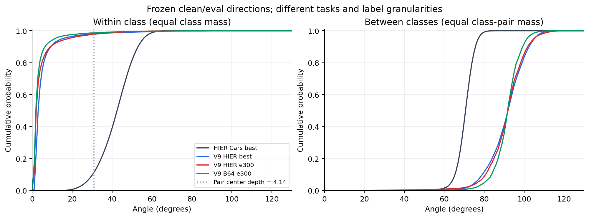
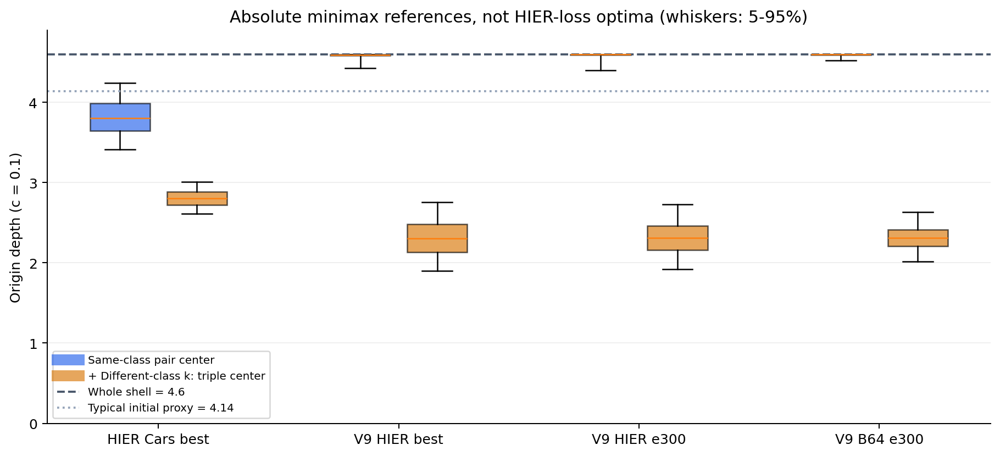
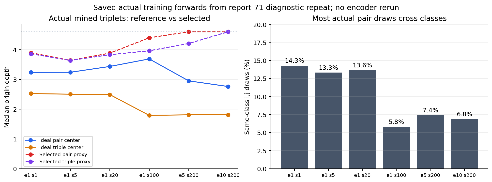
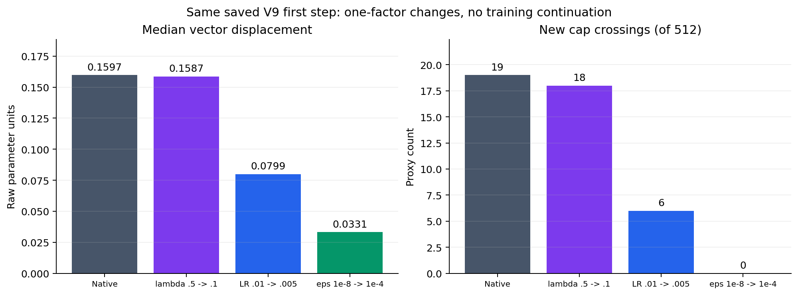

# Cars / V9：类内外角度、参考祖先深度与更新力度审查

日期：2026-10-22。用户要求先解释 HIER 外系数、AdamW 的 eps / 动量及混合精度，再用已有 Cars 与 V9 权重审查角度和迁移后的训练力度。使用已存特征与真实步骤快照，CPU 分析；不重新训练，不修改源权重、BN、优化器或既有结果，不新增 test 前向。

## 1. 对三个疑问的回答

### 0. 初期外移可以合理，首次跨界与越界后不返回需要分别解释

用户提出的两阶段机制是合理的待检验解释：窄方向群体可能要求代理从初始浅层向外靠近；实际一步若超过剩余半径，会跨过前向 cap；随后径向反馈弱、缺少必然内缩目标与优化历史可能让 raw 参数继续漂移。

需要保留三个区别：

- 任意非零夹角的同壳两点，其理想测地中点仍严格浅于 whole。合理外移不等于需要越过 cap；方向越窄，只是所需的内层余量越小。
- 壳上存在 HIER 零 hinge 解，说明该目标不保证内缩；不代表当前真实三元组或全部代理已经零损失。角度变化仍能优化关系。
- 缺少显式向内目标，与已有径向梯度被 cap 的 Jacobian 压低，是两个机制。即使存在内向直接梯度，传回 raw 参数也可能很弱。

[71 号报告](../71_V9_PROXY_CAP_CAUSE_2026-10-22/report.md)第 1 步有 19 个代理越 cap，但全体平均模长下降约 0.02572。这排除了“所有代理初始整体强外推”的简单说法。502 个首次越界在该 2000 步轨迹内均未返回，仍需由保存的实际更新解释。

### 1. lambda=.5 缩放梯度，但不同比缩放 AdamW 代理步长

对层次代理 p，记带外系数的当前梯度为 g_t，weight decay 系数另记 rho：

\[
m_t=\beta_1m_{t-1}+(1-\beta_1)g_t,\quad
v_t=\beta_2v_{t-1}+(1-\beta_2)g_t^2,
\]
\[
\Delta p=-\eta\frac{\widehat m_t}{\sqrt{\widehat v_t}+\epsilon}-\eta\rho p.
\]

假设整段梯度历史统一乘正数 s，则 m 乘 s、v 乘 s²，梯度更新变为：

\[
-\eta\frac{\widehat m_t}{\sqrt{\widehat v_t}+\epsilon/s}.
\]

当 sqrt(vhat) 远大于 eps，缩小系数的作用大部分被约消；当 eps 占主导，才更接近同比缩小更新。故 .5 不能简单理解为“大步长”或“半步长”。从已经训练的状态只改当前 g，不会同时缩放旧 m/v，须另作固定状态对照。

这只适用于主要接收 HIER 目标的代理。共享主干混合 CE、intra 与 HIER，且使用 RSGD；lambda 还会改变合力大小与方向，不能推成对完整网络无影响。[PyTorch 2.8 AdamW 公式](https://docs.pytorch.org/docs/2.8/generated/torch.optim.AdamW.html)

m 是一阶指数滑动平均，即动量。beta1=.9 时，旧 m 占本次 m 的 .9，当前 g 只占 .1。示意：旧 m=-1e-4、当前 g=+1e-5，则新 m=-8.9e-5，负 m 的下降更新仍可向外。实际向量还需经过逐坐标分母，并相对当前 p 分解，不能只用标量符号判断。

“历史”主要是最近若干步，不是第一步的动量保存到第十轮：.9^100 约 2.66e-5。参数转向后，旧位置的切向梯度在当前位置也可能具有径向分量。因此当前内向/近零梯度与历史项外移并不矛盾。

### 2. eps 不仅防除零，AMP 也不自动规定 eps

eps 是分母的稳定项，也是小梯度坐标的有效增益尺度。sqrt(vhat) 远小于 eps 时，更新近似为 -eta*mhat/eps，提高 eps 会减小该项。它没有固定内向偏好；衰减外向更新后，原来就存在的向内 weight decay 可能占优。

纯 FP16 中 1e-8 可舍入为零；但实际原版 Cars 使用 autocast / GradScaler 混合精度，保存的代理参数、m、v 都是 FP32，V9 这些张量也为 FP32。故不能把实际 Cars 的 eps1e-4 解释为已证实的“FP16 Adam 分母必须防下溢”。源码显式按 use_fp16 选择 1e-4/1e-8，选择理由没有文档证据。FP32+eps1e-4 在原则上可以独立设置。

AMP 在更新前反缩放梯度，也不能把 loss scaling 当成额外学习率。FP16 与 FP32 除精度还有动态范围差异，但本次需要区分这些差异与显式 eps 配方变化。[PyTorch 2.8 AMP 示例](https://docs.pytorch.org/docs/2.8/notes/amp_examples.html)

## 2. 角度审查的定义

原版 HIER Cars 与 V9 的类别、任务和维度不同。以共同曲率 c=.1、whole 深度 H=4.6 保留各自方向，计算理想几何参考，避免将 V9 原生 c1 与 HIER 视图混用。

对每个样本对先计算其夹角 theta 与中点深度，再汇总；不使用 acos(mean cosine) 或把平均角度代入公式代替整个分布：

\[
r_{mid}=\frac{1}{\sqrt c}\operatorname{atanh}
\left[\tanh(\sqrt c H)\cos(\theta/2)\right].
\]

| 夹角 | 中点深度 |
|---:|---:|
| 5° | 4.586292 |
| 10° | 4.545819 |
| 20° | 4.392919 |
| 30° | 4.164985 |
| 40° | 3.889129 |
| 60° | 3.277567 |
| 90° | 2.365613 |

中点超过典型初始化深度 4.14 的阈值为 theta<30.966654°。实际高斯初始化不是每个代理都精确 4.14，还需考虑各自方向与到 cap 的余量。

三点使用完整方向 Gram 矩阵求绝对最小包围球中心，不用三个 pair 中点的均值代替。设 v 是三单位方向凸包中范数最小的点，t=||v||，则中心深度为 atanh[t*tanh(sqrt(c)H)]/sqrt(c)；t=0 时为原点。独立推导、投影最优性证书及退化检查见[数学审查](../diagnostics/v9_angle_scale_20261022/math_review.md)。

这些中心是绝对 minimax 参考，**不是 HIER 相对 hinge 的目标解**。HIER 在有限候选中做选择，同一代理又兼任多个关系和角色；不能由理想中心深度直接预测代理最后应停在哪里。

## 3. 实际配方：相同 lambda 没有还原相同更新

| 项目 | 原版 HIER Cars | V9 |
|---|---|---|
| HIER 系数 | .5 | .5 |
| 代理维度/个数 | 512/512 | 256/512 |
| global batch | 180 | 64 |
| 代理参数、m、v | FP32，前向启用 AMP | FP32 |
| eps | 1e-4 | 1e-8 |
| 初始代理 LR | .005 | .01 |
| beta1/beta2、WD | .9/.999、.01 | .9/.999、.01 |
| LR 调度 | 每10轮乘.5，100轮 | 300轮余弦，最低.0005 |
| 基础任务 | PA 检索目标 | CE 分类与 whole–part intra |

Cars best e45 已保存代理 Adam 步数1980、LR=.0003125。其旧 v 对应 sqrt(vhat) 中位数5.9172e-6，99.9985%的坐标小于 eps1e-4。因此该 eps 在此实际状态中主导多数坐标的分母。没有 Cars 该步当前 g，不能据此伪造与 V9 同步的更新重放。

迁移力度需分别看梯度、实际 Adam 位移、位移相对 cap 余量。batch 损失按均值归一，不因64小于180就必然放大180/64倍。margin主要改变激活集合，tau需与候选代价差分布一起判断，二者都不宜只按相同数值称等效。

## 4. 已有完整特征：同类更紧，但三点中心没有被整体推向外侧

Cars 使用 best e45 的8054张训练图像、98个已见汽车细类、D512、clean/eval/frozen BN。V9 使用同9840个 ModelNet40 训练对象、40类、D256 的 best204 / e300 缓存，并补匹配无 HIER 的 B64 e300。没有使用 Cars 的未见类检索测试 split。

类内纳入每类全部非自身无序对，各类等权；类间每对类别抽32对对象，各类别对等权。以下是各量分别计算的加权中位数；不是将表中平均角或中位角直接代入公式。

| 完整 clean/eval 观察 | 类内夹角 | 类内 pair 中点深度 | 类内中点>4.14比例 | 类间对象夹角 | 同类pair+异类k的三点中心 |
|---|---:|---:|---:|---:|---:|
| 原版 HIER Cars best45 | 42.503° | 3.81540 | 11.385% | 70.652° | 2.80667 |
| V9 HIER best204 | 2.971° | 4.59515 | 98.097% | 91.899° | 2.30783 |
| V9 HIER e300 | 1.993° | 4.59781 | 97.833% | 91.908° | 2.30797 |
| V9 B64 e300 | 1.805° | 4.59821 | 98.703% | 91.734° | 2.31289 |

三点参考每类抽64个同类非自身pair，再均匀抽异类k，Cars6272、V9每观察2560个三元组，独立于训练挖掘。

**用户关于分类模型同类更聚集的判断得到末期分布支持。** V9同类理想pair中心几乎就在4.6内侧，原Cars则有更大的内层余量。无HIER的B64同样很紧，说明该几何形态不需要HIER才产生；本次不能单独归因于分类损失。

但跨类方向相反：V9异类更接近正交，加入异类k后理想中心约2.31，比Cars的2.81更浅。类别中心之间的夹角中位数也为Cars63.171°、V9 e30091.926°。因此该分布给pair与triple提供了更明显的深度分离空间，**并不要求所有代理都贴壳。**

ModelNet40 的 car 类单独看，V9 e300 类内夹角中位数0.990°、中点4.59946。它是单一粗汽车类，不能与 Cars 的98个细车型类当作任务匹配的因果对照。

## 5. 真实训练前向：最早越界时尚未出现极紧类簇

读取71号独立10轮诊断复现保存的六个真实前向，每个global64=32类×2，包含当时增强、crop、batch统计和实际挖掘。它们不是终点clean缓存，也不是历史V9的逐位重放。

| 71快照 | 类内平均角 | 类内中点均值 | 实际ij同类比例 | 实际pair中点均值 | 实际三点中心均值 | 选中pair/triple代理深度均值 |
|---|---:|---:|---:|---:|---:|---:|
| e1 s1 | 69.275° | 2.99201 | 14.281% | 3.23836 | 2.57498 | 3.89487 / 3.88517 |
| e1 s5 | 71.573° | 2.92182 | 13.311% | 3.26934 | 2.55428 | 3.65779 / 3.65487 |
| e1 s20 | 66.907° | 3.06631 | 13.639% | 3.50593 | 2.54630 | 3.97958 / 3.84906 |
| e1 s100 | 71.930° | 2.90728 | 5.781% | 3.66468 | 1.84869 | 4.37008 / 3.98247 |
| e5 s200 | 42.674° | 3.76993 | 7.406% | 3.08179 | 1.83398 | 4.59349 / 4.30287 |
| e10 s200 | 33.290° | 4.00339 | 6.844% | 2.93687 | 1.82967 | 4.59887 / 4.45389 |

第一步全部32个同类pair的理想中点都低于4.14；当时已经出现19个代理越cap。因此，“末期同类太紧”不能解释这条轨迹的首次越界。e10实际挖掘的pair中点/三点中心中位数分别2.75981/1.80796，仍远低于选中代理位置；不能把样本中点当作HIER当前真实梯度，但它排除了“相对样本的绝对几何中心必在壳上”这一解释。

为何pair多数跨类：当前K=20包含自身，互惠后去自身；batch每类只有两例，最多只有一个同类非自身候选。j从互惠集合均匀抽样，同类similarity+1保证排序靠前，却不让采样只取同类。条件于有效anchor、同类mate在互惠池且互惠度为d_i，同类j概率为1/d_i；实际约6.8–14.3%与此一致。它是协议性质，不表示代码忽略标签。[互惠与均匀抽样源码](../../../inter_hierarchy_MN40/hier_proxy_scratch_v5/relations.py:64)

因此，类内紧聚集影响其中一部分关系；要讨论整体HIER压力，还需看多数跨类pair、第三点与proxy分项。只用类别内角度不能解释全部代理的径向行为。

## 6. 同一真实状态的一步干预：首次过冲与数值增益有直接联系

7份保存快照在CPU重放原AdamW，和实际更新的最大单坐标误差为5.96e-8。随后分别只改eps、LR，或构造当前梯度/整段梯度历史缩放的代数对照，源状态不变。

第1步没有历史m/v，因而改变lambda的一步对照最清楚：

| 第1步条件 | 全512代理位移范数中位数 | 新越cap数 |
|---|---:|---:|
| 原配置：lambda.5、LR.01、eps1e-8 | .159705 | 19 |
| 仅lambda改.1 | .158717 | 18 |
| 仅LR减半至.005 | .079852 | 6 |
| 仅LR降至.001 | .015970 | 0 |
| 仅eps改1e-4 | .033122 | 0 |

原先19个首次越界代理，到cap的余量中位数为.065487，实际模长增加中位数.103897，向量位移中位数.157466。这里区分模长增加与向量位移，不能用切向位移直接代替径向过冲。**首次跨界是实际更新超过具体余量，且对LR、eps敏感；系数降低五倍却几乎没有同比缩小代理步长。**

第1步sqrt(vhat)坐标中位数1.15768e-5，约为eps1e-8的1158倍；95.11%坐标低于1e-4。这解释了为何前者接近Adam归一化区，后者会显著抑制更新。

已有历史后需另作解释。例如e1s5，更新前已越cap的121代理原平均增模+.039208；只把当前lambda .5改.1后反而为+.040538，因为旧m/v没有相应缩放。不能把“降低当前梯度”等同于重训较小lambda。

e10s200已越cap的502代理，原配置平均增模+.000941、449个继续增模；仅换eps1e-4，平均变为-.000407，且没有一个继续增模。它没有添加内向损失，而是衰减自适应更新，使向内WD等项占优。该步仍没有让这些raw参数立即全部返回cap内。

这些是固定状态的一步干预，不是新完整训练结果，也没有证明分类、形态层次或长期cap率改善。它们足以支持“迁移后的有效步幅不匹配”作为重点原因，不能写成“只需改eps就修好了方法”。

## 7. 对审查建议的结论与下一步含义

1. **分布差异确实存在。** V9末期类内角度远小于Cars，类间更大。同一c/cap/margin/tau/lambda不能因此被视为相同有效学习条件。
2. **当前更强的首次越界证据在实际Adam步幅。** 在紧类簇形成前就发生越界，LR与eps单步干预能大幅减少它；lambda不是代理侧的线性步长开关。
3. **不返回需要结合目标、cap与优化历史。** 相对目标允许壳上解，cap压低raw径向反馈，历史m/v可持续生成外移；原版SOP反例仍须保留。
4. **方向聚集不能单独解释全体代理贴壳。** 多数实际pair跨类，三点参考中心明显在内侧，proxy分项也不由样本类内夹角决定。
5. 若后续开展短程控制，最有区分力的是代理eps单因素，再独立检查LR；同时记录实际步长/余量、首次越界/返回、sample与proxy关系进展及角度。是否添加显式顺序属于方法目标设计，应与数值配方分开。这里没有启动这些新训练。

## 8. 证据边界与复核入口

- Cars 的汽车细分类与 ModelNet40 的粗类别不同；跨任务分布比较不能隔离“分类/检索”这一单因素。
- 完整 clean/eval 缓存描述选中模型的分布；71 的真实训练前向属于单独的10轮诊断复现，不替换历史 V9 轨迹。
- 相同状态的一步 LR/eps 干预与整段梯度历史缩放，只解释局部更新，不预言完整训练的分类或层次收益。
- 使用[独立审查工具](../diagnostics/v9_angle_scale_20261022/README.md)，代码在本地测试、独立分支提交推送，再由服务器 fetch/pull --ff-only 后执行。原始样本身份、完整缓存与权重留私有位置。

匿名输出：[验收与表格校验值](tables/acceptance.json)、[角度全分位汇总](tables/angles_compact.json)、[便于核对的CSV](tables/angles.csv)、[七步Adam全部条件](tables/adam_fixed_state.json)、[Cars真实保存状态](tables/cars_optimizer.json)、[Adam执行记录](tables/adam_execution.json)、[七快照校验值](tables/snapshot_identity.json)。更细的口径说明见[角度审查](../diagnostics/v9_angle_scale_20261022/angles/findings.md)和[优化器审查](../diagnostics/v9_angle_scale_20261022/adam_scale/interpretation.md)。

执行代码为2ed430f，双服务器CPU分析完成于2026-10-22约15:51–15:52（北京时间）；14项独立数学/角度/更新测试通过，四组PNG/SVG已视觉核查。源缓存读前读后SHA保持一致，CUDA不可见，编码器前向、test前向、生产参数更新均为0。后续文档与绘图提交不替换执行源码身份。
