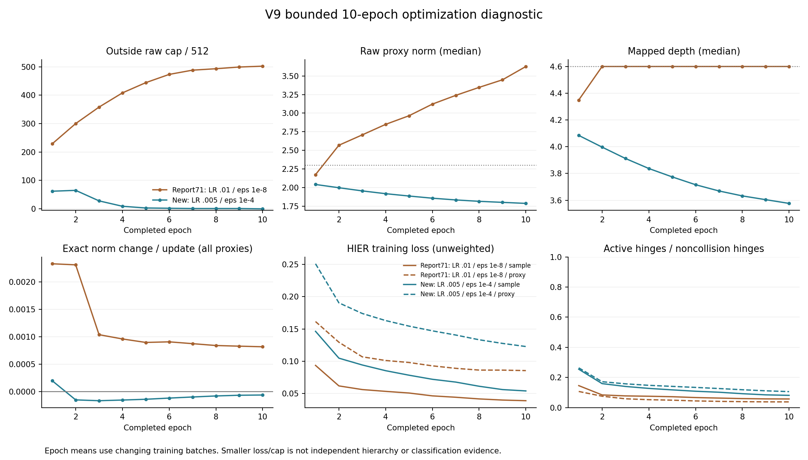

# V9-HIER代理学习率与eps：十轮联合候选诊断

日期：2026-10-22。用户授权将代理初始AdamW学习率改为0.005、eps改为1e-4，从头10轮观察，随后要求停止逐轮监看、待再次询问时检查。任务已自然完成10×200步；本轮按“继续”读取最终保存结果并做CPU验收，没有新增训练。

**这组联合配置在本次十轮中解除了持续贴壳：第十轮越cap从71参考的502/512降为0/512，曾越界的122个代理全部返回内层，末态深度中位3.576、范围3.147–4.572。** 历史动量仍可产生向外分量，但减弱后的自适应更新可被向内weight decay压过。关系损失持续下降，实际更新明显变小，同轮损失仍高于参考；祖先使用与代理内部径向次序表现混合，不能声称整体层次或分类改善。

正式训练于北京时间17:35:33开始、18:03:59结束，耗时28分26秒；正常退出并释放所用GPU1/2。旧结果及其他用户进程保持。结果与80个关键快照已保存，十轮完整验收通过。

## 问题与对照

71号诊断在独立fresh 10×200步中记录e1/e5/e10 raw代理参数越cap229/444/502，502个首次越界均未返回。72号CPU固定状态干预支持降低LR或增大eps能减小部分实际外移，但没有代替完整梯度历史的实测。本次检验联合候选的早期真实趋势，不启动完整300轮或额外矩阵。

## 已批准配置

| 设置 | 71参考 | 本次 |
|---|---:|---:|
| 代理AdamW初始学习率 | 0.01 | 0.005 |
| 代理AdamW eps | 1e-8 | 1e-4 |
| 代理最低学习率 | 0.0005 | 0.0005 |
| 代理betas / weight decay | (0.9,0.999) / 0.01 | 相同 |
| 实际观察步数 | 10×200 | 10×200 |
| 余弦调度总时间尺度 | 300轮 | 300轮 |

其他配置保持：seed22、9840训练池、两卡global64、每卡16类×2例；原生HyCoRe c=1、HIER c=0.1、whole视角固定深度4.6、代理切空间cap2.3与原GS、512×256代理及原初始化0.9倍尺度；K20/T50、lambda0.5、margin0.1、tau0.1；主模型RSGD、whole/part基础损失、分类头及标签平滑均保持。无teacher、输入checkpoint、test/validation前向、选模或早停。

## 实现与验收

执行源码`03e6fa753cc0efb9b7fc4c4f0bf727709e06f7f6`，分支`codex/v9-lr-eps-10e-20261022`，已先本地测试、提交并推送，再由服务器fetch/pull --ff-only同步。41项服务器CPU合同通过（继承观察器12、新配置10、原几何/base19），独立2×2训练短测通过。正式诊断于2026-10-22 17:35:33北京时间在用户优先服务器的空闲GPU1/2启动。

五个训练分片名称、大小与字节SHA全部与71参考一致；主模型初始SHA `fd7251e0…88d29d`、代理初始SHA `7c445a59…ad1d9`、训练标签/划分SHA、首批对象ID的JSON SHA均一致。第一步whole/child点数为835/324，与71一致。跨硬件仍不承诺后续逐位相同。

短测保存状态已核验：代理实际eps=0.0001、initial_lr=0.005、T_max=300、eta_min=0.0005；两轮后的lr=0.0049995065378184034，符合原时间尺度。

[新入口](../diagnostics/v9_lr_eps_20261022/README.md)复用71经过审查的逐步观察器；生成训练源码除诊断版本标识外，只变更实际代理优化器的LR与eps。源SHA守卫保留。保存配置和实际优化器状态都检查，防止只改声明未改训练。

先CPU合同，再在完全空闲双卡上执行独立fresh 2×2短测；短测退出后重新初始化正式10轮。新目录冻结源码、记录commit/config/seed/GPU/时间/初始化/数据身份。旧结果及生产源码不覆盖。

比较训练分片排序与字节校验值、标签/划分、初始主模型/代理SHA和首批对象/crop身份。跨硬件不承诺逐位相同。完成后验收2000步、80关键步快照、双卡代理同步、固定4.6壳、实际Adam参数与300轮调度。

最终11项完整性验收全部通过：2000步、10个整轮记录、80快照及各自SHA、last权重SHA、双rank代理一致、HIER whole视角固定4.6、零test/validation与选模。另核验初始网络/代理、训练标签、首批ID/crop匹配，以及80个快照的同图分项梯度求和与实际梯度一致。实际保存的代理initial_lr=0.005、eps=0.0001、T_max=300、eta_min=0.0005；第十轮后lr=0.004987674264578612，未把余弦压缩到10轮。见[完整性验收](tables/acceptance.json)与[补充核验](tables/validation_details.json)。

CPU分析使用已发布的`6b67040`工具。原始逐步日志、完整权重和快照保留私有位置，仅导出匿名聚合表和图；分析不使用GPU，不执行编码器前向或优化更新。

## 十轮代理轨迹

“越cap”指更新后raw切空间参数模长严格大于2.3；“深度”指HIER c=0.1映射后的原点距离。整表使用同一分析器对512个代理取中间两值平均的中位数；训练心跳使用Torch下中位数，两种中位数在偶数样本时可有小差别。

| 轮次 | 71参考越cap | 新配置越cap | 参考深度中位 | 新配置深度中位 |
|---|---:|---:|---:|---:|
| 1 | 229 | 62 | 4.349 | 4.085 |
| 2 | 300 | 65 | 4.600 | 3.997 |
| 3 | 358 | 28 | 4.600 | 3.912 |
| 4 | 408 | 9 | 4.600 | 3.837 |
| 5 | 444 | 3 | 4.600 | 3.774 |
| 6 | 473 | 2 | 4.600 | 3.716 |
| 7 | 488 | 1 | 4.600 | 3.669 |
| 8 | 493 | 1 | 4.600 | 3.632 |
| 9 | 499 | 1 | 4.600 | 3.604 |
| 10 | 502 | 0 | 4.600 | 3.576 |

新配置第一步越cap为0，参考为19。新轨迹有122个不同代理曾越界，全部至少返回一次；累计2737次越界与2737次返回是重复事件数，不是代理数量。早期反复跨过阈值，此后回内；参考502个首次越界代理在2000步内均没有返回。

末态raw模长中位3.62675→1.78808；新配置最大模长2.28601，低于2.3。forward深度中位4.59999→3.57616，标准差0.05235→0.40972。新512个代理全在固定4.6 whole视角内侧，并出现径向分散。原生c=1 whole/part深度没有被改成这个固定壳，不能混用两域。

严格raw越界与“forward深度≥4.5999”的近壳计数不同。例如新配置e1为62/67、e2为65/82；数值接近cap的内侧代理也可计入近壳。e10两种计数均为0。[完整逐轮表](tables/trajectory_comparison.csv)

## 为什么能够回到内层

两组都没有增加“代理必须比whole浅”的损失，也没有更新后强制投影参数。本次变化作用在Adam的实际步幅：eps增大后，较小的二阶矩不再产生同样大的归一化更新；LR也减半。旧历史一阶矩的向外作用被抑制，weight decay可以占优。

以下为e10全部512代理、200步的平均径向贡献，单位为每次参数更新的模长尺度；正号向外、负号向内。各项共享当时真实Adam二阶矩分母，是代数核算，不是彼此独立的干预。

| 实际更新分量 | 71参考 | 新配置 |
|---|---:|---:|
| 历史m的径向贡献 | +1.1980e-3 | +2.6466e-5 |
| 当前g的径向贡献 | −2.3329e-6 | +1.8713e-6 |
| weight decay | −4.3381e-4 | −9.4886e-5 |
| 最终精确模长变化，含其余切向/有限步项 | +8.1699e-4 | −6.4028e-5 |

**新配置e10的当前梯度径向贡献仍平均向外，但代理整体在回内；这不需要HIER当前梯度主动把它们推向内侧。** 原配置WD的向内绝对值虽然更大，仍压不过更大的历史外移；新配置WD较小，却足以压过减弱后的外移项。

全程处于cap外的动态代理—步集合，实际增模比例87.63%→35.96%，平均模长变化+1.3405e-3→−6.1299e-6。两组集合大小分别807594与32015，属于各自轨迹的条件统计，不是匹配同状态的因果分解；同状态一步证据仍应引用72。

因此，持续贴壳并非越界后必然不可逆。结合72的固定状态控制，本次支持“迁移后的实际优化步幅与历史累积是重要可干预因素”。不把全部改善归因于eps单独一项，也不抹去缺少径向顺序约束这一目标设计问题。[完整Adam分解](tables/optimizer_comparison.csv)

## 代价：更新更温和，同轮关系损失较高

| 全轮训练均值 | 71 e1 | 新e1 | 71 e10 | 新e10 |
|---|---:|---:|---:|---:|
| sample未乘lambda损失 | 0.09365 | 0.14642 | 0.03895 | 0.05409 |
| proxy未乘lambda损失 | 0.16152 | 0.25102 | 0.08556 | 0.12286 |
| sample正hinge / 非碰撞hinge | 14.56% | 25.45% | 5.70% | 8.10% |
| proxy正hinge / 非碰撞hinge | 10.68% | 26.37% | 3.76% | 10.58% |

新配置两分项损失均持续下降，存在大量非碰撞正hinge及非零更新，不能说只靠完全停止学习来避免cap。但同轮损失更高、未满足hinge更多；e10实际参数切向位移范数均值0.001125，对照0.023238，约为其4.84%。这是参数切向位移，不是角度弧度。

训练批次、挖掘关系和Gumbel选择都随模型改变，所以以上是实际训练进度监测，不是同一冻结关系集上的收敛速度实验。它们支持更温和的更新和优化代价，不能单凭较小cap率宣布方法更优。[损失与计数](tables/learning_comparison.csv)

## whole与代理分层恢复，代理内部树形关系仍未保证

以下均为e10整轮实际hard-Gumbel选择、排除pair/triple选中同一代理的碰撞抽样；两分项各200步。pair为二元祖先，triple为三元祖先。

| 分项/量 | 71参考 | 新配置 |
|---|---:|---:|
| sample pair祖先平均深度 | 4.59737 | 3.75850 |
| sample triple祖先平均深度 | 4.43553 | 3.49252 |
| sample pair相对最浅端点的平均深度余量 | 0.00263 | 0.84150 |
| sample triple相对最浅端点的平均深度余量 | 0.16447 | 1.10748 |
| proxy pair相对最浅端点的平均深度余量 | −0.00544 | −0.04538 |
| proxy triple相对最浅端点的平均深度余量 | 0.32258 | 0.07522 |

sample端点都在构造的4.6壳上，内层祖先与样本间隔明显恢复。proxy分项的端点本身是不同深度代理，pair平均仍比至少一个端点更深，不能把这一结果描述为已经形成可靠的多层径向树。

严格`triple深度<pair深度`的比例，sample为77.45%→91.90%，proxy为90.25%→76.14%；新proxy triple严格浅于全部端点的比例为60.21%。这些`>0`统计包含近零浮点差异，尤其旧组大量同壳时，**不等于有实质间隔或margin=0.1达标**，不据此概括树形质量改善。

祖先使用也有得有失。下面的有效代理数为整轮非碰撞选择频次熵的指数，越大表示该角色使用较分散；它不等于有正损失代理的数量。

| 分项/角色 | 71有效代理数 | 新有效代理数 |
|---|---:|---:|
| sample pair | 132.48 | 66.94 |
| sample triple | 204.44 | 273.62 |
| proxy pair | 487.00 | 365.31 |
| proxy triple | 20.39 | 164.85 |

sample pair更集中，而proxy triple分散明显。若只看非碰撞且该次抽样损失为正的选择，新配置sample pair/triple覆盖386/432个代理，proxy覆盖398/479；对照四项均512。因此不能概括为所有代理更活跃、覆盖全面改善。这里衡量实际训练角色使用，没有独立形态语义验证。

匿名完整表：[新配置结构](tables/structure_new/structure.json)、[参考结构](tables/structure_baseline/structure.json)，各自附CSV；源逐代理计数数组未导出。

## 结果判读口径

同时报告raw参数越cap与forward深度、首次越界/返回、模长分位数、实际径向/角向更新、当前梯度/历史一阶矩/weight decay贡献，以及sample/proxy损失、非碰撞hinge激活与代理覆盖。cap减少可能仅意味着学习减慢，必须结合损失与覆盖解释；本次不评估分类收益或语义层次质量。

联合改变LR与eps只能评估组合，不能声称分离了两者贡献。71新鲜诊断与69历史主训练分别保留，不把本次数据替换进旧报告。

本次仅单seed、前十轮、独立硬件轨迹；不能外推300轮稳定、准确率提升或真实形态层次。后续若继续训练，该组合可作为已有早期稳定证据的候选；本次没有启动更长训练、LR/eps单因素矩阵或margin修改。

## 同期CE答疑

[分类正确与置信度上界](ce_explanation.md)独立说明：80%是单样本平滑训练标签，而非目标正确率。当前40维单位球坐标直接作logits，softmax正确类概率上界约6.59%，但准确率仍可100%；目标不可达不能单独证明whole方向坍缩。本次保持分类头和标签平滑不变。
