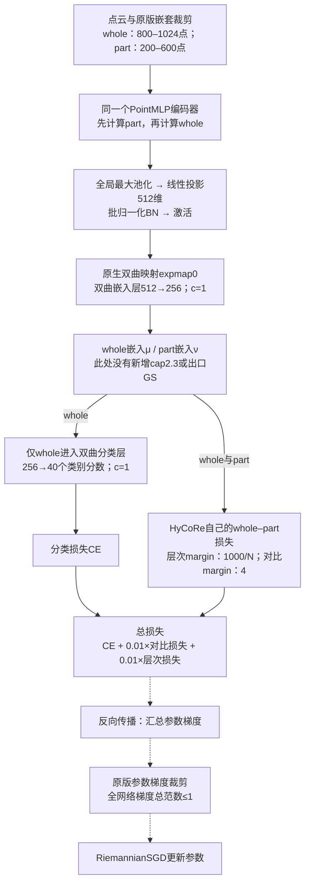
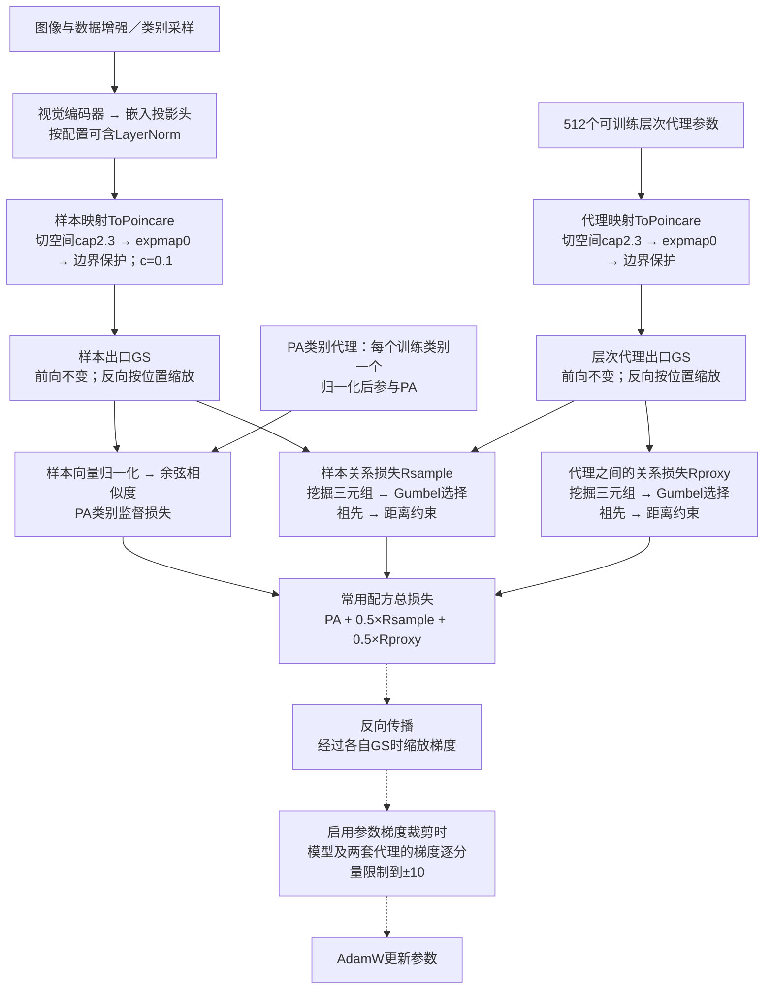
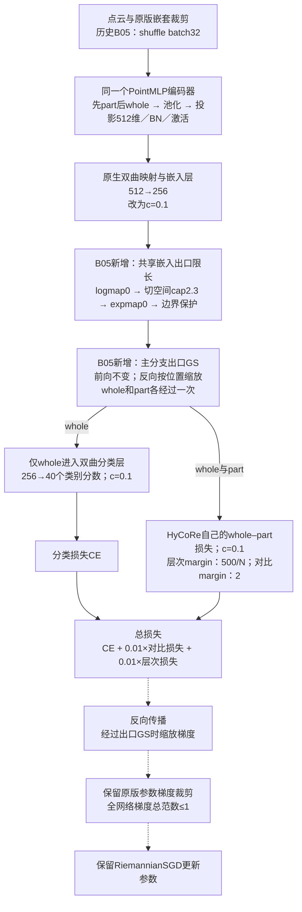

# 原版HyCoRe、原版HIER与B05：源码核实和dataflow

日期：2026-10-23。本文回答“原版HyCoRe是否已有类似梯度截断的操作，以及它与B05的基础GS是什么关系”。只读核实本地源码并整理示意图；没有修改训练代码、连接服务器或启动实验。

## 1. 先纠正术语

**原版HyCoRe确实有参数梯度裁剪，但实际PointMLP前向没有B05所用的输出GS。** 两者不是同一个模块。“基础GS”在历史实验命名中指“加在基础HyCoRe分支共享出口的GS”，不是“HyCoRe原版自带的GS”。今后说明时宜写成“主分支出口GS（B05新增）”。

| 操作 | 改变什么 | 放在哪里 | 对应源码行为 |
|---|---|---|---|
| cap：嵌入限长 | 前向得到的表示；过长才缩短 | 映射到双曲球之前；B05先把已有嵌入映回切空间 | HIER/B05使用切空间norm上限2.3；对应双曲深度上限约4.6，不是强制所有点深度4.6 |
| GS：嵌入处梯度缩放 | 该位置向上游传递的梯度；前向数值原样通过 | HIER映射出口，或B05共享嵌入出口 | 反向乘 `(1-c*||z||²)²/4`；同一位置各方向乘相同系数，位置越靠球边界系数越小 |
| 参数梯度裁剪 | 已汇总到模型参数上的梯度 | 全部损失反向传播之后、优化器更新之前 | HyCoRe/B05限制全网络梯度总L2范数到1；官方HIER启用裁剪时逐分量限制到[-10,10] |
| 优化器 | 如何用梯度更新参数 | 参数梯度裁剪之后 | HyCoRe/B05为RiemannianSGD；官方HIER为AdamW |

另有“球边界数值保护project”：防止浮点误差使点落到数学定义域外。它与人为设定cap2.3、GS和参数梯度裁剪也分别是不同操作。

例如，把全部参数梯度拼成一个长向量后，HyCoRe的范数裁剪在其总长度超过1时统一缩短，保留该长向量的方向；HIER的逐分量裁剪只截掉超过±10的分量，可能改变长向量方向。两者都不能替代嵌入出口的GS。

## 2. 原版HyCoRe

实线表示前向数据和损失计算；虚线串表示反向传播及参数更新的执行顺序。图中“反向传播”会沿所有实线路径反向计算梯度，未逐条重画反向箭头。

这里的层次损失是HyCoRe原本的局部—整体约束，不是跨实例HIER代理损失。`N`是part的采样点数；对比项还使用batch中翻转顺序形成的负part。

**源码定位：**

- [实际网络构造与forward](D:/Hycore/classification_ModelNet40/models/pointmlp.py:394)：投影、`expmap0`、`emb`、`classifier`依次执行；part通过`emb=True`直接返回，whole继续进入分类层。
- [实际训练与裁剪](D:/Hycore/classification_ModelNet40/main_pointmlp_hycore.py:218)：第224–227行依次为总损失、`backward()`、`clip_grad_norm_(net.parameters(), 1)`、`optimizer.step()`。
- [优化器构造](D:/Hycore/classification_ModelNet40/main_pointmlp_hycore.py:136)：`geoopt.optim.RiemannianSGD`。
- [MobiusLayer实际计算](D:/Hycore/classification_ModelNet40/models/ops/manifold_layers.py:110)：矩阵变换等流形操作，实际路径未调用另一个类中定义的`grad_fix`。仓库存在带GS的`ToPoincare`类，不等于PointMLP使用了它。

“RiemannianSGD”是优化器名称，不能据此在whole出口补画一个GS。当前实际Mobius层默认`over_param=False`，其权重和偏置是普通Parameter；不能将整个网络所有普通参数都描述为流形参数。

## 3. 原版HIER

下图对应官方常用的Proxy-Anchor（PA）监督配方：`c=0.1`、cap2.3、512个层次代理。不同官方脚本的视觉backbone和嵌入维数可不同。**PA类别代理与512个层次代理是两套独立参数。**

`Rsample`使用样本—层次代理距离，样本三元组挖掘还用到了样本标签。`Rproxy`只用层次代理之间的关系，没有直接通向图像编码器的数据路径。样本出口GS在PA与Rsample分叉之前，因此这两个损失回到编码器的梯度都会经过它；PA类别代理自身不经过层次代理的ToPoincare/GS。

原版HIER的cap只限制最大深度，**不把所有样本统一投到4.6壳上**。我们V9的固定壳视图是后来增加的设计。

**源码定位（本地官方快照，固定上游commit `3986a744a1a54fd357e307d1cb3f2e81910b9ffc`）：**

- [编码器、投影头和样本ToPoincare](D:/Hycore/.codex-local/references/HIER-CVPR23/hier/models/model.py:111)。
- [cap、映射、边界保护、GS的顺序](D:/Hycore/.codex-local/references/HIER-CVPR23/hier/hyptorch/nn.py:194)；[GS前向与反向](D:/Hycore/.codex-local/references/HIER-CVPR23/hier/hyptorch/pmath.py:30)。
- [层次代理参数与独立ToPoincare](D:/Hycore/.codex-local/references/HIER-CVPR23/hier/losses.py:17)；[Rsample与Rproxy](D:/Hycore/.codex-local/references/HIER-CVPR23/hier/losses.py:85)。
- [独立的PA类别代理、归一化与余弦相似度](D:/Hycore/.codex-local/references/HIER-CVPR23/hier/losses.py:210)。
- [总损失、反向和更新](D:/Hycore/.codex-local/references/HIER-CVPR23/hier/train.py:153)；[逐分量裁剪实现](D:/Hycore/.codex-local/references/HIER-CVPR23/hier/utils.py:212)。训练代码在`args.clip_grad>0`时调用固定阈值10；不能照参数名/help误画为范数裁剪，或照传入`--clip_grad`数值推断实际阈值。
- [AdamW及eps选择](D:/Hycore/.codex-local/references/HIER-CVPR23/hier/train.py:271)。AMP配方在裁剪前先对参数梯度unscale；混合精度的loss scaling也不是图中的几何GS。

## 4. 历史B05

这里画的是已经完成的B05：`HC-C01-Cap23-GS1-M500_2-SH32x307`，不是“B05＋未来固定壳HIER”的设计。历史B05使用shuffle32、c0.1、共享cap2.3和GS、半margin；**没有HIER损失、没有层次代理、没有固定壳分支。**

新增模块注册在`model.emb`的输出上，位于分类层之前，也位于whole/part损失读取嵌入之前。CE、层次损失和对比损失向上游编码器回传的梯度会经过这个GS；分类层自己参数的直接梯度不经过前面的GS。随后全网络参数仍一起参加范数1裁剪。

**源码定位：**

- [B05新增模块和注册位置](D:/Hycore/inter_hierarchy_MN40/hycore_c01_gs_halfmargin_20261020/train.py:138)：`logmap0(mu)`后调用`to_ball(..., clip_r=CAP, hook=True)`，通过`model.emb.register_forward_hook`插入。
- [B05复用的cap/map/GS实现](D:/Hycore/inter_hierarchy_MN40/hier_proxy_scratch_v8/geometry.py:28)：GS在第28–38行，cap→映射→边界保护→GS在第41–51行。
- [模型曲率设置](D:/Hycore/inter_hierarchy_MN40/hycore_c01_gs_halfmargin_20261020/train.py:144)；[损失曲率设置](D:/Hycore/inter_hierarchy_MN40/hycore_c01_gs_halfmargin_20261020/train.py:168)。
- [margin减半](D:/Hycore/inter_hierarchy_MN40/hycore_c01_gs_halfmargin_20261020/train.py:217)：只改hinge阈值，不把损失系数0.01减半。
- [保留原版优化器与训练入口](D:/Hycore/inter_hierarchy_MN40/hycore_c01_gs_halfmargin_20261020/train.py:318)：构造原RSGD，再在第343行调用原版`original.train`，因此保留原版backward→范数1裁剪→step。

## 5. 用于后续讨论的简表

| 位置／操作 | 原版HyCoRe | 原版HIER常用PA配方 | 历史B05 |
|---|---|---|---|
| 主要输入 | 点云whole/part | 图像 | 点云whole/part |
| 主监督 | CE分类 | PA度量监督 | CE分类 |
| HyCoRe局部—整体损失 | 有，1000/N与4 | 无 | 有，500/N与2 |
| HIER跨实例代理关系损失 | 无 | 有 | 无 |
| cap2.3 | 无该新增cap | 样本和层次代理各有 | 共享whole/part嵌入出口有 |
| 出口GS | 实际PointMLP路径没有 | 样本和层次代理各有 | 新增在共享whole/part嵌入出口 |
| 强制whole固定深度4.6 | 无 | 无 | 无 |
| 参数梯度裁剪 | 总范数1 | 启用时逐分量±10 | 总范数1 |
| 优化器 | RiemannianSGD | AdamW | RiemannianSGD |

因此，“保持原版HyCoRe的梯度裁剪”与“保留B05新增的出口GS”应分别记录。这次源码说明不替用户决定未来8000方案是否保留B05的出口GS，也不改动76中的待确认设计。
