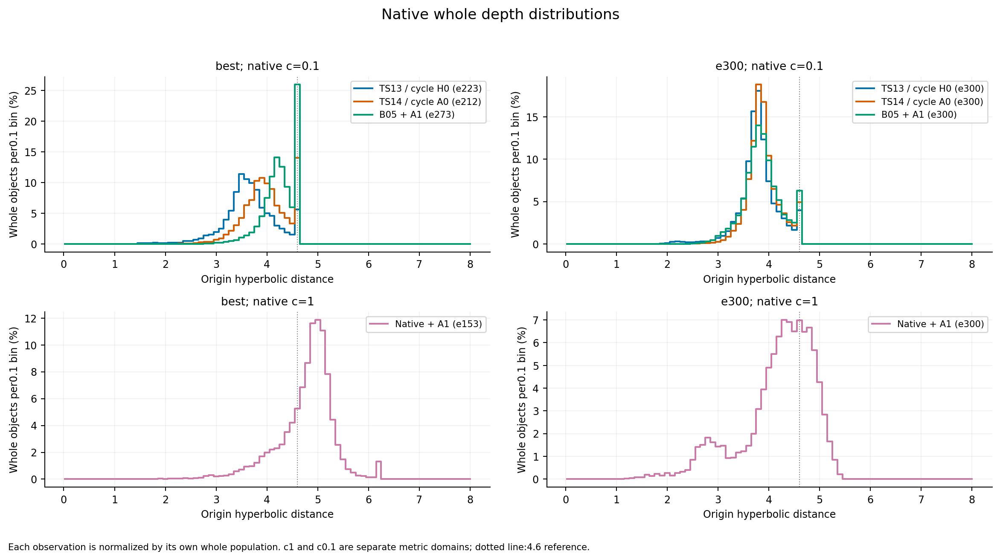
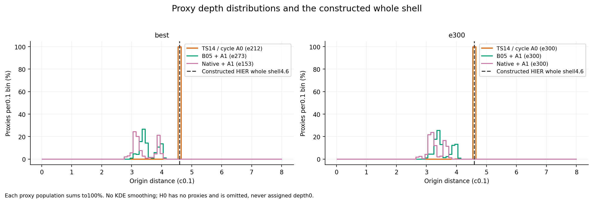
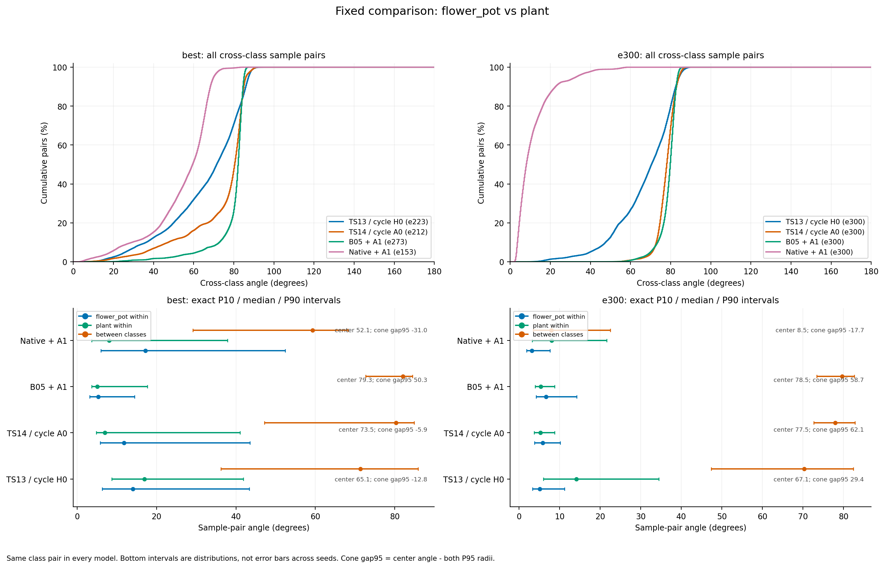

# 四组whole与代理嵌入审查

2026-10-25，按[85检测计划](plan.md)在8000执行。主四组各best/e300，共8份；另复用8份历史辅助缓存。每份均为相同9840个训练对象、原始first1024点、无增强、eval及各自保存的BN。没有训练更新、反传、test前向或BN校准。

**主要结论：采用A1的两组训练均恢复了代理相对HIER固定壳的径向分离，也呈现更好的冻结样本祖先次序；但代理内部仍不满足普遍的祖先深度顺序，尚不能称为完整层次树。原生A1末轮还出现flower_pot–plant的明显局部方向纠缠，总体角度统计会掩盖它。**

本文的“新B05／原生A1”指10月23日启动、现已完成的**双卡CB64**两组，不包括10月25日刚排队的单卡CB32新旧HIER实验。

## 1. 实验身份和比较范围

| 主实验 | best轮次 | 协议 | HIER | 历史best／e300 test OA |
|---|---:|---|---|---:|
| TS13／B10 | 223 | c0.1、cap2.3、基础GS、半margin；循环64；300×300 | 无 | 93.395／92.788% |
| TS14／B10 | 212 | 与TS13匹配 | 固定4.6壳，A0：LR0.01、eps1e-8 | 93.882／93.274% |
| B05＋A1 | 273 | 严格B05；有放回CB64；300×200 | 同固定壳，A1：LR0.005、eps1e-4 | 93.476／93.112% |
| 原生HyCoRe＋A1 | 153 | 原生c1、无新增cap／出口GS、原margin；有放回CB64；300×200 | 同固定壳、同A1 | 92.747／89.506% |

均seed4780。OA引用[83完成报告](../83_S4780_NATIVE_B05_COMPLETION_2026-10-24/report.md)和[84配置比较](../84_TS14_VS_NEW_HIER_2026-10-24/report.md)，本次没有重测或重新选best。TS13→TS14是匹配的HIER开关比较；TS14→新B05同时改变采样、更新预算和AdamW；B05→原生同时改变曲率、cap、基础GS及margin。

辅助组为TS06/B05-H0、TS01/HIST原版、TS11/V9-H0和TS12/V9-A0，各best/e300。HIST best是原始epoch229／完成230，不冒充TS02 R2；历史SH32、seed22及不同随机流均保留真实身份，不能作为本轮匹配H0。

## 2. whole与代理的深度百分比分布

深度统一按各空间真实曲率计算：`h=2/sqrt(c)·atanh(sqrt(c)·||x||)`。whole按9840、代理按512分别归一化到100%；0.1深度bin和ECDF均保留贴壳质量。HIER whole固定4.6是构造，单独标记；其浮点级深度抖动只在构造壳的直方图／ECDF中合并为精确4.6，原始统计仍保留。

| 主实验 | 阶段 | 原生whole深度P5／中位／P95 | 代理深度最小／中位／最大 | 贴cap代理 |
|---|---|---:|---:|---:|
| TS13 | best | 2.828／3.639／4.598 | N/A | N/A |
| TS13 | e300 | 3.209／3.787／4.490 | N/A | N/A |
| TS14 | best | 3.287／3.965／4.600 | 4.092／4.600／4.600 | 511/512 |
| TS14 | e300 | 3.423／3.858／4.547 | 4.040／4.600／4.600 | 511/512 |
| B05＋A1 | best | 3.688／4.279／4.600 | 3.028／3.444／4.142 | 0/512 |
| B05＋A1 | e300 | 3.242／3.849／4.600 | 3.018／3.440／4.118 | 0/512 |
| 原生＋A1 | best | 3.723／4.889／5.441 | 2.787／3.213／4.081 | 0/512 |
| 原生＋A1 | e300 | 2.671／4.337／5.064 | 2.677／3.221／3.827 | 0/512 |

贴cap以距4.6不超过0.001计。TS14的511个代理raw参数也超过tangent cap2.3；新两组均没有越cap。TS14的径向形态实际是**511个同壳代理加1个内层例外**，不能把浮点级差别解释成多层。

“A1代理在whole里面”应准确说成：全部代理在**HIER看到的4.6壳以内**。B05原生whole仍有深浅分布，不能据此保证每个代理浅于所有实际whole；原生c1 whole与c0.1代理更不能直接按深度大小认定祖先。

另见[深度ECDF](figures_primary_r2/03_depth_ecdf.png)、[完整分箱百分比](public_stats_r2/depth_histograms.csv)和[ECDF数据](public_stats_r2/depth_cdf.csv)。

## 3. 类内紧致程度并不是统一的“两度”

下表“类内中位数／P90”来自全部不同同类对象对；同时另存40类等权汇总，避免大类支配解释。共1,916,864个同类对、46,491,016个异类对／检查点。对象对数量不等于独立训练重复次数。

| 主实验 | 阶段 | 类内角中位数／P90 | 异类角中位数 | 最小类中心角 | P95类锥负间隔类对 |
|---|---|---:|---:|---:|---:|
| TS13 | best | 6.242°／10.982° | 91.634° | 65.144° | 1/780 |
| TS13 | e300 | 3.720°／6.162° | 91.349° | 67.086° | 0/780 |
| TS14 | best | 6.247°／11.169° | 88.755° | 72.244° | 1/780 |
| TS14 | e300 | 3.872°／6.420° | 88.608° | 76.281° | 0/780 |
| B05＋A1 | best | 3.801°／6.035° | 91.526° | 79.331° | 0/780 |
| B05＋A1 | e300 | 4.482°／7.170° | 91.389° | 78.515° | 0/780 |
| 原生＋A1 | best | 4.363°／16.416° | 92.059° | 52.055° | 4/780 |
| 原生＋A1 | e300 | 1.864°／5.172° | 92.206° | 8.522° | 1/780 |

类中心先逐对象归一化、再求均值并归一化。P95类锥半径是对象到本类中心角的P95，类锥间隔为“两个中心角−两类半径之和”。负间隔表示方向包络可能重叠，**不等于实际分类边界或错误率**。

TS13→TS14的e300有28/40类的类内中位数扩大，但总体只增加约0.151°，plant反而从14.153°收紧到5.291°。780个类对仅75个中心角增加，705个减少。因而旧HIER的正分类增量不能解释为“所有类内统一撑开”或“所有类间统一拉远”。

辅助反例也很重要：TS06/B05-H0的best类内中位数8.092°、P90为21.811°，仍取得历史OA94.327%；新B05更紧、几何类锥更分离，却没有超过它。两者协议不匹配，不能反向推导“宽更好”，但足以说明角度紧致度不是准确率的单调指标。旧V9 TS11→TS12的e300类内中位数仅1.679°→1.791°，P90却7.507°→14.567°，也说明中位数会掩盖宽尾类别。

图表：[40类类内分布](figures_primary_r2/04_class_intra_angles.png)、[类锥半径](figures_primary_r2/04b_class_cone_radii.png)、[40×40类中心热图](figures_primary_r2/05_class_centroid_angles.png)；完整[每类表](public_stats_r2/class_intra_angles.csv)和[780类对表](public_stats_r2/class_pair_angles.csv)。

## 4. 代表类对：一个改善例子，也保留反例

六组事先指定类对均已检查；另以TS13-best一次选定五个最近的额外类对，固定到所有模型：flower_pot–plant、mantel–range_hood、flower_pot–vase、keyboard–laptop、table–tv_stand。没有按各模型分别挑选最有利案例。

### 原生A1的flower_pot–plant局部退化

| 检查点 | 类中心角 | 跨类对象对P10／中位数 | P95类锥间隔 |
|---|---:|---:|---:|
| 原生A1 best | 52.055° | 29.111°／59.317° | 见完整类对表 |
| 原生A1 e300 | 8.522° | 3.501°／7.948° | −17.738° |
| B05 A1 e300 | 78.515° | 73.394°／79.671° | +58.734° |

原生A1末轮plant自身类内中位数约8.067°，甚至略大于它与flower_pot之间的跨类中位数7.948°。所以“总体类内更紧”和“总体异类仍约92°”同时成立时，某个困难类对仍可能严重纠缠。这是原生末轮OA下降值得追查的**局部几何候选原因**。

本次没有test嵌入、逐类test混淆或分类头干预；半径与学习到的分类头也参与判别，不能据该类对独自解释全部OA下降。

### TS13→TS14：不同类别变化不一致

| 同e300类对 | 类中心角TS13→TS14 | 跨类对象对中位数 | P95类锥间隔 |
|---|---:|---:|---:|
| flower_pot–plant，改善例 | 67.086°→77.542° | 70.285°→77.934° | 29.414°→62.117° |
| dresser–night_stand，反例 | 86.223°→76.281° | 86.952°→76.906° | 74.426°→63.307° |
| cup–vase，反例 | 88.065°→76.754° | 88.090°→77.309° | 69.490°→60.563° |

这支持“部分困难类别的组织改善”这一候选解释，不支持全局单调扩张，也尚不能把12个test对象的增益归因到某个类对。另有[chair–stool](figures_primary_r2/06_pair_chair_vs_stool.png)、[desk–table](figures_primary_r2/06_pair_desk_vs_table.png)、[bottle–vase](figures_primary_r2/06_pair_bottle_vs_vase.png)、[cup–vase](figures_primary_r2/06_pair_cup_vs_vase.png)、[dresser–night_stand](figures_primary_r2/06_pair_dresser_vs_night_stand.png)、[airplane–car](figures_primary_r2/06_pair_airplane_vs_car.png)直接分布图及[全部代表类对数据](public_stats_r2/representative_pair_angles.csv)。

## 5. “回内”与“形成代理内部层次”是两件事

用冻结缓存、相同对象批次、K20/T50和确定性minimax读出祖先，容差主值0.001，另存0.0001／0.01敏感性。此诊断使用类内无放回抽取，每个模型挖掘自己的关系；它采用理想Poincare距离，**不是训练Gumbel选择或官方含小数值项距离的逐次重放**。

三项严格次序定义为：pair代理浅于两个端点、triple代理浅于三个端点、triple代理浅于pair代理；三项必须同时满足。

| e300冻结诊断 | TS14旧HIER | B05＋A1 | 原生＋A1 |
|---|---:|---:|---:|
| 样本→代理：三项严格，非碰撞 | 0%（n=24771） | 92.827%（n=24383） | 98.760%（n=25249） |
| 代理→代理：三项严格，非碰撞 | 0%（n=25288） | 5.396%（n=20903） | 6.743%（n=22378） |
| 再排除祖先选中端点自身 | 0%（n=5609） | 17.264%（n=6534） | 21.854%（n=6905） |
| 排除后，pair祖先深于至少一个端点 | 0.160% | 78.329% | 74.352% |

A1的主要短板是**pair代理并不普遍浅于其代理端点**。移除端点自选后问题仍存在，因此不能只归咎“祖先选择了自己”。B05／原生末轮全部代理抽样中的pair端点自选比例分别约67.882%／68.444%，这些比例另行展示。

同时，A1的代理全部浅于4.6构造壳，已经自动决定了“样本端点比其代理深”这一部分成立。较高的样本三项比例仍不能单独证明代理内部成树。

TS14在冻结读出中可以经唯一内层例外形成一些更浅的triple祖先，但其pair仍基本与端点同壳。这个例外在确定性读出里承担许多上层选择，**不能据此声称真实Gumbel训练出现根节点垄断**。

图：[冻结祖先次序](figures_primary_r2/08_frozen_ancestor_orders.png)、[碰撞与端点自选](figures_primary_r2/08b_frozen_collisions_endpoint_identity.png)。完整分母、深度差分布、容差和全抽样／非碰撞／非端点口径见[summary.json](public_stats_r2/summary.json)。

## 6. 类别绑定、深度广度和使用率

“浅代理更广、深代理更专一”的一致证据仍不足。按0.001深度分辨率合并数值噪声后，深度与最近32样本类别熵的Spearman为：

| 模型 | best／e300相关系数 | 64次深度置换的描述性绝对超越比例 |
|---|---:|---:|
| B05 A1 | −0.038／−0.019 | 0.462／0.754 |
| 原生A1 | −0.109／−0.100 | 0.015／0.062 |
| TS14 A0 | N/A | 511同层＋1例外，不足以支持深度关联 |

B05没有稳定趋势；原生只有较弱倾向。置换是固定缓存的条件基线，不是独立训练重复或独立形态真值。

末轮冻结NN4和真实训练使用量呈现不同变化：

| e300指标 | TS14 | B05 A1 | 原生A1 |
|---|---:|---:|---:|
| NN4四样本均同类的代理比例 | 53.91% | 75.59% | 77.34% |
| NN4覆盖的不同对象数 | 818 | 1198 | 1135 |
| 最热4对象占NN4总槽位比例 | 21.826% | 4.736% | 3.467% |
| 真实sample祖先抽样的熵有效代理数 | 345.4 | 209.2 | 141.0 |
| 有效非碰撞sample使用的熵有效代理数 | 441.1 | 289.2 | 254.0 |

NN4总共只有512×4＝2048槽位，覆盖9840对象的理论上限为20.813%，不能以100%作目标判断8%–12%覆盖失败。A1的冻结热点减轻，但真实sample祖先分布更集中，因此不能笼统称“覆盖全面改善”。B05末轮sample抽样使用509个代理、有效项使用508个；其余两组对应口径均使用512个。原始计数还受300／200步等协议差异影响。

固定whole壳下，角度近邻和双曲距离近邻理论等价，这里读出一致，不算两项独立验证。NN4同类绑定明显高于标签置换，但类别标签已参与训练；它说明监督一致性，仍不是独立形态层次证据。

图：[代理深度与类别广度](figures_primary_r2/07_proxy_depth_class_breadth.png)、[真实训练使用](figures_primary_r2/09_saved_training_proxy_usage.png)、[冻结热点](figures_primary_r2/09b_static_nn4_hotspots.png)；表：[逐代理统计](public_stats_r2/proxy_stats.csv)、[深度分箱](public_stats_r2/proxy_depth_bands.csv)。

## 7. 审查验收与复现

- 六份新权重副本逐一核对SHA；TS13缓存源SHA与现存best/e300权重核对。16缓存的canonical ID／标签完全一致，完整输入SHA一致。
- 固定80对象首次重组批次时平均坐标误差2.022e-6，略高于2e-6门槛，未放行。恢复历史canonical batch32上下文后，坐标／深度误差均为0、预测差异0；阈值未放宽，失败记录保留。
- 一次GPU启动因回归退出后的资源释放延迟而被安全拒绝。增加释放等待后，在全新目录完成提取；旧记录、旧模型和历史结果未改。
- 六份全量新缓存均为9840×256；模型／BN及源权重哈希不变，无梯度、optimizer或test前向。审查GPU已释放。
- 21项本次统计／回归度量／绘图CPU检查在8000通过；随后完成独立数值口径和实际图表审阅。构造壳ECDF与热图色条布局的最终修正另按已发布版本重算CPU派生结果，不重复模型提取。
- 原始嵌入、权重、输入身份和完整私有运行清单已备份到非仓库目录。公开[来源与验收摘要](execution_checks.json)只包含哈希及派生检查；公开数据不包含点云、原始嵌入或对象ID。

计划的9类图和补充图均提供PNG／SVG；主组与辅助组分开。辅助对照图见[辅助图清单](figures_auxiliary_r2/figures_manifest.json)，详细汇总见[完整统计JSON](public_stats_r2/summary.json)。

## 8. 对当前实验问题的判断

目前可以确认的是：A1解决了这两套完整训练的代理贴cap终态，并改善了固定HIER视图下的样本祖先深度次序；方向近邻热点也减轻。尚未解决的是：代理内部pair祖先经常比端点更深、深度与类别广度关系弱、没有独立形态层次验证。

TS14在511个代理贴壳的情况下仍有匹配的分类正增量，说明分类正则作用不要求先形成完整径向代理树。原生A1又显示“类内整体收紧”可以伴随局部类间纠缠；是否有益应看具体类对、分类器和协议，不能只看约两度或代理是否回内。今天已排队的同CB32 A0/A1对比可进一步检验优化器组合效应，本报告不提前预测其结果，也不追加训练。
