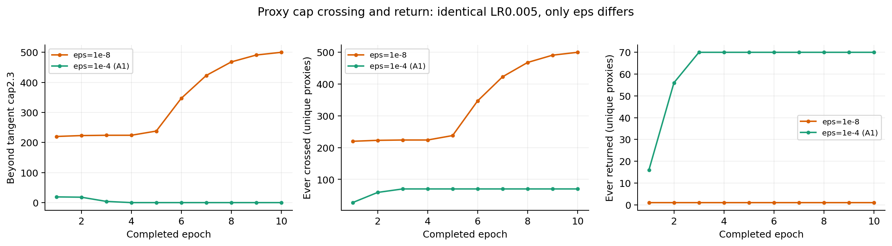
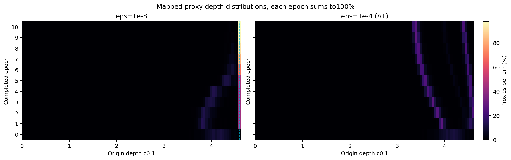
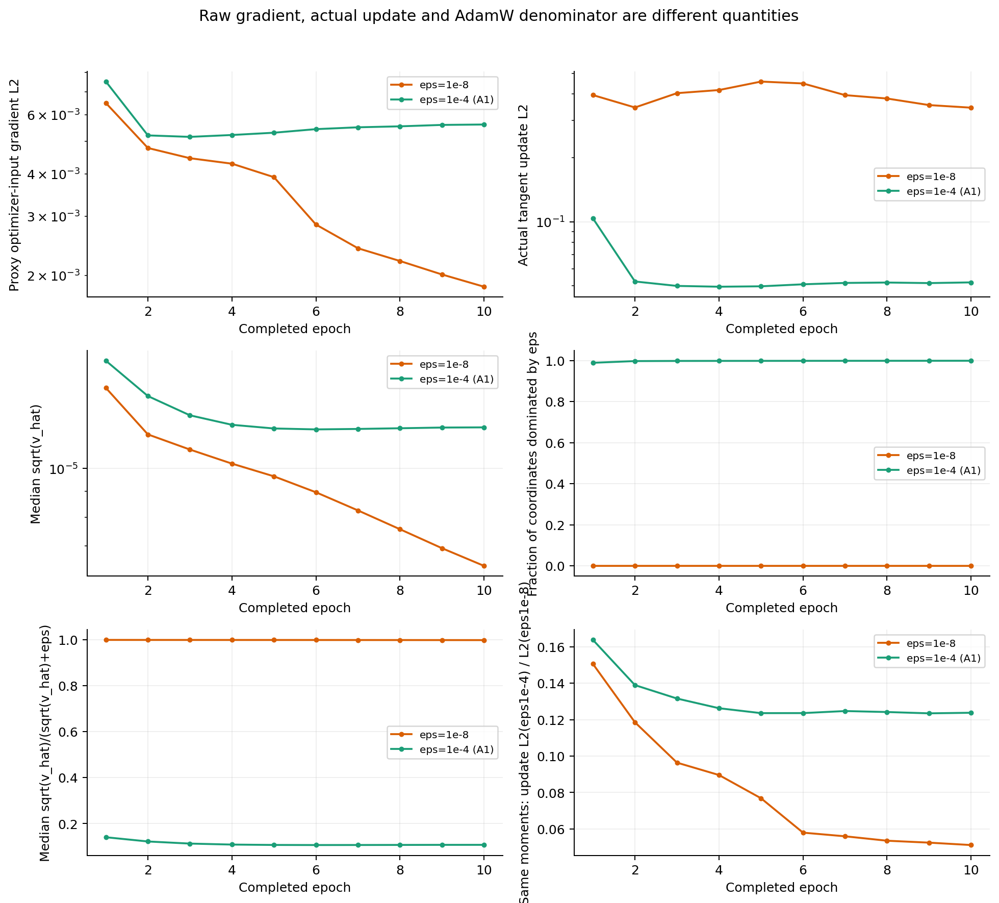
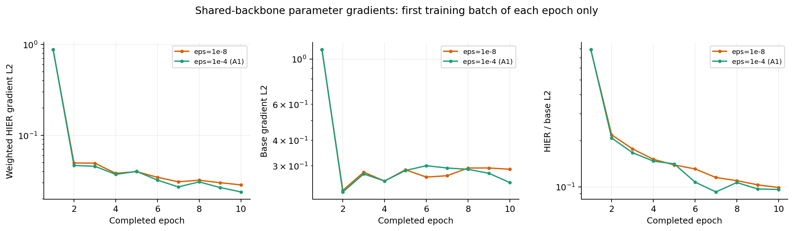

# B05双卡：AdamW eps单变量十轮审查

两组已于2026-10-25 **16:17:26（北京时间）**全部完成，各10轮／2000次更新，验收通过，GPU已释放。本机备份81份文件逐一SHA核对一致。源码c8c05bc；没有test／validation前向、选模或新增完整训练。两组模型和代理初始化、首批输入／增强、首步梯度哈希均相同，详见[独立验收](inspection.json)。

## 核心结论

**固定代理LR0.005，仅改变eps，足以在这次十轮实验中造成“几乎全部贴cap”与“全部位于whole壳内”的明显分叉。大eps确实削弱小梯度产生的参数更新，但没有让HIER反传梯度消失。**

| 第10轮末／第10轮统计 | eps1e-8 | eps1e-4（A1） |
|---|---:|---:|
| raw模长>2.3的代理 | 500/512（97.66%） | 0/512 |
| 实际映射深度中位数 | 4.600 | 3.439 |
| 深度P5—P95 | 4.600—4.600 | 3.346—4.432 |
| raw模长中位／最大 | 2.618／5.514 | 1.720／2.247 |
| 相对各自初始化的深度位移中位数 | +0.456 | −0.451 |
| 比各自初始化更浅的代理 | 0/512 | 357/512（69.73%） |
| 每步整组代理梯度L2的轮均值 | 0.001853 | 0.005607 |
| 每步整组代理实际更新L2的轮均值 | 0.3446 | 0.05175 |
| 每轮首batch主干加权HIER/base梯度比 | 9.88% | 9.60% |

大eps组第1—4轮末越cap数量为19→18→4→0，随后直到第10轮末均为0；累计曾在cap外的70个代理都曾返回。第4／5轮内部仍有12／5次短暂越界，均返回，第6轮起逐步记录也没有新增越界。小eps组则从第1轮末220个继续升到第10轮末500个。这里既有初期差别，也有后续持续外移／回缩，不能仅以“第一步全部冲出去了”概括。

大eps第10轮仍有明显HIER梯度：代理梯度约为小eps的3.03倍，实际更新约为其15.0%。每轮首批主干HIER/base比例也仍非零且接近小eps；这只能证明所观察批次中的HIER信号仍在，不能据此推断完整分类效果或语义分层已建立。

## eps直接改变了什么

首步两组反传梯度L2都为0.1145643，坐标绝对值中位约7.921e-6；实际参数更新L2却由1.79944降到0.446155，约保留24.8%。同状态下的weight-decay更新L2均为0.00233871。这直接区分了原始反传梯度与优化器最终更新。

首步并非全体向外：小eps仅37.5%的代理raw模长增大，整组raw模长平均反而下降约0.01175；大eps对应35.55%、平均下降约0.00664。一些代理很早越界成立，“整体首步被统一向外推”不符合这批实测。

首步典型坐标的自适应缩放约保留7.34%，但整组更新并非只剩7.34%：不同坐标梯度尺度不同，较大坐标保留更多。第10轮大eps组平均99.94%的参数坐标满足sqrt(vhat)<eps；它表示分母主要由eps决定，**不表示99.94%的梯度为零**。

eps还改变各坐标的相对权重。首步固定同一mhat／vhat只换eps，两种适应更新方向的整体余弦约0.660；大eps组第10轮此固定状态反事实的适应更新范数比例约12.38%、方向余弦约0.777。因此不能将eps增大等同于把LR统一乘一个常数；该反事实也不能冒充两条已经分叉的实际训练轨迹之比。

小eps第10轮径向梯度在大量cap代理上已接近零，但raw参数仍在增长：本轮逐代理每步raw模长增量均值约+3.70e-4，实际更新径向分量均值约+3.41e-4；大eps相应为−5.27e-5和−5.35e-5。Adam坐标缩放、近期动量及有限步长共同参与更新，仅凭早期一次梯度不能解释整个过程。这里没有单独隔离各项因果贡献。

## 初始化与分布的必要澄清

本实验沿用的初始化是`randn/sqrt(256) × 2.3 × 0.9`，**不是逐个归一化后严格设为4.14深度**。两组实际初始深度中位4.13975、标准差0.19393、范围3.53314—约4.6；初始已有4/512个raw模长超过2.3。该设置在两组间完全相同，因此不破坏本次eps配对，但今后不要将其写成“代理全体等深4.14”。

累计“曾越cap”包含这4个初始代理。小eps训练中新首次越界496个，大eps66个；重复事件分别为504/8次越界／返回、599/603次越界／返回，满足`初始4＋越界次数−返回次数＝末态cap数`。次数不是独立代理人数，不能据599>504认定大eps让更多代理持续贴壳。

大eps的“全部在whole壳内”不等于“全部比自身初始化更浅”：第10轮357个更浅、155个更深。其深度分布有两个密集区域：300/512低于3.6，184/512位于4.3—4.5，其余28个在中间；深度双峰本身不能证明树结构。每个代理的累计深度位移中位数−0.451，也不同于两次总体深度中位数之差−0.701，两种统计不应混用。

以下为自动生成的完整逐轮表与分布图。位移是起终点差，不是累计行走距离。

两组均从相同seed4780初始化，严格B05、双卡CB64、K20/K20、每轮200步；代理初始LR均0.005、最低LR0.0005，仅eps分别为1e-8与1e-4。实际运行前10轮，余弦调度保留300轮时间尺度。不进行test前向或选模。

eps不修改同一计算图反向得到的原始梯度；它进入AdamW分母，改变梯度最终产生的参数更新。固定状态下更新为 `−lr·m_hat/(sqrt(v_hat)+eps)`，另有独立weight decay。初步同梯度情形若尺度为1e-5，eps1e-4相对1e-8的适应项约为9.1%；尺度为1e-6时约为1%。这不是对整段训练更新量的固定缩放：参数轨迹改变后，后续梯度、关系选择和动量也会改变。

## 每轮cap及深度移动

原始cap计数按raw tangent norm>2.3；映射深度上限约4.6。位移正值代表向外，负值代表向内；基本不动以绝对值≤1e-5为准。首次越界与返回次数来自逐步观察器，不能仅从每轮末态推断。

| eps | 轮次 | 越cap | 曾越cap | 曾返回 | 深度P5／中位／P95 | 相对上轮Δ深度中位 | 相对初始Δ深度中位 | 向内／向外比例 |
|---|---:|---:|---:|---:|---:|---:|---:|---:|
| eps1e-8 | 1 | 220 | 220 | 1 | 3.747／3.989／4.6 | 0.04694 | 0.04694 | 46.9%／52.3% |
| eps1e-8 | 2 | 223 | 223 | 1 | 3.768／4.029／4.6 | 9.537e-07 | 0.05119 | 21.5%／35.5% |
| eps1e-8 | 3 | 224 | 224 | 1 | 3.89／4.126／4.6 | 0.006688 | 0.1354 | 5.9%／50.6% |
| eps1e-8 | 4 | 224 | 224 | 1 | 3.995／4.231／4.6 | 3.815e-06 | 0.1932 | 8.4%／47.9% |
| eps1e-8 | 5 | 238 | 238 | 1 | 4.246／4.515／4.6 | 0.1486 | 0.3346 | 0.4%／55.9% |
| eps1e-8 | 6 | 347 | 347 | 1 | 4.348／4.6／4.6 | 0.009546 | 0.3997 | 2.9%／50.6% |
| eps1e-8 | 7 | 423 | 423 | 1 | 4.39／4.6／4.6 | 9.537e-07 | 0.4305 | 6.1%／26.2% |
| eps1e-8 | 8 | 468 | 468 | 1 | 4.453／4.6／4.6 | 4.768e-07 | 0.442 | 3.5%／13.9% |
| eps1e-8 | 9 | 491 | 491 | 1 | 4.6／4.6／4.6 | 0 | 0.4536 | 1.4%／7.2% |
| eps1e-8 | 10 | 500 | 500 | 1 | 4.6／4.6／4.6 | 0 | 0.4558 | 0.6%／3.5% |
| eps1e-4 | 1 | 19 | 27 | 16 | 3.899／3.992／4.6 | 0.06184 | 0.06184 | 40.8%／58.6% |
| eps1e-4 | 2 | 18 | 59 | 56 | 3.796／3.905／4.6 | -0.04862 | 0.003884 | 63.9%／34.6% |
| eps1e-4 | 3 | 4 | 70 | 70 | 3.693／3.818／4.595 | -0.0633 | -0.07971 | 88.5%／10.9% |
| eps1e-4 | 4 | 0 | 70 | 70 | 3.606／3.726／4.581 | -0.05657 | -0.1583 | 98.4%／1.6% |
| eps1e-4 | 5 | 0 | 70 | 70 | 3.533／3.646／4.561 | -0.04742 | -0.2437 | 98.6%／1.4% |
| eps1e-4 | 6 | 0 | 70 | 70 | 3.47／3.576／4.535 | -0.04039 | -0.3156 | 98.8%／1.2% |
| eps1e-4 | 7 | 0 | 70 | 70 | 3.421／3.526／4.508 | -0.03409 | -0.3668 | 95.1%／4.9% |
| eps1e-4 | 8 | 0 | 70 | 70 | 3.384／3.489／4.478 | -0.03032 | -0.41 | 91.4%／8.6% |
| eps1e-4 | 9 | 0 | 70 | 70 | 3.36／3.463／4.455 | -0.02555 | -0.4434 | 85.7%／14.1% |
| eps1e-4 | 10 | 0 | 70 | 70 | 3.346／3.439／4.432 | -0.02239 | -0.4509 | 83.6%／16.4% |

[深度ECDF](figures/05_depth_ecdf.png)、[逐轮深度位移](figures/06_epoch_depth_movement_heatmap.png)、[累计深度位移](figures/07_cumulative_depth_movement_heatmap.png)、[raw模长分布](figures/08_raw_tangent_norm_heatmap.png)、[位移分位区间](figures/09_depth_movement_quantiles.png)。每张分布按各自512个代理归一化到100%，未作KDE平滑。

## 原始HIER梯度与实际更新

代理梯度是实际同步后送入AdamW的切空间参数梯度，已经包含HIER权重0.5及前向映射的反向路径；主干梯度是每轮首批的独立参数分项审查，保留其BN／随机流，不能冒充整轮均值。

| eps | 轮次 | 整轮代理梯度L2均值 | 实际参数位移L2均值 | sqrt(v_hat)坐标中位的轮均值 | eps主导坐标占比轮均值（0—1） | 首批主干HIER/base梯度比（0—1） |
|---|---:|---:|---:|---:|---:|---:|
| eps1e-8 | 1 | 0.006492 | 0.395 | 1.449e-05 | 5.608e-06 | 0.7913 |
| eps1e-8 | 2 | 0.004777 | 0.3453 | 1.17e-05 | 0 | 0.2184 |
| eps1e-8 | 3 | 0.004455 | 0.4034 | 1.091e-05 | 0 | 0.177 |
| eps1e-8 | 4 | 0.004292 | 0.4172 | 1.023e-05 | 0 | 0.1512 |
| eps1e-8 | 5 | 0.003914 | 0.4574 | 9.649e-06 | 0 | 0.139 |
| eps1e-8 | 6 | 0.002832 | 0.4482 | 8.966e-06 | 0 | 0.1308 |
| eps1e-8 | 7 | 0.002409 | 0.3949 | 8.248e-06 | 0 | 0.115 |
| eps1e-8 | 8 | 0.002208 | 0.3806 | 7.564e-06 | 0 | 0.1097 |
| eps1e-8 | 9 | 0.002014 | 0.3544 | 6.932e-06 | 0 | 0.103 |
| eps1e-8 | 10 | 0.001853 | 0.3446 | 6.392e-06 | 0 | 0.09881 |
| eps1e-4 | 1 | 0.007516 | 0.1036 | 1.642e-05 | 0.9894 | 0.7913 |
| eps1e-4 | 2 | 0.005205 | 0.05225 | 1.396e-05 | 0.9978 | 0.2086 |
| eps1e-4 | 3 | 0.005153 | 0.0498 | 1.278e-05 | 0.9985 | 0.1671 |
| eps1e-4 | 4 | 0.00522 | 0.04937 | 1.223e-05 | 0.9987 | 0.1472 |
| eps1e-4 | 5 | 0.005301 | 0.04959 | 1.203e-05 | 0.9988 | 0.1411 |
| eps1e-4 | 6 | 0.005433 | 0.05068 | 1.197e-05 | 0.9989 | 0.1072 |
| eps1e-4 | 7 | 0.005501 | 0.05144 | 1.2e-05 | 0.9991 | 0.09251 |
| eps1e-4 | 8 | 0.005538 | 0.05167 | 1.204e-05 | 0.9992 | 0.1066 |
| eps1e-4 | 9 | 0.005591 | 0.05135 | 1.208e-05 | 0.9993 | 0.09674 |
| eps1e-4 | 10 | 0.005607 | 0.05175 | 1.209e-05 | 0.9994 | 0.09598 |

完整[每轮统计](epoch_summary.csv)、[逐步标量](step_metrics.csv)、[逐代理深度及位移](proxy_depth_movements.csv)、[百分比直方图](distribution_histograms.csv)、[ECDF](distribution_ecdf.csv)、[主干分项梯度](backbone_gradient_audits.csv)及[验收摘要](summary.json)均已保存。逐代理表只有标量深度／模长，没有嵌入坐标或样本ID。

本次是同学习率的eps单变量短轨迹比较；不据10轮结果推断完整300轮分类效果。cap后的深度不再反映继续增长的raw模长，所以必须结合raw模长、原始梯度、Adam状态与实际位移判断。若后期原始梯度不同，这可能是两条轨迹已分叉的结果，不能称eps直接改写了反向梯度。
