# B05均衡32＋旧HIER：前十轮同配置复跑与85号几何审查

2026-10-25 21:14（北京时间）已完成全部计算与验收。保留11个复跑阶段、原任务e1/e5两个真实阶段及TS13参考，共14份同9840对象缓存；33项服务器CPU检查、真实单卡短测、逐轮保存状态和85固定80对象回归通过，GPU已释放。14份原始缓存和47份结果／验收文件已在本机逐一核对SHA。

## 先看结论

**代理早期贴cap发生时，类内方向仍然很宽，并不需要先收紧到约2°。** 原任务真实e5已有508/512个代理越cap，而clean/eval类内全对夹角中位仍40.10°，40类中最窄一类中位仍22.75°。新复跑e3为503/512越cap、类内41.26°；e10为511/512、31.34°。这缩小了原因范围，但不能排除实际训练局部KNN关系比全类更窄、或train与clean/eval条件不同所产生的向外吸引。

**前十轮没有形成普遍的严格pair／triple代理深度次序。** 复跑e10只有一个内层代理，其余511个与whole近同壳；按85容差0.001，样本→代理三项严格为0%（非碰撞n=23952），代理→代理为0%（n=25187），再排除端点自选后仍0%（n=7218）。这些零值有有效分母，不是没有抽到关系。e0的样本非碰撞分母为0则另标N/A。

**使用率分化，不是所有分支都失活。** 复跑proxy分支全抽样熵有效数由e1的282.98降到e10的75.83；512个代理都被选中过，但唯一内层代理142占41.14%的pair＋triple选择槽位。只看active非碰撞有效关系时，有效数仍351.63、最热占9.49%；sample分支全抽样有效数反而214.45→421.01。不能把全抽样热点说成全部有效训练都被一个根垄断，也不能把浅／高频代理称为已验证的语义根。

**这是新增fresh同配置十轮复跑的e0—e10轨迹，不是补造原300轮任务缺失的历史权重。** 原任务可用e1／e5单独作为辅助读出，不与复跑串接；本审查不包含PartHier。

主配置为B05 c0.1／cap2.3／基础GS／500/N与2，CB32＝16类×2有放回，样本K10／代理K20，代理AdamW LR0.01／eps1e-8，seed4780。训练前十轮沿用300轮调度及原正式评估路径；下述几何提取只用9840训练对象clean first1024、canonical batch32、eval保存BN，不校准、不优化。

## 同85号的测量口径

全量whole深度、类内全对／780类对／40×40中心角、P95类锥间隔、固定11代表类对、代理深度／NN4与NN32绑定、稳健祖先次序及使用率，均复用原85 analyze.py计算和CSV定义。百分比whole每轮各按9840归一，proxy每轮各按512归一；构造HIER壳4.6单独标注，不当作自然学出的薄壳。

**共同冻结诊断仍按85号CB64／K20／T50、seed4780和确定性minimax。** 它便于跨审查保持共同读出，不是本任务真实训练CB32／K10-K20／Gumbel的重放。真实训练usage只使用该轮保存的sample／proxy计数，e0无usage标N/A；非碰撞、非端点自选分母和1e-4／1e-3／1e-2容差均保留在完整summary中。

## 每轮核心轨迹

| 轮末 | raw越cap／512 | native whole深度中位 | proxy深度P5／中位／P95 | 类内全对角中位° | 异类全对角中位° | 相对初始化Δ深度中位 | 比自身初始化更浅比例 |
|---|---:|---:|---|---:|---:|---:|---:|
| e0 | 4 | 4.6 | 3.789／4.14／4.425 | 11.77 | 12.31 | 0 | 0% |
| e1 | 246 | 4.6 | 3.904／4.369／4.6 | 46.46 | 90.6 | 0.2211 | 22.07% |
| e2 | 406 | 4.6 | 4.254／4.6／4.6 | 42.5 | 88.58 | 0.4099 | 0.5859% |
| e3 | 503 | 4.6 | 4.6／4.6／4.6 | 41.26 | 89.98 | 0.4549 | 0.1953% |
| e4 | 510 | 4.6 | 4.6／4.6／4.6 | 41.07 | 89.66 | 0.4578 | 0% |
| e5 | 511 | 4.6 | 4.6／4.6／4.6 | 38.12 | 90.13 | 0.4593 | 0% |
| e6 | 511 | 4.6 | 4.6／4.6／4.6 | 35.36 | 89.87 | 0.4593 | 0% |
| e7 | 511 | 4.6 | 4.6／4.6／4.6 | 34.56 | 90.01 | 0.4593 | 0% |
| e8 | 511 | 4.6 | 4.6／4.6／4.6 | 34.74 | 90.52 | 0.4593 | 0% |
| e9 | 511 | 4.6 | 4.6／4.6／4.6 | 32.25 | 90.32 | 0.4593 | 0% |
| e10 | 511 | 4.6 | 4.6／4.6／4.6 | 31.34 | 90.89 | 0.4593 | 0% |

末轮有511/512个raw代理越cap；raw模长中位4.001、最大8.941。每个代理相对自己初始化的映射深度位移中位为0.4593；它不等于两次总体中位数相减，也不是累计移动路程。

当前raw越cap数量不是历史越界次数。每轮快照能给轮末存量和相邻轮末变化，不能推断轮内越界／返回事件；若需这些事件，应另读训练逐步记录，而不是从轮末CDF补造。

## 角度、具体类别与代理次序

e0→e10，whole类内全对角中位11.77°→31.34°；类间全对角中位12.31°→90.89°。完整40类和780类对表同时保留，不用总体均值代替局部困难类对。

末轮共同冻结诊断中，非碰撞样本→代理三项严格次序为0%；代理→代理为0%，再排除端点自选后为0%。主容差1e-3；必须连同完整分母、碰撞和端点自选比例解释。

代理回内、代理内部成树、类别邻域绑定和分类收益是不同命题。监督类标签参与了训练；NN同类纯度和深度关联不能独自证明独立语义／形态层次。训练test指标来自原训练路径，本几何审查不再以test挑类别或调阈值。

## 原300轮任务现存检查点：辅助对照

| 原历史轮末 | raw越cap | native whole深度中位 | proxy深度中位 | 类内全对角中位° |
|---|---:|---:|---:|---:|
| e1 | 241 | 4.6 | 4.164 | 44.54 |
| e5 | 508 | 4.6 | 4.6 | 40.1 |

这些是原任务自己的已保存权重，不是复跑阶段别名。相同seed／配置不自动承诺不同硬件环境下逐位重放；初始化和e1/e5一致性须按采集验收另核实。

## 原任务／复跑的e1、e5参数一致性

| 轮末 | 参数组 | 逐位相同 | 最大绝对差 | 平均绝对差 |
|---|---|---|---:|---:|
| e1 | net | 否 | 32.83 | 0.002063 |
| e1 | proxy | 否 | 0.7678 | 0.09096 |
| e5 | net | 否 | 22.6 | 0.002863 |
| e5 | proxy | 否 | 2.311 | 0.2495 |

表中net为完整state_dict，含BN缓冲；最大绝对差不能直接称作模型权重最大差。首批输入身份一致与轮末状态逐位相同是不同约束。

独立核对发现：首步实际whole／part／HIER嵌入、代理、损失、代理梯度及更新都逐位相同，首步主干preclip范数却为原2.06877446、复跑2.06876326；第二步起损失分叉。前971步对象ID和whole／part点数全相同。最早可证实的是主干反向—范数／裁剪阶段的微小数值差异，未独立定位具体算子，不能笼统归因于硬件，更不能误指本模型未调用的PointNet2自定义group/gather反向。详见[首次分叉记录](first_step_divergence.json)。复跑始终作为同配置新轨迹，不当作原历史缺失轮的精确恢复。

## 原任务真实前十轮日志补充

原e1／e5轮末真实越cap数为241／508。原每轮200批次的平均前向clip数量e1／e5／e10为230.425／506.510／510.000；这是轮内平均，不补造缺失的轮末分布。原proxy梯度L2轮均值0.008590→0.001808，实际更新L2轮均值仍0.73064→0.64718，raw参数继续外移。通过保存的实际raw增量可重建原e10整体raw模长均值约5.19952，在可核对e1/e4代理/e5端点上的误差小于5e-9；只能恢复均值，不能恢复逐代理分布或whole权重。见[原任务十轮日志表](original_training_first10.csv)。

## 固定代表类别：变化并不一致

以下均来自85预先固定的11类对。数值是本次复跑e1→e10，不与原任务混接。

| 类对 | 类中心角 | 跨类对象对夹角中位 | e10 P95类锥间隔 |
|---|---:|---:|---:|
| chair–stool | 46.50→71.80° | 72.66→80.03° | −33.51° |
| bottle–vase | 32.16→61.31° | 43.05→71.35° | −59.54° |
| flower_pot–plant | 48.18→42.33° | 76.18→71.74° | −97.00° |

前两例分离增加，flower_pot–plant则呈反向趋势；bottle自身类内中位还由19.56°升至22.53°，并非所有类别同步收缩。负类锥间隔表示宽尾包络重叠，不等于分类器必然混淆。以上均为早期几何证据，不能单独解释原任务最终94.206%的分类成绩。

## 图表与完整数据

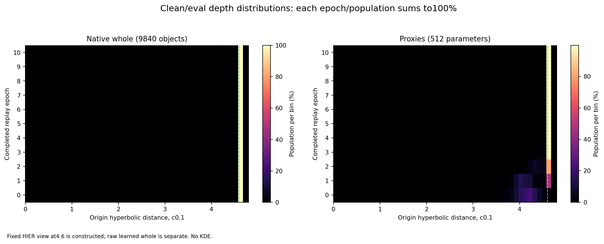

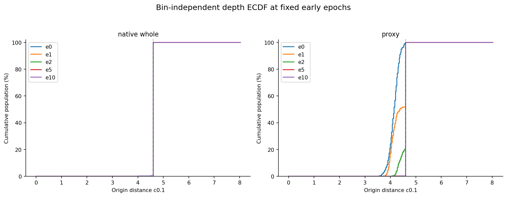

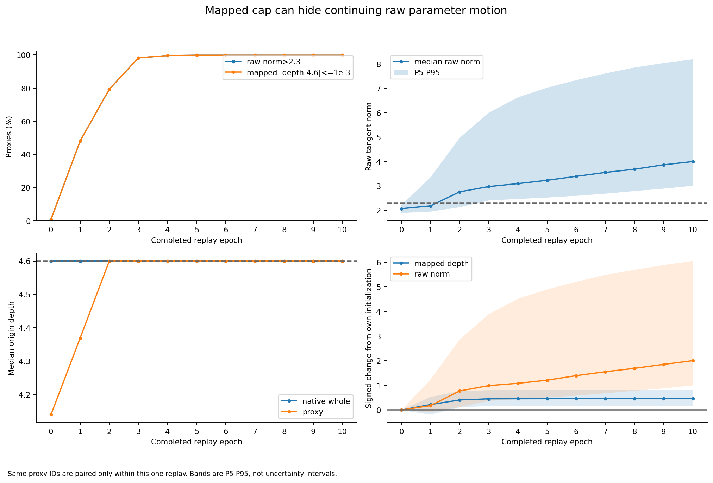

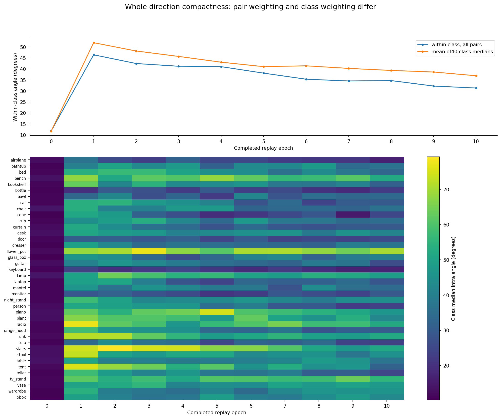

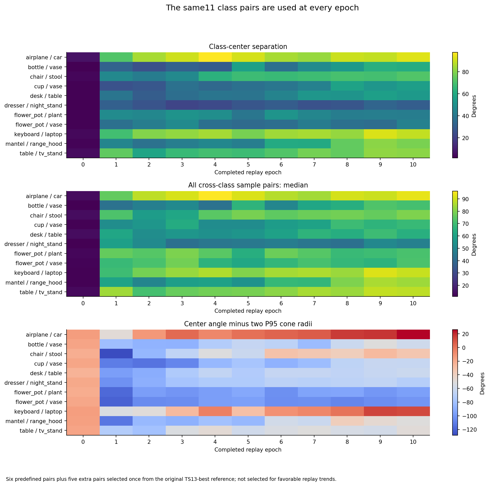

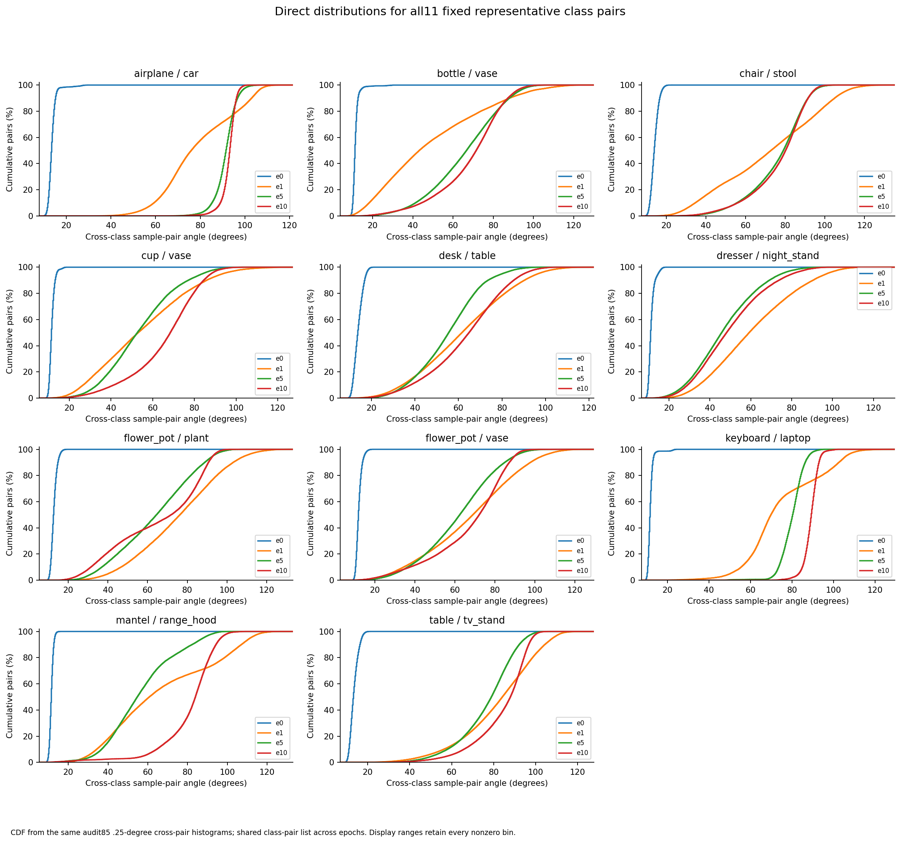

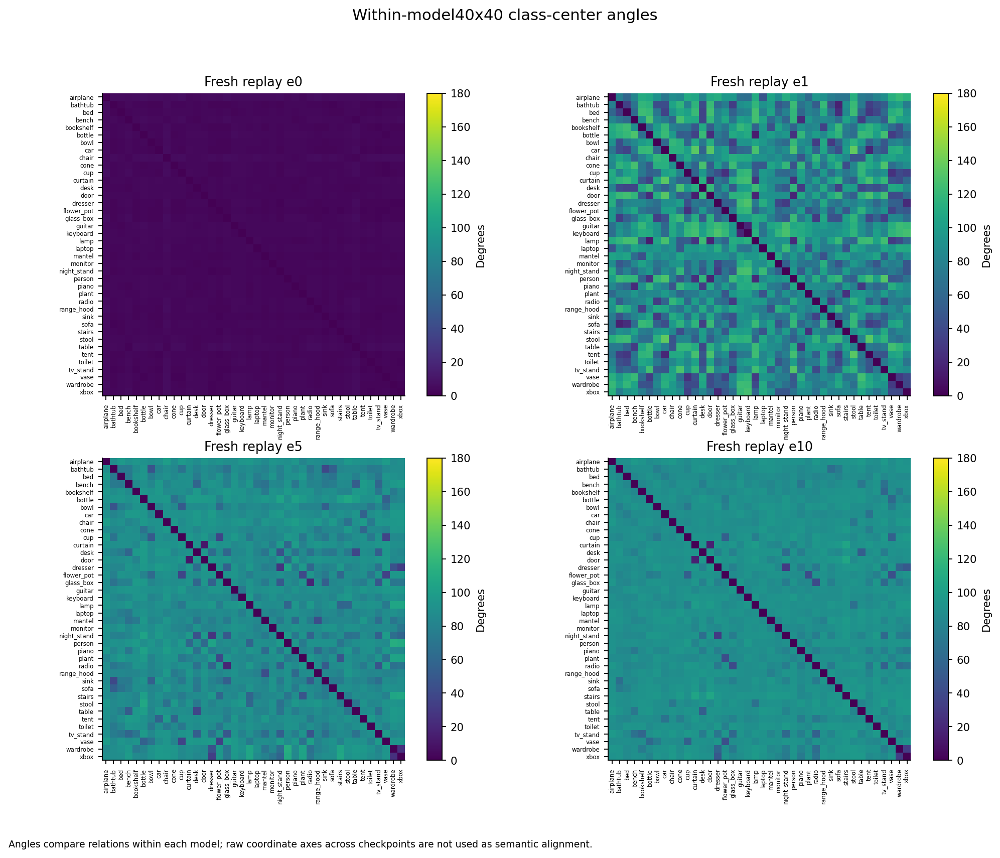

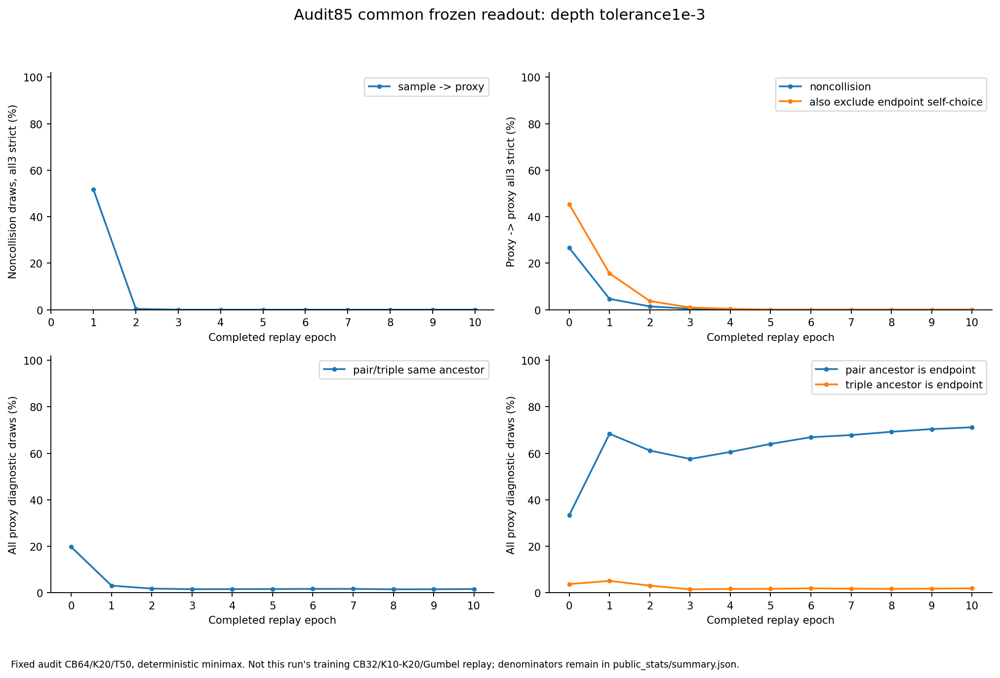

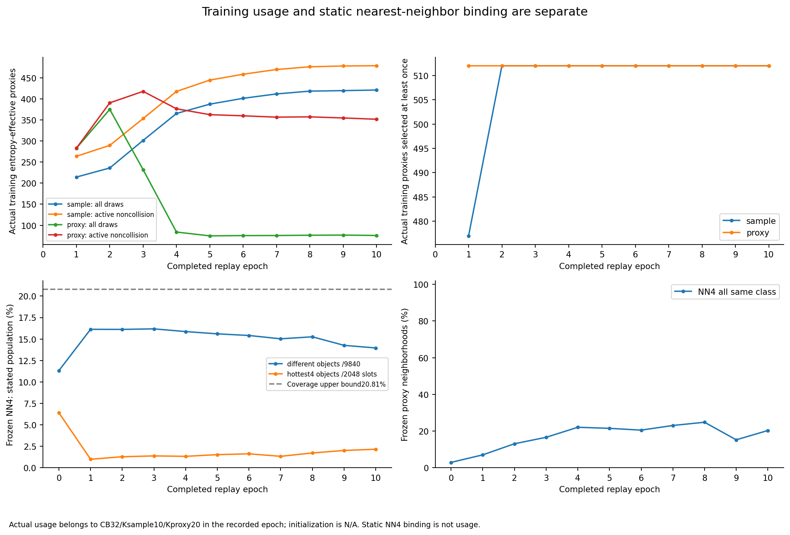

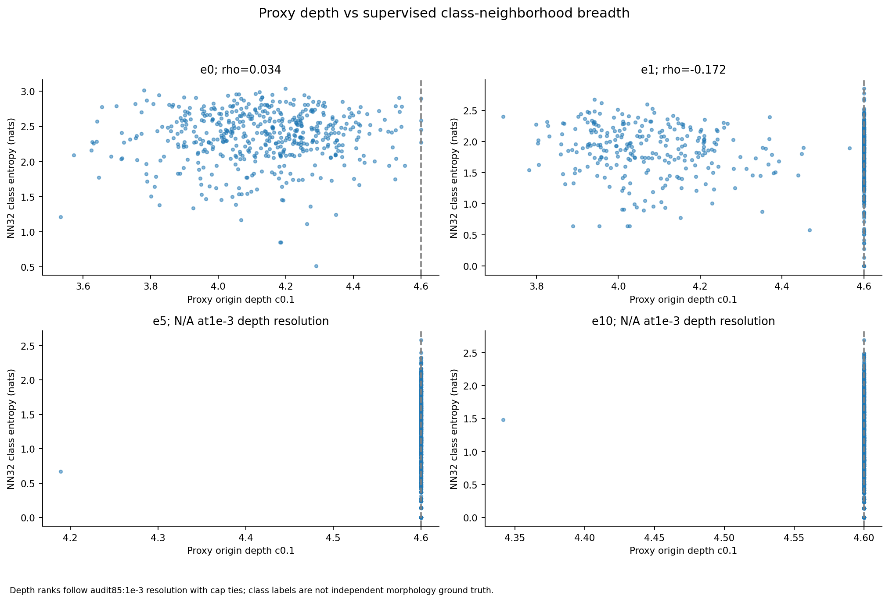

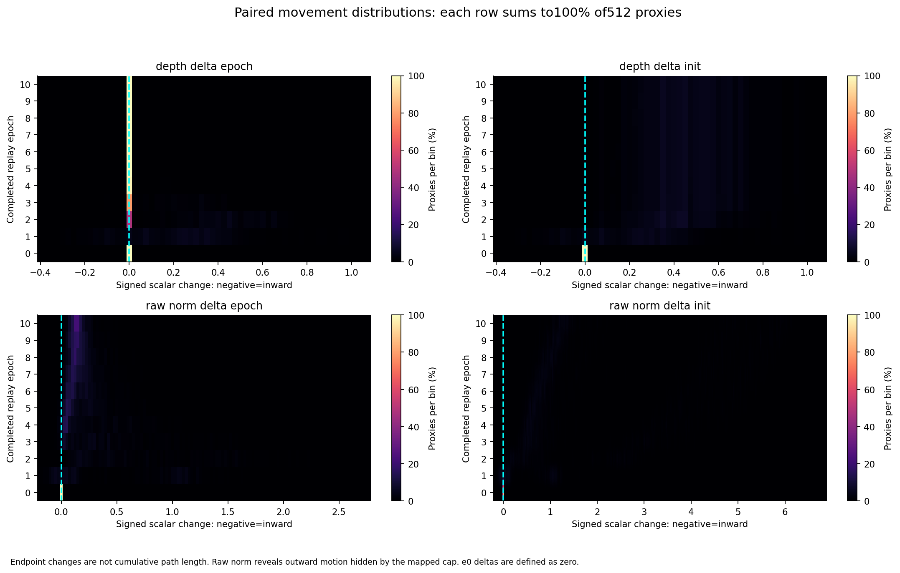

原样85统计保存在[public_stats/summary.json](public_stats/summary.json)，以及该目录的40类、780类对、类中心、深度直方图／ECDF、固定代表类对和逐代理统计CSV。

[逐轮轨迹表](trajectory_summary.csv)、[逐代理标量位移](proxy_depth_movements.csv)、[位移百分比直方图](movement_histograms.csv)、[轨迹与口径验收](trajectory_verification.json)。逐代理表仅有深度／raw模长标量，不含嵌入坐标、对象ID或点云。
