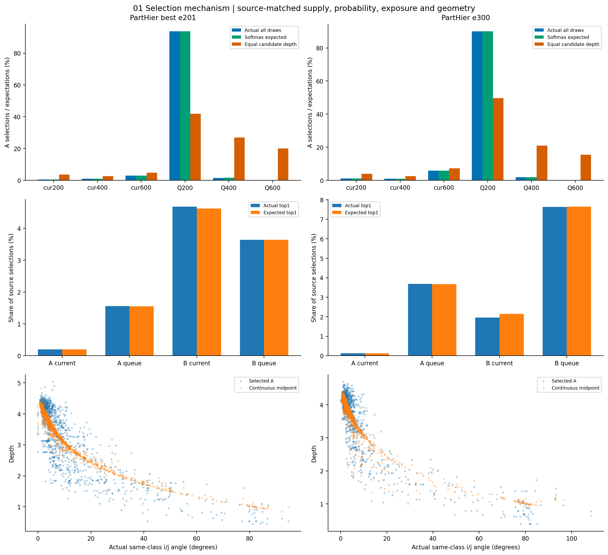
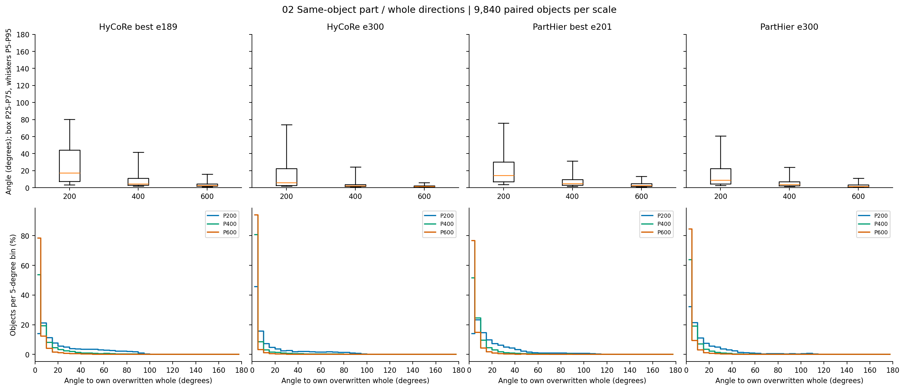
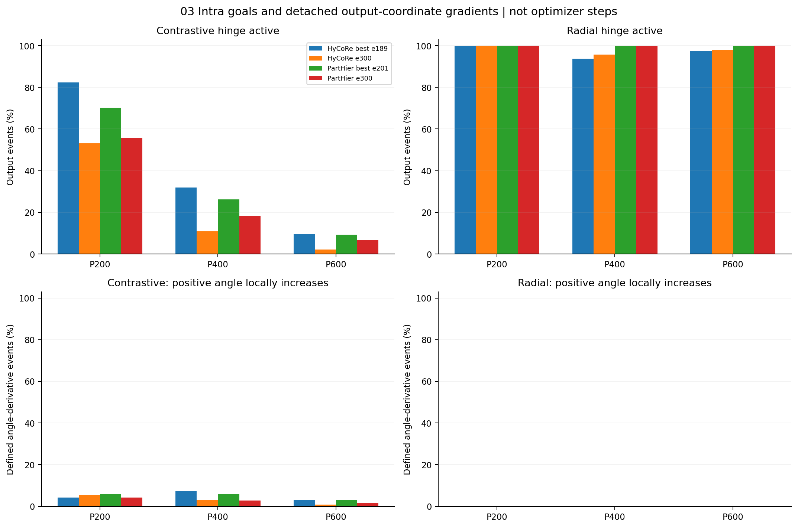
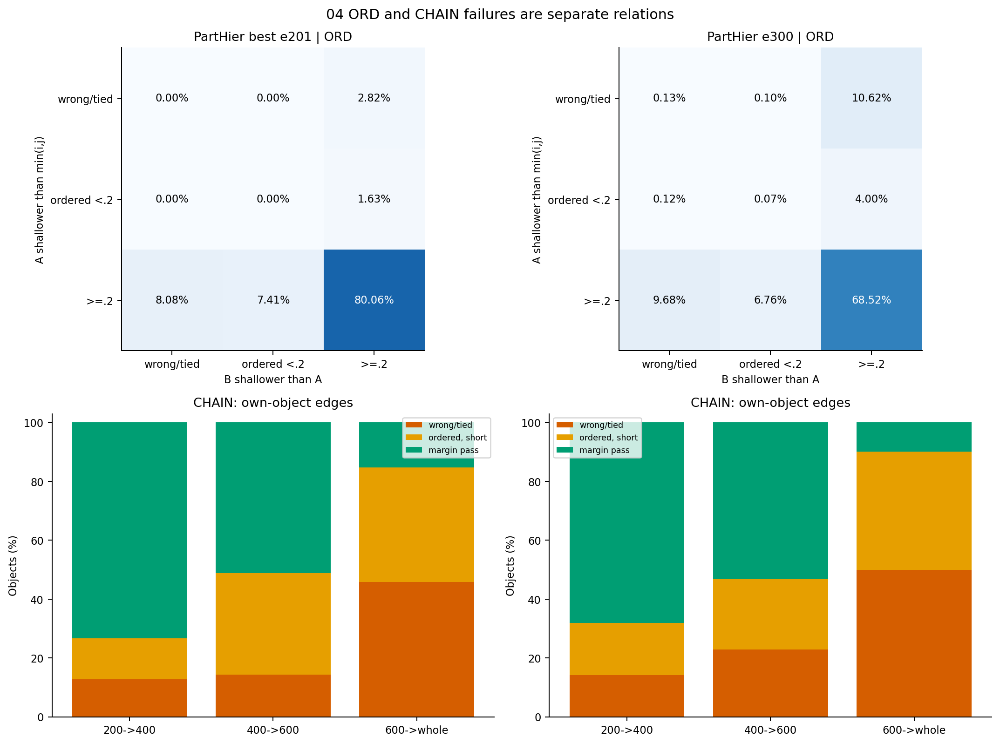
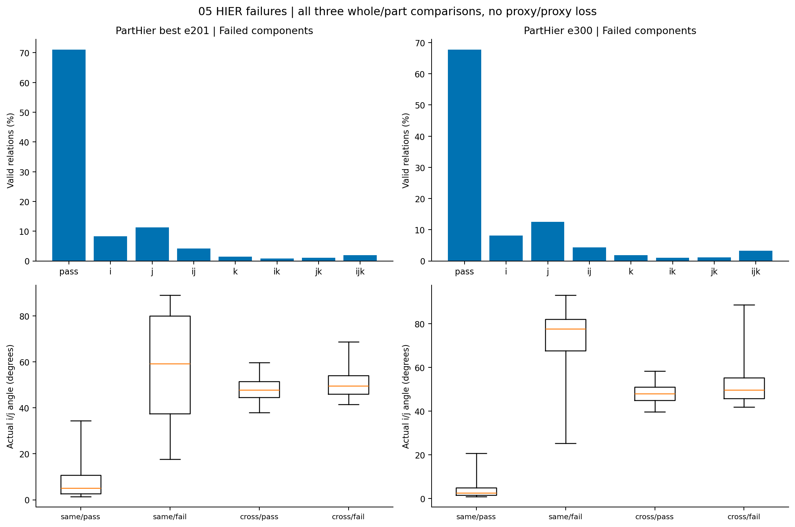

# PartHier后续五问审查

**主要答案：浅p200偏好既受候选供给影响，也明显受当前评分的径向因素影响；同类且小夹角的关系并不普遍选择浅A。原intra梯度也不支持“普遍靠扩大正part角度满足径向间隔”的解释。**

全部统计与绘图在8000完成，复用原4份冻结缓存与配套Q2048，没有编码前向、网络反传、参数更新或新训练。原200批CB64/K20/T50/seed4780，先核对94读出再解释新结果。

## 1. A为什么偏浅p200，热点从哪里来？

A评分为max(d(i,q),d(j,q))，不是只靠近一个whole。下表统一到Q-p200内部比较；候选数按条目计、选择按事件计，百分位是在本batch同来源/尺度中计算。

| 权重 | Q-p200候选深度中位 | 选中A深度中位 | 选中A的组内深度百分位中位 | p200预期选择占比 | 候选统一深度后 |
|---|---:|---:|---:|---:|---:|
| PartHier best | 1.70 | 1.41 | 31.30% | 94.20% | 45.51% |
| PartHier e300 | 2.06 | 1.41 | 19.13% | 91.09% | 53.59% |

统一深度只改变候选副本的半径，方向和原ijk不变；它检查当前评分的径向敏感性，不代表新训练的因果结果。队列和当前eval的裁剪/增强/BN/历史参数条件不同，不能拿全9840 p200中位数直接解释队列选择。

同类且HIER通过组，i/j夹角中位数为5.11°→2.54°，A深度中位数为3.67→4.07；同类失败组的实际夹角却为59.31°→77.77°，A深度为1.07→0.96。**“同类”不自动等于“同向”，总体A中位数也不能代表同类关系。** 异类通过组A约1.39→1.38，连续双曲中点约1.57→1.56，方向分离时共享中心内移与这些浅层选择相符。

热点同时给真实次数、softmax预期与曝光率，见[热点表](tables/hotspots.csv)。Top1是一条最热条目，Top5%是曝光条目中最热5%的合计；对象/尺度合并不代表同一裁剪几何part。概率预期只与全部抽签比较。

队列A最热一条的实际/预期占比：best为1.56%/1.55%，e300为3.69%/3.67%；队列B相应为3.65%/3.64%、7.64%/7.64%。热点已明显体现在距离评分概率中，不能只归于一次Gumbel抽签的偶然波动。这是固定历史队列重复读出的占比，不外推为训练中刷新队列的全程占比。

## 2. 同一对象的part与whole夹角

三个尺度的偏离程度不同：200点part最分散，600点part整体接近whole方向。p200仍有长尾；PartHier best/e300的P90为51.71°/41.69°。

| 权重 | p200中位 | p400中位 | p600中位 |
|---|---:|---:|---:|
| 原版best | 17.12° | 4.56° | 2.56° |
| 原版e300 | 5.89° | 2.17° | 1.47° |
| PartHier best | 14.26° | 4.83° | 2.51° |
| PartHier e300 | 8.83° | 3.59° | 1.62° |

每尺度各9840个配对对象，whole为训练配对的覆写whole。箱体P25–P75、须P5–P95；下排保留角度分布，近零方向单列。固定6个对象的逐尺度数据见[实例表](examples.md)。

## 3. 统一4与角度自由度

**4约束正负双曲距离差；1000/N约束原点深度差。转角不能直接满足后者。** 下表是PartHier e300的输出空间局部梯度：

| 尺度 | 对比项活跃 | 径向项活跃 | 对比项局部使正角度增大 | 径向项局部使正角度增大 |
|---|---:|---:|---:|---:|
| 200 | 55.80% | 100.00% | 4.10% | 0.00% |
| 400 | 18.43% | 99.84% | 2.82% | 0.00% |
| 600 | 6.81% | 99.95% | 1.75% | 0.00% |

以末轮p200为例，对比项局部使61.40%的正角度减小、4.10%增大、34.50%近似不变；径向项没有直接角度驱动。**现有探针不支持“普遍拉大正角度以满足intra”的说法。** 它仍不能代替真实训练消融。

保留同一个part兼任flip负例的梯度贡献，同时考虑whole/part双方移动；每尺度权重0.01。完全同向/反向时角度导数无定义，单列数量；增大/减小比例以导数有定义事件为分母。探针只对复制出的输出叶子求导，不连接主干、不执行优化器；这是局部驱动，不是实际训练一步或margin消融的效果。径向切向分量验收通过；完整正负角度、距离与梯度见[表](tables/gradients.csv)。

## 4. ord与chain的反例不同

ord分别检查min(hi,hj)−hA与hA−hB；chain检查同对象三条相邻边。状态分错序/并列、方向正确但间隔不足、达到设计间隔。

| 权重 | ord第一项不达0.2 | ord第二项不达0.2 | ord联合失败 | chain联合失败 |
|---|---:|---:|---:|---:|
| PartHier best | 4.45% | 15.49% | 19.94% | 92.23% |
| PartHier e300 | 15.05% | 16.86% | 31.48% | 95.98% |

**p600≈whole直接对应chain末边；不能把它当作ord失败的定义。** ord按A/B尺度与来源的失败贡献另列[分组表](tables/ord_groups.csv)，三种ord与chain代表反例见[实例](examples.md)。

合并当前/Q来源后，ord失败关系中A为p200的比例为78.74%→76.54%，A为p600仅15.17%→18.87%。best主要缺在B比A浅0.2这一项；末轮两项失败都增多。这里统计的是失败关系里A的尺度，不等于其来源对象自身chain是否失败。

## 5. HIER失败的ijk长什么样？

只检查i/j更近A、k更近B三项whole–part距离；没有代理–代理距离损失。图中i/j/k组合表示对应哪些项未达到0.1，pass为全通过。

| 权重 | 基本方向联合通过 | 0.1联合通过 | 原抽签数 | 碰撞数 |
|---|---:|---:|---:|---:|
| PartHier best | 79.50% | 70.99% | 582300 | 3048 |
| PartHier e300 | 73.39% | 67.68% | 545550 | 5525 |

展示的6个HIER反例中，6个在同一2240候选池里存在另一组可行A≠B；只检查这些例子，不外推总体，也不修改原选择或通过率。完整五深度/六距离/替代说明见[反例卡](examples.md)。

失败更多出现在i/j端的相对偏好：仅j项失败占有效关系11.24%→12.56%，仅k项失败为1.42%→1.85%。独立minimax评分和Gumbel选择不直接保证三项相对距离联合达标；这些示例中，候选池有可行对而原选择没有取到。

通过/失败组按同类/异类分开，三whole深度、三对夹角与距离、A/B深度及j是否实际比k更近i见[几何表](tables/geometry_groups.csv)。

原Q包含历史train-mode特征，本次是保存状态审查；原版并非匹配训练消融。结果解释当前几何和选择机制，不单独证明训练因果或形态树。输入SHA、冻结重放及无更新验收见[summary.json](summary.json)。

验收：8000 GPU0完成分析后释放，两个PartHier端点的抽签数、有效数、碰撞数和四个联合通过率均与94精确一致；四模型共12组角度各9840对。12项服务器CPU合同通过；28份派生文件取回SHA一致，五图已逐一查看。本地只整理解释文字，原始逐关系明细和原结果保留服务器。来源提交e4c757c；结果文件核验见[verification.json](verification.json)。
