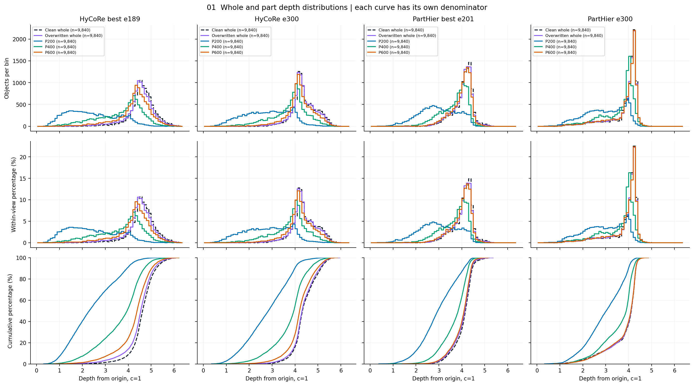
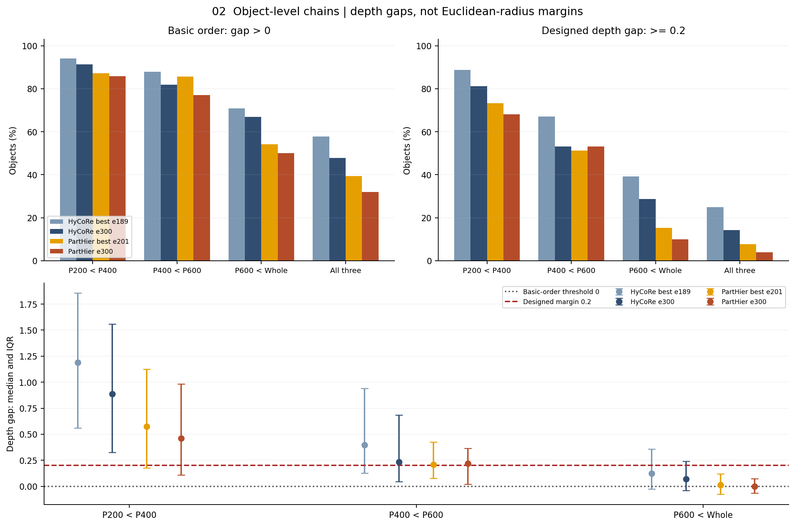
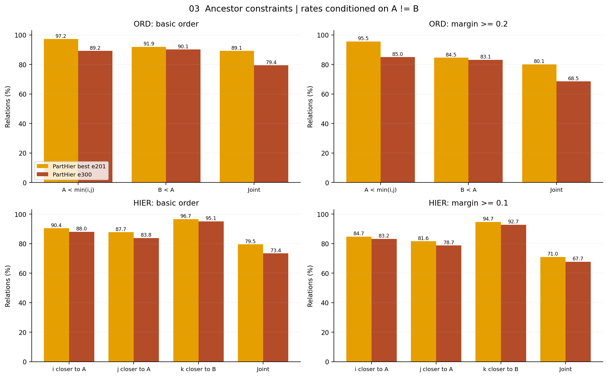
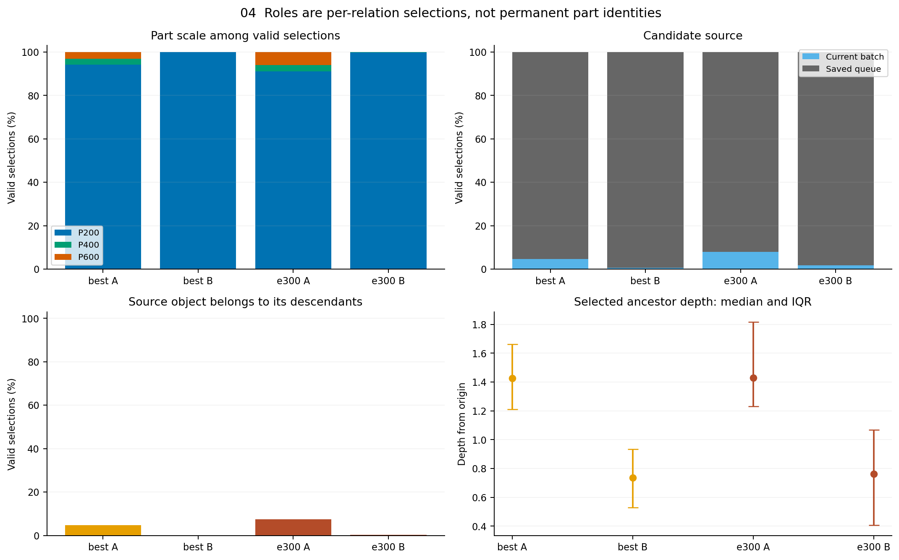
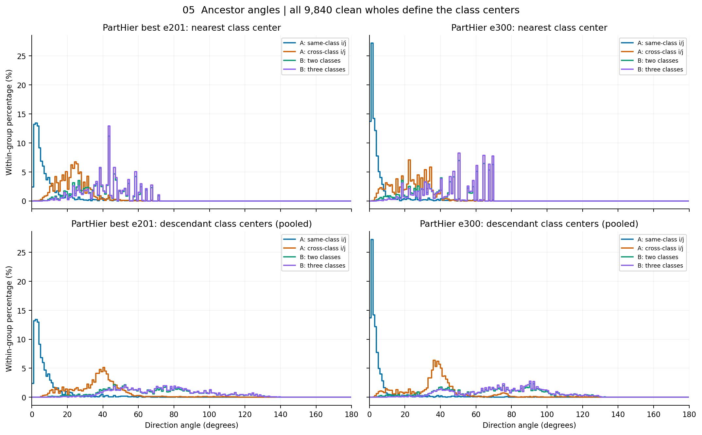

# PartHier v1嵌入审查结果

**主要发现：A/B祖先约束部分兑现，但同一对象的四级局部链没有稳定形成。最明显的缺口是p600与whole深度接近；A和B也没有形成“大part负责pair、小part负责triple”的粒度分工。**

四份冻结权重使用相同9840个训练对象、一个固定同中心嵌套视图；全量clean whole建立类别中心，未另分参考集。没有参数更新或BN校准。

A/B按正常ijk挖掘后选择，使用各检查点保存队列与当前part；历史队列和新eval特征共同构成保存状态读出，**不是精确训练重放**。以下祖先满足率只以A≠B的有效关系为分母。

## 1. whole与part的分布

**PartHier的whole较原版浅，p200较深，尺度间分离减弱。** p200仍整体偏浅，但p400、p600、whole大量重叠，尤其p600与whole不能视为两个清晰层级。这个差异只描述四份权重，不归因于某个单独损失。

PartHier两份权重的五种输入均没有欧氏范数≥0.995的条目；当前集中在约4.1深度，不能称为贴近球边界。

深度为到原点的双曲距离，各条曲线分别归一化；clean与覆写whole分开读。下表为深度中位数，不能替代逐对象链检查。

| 权重 | clean whole | 覆写whole | p200 | p400 | p600 |
|---|---:|---:|---:|---:|---:|
| 原版 best e189 | 4.626 | 4.547 | 2.301 | 3.952 | 4.386 |
| 原版 e300 | 4.325 | 4.306 | 2.837 | 3.948 | 4.200 |
| PartHier best e201 | 4.159 | 4.132 | 2.951 | 3.842 | 4.098 |
| PartHier e300 | 4.118 | 4.107 | 3.024 | 3.897 | 4.098 |

读者追问的实验设计见[后续审查计划](followup_plan.md)，按“疑问—实验—输出数据”逐项组织；尚未启动新增分析。

## 2. Lchain

每个对象检查三条相邻边。基本次序为深度差>0，设计间隔为各≥0.2；下表是三条边联合满足率。

| 权重 | 基本次序联合 | 0.2间隔联合 |
|---|---:|---:|
| 原版 best e189 | 57.72% | 24.95% |
| 原版 e300 | 47.77% | 14.27% |
| PartHier best e201 | 39.39% | 7.77% |
| PartHier e300 | 32.04% | 4.02% |

**chain未达到预期，末轮进一步退化。** 最弱的p600→whole一边，基本次序满足率为54.15%→50.08%，达到0.2仅15.30%→9.96%。逐对象深度差的中位数为0.0133→0.00013，末轮已落入1e-3临界范围。这里是先逐对象求差再取中位数，不能用上一表两个中位数相减替代。

## 3. Lord与HIER距离关系

Lord要求A浅于i/j且B浅于A，深度间隔各0.2；HIER要求i/j更近A、k更近B，距离间隔各0.1。B浅于k仅作诊断，不算第三项ord。

| 权重 | 有效/全部关系 | A=B | ord间隔联合 | HIER间隔联合 | 两者同时 |
|---|---:|---:|---:|---:|---:|
| PartHier best e201 | 579,252/582,300 | 0.52% | 80.06% | 70.99% | 59.68% |
| PartHier e300 | 540,025/545,550 | 1.01% | 68.52% | 67.68% | 53.81% |

**选出来的祖先多数满足目标，但不能据此认定所有part已分层。** 不要求间隔时，ord联合基本次序为89.10%→79.35%，HIER联合基本次序为79.50%→73.39%；两者末轮均下降。上表是选完A/B后检查原ijk，没有根据祖先重新挑样本。这些结果审查的是选择后约束兑现，不是独立的形态树验证。

## 4. A/B由谁承担

**A/B都主要选择200点part，区别更多表现为所选条目的深度。**

| 权重/角色 | p200占比 | 来自保存队列 | 所选深度中位数 |
|---|---:|---:|---:|
| best A | 94.17% | 95.32% | 1.426 |
| best B | 99.92% | 99.45% | 0.736 |
| e300 A | 91.00% | 92.00% | 1.429 |
| e300 B | 99.80% | 98.28% | 0.763 |

不能预设大part天然成为A。候选本来就有2048条队列、192条当前part，队列数量占91.43%，所以来源比例也受候选基数影响；历史train-mode特征与当前eval特征并非同一前向条件。上述比例不能直接代表训练中每一步的选择比例。

下图按有效选择事件计数。同一条part可被多次选择或兼任不同角色；队列来源占比也受候选条目数量影响。独立条目使用量及来源比例见[角色表](tables/roles.csv)。

## 5. 类别中心角度

**同类pair的A很贴近共同类别方向，异类pair的A及B更分散。** 全部抽取关系中，i/j同类仅占8.37%→9.73%，异类占多数，不能把全部A解释成类内祖先。

分别看同类pair、异类pair，以及含两类/三类的triple。下表为到最近类中心的中位数/P90；到后代类中心的角度另见图与[角度表](tables/angles.csv)。

| 关系组 | best中位/P90 | e300中位/P90 |
|---|---:|---:|
| A：i/j同类 | 4.88° / 19.02° | 2.56° / 10.70° |
| A：i/j异类 | 23.29° / 32.42° | 22.98° / 35.26° |
| B：两类triple | 40.06° / 58.44° | 42.00° / 67.84° |
| B：三类triple | 43.56° / 60.10° | 47.97° / 67.84° |

同类pair的A到共同类别中心中位数同为4.88°→2.56°，最近中心属于共同类的比例95.46%→96.01%。异类pair的A到i、j类中心的角度中位数分别为38.03°/38.78°→37.42°/38.20°；最近中心属于这两个类之一的比例49.22%→48.13%。注意“最近类别中心”可能是后代类以外的类别。

B到后代类中心的合并角度中位数：两类triple为69.54°→72.36°，三类为72.87°→76.63°；最近中心落在后代类中的比例约17%–23%。B没有唯一正确类别，不能仅凭此判错，但目前不足以支持其稳定承载后代类别的共同语义。图中同一关系内重复类别只计一次，近零方向无定义项为0。

原intra附表：[三尺度径向及对比间隔](tables/intra.csv)。图表细项另见[局部链](tables/chain.csv)、[关系目标](tables/relation.csv)和[汇总JSON](summary.json)。

附表提示：whole−p200达到原5深度间隔的比例，PartHier两份均为0；原版best/e300也仅0.061%/0.010%。对比距离目标比大径向间隔更常满足，因此“原intra损失存在”本身不能保证径向层次已兑现。

原版与PartHier不是匹配H0。以上只描述这些权重的几何与目标兑现程度；排序、角度或类别绑定不能单独证明形态树，也不能单独解释test下降。

执行与核验：全部提取、统计及绘图均在8001完成，2026-10-26北京时间19:19结束，审查GPU已释放。每模型200个CB64审查batch，K20/T50、当前192part＋配套静态Q2048，seed4780。严格FP32提取，关闭TF32和cuDNN benchmark；原权重/BN不变、零反向/更新、没有test前向。提取提交807a5d6，统计提交6cc302b；21份派生文件取回SHA一致，五组图已逐一查看。本地仅整理报告文字，未启动本地统计。复现身份与文件核验见[verification.json](verification.json)。
