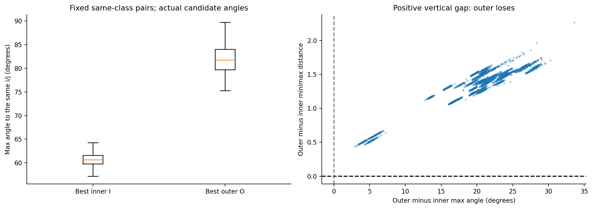
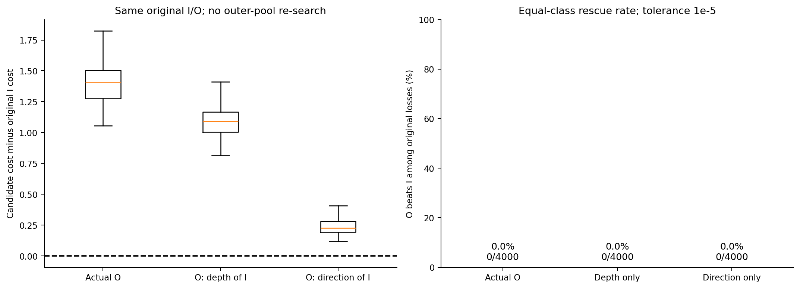
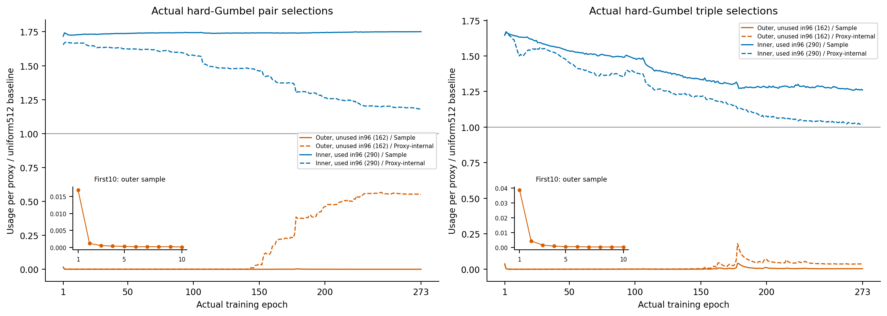
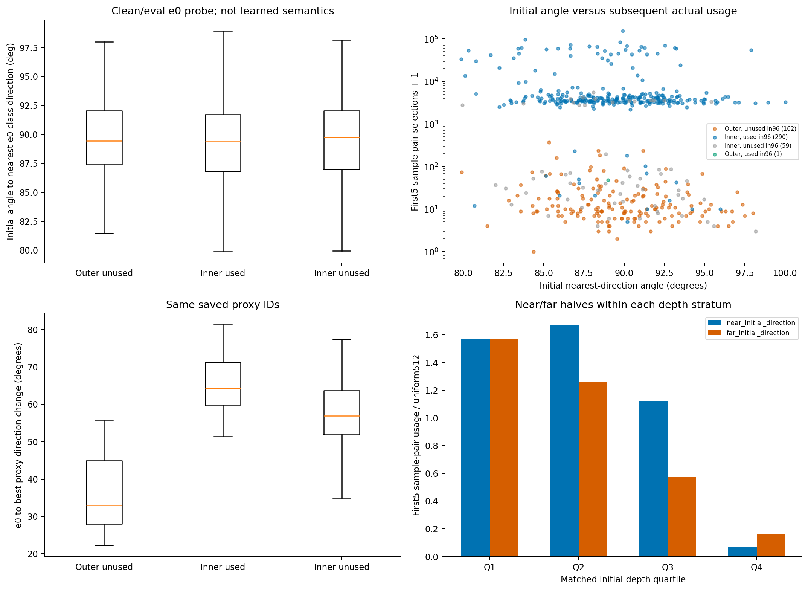

# TS17外层代理为什么少被选中：三步审查结果

2026-10-27，8000完成。对象为TS17/B12 best e273、原始e0/e5，以及e1–273真实训练计数。全部whole参与几何选择前统一到c0.1深度4.6；代理保持保存的实际深度。没有新增训练，GPU已释放。

**当前落选确实与方向不合适有关；但“初始方向差，所以一直冷落”没有得到同样强的支持。更明显的起始差异是初始深度：最终冷落的外层代理，起初通常就更深，前几轮使用机会很少，到e5时方向偏离初值的幅度也较小。** 这是一条与现有数据相容的训练路径，尚不能当作唯一因果解释。

## 1. 同一对i/j眼中，外层确实更偏，而且不是靠深度就能接近

复用96的同类关系，按无序对象对去重，每类固定100对，共40类4000对；每对分别找349个内段中的最佳I和163个外段中的最佳O。实际评分为`max[d(i,p),d(j,p)]`。

| 比较量 | 结果 |
| --- | --- |
| I与这对i/j较大夹角的中位数 | 60.670° |
| O与这对i/j较大夹角的中位数 | 81.779° |
| O落后的评分差中位数 | 1.404 |
| 外层胜出 | 0/4000 |
| 原Gumbel下，全部外层候选合计的平均选择概率 | 0.03284% |

这是与实际i/j的夹角，不是最近类别中心角。内层的60°也不算贴近样本方向；它只是比外层更适合这对关系。

接着固定这对i/j及原I/O，分别只改O的深度或方向：

| 外层O的状态 | 相对原I的评分差中位数 | 逐对评分改善中位数 | O对I翻盘 |
| --- | --- | --- | --- |
| 原样 | 1.404 | 0 | 0/4000 |
| 只换成I的深度，保留O的方向 | 1.092 | 0.274 | 0/4000 |
| 只换成I的方向，保留O的深度 | 0.225 | 1.153 | 0/4000 |

**这次固定候选替换里，改善方向的效果更大；偏深也确实在增加距离。** 换方向后还剩0.225的劣势，正好说明：即使方向与I相同，在这个方向上更深仍可能更远。两个改动都没有翻盘，不等于两个因素都无关。

这也解释了最初的直觉为什么没有兑现：代理若几乎朝着样本，外移通常能靠近whole；若相差60°甚至80°，不能仅凭径向更接近4.6判断总距离。上述改善量也不能相加当作独立贡献比例。

六对不同类别的具体I/O深度、两个夹角和两个距离，见[完整账单报告第5节](outer_results/report.md)及[案例表](outer_results/representative_pair_accounts.csv)。所有案例按分数差分档后固定规则选取。

## 2. 它们早期就很少用于样本，但不是始终完全没用

固定96中的两组代理ID：外段未入选162个，与内段入选290个。其余60个仍完整保留在明细中。这里“未入选”指96冻结审查，不是先验断言训练期间从未使用。

| 指标 | 外段未入选162个 | 内段入选290个 |
| --- | --- | --- |
| 前5轮占全部样本pair选择的份额 | 0.121% | 98.047% |
| e273占全部样本pair选择的份额 | 0.00641% | 99.149% |
| e0→e5净转动角中位数 | 2.848° | 33.713° |
| e0→best净转动角中位数 | 32.982° | 64.266° |
| e273占代理内部pair选择的份额 | 17.428% | 66.861% |

真实逐轮计数显示，外段这批代理在第一轮就处于样本选择劣势，后续仍很少承担样本pair角色。**但它们不是一动不动，也不是对所有目标都没用**：训练后期，代理内部pair项仍明显使用这批节点。这里的转动角是两个保存时点之间的净变化，不是逐步累计的运动路程。

历史日志的“样本pair”包含同类与异类pair，没有再按S/C拆开；它与第1节的4000对同类pair是两个不同口径。计数是实际hard-Gumbel选择，保留全部选择；碰撞及有效关系另表，不能把硬选择次数直接当非零梯度次数。

图中按单个代理归一，1代表512个代理的平均机会，避免162个与290个直接比总次数。橙色为外段未入选组，蓝色为内段入选组；实线是样本项，虚线是代理内部项。

## 3. 初始化共同点：初始深度比初始方向更明显

原e0代理逐位匹配源码的独立seed4780高斯初始化。**它随机的不只是方向，还有模长；并非512个代理都恰好在4.14深度。** 实际初始深度约3.533–4.600。

用e0/e5同一批800个对象（每类20个）做冻结方向探针，best复用同ID缓存：

| 起始特征 | 外段未入选162个 | 内段入选290个 |
| --- | --- | --- |
| 初始到最近e0样本类别方向的夹角中位数 | 89.455° | 89.385° |
| 初始方向到e5类别方向的最近夹角中位数 | 82.703° | 82.508° |
| 初始深度中位数 | **4.295** | **4.027** |

两组起始方向角分布十分接近，初始深度却有明显差异。全部512代理中：

- 初始方向角与前5轮样本pair使用量的Spearman相关：**−0.130**。
- 初始深度与同一使用量的Spearman相关：**−0.697**。

负相关表示角度越偏／深度越深，后续使用通常越少。这里比较的是关联强弱，不能等同于两个变量各自的独立因果效应。

再按初始深度由浅到深分成四组，每组128个：

| 初始深度组 | 最终属于外层冷落组的数量 | 该组冷落比例 | 前5轮样本pair选择份额 |
| --- | --- | --- | --- |
| 最浅1/4 | 1/128 | 0.78% | 39.283% |
| 第2组 | 9/128 | 7.03% | 36.683% |
| 第3组 | 51/128 | 39.84% | 21.217% |
| 最深1/4 | 101/128 | 78.91% | 2.817% |

初始方向也不是完全没有关系：在初始深度第2、3组中，方向较近的一半平均使用较多；第1组几乎无差别，第4组均值不遵循这个顺序。四分位只是粗分层，不能说已彻底排除深度差异，也不能把方向优势说成统一规律。

需要注意：e0网络尚未学出类别语义，e0角度描述的是起始样本方向覆盖。e5类别方向已经受共同训练影响，只作回顾说明，不能倒过来当作独立预测初期机会的证据。clean/eval方向探针也不是训练增强与train-mode BN的逐步重放。

## 4. 对假说的判断

数据支持“较早失去样本选择机会的一批代理，方向净变化较小，最后仍与样本方向差得较远”这一现象；**目前不支持把它主要归为随机初始方向没有被类别捕获。更值得优先关注的是高斯初始化附带的初始深度不均。**

一种相容的路径是：初始偏深，在近乎正交的初始方向条件下竞争较差；早期较少被样本选择，方向净变化较小；最终保留较深且偏离样本的几何状态。这个解释包含合理推断，尚缺初始化干预来证明因果。Gumbel软反向和代理内部项也使“少被选”不等于“没有梯度”。

如果后续要检验起始条件的因果，优先问题应是“保持相同随机方向，是否需要把初始深度真正统一”，而非仅更换随机方向。本轮没有启动这类新训练。

## 数据与验收

- 本机6项合同检查通过；正式best32前向与85缓存逐坐标相同。
- 正式流程前向1632个对象：e0/e5各800，加best32回归；参数、BN和源输入保持不变，反传／优化器更新／test读出均为0。
- 首次32对象回归因卷积计算设置与85不一致而自动停止；恢复85原设置后回归通过。失败记录保留。该次加正式流程合计前向1664个对象，没有使用失败读出形成结论。
- 4000对真实及两种换位评分经独立CPU公式复核，最大误差小于0.0000034；e1–273全部逐代理历史计数逐项复核一致。原权重、缓存及旧结果未改写。
- 18份最终服务器导出文件下载后SHA全部匹配；四张主图已逐图检查。

正式读出源码`de2644d`，独立复核`480df74`，CPU绘图整理`a48d08b`。[完整统计](outer_results/summary.json)、[512代理表](outer_results/proxy_initial_history.csv)、[初始深度四分组](outer_results/initial_depth_quartiles.csv)、[40类候选比较](outer_results/class_competition.csv)、[真实使用历史](outer_results/history_groups.csv)、[复核记录](outer_results/review_qa.json)、[权重与缓存身份](outer_results/source_hashes.json)。
