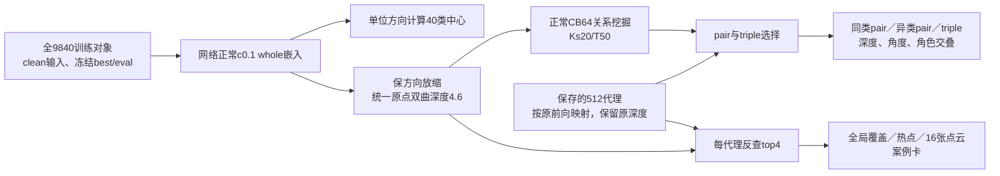

# TS17 best：代理双层分布与pair／triple角色审查计划

> **执行更新：已获用户批准并于2026-10-27在8000完成。** [最终报告](report.md)与results目录已归档。1000批冻结读出、16组形态卡、12项合同及20项复算完成，62份文件SHA一致；GPU释放，无新训练。本页下文为执行前原计划，保留当时状态记录。

日期：2026-10-27。用户指定[93总账TS17/B12](../93_V9_EXPERIMENT_ATLAS_2026-10-26/report.md)，只审查best，不审e300。本轮交付检测设计，并只读核实8000上的现有材料；尚未执行角色统计、网络前向或绘图。

## 1. 权重已经保存在8000

已实际检查8000中的`B05_A1_best.pth`冻结副本：e273、53,817,601字节，含`net`及`proxy.tangent_proxies`，代理形状512×256；CPU加载成功，CUDA未初始化。副本SHA256为`d10144896c69ffa215a6622e4077a05749e3547c0fd606a546b0f750ae4af61b`，与85审查归档一致。原训练best SHA为`86997f21afe34b299fdc306be754e5055455abbbc7d26a163ab98abc3193c1e7`；文件经过提取封装，两个SHA不同，各自身份分别核对，不能要求文件字节相同。

8000另有同一权重的9840对象缓存`B05_A1_best.npz`，SHA256为`b0142fac9d4ce59ddfacf44a9600ccbcce322e9311544a0dca25ce0e5642bfde`。其中包含native_mu、hier_mu、标签、对象ID、代理切向量及球内坐标；权重和缓存均已本轮重新核对SHA。私有绝对路径及核验原件保存在本机任务私有目录，不写入公共仓库。

TS17的准确身份：严格B05几何、c0.1／cap2.3／基础GS、均衡CB64×200、固定壳HIER、Ks20/Kp20、lambda0.5、代理AdamW LR0.005/eps1e-4、seed4780；best e273 OA93.476499%。它与B05单卡CB32、新旧HIER比较任务不是同一条训练。

85已有该best代理深度约3.028–4.142、中位3.444、0/512越cap的记录。这只是既有定位信息，**不能预先把较深的一段写成“触及4.6 cap”**。本次分别检验“pair相对外层”和“pair接近cap”，并直接报告离4.6的距离。

## 2. 数据流：网络正常输出，选代理前统一4.6

- 使用全9840训练对象，clean first1024输入、eval及该best保存的BN，不使用test对象，也不更新BN。优先复用85中已经由该网络正常前向产生且验收通过的缓存；复用须再次验证输入ID、权重身份、native与hier视图一致。若无法通过，才在实施阶段从同一best重新提取一次。
- 正常网络输出记为`x_native`。使用样本挖掘关系、选择代理，以及代理反查top4时，统一使用`x_shell`：方向不变，c0.1原点深度4.6。调用既有`whole_to_hier`，不把native实际深度直接代入代理选择。
- **代理保持保存权重的实际深度，不放缩到4.6。** 切向参数按原训练的前向cap2.3／expmap映射；不投影更新参数，不训练代理。
- 最近类角度的中心由正常whole的单位方向计算；放缩不改变方向。原native深度仅作输入验收，不混入本次代理深度箱形图。

## 3. 如何定义同类pair、异类pair、triple

固定冻结读出，采用原CB64采样结构：每批32个不同类、每类有放回2例，Ks20、每合格anchor抽T50；保留原同类相似度`+1`、互近邻关系与self-k排除。五个固定审查seed（4780–4784）各200批，共1000批；生产训练seed仍是4780。各200批结果同时保留，用于判断有限采样下角色份额是否稳定。

主分析保留三个不同对象ID的关系；原有放回采样产生的重复对象关系数量和含重复读出另表报告，不静默改变训练历史。对于同一`(i,j,k)`，在保存的全部512代理中选择：

\[
A=\arg\min_p\max[d(x_i,p),d(x_j,p)],\quad
B=\arg\min_p\max[d(x_i,p),d(x_j,p),d(x_k,p)].
\]

这里所有`x`均指4.6视图，距离沿用c0.1原函数。稳定并列按代理ID处理，并报告近似并列数量。

| 角色 | 定义 | triple如何处理 |
|---|---|---|
| S：同类pair | A且`y_i=y_j` | 不要求k属于其他类别 |
| C：异类pair | A且`y_i≠y_j` | 不额外约束k |
| T：triple | B | 统一统计，不按三点标签组合再分组 |

这是**确定性冻结几何选择**，不声称恢复训练时的随机Gumbel轨迹。为了避免结论仅来自去掉随机性，另按原tau0.1计算`softmax(-pair_cost/tau)`和`softmax(-triple_cost/tau)`，累计三种角色的期望使用质量及概率加权深度／角度分布；无需反复抽Gumbel。原两次选择独立，非碰撞的期望角色质量可用`pA*(1-pB)`与`pB*(1-pA)`复核。不能用“随机曾抽到一次”定义稳定职能，否则极小概率也会把大量代理计为活跃。

同一代理可以被同类pair、异类pair及triple共同选择。A=B是本次关系中的碰撞，须给比例；不能把这类情况直接当作两层成功。主角色分布保留全部选中关系，另给A≠B有效关系子表。

## 4. 验证“双层就是pair／triple分工”

### 4.1 深度分布与同一关系中的次序

深度统一指c0.1的原点双曲距离`h(p)=d_c(0,p)`，不是欧氏模长。输出：

1. 全512代理的深度直方图与ECDF，用于确认两段结构是否存在；深浅分界由全体代理的深度分布独立确定，再检查角色，不先按角色画出理想边界。若没有稳定谷值，不强制分成两层。
2. S/C/T各组**不同代理各计一次**的中位数、Q1/Q3、IQR、范围、箱形图；同时附使用次数加权及Gumbel概率加权版本，避免一个热点代理因被重复选择而决定整张图。
3. 对同一ijk且A≠B，统计`h(A)-h(B)`的中位数、箱形图、正／近零／负比例，以及`h(B)+0.001<h(A)<4.6`成立率。同类pair与异类pair分别报告，不能只靠三张独立分布图判断层次。
4. 每代理按深度排序，画S/C/T使用构成；报告pair倾向`(nS+nC)/(nS+nC+nT)`与深度的关系、深浅段的角色富集和交叠。代理角色纯度不高时，应写成“使用偏好”，不能宣称两种互斥节点类型。
5. 对S/C/T分别报告`4.6-h(p)`；预先列出距cap≤0.1、≤0.5及真实前向cap命中的比例。不以“全体中较深”代替“贴近cap”。

稳定性以五组审查批次为单位报告，不把同一代理的成千上万次重复选择当作独立样本。

### 4.2 最近类别的夹角

对每一类，先平均该类所有对象的单位whole方向，再归一化，得到40个类别方向中心`u_c`。代理方向为`u_p`，最近类角度为：

\[
\theta_{nearest}(p)=\min_c\arccos(\mathrm{clip}(u_p^\top u_c,-1,1)).
\]

S/C/T各组给最近类角度的中位数、四分位与箱形图，单位为度，并保留最近类名称。这里“最近类”明确指最近**类别方向中心**，不是某个最近对象。附同类pair最近类是否等于其共同标签、异类pair最近类是否属于i/j标签的比例；triple仍不拆分类别组合。零方向或中心范数异常须标为无定义，不补造方向。

## 5. 用代理反查top4：覆盖、热点与纯类比例

对每个代理，在**全9840个4.6视图**中按c0.1双曲距离选4个不同对象ID。不限制为选中该代理的那一批，也不只在某个类别内选。S/C/T及pair并集各自汇总，跨角色重复代理在并集中只计一次。

| 问题 | 报告指标与分母 |
|---|---|
| 覆盖多少样本 | 不同对象数U、U/9840；另给`U/min(9840,4M_role)`，其中M_role为该角色不同代理数 |
| 有没有热点 | 每对象被多少个不同代理纳入top4；最大值、top1/top10占槽位比例、有效样本数、重复四元组；给全体及已覆盖对象口径 |
| 热点是否只是类别规模造成 | 固定每代理top4的标签组成，类内随机重选不同对象1000次，比较实际最大曝光次数与随机对照分布 |
| top4是否为同类 | 4个GT标签完全相同才算“纯类top4”；分别计算全512、已入选代理及各角色组内的纯类比例，分子随对应集合限定 |

令Pure为全512中top4标签完全一致的代理集合，Used为已入选集合。三个口径分别为`|Pure|/512`、`|Pure∩Used|/M_used`、`|Pure∩S|/|S|`（C/T同理）。不能把全512中的纯类代理数量直接除以M_used。

每个代理的top4只统计一次，不按它被选中的关系次数重复累加。即使全部512代理都参与，也只有2048个top4槽位，理论最多覆盖训练集20.81%；不能把低于100%的覆盖率直接解释为塌缩。样本等深时，固定非零代理的理想距离排序与方向角排序一致，可用于非近似并列情形的数值回归，正式结果仍使用指定双曲距离。

## 6. 代理角色比例：排除未入选，同时保留512分母

主S/C/T集合和`M_used=|S∪C∪T|`取五个seed合并后的代理ID并集，每个代理在同一集合只计一次；每个seed另作稳定性面板，不把五个百分比的平均值当作并集比例。“未入选”只指本次有限审查，不等于训练中从未使用。输出S、C、T各自数量及`数量/M_used`，并附`数量/512`，把两个分母写清楚。

S/C/T可能交叠，三项百分比不要求相加为100%。另给七种互斥组合：仅S、仅C、仅T、S+C、S+T、C+T、S+C+T；七项在M_used中合计100%。未入选代理单列`512-M_used`，不混进主百分比。五组审查seed的活跃数、角色比例和累计稳定性一并展示。

## 7. 形态展示：8＋4＋4张代理卡

- 同类pair 8个代理、异类pair 4个、triple 4个，共16个展示例；每例为**同一个代理的top4点云并排**，共64个点云面板。
- 按各角色代理深度四分位预先分层取例：同类pair每层2例、其余每层1例；层内尽量覆盖纯类与混类top4，随后按固定ID/seed取例，不按“看起来相似”挑选。
- 优先使用不同代理ID；角色组数量不足时明确少于目标，不伪造例子。确须跨组复用代理时，标明相同ID和多重角色。
- 每卡标代理ID、深度、角色交叠、使用量、最近类及夹角、4个对象ID与标签；图片使用相同点数、相机、坐标约定和显示比例，不按类别旋转美化。
- 展示点云对应同一clean对象输入；图像只用于观察局部形态，不把标签一致直接写成语义或形态层次证明。

## 8. 轻量补充、交付与结论边界

TS17的HIER还包含**代理–代理内部项**。另做一张内部K20/T50的pair/triple角色与深度交叉表，辅助判断两段结构是否也对应内部目标；它没有样本GT同异类标签，不能混入上述S/C/T主分母。只读检查不能单独证明哪一项训练损失造成了分层。

实施交付：主报告；深度/角度箱形图与完整分布；512行代理明细；S/C/T角色计数及七种交叠组合；top4邻居和热点表；16张形态卡PNG/SVG；采样seed、权重/缓存/输入哈希及统计分母。逐关系和对象ID原件保留在服务器私有新目录，公共报告只包含必要汇总与经确认的展示图。任何新计算均使用独立目录，不覆盖85或训练结果。

检验成功应同时看到：深度两段稳定、较深/较浅代理具有不同的pair/triple使用偏好、同一ijk的pair普遍比triple深，且原Gumbel概率复核不推翻这一趋势。若仅箱形图中位数不同、角色大面积混用或多数A=B，应据实区分“相对偏好”与“清晰层级分工”。

本轮已完成的操作仅为：存在性、SHA、CPU可加载、代理维数及缓存字段核验；**尚未启动这份计划的角色读出、网络提取或GPU分析**。不审其他实验或e300，不启动训练。

复用依据：[85方法](../85_EMBEDDING_AUDIT_2026-10-24/methods.md)、[85结果](../85_EMBEDDING_AUDIT_2026-10-24/report.md)、`hier_proxy_scratch_v8/hier_loss.py`、`hier_proxy_scratch_v5/relations.py`、`hier_proxy_scratch_v6/hier_loss.py`、`hier_proxy_cycle_v9c/geometry.py`。原Gumbel与确定性冻结读出的区别必须在最终图注中保留。
