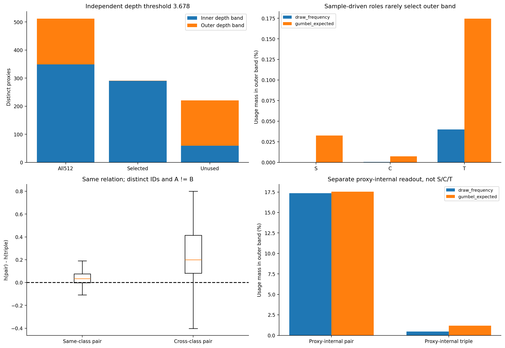
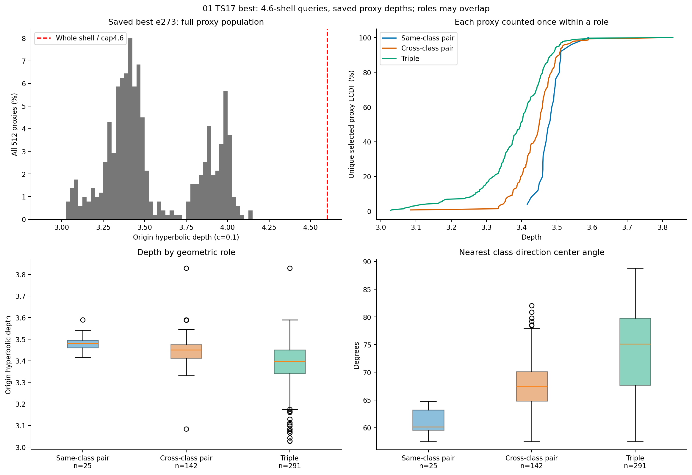
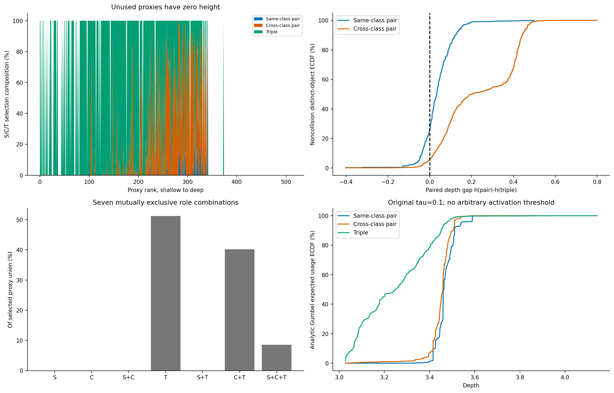
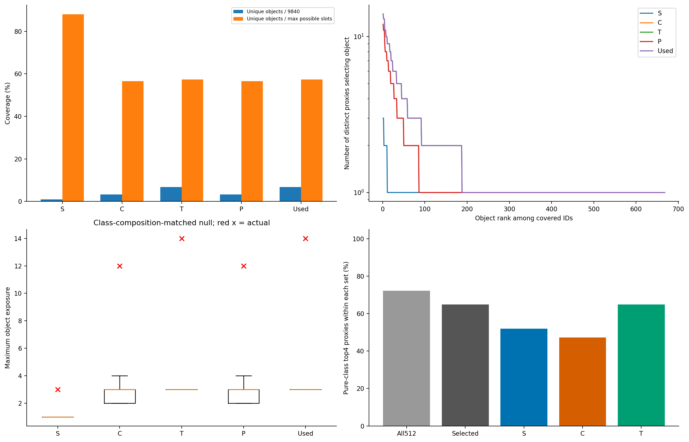
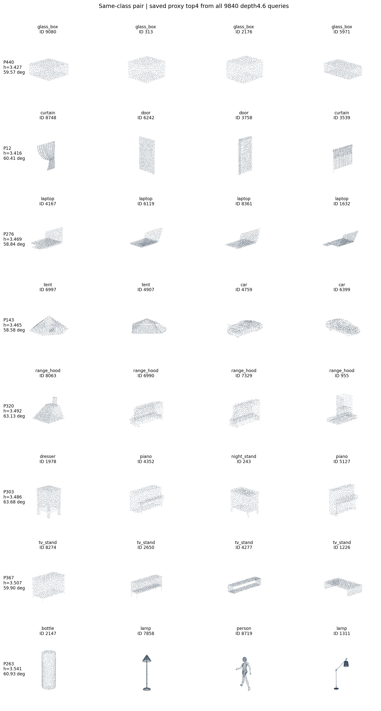
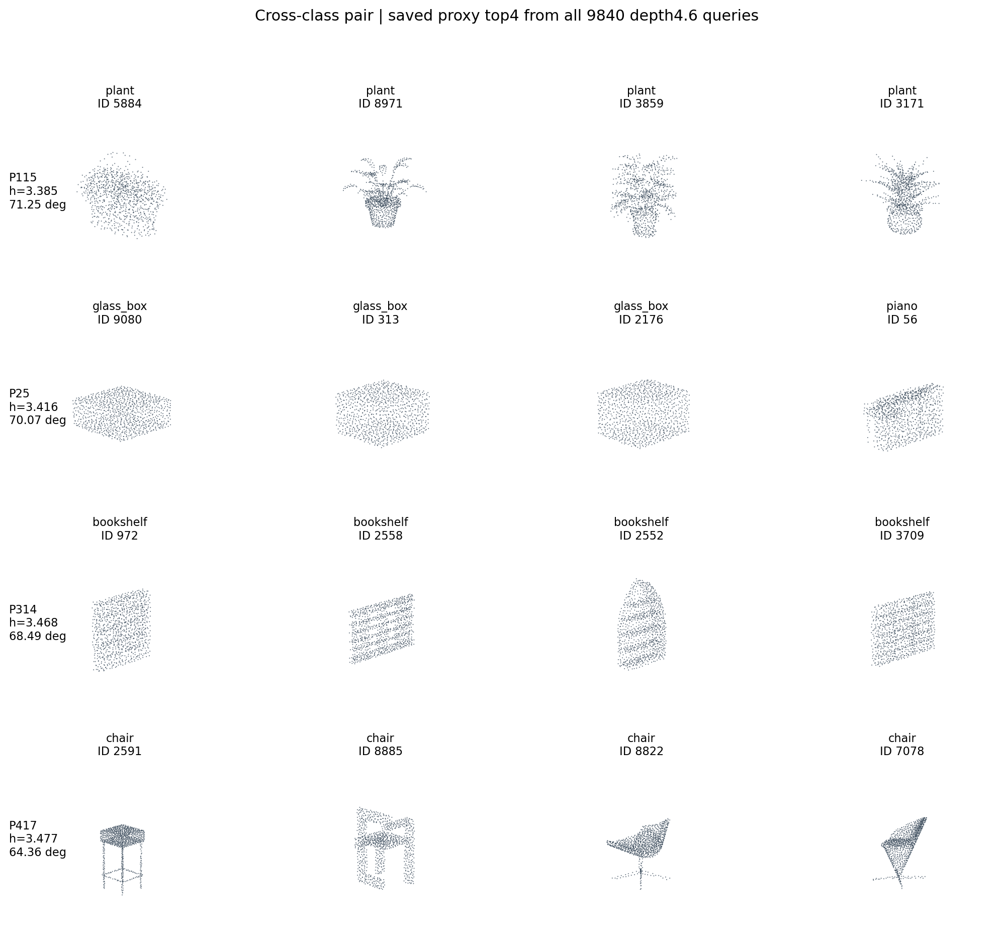
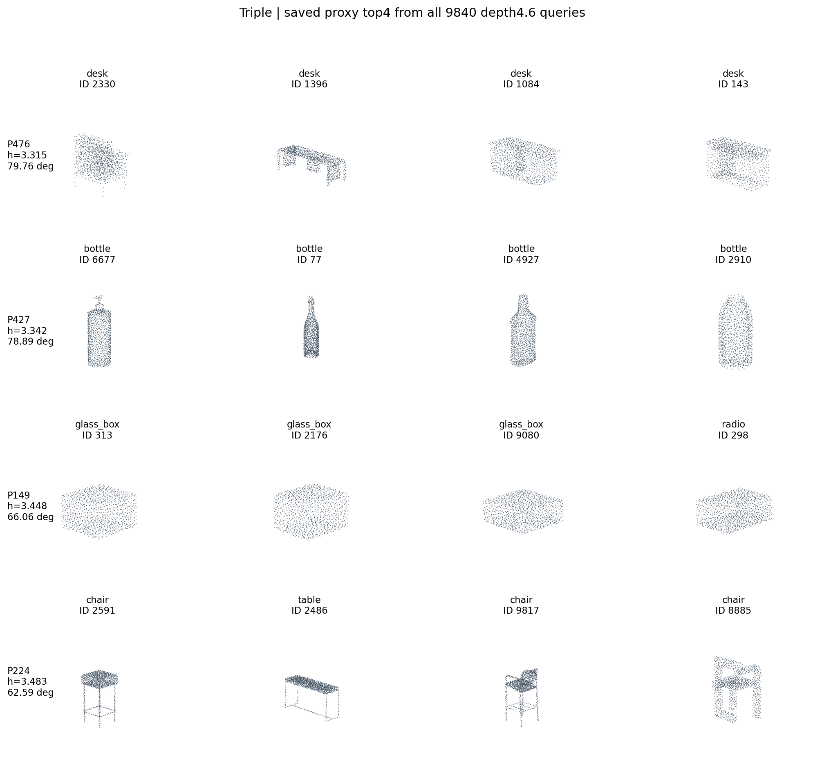
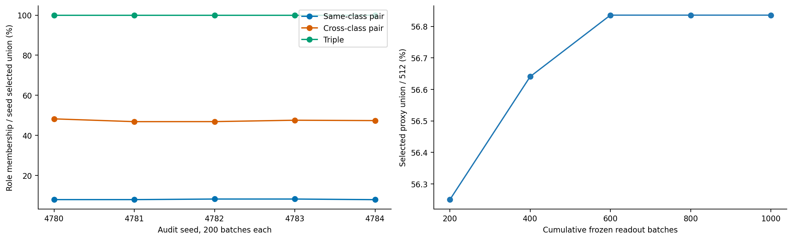

# TS17 best代理角色与top4形态审查结果

## 本次结论

**两段深度分布存在，但不支持“较深一段是pair、较浅一段是triple”这一整体分工假说。** 以独立谷值3.678分段，外层共163个代理，其中仅1个在本次样本驱动读出中入选；其余162个没有入选。同类pair、异类pair和triple基本都使用内层代理。这里的外层仅是相对全体代理的较深一段，离4.6 cap仍有距离。

**在已入选代理内部，pair比triple深的使用偏好成立。** 同一ijk、A≠B时，同类pair更深的比例73.89%，异类pair94.31%，深度差中位分别0.034和0.200；但S的25个代理全属于C，C的142个全属于T（T共291个），不存在仅pair的独占集合。应描述成重叠代理的相对使用偏好，不能据此称为两个独立语义层。

最近类角度随S→C→T增大，top4也存在超过类组成随机对照的热点。这些支持方向使用差异与检索集中现象；仅凭类标签、径向次序和展示卡，还不能证明独立形态层次。

| 集合 | 内段代理数 | 外段代理数 | 合计 |
| --- | --- | --- | --- |
| All512 | 349 | 163 | 512 |
| Selected | 290 | 1 | 291 |
| Unused | 59 | 162 | 221 |
| S | 25 | 0 | 25 |
| C | 141 | 1 | 142 |
| T | 290 | 1 | 291 |

原tau0.1 Gumbel概率下，外段的S/C/T期望选择质量分别为0.03%／0.01%／0.17%，仍不足以将外段解释为样本pair层。有限确定性读出的“未入选”不等于训练历史中从未使用；代理内部项的冻结读出另见附表，不与样本角色混算。

执行状态：8000已完成，GPU已释放；本次只读best e273，复用匹配的正常嵌入后重新构建4.6视图。后处理只统一不同代理统计与箱形图的四分位定义，没有改变选择结果、top4或频次。

仅TS17/B12 best e273，固定保存权重、全9840训练对象。正常网络嵌入复用85已验收缓存；选代理和反查样本统一使用c0.1深度4.6视图，代理保留原深度。五个seed各200批正常CB64，共1000批。没有编码器前向、反传、参数更新、BN更新或test读出。

## 1. 先看“双层是否对应pair／triple”

全部512代理深度范围3.028–4.142，中位3.444；raw参数越cap为0/512。独立三带宽KDE的两段稳定性判定为 **True**，分界为3.678。判定规则先于角色分类固定；不强迫连续分布二分。

| 角色 | 不同代理数 | 深度中位 [Q1,Q3] | 最近类中心角中位 [Q1,Q3]（度） | 选择频次加权深度中位 |
| --- | --- | --- | --- | --- |
| Same-class pair | 25 | 3.481 [3.460,3.496] | 60.142 [59.534,63.220] | 3.465 |
| Cross-class pair | 142 | 3.450 [3.412,3.476] | 67.510 [64.798,70.112] | 3.460 |
| Triple | 291 | 3.397 [3.340,3.450] | 75.103 [67.670,79.791] | 3.310 |

箱形图按每组不同代理各计一次；同一代理可以跨组出现。最近类是全量40类单位方向中心中夹角最小的一类，不是最近对象。

| 角色 | 同ijk、A≠B关系数 | h(pair)−h(triple)中位 | pair更深比例（>0.001） | 近零比例 | 逆序比例 |
| --- | --- | --- | --- | --- | --- |
| Same-class pair | 201734 | 0.034 | 73.89% | 0.97% | 25.14% |
| Cross-class pair | 2868778 | 0.200 | 94.31% | 0.32% | 5.36% |

pair倾向与深度的Spearman相关（平均秩处理并列）为0.733。完整合法索引抽样3200000条，其中三个不同对象ID的主分析关系3198868条；重复对象关系占0.04%。主分析A=B占4.01%，保留在角色分布中，非碰撞次序另表。

主选择为确定性minimax，不能称训练随机轨迹重放。原tau0.1下独立Gumbel选择的解析概率及非碰撞期望权重另行累计，详见role_distribution.csv的gumbel_expected两种口径；不以随机曾抽中一次定义活跃代理。

## 2. 活跃代理、角色交叠与纯类top4

本次合并活跃集合M_used=**291**，未入选221。主角色比例排除未入选代理；‘未入选’仅指本次有限冻结审查。

| 角色 | 数量 | 占活跃并集 | 占全512 | 组内纯类top4比例 |
| --- | --- | --- | --- | --- |
| Same-class pair | 25 | 8.59% | 4.88% | 52.00% |
| Cross-class pair | 142 | 48.80% | 27.73% | 47.18% |
| Triple | 291 | 100.00% | 56.84% | 64.95% |

全512中纯类top4为370/512（72.27%）；活跃代理中为189/291（64.95%）。纯类指top4的四个GT标签完全相同。两个分母的分子各自限制在相应集合，不能混除。

| 互斥角色组合 | 代理数 | 占活跃并集 |
| --- | --- | --- |
| S | 0 | 0.00% |
| C | 0 | 0.00% |
| S+C | 0 | 0.00% |
| T | 149 | 51.20% |
| S+T | 0 | 0.00% |
| C+T | 117 | 40.21% |
| S+C+T | 25 | 8.59% |

七种组合合计100%；S/C/T三个重叠集合的比例不要求合计100%。

## 3. top4覆盖与热点

| 角色集合 | 不同代理 | 覆盖对象数 | 占9840 | 占槽位覆盖上限 | 最大曝光 | 类组成匹配随机最大曝光p95 | 随机尾概率 |
| --- | --- | --- | --- | --- | --- | --- | --- |
| S | 25 | 88 | 0.89% | 88.00% | 3 | 2.000 | 0.001 |
| C | 142 | 321 | 3.26% | 56.51% | 12 | 3.000 | 0.001 |
| T | 291 | 668 | 6.79% | 57.39% | 14 | 4.000 | 0.001 |
| P | 142 | 321 | 3.26% | 56.51% | 12 | 3.000 | 0.001 |
| Used | 291 | 668 | 6.79% | 57.39% | 14 | 4.000 | 0.001 |
| All | 512 | 1154 | 11.73% | 56.35% | 17 | — | — |

每个代理只贡献一次top4，从全9840个等深whole按双曲距离选取四个不同对象。即使全512代理都参与，只有2048个槽位，覆盖上限20.81%；覆盖低于100%本身不等于塌缩。热点曝光按不同代理计数。随机对照固定各代理四个邻居的标签组成，在相应类内重选不同对象1000次；尾概率=(1+超过实测最大值次数)/1001。真实热点也可能反映方向上常见的对象，不单凭集中度宣称语义失败。

## 4. 16个代理的四点云形态卡

同类pair八例、异类pair四例、triple四例。按角色内深度四分位取例，层内优先兼顾纯类与混类，随后固定选择规则；未按形态好看程度筛选。跨角色复用代理会明确标记。每例是同一代理的top4对象并排，相机、原始坐标和点数一致。每卡标明代理深度、多重角色、使用量及最近类夹角。

单卡高清图见[cases目录](cases/)，逐卡说明见[case_summary.json](case_summary.json)。对象ID对应关系、完整邻居表和逐关系原件只保留在服务器私有目录。

## 5. 稳定性、代理内部目标与边界

代理内部K20/T50另有每角色105750次读出，pair/triple使用频次加权深度中位为3.410/3.083。该项参与原训练，但没有样本同异类标签，不混入S/C/T分母；冻结选择关联不能单独证明分层由哪一损失造成。

最终判断需同时结合深度分布、角色交叠、同ijk的深度次序和Gumbel概率复核；边际箱形图差异不等于互斥的pair/triple两类节点。类中心夹角和标签纯度也不是独立形态层次证明。

## 6. 数据、身份与验收

权重SHA `d10144896c69ffa215a6622e4077a05749e3547c0fd606a546b0f750ae4af61b`；缓存SHA `b0142fac9d4ce59ddfacf44a9600ccbcce322e9311544a0dca25ce0e5642bfde`。前向映射重建误差：whole 0、代理 0；top4与85可信邻居距离最大差0。输入/权重哈希在计算前后均未变。

完整统计：[summary.json](summary.json)、[代理明细](proxy_statistics.csv)、[角色分布](role_distribution.csv)、[角色交叠](role_combinations.csv)、[同关系深度差](paired_depth_gap.csv)、[覆盖与热点](coverage_hotspots.csv)。角色明细保留512个代理，包括未入选者；报告主比例依计划排除未入选。原模型/BN/优化器未构造或更新。

### 补充解释：外段是否完全没有作用

不能从样本角色的未入选直接推断所有目标都不用外段。代理内部项中，pair／triple的外段选择频次质量为17.37%／0.47%，原Gumbel期望质量为17.55%／1.19%。外段在内部pair目标中仍有使用偏好，但这仍不是样本pair／triple对应两段的证据，也不能据冻结best单独归因训练成因。

### 最近类与关系标签是否一致

| 角色 | 最近类属于本关系对应标签的次数 | 关系数 | 比例 |
| --- | --- | --- | --- |
| S | 102654 | 206568 | 49.70% |
| C | 1707092 | 2992300 | 57.05% |
| T | 882986 | 3198868 | 27.60% |

S检查共同类，C检查i/j任一类，T检查i/j/k任一类；按关系次数计数，和不同代理的角度箱形图分母不同。

附加表：[深浅段计数](depth_bands_by_role.csv)、[代理内部项](internal_role_distribution.csv)、[各seed中位数](per_seed_role_stats.csv)、[距cap统计](cap_distance.csv)。不同代理的分位数采用线性插值，频次／概率加权分位数采用经验加权CDF。

读出源码 `3f25a311f0c3f762d4f818a201e52fb725bdb73c`；CPU整理源码 `f08d7294a053207f5dac583a2b15413290b3d82e`。见[验收](acceptance.json)与[独立复算](review_qa.json)。
