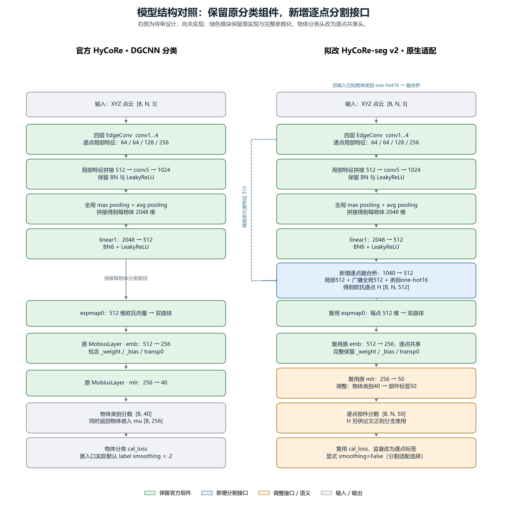
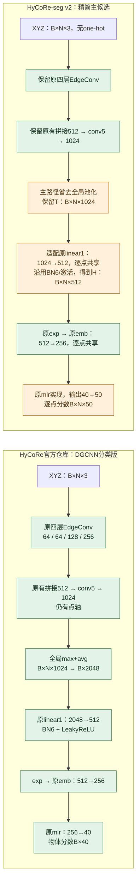
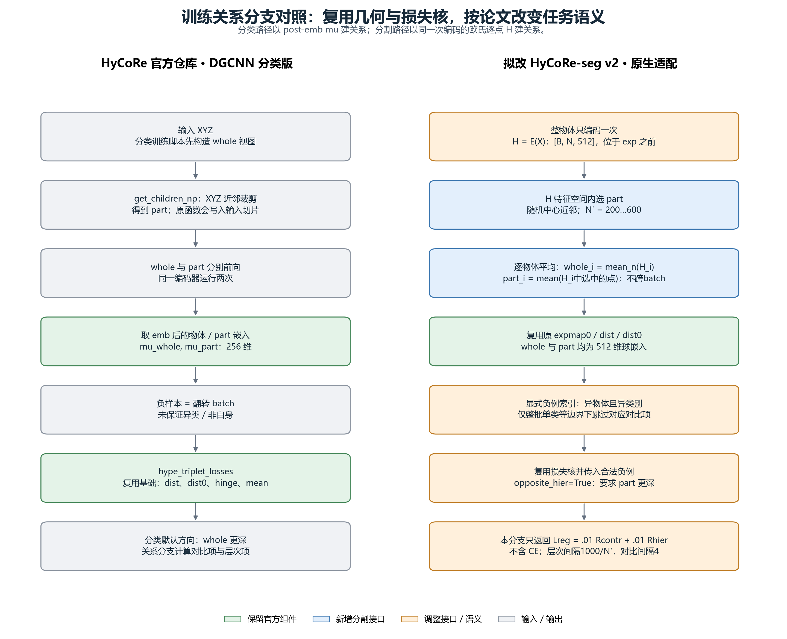
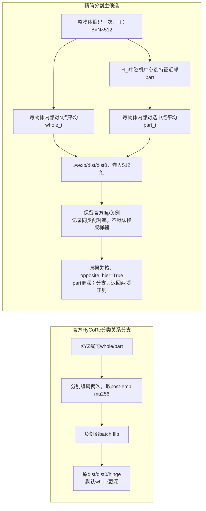
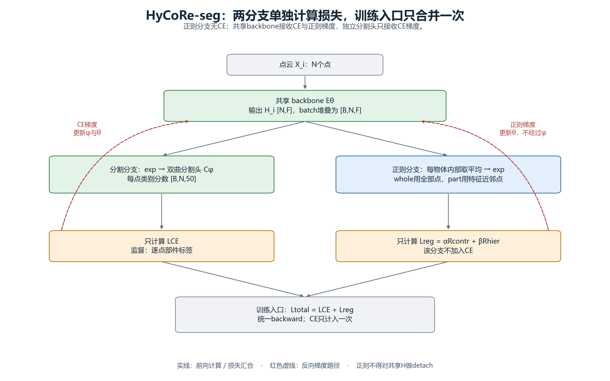

# HyCoRe → HyCoRe-seg 原生迁移审查报告

日期：2026-10-28。修订：用户三条批注后的精简主方案。状态：**静态审查与设计完成；v2尚未实现或训练。**

## 1. 当前结论与修订

“官方”统一指HyCoRe官方仓库的DGCNN分类模型，源文件为 `classification_ModelNet40/models/dgcnn_hmodel.py`。以其活动模块为起点，保留四层EdgeConv、原有层间拼接、conv5、BN6/激活、完整exp/emb/mlr及几何损失核心；只做逐点任务需要的改造。

用户最新约束落实为：

- **去掉模型类别one-hot输入。** 类别元数据仍供负例类别统计和Cls. mIoU使用，不输入网络。不承诺精度完全不变，但one-hot不是完成逐点预测的必要条件。
- **主方案去掉先前提出的1040→512融合桥和额外局部绕接。** 原编码器内部已有的四层拼接保留；新增绕接仅列为后续消融候选。
- **主方案保留官方flip负例配对。** 增加同类/自身配对统计，区分源码兼容行为与论文文字定义；不擅自换成新采样器。
- 主实验全部从seed4780重新初始化，未指定或加载分类预训练checkpoint。旧v1和全部结果保留，不冒称v2。

当前v1继承AnTao分割模型并简化替换末层，没有完整复用官方emb/mlr与权重参数化，仍归历史工程路线。本报告不修改其已完成实验。

## 2. 模型对照：主方案只保留逐点轴并调整原投影层

颜色：绿色＝保留HyCoRe原模块/运算；橙色＝逐点任务所需调整；灰色＝输入输出。右侧为待审主方案，不是现有v1。



[SVG](figures/model_comparison.svg)。B为批中物体数，N为每物体点数，F为每点特征维度。本候选F=512；典型输入N=2048。



### 2.1 保留点轴与通道投影是两件事

分类全局池化是沿N点汇总，产生每物体向量，这是分类所需行为。原DGCNN分割版则保留局部特征，广播全局上下文后拼接，并非所有位置都不做池化。[DGCNN作者分割实现](https://github.com/WangYueFt/dgcnn/blob/master/tensorflow/part_seg/part_seg_model.py)

最简分割适配可以在主路径不做最终全局池化，从而一直保留N。本候选原conv5输出每点1024维，需要变成官方emb要求的512维，因此将原linear1输入维度2048改为1024、输出仍为512，对每点共享调用。无需额外新增“融合桥”模块。

`Linear(1024,512,bias=False)`作用于最后一轴，可把`[B,N,1024]`变成`[B,N,512]`。等价1×1卷积则处理`[B,1024,N]`，输出`[B,512,N]`；**它改变特征通道，不负责创建或恢复N。** 主候选固定使用逐点Linear，以尽量沿用原linear1的模块类型。

BN6需要接`[B,512,N]`或`[B*N,512]`，不能直接把`[B,N,512]`交给BatchNorm1d(512)。此处统计范围从分类的B物体改为B×N点，是必须明示的任务适配。exp/Möbius沿最后特征轴运算。

### 2.2 原有多层拼接与新增绕接必须区分

官方编码器本来就把x1/x2/x3/x4拼接为512维，再送conv5。保留它是在复用已有模型，并未新增结构。

旧候选额外把局部512送到解码端，与全局512和类别16再次拼接，是另一条新增绕接；这不是逐点分割的必要条件，现已从主方案删除。用户随后认可P0简单结构，并提出与DGCNN式全局特征拼接比较，现优先规划以下消融方向：

| 候选 | 原linear1的输入 | 目的 |
|---|---|---|
| 主候选P0 | 仅conv5逐点特征T1024 | 少增模块，先检验原生逐点适配 |
| 全局拼接消融Pglobal | concat(T_i,n1024,broadcast(max_n T_i,n)1024)=2048 | 检验追加物体全局上下文的效果 |

Pglobal使用逐点linear1(2048,512)，其余编码器、双曲头、正则和协议与P0匹配；无one-hot，不恢复旧融合桥。这里2048是“逐点1024+全局max1024”，原分类2048是“全局max1024+全局avg1024”，维度相同但信息组织不同。Pglobal比P0增加1024×512=524288权重，比较时报告容量变化，不把差异全部归因于全局信息。用户认可的是主结构与消融方向，尚未授权启动新训练；额外低层多尺度绕接继续搁置。

### 2.3 完整Möbius层继续复用

分类模型的替换对应关系为：普通DGCNN的linear2(512,256)对应HyCoRe的emb(512,256)，linear3(256,40)对应mlr(256,40)；linear1输出512仍属欧氏路径。宽度对应之外，HyCoRe还去掉了原dp1、bn7/LeakyReLU与dp2，不能称两个完整子块原样逐项替换。

原DGCNN分割尾部为1280→256→256→128→50，并没有同一个512维起点。若从该尾部逐层换成双曲层，层数取决于encoder/head的切分位置，例如256→128→50可换两层，256→256→128→50可换三层。分割任务本身不要求某个固定Möbius层数；当前主方案为复用HyCoRe双曲头而选512→256→50两层，不能说论文强制512维或两层。来源：[普通分类头](../../../segmentation_ShapeNetPart/hycore_seg_v1/vendor/dgcnn_model.py#L124)、[HyCoRe分类头](../../../classification_ModelNet40/models/dgcnn_hmodel.py#L121)、[原分割尾部](../../../segmentation_ShapeNetPart/hycore_seg_v1/vendor/dgcnn_model.py#L254)。

官方 `MobiusLayer` 中，`_weight[K,F]`是原始可训练权重，`_bias[K,1]`参与权重重参数化；`transp0`是平行移动运算，不是可训练矩阵。有效权重为：

`W_eff = transp0(expmap0(_weight * _bias), _weight)`

随后用`mobius_matvec(W_eff,input)`计算输出。不能只保留裸W就称为完整原层。分割主候选继续保留emb512→256与mlr256→50，直接返回Möbius输出作为logits。[官方双曲层](https://github.com/diegovalsesia/HyCoRe/blob/ef56a73020e309b1009c486fea1f601d3f7b3252/classification_ModelNet40/models/ops/manifold_layers.py)

`[B,40]`表示每物体40个类别分数；`[B,N,50]`表示每物体每点50个部件分数。这个变化来自保留点轴与逐点共享预测，不能只把分类结果reshape实现。

## 3. part、whole与关系损失



[SVG](figures/regularizer_comparison.svg)。



H_i是物体i的`[N,F]`逐点特征矩阵，h_i,n才是其中一个点的F维特征，H是batch堆叠的`[B,N,F]`。平均严格为：

`z_whole_i = exp0((1/N) * sum_n h_i,n)`

`z_part_i = exp0((1/|I_i|) * sum_n_in_I_i h_i,n)`

只按同一物体的点轴平均，不跨batch混合物体。正则入口是512维欧氏H，不是post-emb mu256或输出logits50；先欧氏平均，再exp。part随机中心的特征近邻、N′200–600、1000/N′与4、两项系数.01继续采用。

### 3.1 两篇论文负例定义一致，原码flip不是类别筛选

分类论文§3.3式(6)后与分割论文§3.1均将负part定义为异点云、异物体类别。此前把异类要求说成分割新增要求不准确，已纠正。[分类论文](https://proceedings.neurips.cc/paper_files/paper/2022/file/da8f9fc2b555d122369f36a9684415c1-Paper-Conference.pdf)、[分割论文](https://iris.polito.it/retrieve/handle/11583/2982650/73ff1be4-1ad0-44ac-b539-34f81d452df4/Hyperbolic_regularizer-1.pdf)

官方默认 `neg_child_mu=torch.flip(pos_child_mu,[0])`。固定batch32且drop_last时不会配到自己，但没有保证不同类别。示例：

```text
原类别：  A B B A
翻转类别：A B B A
```

这里有两个类别，每个anchor都“存在”异类候选，但flip产生的四个配对全为同类。shuffle改变概率，不保证具体配对满足异类条件。“至少两个类别就能找到合法负例”原意是可以从批内任意选择，不是说flip必然选中。

尊重用户尽量复用原码的要求，**主方案保留flip，不增加新的负例选择实体**。记录negative_pair_same_class_fraction和self_pair_fraction；同类配对照原码计算，不偷偷过滤或修补。严格异类筛选仅作为待审协议对照，未实施。这样是源码兼容选择，不能同时声称每个配对严格符合论文异类定义。

## 4. 两分支及梯度



[SVG](figures/branch_gradient_flow.svg)。分割头分支计算LCE；正则分支只计算`Lreg=αRcontr+βRhier`。训练入口仅相加一次`Ltotal=LCE+Lreg`后反传。

- 共享backbone参数θ接受CE与两项正则梯度。
- 独立双曲分割头φ只接受CE梯度，正则不经过emb/mlr。
- 不在正则模块重复加入CE，也不detach共享H或负part特征。离散选点索引本身不求导。

现有v1的criterion已经返回reg-only，训练入口另算CE后相加；本次只修订计划和图示，不改现有实验。

## 5. 参数量与适配来源

| 部分 | 相对HyCoRe原40类分类模型 |
|---|---|
| 原四EdgeConv、cat、conv5 | 保持 |
| 最后global max+avg | 主seg路径省去，不影响可训练参数量 |
| 原linear1：2048→512改1024→512，无偏置 | 减少524288 |
| 原BN6、emb及其_weight/_bias | 保持数量，BN统计轴改变 |
| 原mlr：256→40改256→50 | 增加2570 |
| 合计 | **减少521718个可训练标量** |

完整双曲头仍有`512×256+256+256×50+50=144178`个可训练标量。相对旧1040融合桥候选，本候选少1057792个标量；这是静态推导，实施后按真实模型核验。

不能声称此分类模型适配版与论文未公开的DGCNN分割模型总参数相等。H0/HC则必须同架构、同初始化与同参数量，仅切换两正则。

## 6. 复用、调整与不采用

| 判定 | 组件 |
|---|---|
| 保留源码活动模块 | 图特征、四EdgeConv、原cat/conv5、BN6/LeakyReLU、PoincareBall、exp、完整emb/mlr、dist/dist0/hinge、flip、RSGD/clip与保存框架 |
| 任务适配 | 省最终global池化、linear1入维及逐点调用、BN轴、40→50、H欧氏池化、特征part、opposite_hier=True、分割数据/CE/指标 |
| 主方案不采用 | 类别one-hot、1040→512新增桥、额外局部绕接、温度/历史cap/hook、教师/代理/LCA、分类checkpoint初始化 |
| 用户认可的消融方向 | 追加DGCNN式全局max上下文Pglobal；仅设计，不自动排队 |
| 其他暂缓 | 额外低层多尺度绕接、严格异类负例策略 |

官方核心七个文件与固定提交的核对见[source_manifest.json](source_manifest.json)。[原码专项审查](native_source_findings.md)、[论文专项审查](paper_findings.md)、[v1偏离审查](v1_deviation_findings.md)保留为来源证据；其中旧融合候选/负例修改建议已由本修订覆盖。

## 7. 后续验收与边界

当前无v2数值前向/梯度或显存实验。先核验原组件等价、逐点Linear与BN轴、H/whole/part形状、原flip及配对统计、完整state与初始化一致，再做完整尺寸无test短测。四层编码器显存不能沿用v1估算。保留官方c=1，测H范数/球半径/正则及CE的共享梯度，不悄悄增加数值改造。

具体训练协议和顺序见[复现计划](reproduction_plan.md)，图与引用检查见[review_checks.json](review_checks.json)，步骤见[审查计划](audit_plan.md)。本轮只修订文档和绘图，未改模型、连接服务器或启动训练。
