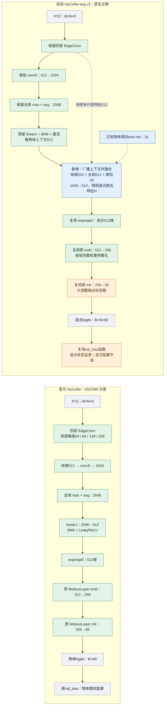
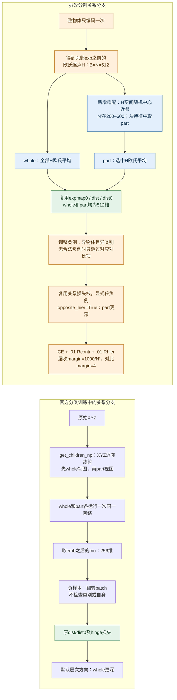

# HyCoRe → HyCoRe-seg 原生迁移审查报告

日期：2026-10-28。状态：**源码与论文静态审查已完成；v2 尚未实现或训练。** 本轮没有连接服务器或干预已有任务。

## 1. 结论

用户要求的路线应落实为：**从官方 HyCoRe 的 DGCNN 分类模型提取并复用原组件，增加逐点接口，再依照 HyCoRe-seg 论文调整正则。** 官方代码已经包含 DGCNN、双曲映射、两个 `MobiusLayer`、关系损失、RSGD 和训练框架，具备可迁移的基础。

当前 `hycore_seg_v1` 继承的是 AnTao `DGCNN_partseg`，只把最后的128→50卷积换成简化 Möbius 运算。它没有复用官方 `emb→mlr` 两层及完整权重参数化，**不满足本次重申的源码继承要求**。既有结果和代码保留为历史工程对照，不改名冒充 v2。

建议的 v2 保留官方四层 EdgeConv、`conv5`、全局 max+avg、`linear1/bn6`、`expmap0`、`emb`、`mlr`、几何运算及损失核心。新增逐点融合桥，把输出从物体分类40类改为逐点部件50标签。**复用代码结构不意味着加载旧分类权重；主实验仍从头初始化。**

此方案明确优先满足用户的原生迁移路线。论文没有公布逐层分割代码；保留四层分类编码器和新增融合桥不能被称为作者分割网络的精确恢复，整体参数量也不能直接与论文原DGCNN分割基线宣称相等。需要新结构自身的匹配对照。

## 2. 对照流程图：模型主干与输出

颜色：绿色＝保留官方模块/运算；蓝色＝分割适配新增；橙色＝调整接口或语义；灰色＝数据或结果。右侧是待审设计，不是现有 v1。

[可缩放SVG](figures/model_comparison.svg)。图中张量省略部分轴顺序，B为批量、N为点数；每个点共享同一套头部参数。

原 `linear1(2048,512)` 完整保留在全局分支，不直接把它改成另一输入维度的层。新增融合桥解决分类已经池化掉点轴的问题，避免只修改40→50却仍然每物体输出一个类别。融合桥采用共享1×1卷积或等价逐点Linear，具体实现须固定；本计划选无偏置1×1卷积1040→512、BN、LeakyReLU(.2)。这属于有来源说明的新增适配，不是论文明确指定的逐层配置。

## 3. 对照流程图：part 与正则分支

[可缩放SVG](figures/regularizer_comparison.svg)。图中“移除”指不接入 v2；原始分类代码保留。

分类版关系作用于经过 `emb` 的 `mu`；分割论文要求取编码器的欧氏逐点H，在欧氏域平均后exp。因此 v2 的正则入口是512维H，**不是256维mu，也不是50维输出球坐标**。正则不再额外经过 `emb`。分类损失中原有 `opposite_hier=True` 可表达正确径向符号；负例选择则需要扩展，不能照搬batch flip。[分割论文§3.1–3.2](https://iris.polito.it/retrieve/handle/11583/2982650/73ff1be4-1ad0-44ac-b539-34f81d452df4/Hyperbolic_regularizer-1.pdf)、[官方hutil](https://github.com/diegovalsesia/HyCoRe/blob/ef56a73020e309b1009c486fea1f601d3f7b3252/classification_ModelNet40/hutil.py)

## 4. 哪些直接复用，哪些需要调整

| 组件 | 官方活动代码 | v2判定及理由 |
|---|---|---|
| 特征kNN及图特征拼接 | `dgcnn_hmodel.py` 的 `knn/get_graph_feature` | 保留算法；把硬编码cuda改为输入设备。分割part选择另用H近邻，不能混淆两个k。 |
| 四层EdgeConv | `conv1..4`；局部64/64/128/256 | 保留模块、初始化和连接，暴露中间逐点特征。与AnTao分割三阶段不是同一拓扑。 |
| 多尺度拼接及conv5 | 拼接512→1024，BN/LeakyReLU | 保留。conv5之前的局部拼接L512送入融合桥；conv5的1024维输出送入全局池化分支。 |
| 全局max+avg与linear1/BN6 | 2048→512 | 保留作每物体上下文，然后广播到每个点；不能让它直接代替全部逐点特征。 |
| 逐点融合 | 分类版没有这个接口 | 新增1040→512共享层，输入局部512、全局512、one-hot16。保留点轴，形成H。 |
| expmap0及PoincareBall | `models/manifolds/poincareball.py` | 复用原类/父类运算，c=1；分别给512维H、256维mu配置正确几何元数据和设备。 |
| emb / mlr | `MobiusLayer(512,256)`、`MobiusLayer(256,40)` | 复用整个类与两层链；mlr改50输出；逐点共享，禁止简化成只有裸W的matvec。 |
| 有效权重与初始化 | `_weight`、`_bias`、`transp0`、`expmap0`、`reset_parameters` | 完整保留。`_bias`参与有效权重而非普通输出加法；它必须有梯度、进入优化器和checkpoint。 |
| 分类分数读出 | `logits=self.mlr(mu)` | 保留直接logits。原代码已如此，不擅自加温度、logmap读出或替换超平面头。 |
| dist/dist0及hinge | `hype_triplet_losses` | 复用几何与公式，参数化ball_dim=512；径向调用opposite_hier=True。 |
| XYZ裁剪与第二次编码 | `get_children_np`及分类train | v2不接入：论文改为特征近邻和共享H。原函数还会通过切片写回输入，不能直接用于逐点标签任务。 |
| 负样本 | 分类函数的 `torch.flip` | 需适配为显式异物体异类索引/有效掩码；原flip可用于数值回归用例，不作为正式分割负例规则。 |
| CE工具 | 实际调用 `utils.misc.cal_loss` | 复用函数；展平[B,N,50]和点标签。显式传smoothing，不能依赖未生效的CLI开关。 |
| RSGD/余弦/梯度裁剪 | `main_dgcnn_hycore.py` | 保留实现；源默认LR=.01、momentum=.9、WD=1e-4、eta=LR/100、clip=1，分割具体配方详见计划。 |
| 分类数据、OA/AA | ModelNet40与物体级评估 | 换成ShapeNetPart点标签和Class/Instance mIoU；数据预处理、选模均按用户已定分割协议。 |
| 状态保存与运行追踪 | 分类保存工具及v1完整状态工程 | 保留有用代码，补全model/optimizer/scheduler/RNG与来源清单；不复制分类仅凭日志名“Valid”判定数据集的做法。 |
| 注释中的MLR/超平面头、PointMLP等 | 非本DGCNN活动路径 | 此次不接入；“尽可能复用”以活动路径和任务语义为准，不把所有仓库实验模块堆进模型。 |

来源固定为官方提交 `ef56a73020e309b1009c486fea1f601d3f7b3252` 的 [DGCNN](https://github.com/diegovalsesia/HyCoRe/blob/ef56a73020e309b1009c486fea1f601d3f7b3252/classification_ModelNet40/models/dgcnn_hmodel.py)、[双曲层](https://github.com/diegovalsesia/HyCoRe/blob/ef56a73020e309b1009c486fea1f601d3f7b3252/classification_ModelNet40/models/ops/manifold_layers.py)、[训练入口](https://github.com/diegovalsesia/HyCoRe/blob/ef56a73020e309b1009c486fea1f601d3f7b3252/classification_ModelNet40/main_dgcnn_hycore.py)。详细文件/行号见[原码专项审查](native_source_findings.md)。

## 5. 参数量与论文约束

官方默认 `MobiusLayer(F,K)` 有 `F×K+K` 个可训练标量，不能只数矩阵。

- 新原生双曲头512→256→50：`512×256+256+256×50+50=144178`。
- 同宽度、普通有偏置的两层Linear也为144178。可用于参数数量匹配的原生欧氏对照；两种偏置的运算语义并不相同。
- 若从无偏置两层Linear比较，官方头多306个参数。当前v1单层128→50为6400，不能拿它的“参数不变”证明原生复用。
- 本方案新增融合Conv(1040→512,bias=False)为532480个权重，加BN的1024个可训练标量，共533504。若仅把原分类输出40改50，还增加2570个标量。其余保持原模块时，总量相对原40类分类模型增加536074；实现后必须由模型实际计数复核，不以推导替代验收。

论文声称相对其DGCNN分割基线总参数量不变，但未提供逐层清单。此原生迁移的融合桥和编码器来源不同，**不能声称已满足与论文基线总参数相等**；H0与HC则必须完全同参数量，正则本身不增加可训练参数。[论文§4](https://iris.polito.it/retrieve/handle/11583/2982650/73ff1be4-1ad0-44ac-b539-34f81d452df4/Hyperbolic_regularizer-1.pdf)

## 6. 当前v1结果能说明什么

v1中的数据缓存、点标签同步增强、mIoU、独立采样随机流、完整状态保存、空闲GPU检查和运行身份追踪可以保留；特征part采样与正则方向也有论文依据。其模型和层实现不能作为官方HyCoRe等价证据。

现有16项合同验证vendor等价及v1内部约定，没有验证官方 `_bias/transp0`、两层头、原几何模块或分类训练行为。v1使用普通CE、LR .1且没有源脚本的clip1；源实际CE默认label smoothing .2、LR .01且每步clip1。修订带来的变化必须分成**组件继承修正、训练协议变化、正则增量**三类报告，不将v1→v2差值全部归因于HyCoRe-seg方法。[v1专项审查](v1_deviation_findings.md)

## 7. 风险、未决信息与后续门槛

1. 四层原生编码器含128/256通道，与现有三阶段64通道分割模型显存不同。不能沿用现有每轮约100秒的预计或保证batch32/2048点可装入显存，须实际尺寸短测。
2. 512维H直接exp可能有较高投影率。沿用官方尺度/c=1先测原始范数、球半径、CE/正则共享梯度和官方层参数梯度；仅“没有NaN”不足以证明正则有效。不得悄悄加归一化、温度或历史cap/hook。
3. 论文未披露E截止层、F、头宽、训练细节和选模规则。本文512/256两层、上下文融合、one-hot16、采样分布等均为明示重建选择。
4. margin文献有矛盾，继续用户已定1000/N′和4。seed4780与trainval/逐轮test Instance mIoU选best继续生效，不自动重开选项。
5. 源码复用不保证论文分数。先建立组件数值回归和原生H0，再比较仅打开两项正则的HC。AnTao DGCNN仅作外部benchmark。

本轮完成：文件级静态追踪、官方活动代码与本地核心文件版本差异核对、论文全文文本复核、维度和参数计数推导、当前v1偏离审查及图示。**没有执行v2前向/梯度/显存实验**；论文PDF截图本次仍不可用，Fig.1仅核对可读取文本及图注，不声称完成独立图像核验。

下一步见[复现计划](reproduction_plan.md)；审查实施步骤见[审查计划](audit_plan.md)。固定源码身份和本地文件SHA见[source_manifest.json](source_manifest.json)，文档链接、图示及静态检查记录见[review_checks.json](review_checks.json)。这些记录不替代尚未执行的v2数值回归。
